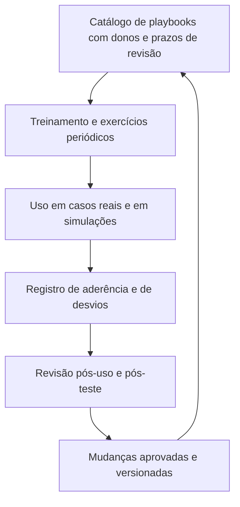

# Governança, Testes e Checklist de Playbooks

> **Objetivo pedagógico:** governar o catálogo de playbooks forenses (donos, revisões e controle de mudanças), testá-los com exercícios de mesa e técnicos, medir a aderência e a eficácia, manter a automação sob controle e verificar a qualidade com modelos e listas de verificação, de modo que os playbooks funcionem de fato sob pressão.

## 1. Catálogo de playbooks (índice)

| ID | Playbook | Dono (função) | Última revisão | Último teste | Situação |
|---|---|---|---|---|---|
| PB-00 | Abertura e triagem do caso | Líder do laboratório | | | |
| PB-01 | Preservação imediata de logs | Líder forense | | | |
| PB-02 | Decisão sobre sistemas ligados | Líder forense | | | |
| PB-03 | Coleta remota e triagem em escala | Líder de DFIR | | | |
| PB-04 | Custódia e transferência | Custodiante | | | |
| PB-10 | Host Windows comprometido | Analista sênior | | | |
| PB-11 | Servidor Linux comprometido | Analista sênior | | | |
| PB-12 | Aquisição e triagem de memória | Analista de memória | | | |
| PB-13 | Aquisição de disco | Analista forense | | | |
| PB-14 | Cópia indevida por colaborador | Líder forense e RH | | | |
| PB-15 | Linha do tempo | Analista forense | | | |
| PB-20 | Triagem de phishing | Líder do SOC | | | |
| PB-21 | Amostra suspeita | Analista de malware | | | |
| PB-22 | Servidor web e webshell | Analista forense | | | |
| PB-23 | Comunicação de rede suspeita | Analista de rede | | | |
| PB-24 | Exfiltração por volume | Líder de DFIR | | | |
| PB-25 | Ransomware, primeiras horas | Líder de resposta | | | |
| PB-30 | Credencial de nuvem comprometida | Líder de nuvem | | | |
| PB-31 | Conta Entra ID comprometida | Líder de identidade | | | |
| PB-32 | BEC e caixa M365 | Líder de e-mail | | | |
| PB-33 | Exfiltração SharePoint e OneDrive | Líder de SaaS | | | |
| PB-34 | Armazenamento exposto | Líder de nuvem | | | |
| PB-35 | Kubernetes | Líder de plataforma | | | |
| PB-36 | Aplicativo OAuth malicioso | Líder de identidade | | | |
| PB-40 | Dispositivo móvel | Analista mobile | | | |
| PB-41 | Stalkerware e spyware | Analista mobile | | | |
| PB-42 | Preservação OSINT | Analista OSINT | | | |
| PB-43 | Infraestrutura de phishing e marca | Analista de CTI | | | |
| PB-44 | Mídia suspeita de manipulação ou IA | Analista de mídia | | | |
| PB-45 | Incidente com IA e LLM | Líder de IA e segurança | | | |
| PB-46 | Retenção legal e eDiscovery | Especialista em eDiscovery | | | |

Mantenha o catálogo em repositório versionado e em **cópia offline**, acessível mesmo quando os sistemas estiverem indisponíveis.

## 2. Governança

| Elemento | Prática |
|---|---|
| Dono de cada playbook | Uma função responsável por manter, revisar e treinar |
| Aprovação | Técnica, jurídica e de privacidade antes da publicação |
| Controle de mudanças | Alterações via proposta, revisão e registro de versão |
| Frequência de revisão | Ao menos anual, e **após** incidentes, mudanças tecnológicas, legais ou organizacionais |
| Fonte de verdade | Um único repositório; evitar cópias desatualizadas |
| Acesso | Leitura ampla para as equipes de resposta; edição restrita; cópia offline |
| Treinamento | Novos membros treinados; reciclagem periódica |
| Conformidade | Evidências de que os playbooks são seguidos (registros de uso) |
| Relação com o plano de resposta | Alinhamento de papéis, autoridade e comunicação |

## 3. Estratégias de teste

| Tipo de teste | Descrição | Frequência sugerida |
|---|---|---|
| Leitura guiada (walkthrough) | A equipe lê o playbook passo a passo e identifica lacunas e ambiguidades | A cada nova versão |
| Exercício de mesa (tabletop) | Simulação de um cenário, com decisões em tempo real e injeção de eventos (por exemplo, com os pacotes de exercícios do CISA) | Semestral, ao menos |
| Exercício técnico (drill) | Execução real de passos técnicos em ambiente de teste: coleta, preservação e aquisição | Trimestral para os playbooks críticos |
| Exercício de emulação (purple team) | Emular técnicas em ambiente controlado para validar a detecção e a resposta | Semestral |
| Teste de acessibilidade | Verificar o acesso ao catálogo e às ferramentas sem os sistemas principais | Semestral |
| Teste de contatos | Verificar a atualização dos contatos e dos canais fora de banda | Trimestral |
| Revisão pós-incidente | Avaliar o uso do playbook em casos reais | Após cada uso relevante |

### 3.1 Cenários de exercício de mesa (sugestões)

| Cenário | Playbooks envolvidos |
|---|---|
| BEC com pagamento em curso | PB-20, PB-31, PB-32, PB-36 |
| Ransomware com exfiltração | PB-00, PB-01, PB-02, PB-25, PB-24 |
| Chave de nuvem vazada em repositório público | PB-30, PB-34 |
| Colaborador em desligamento copiando arquivos | PB-14, PB-33, PB-46 |
| Servidor web com webshell | PB-22, PB-11, PB-23 |
| Vídeo falso de executivo | PB-42, PB-43, PB-44 |

## 4. Medição de aderência e de eficácia

| Indicador | Uso |
|---|---|
| Tempo até iniciar o playbook (do gatilho ao primeiro passo) | Prontidão |
| Tempo para concluir os passos críticos de preservação | Eficiência |
| Percentual de passos concluídos e de passos pulados | Aderência |
| Número de desvios e justificativas | Qualidade do playbook |
| Completude das evidências (hashes, custódia e registros) | Qualidade da prova |
| Passos que geraram dúvida ou retrabalho | Pontos de melhoria |
| Cobertura de cenários (frequência e risco) | Lacunas do catálogo |
| Resultado dos testes (itens corrigidos) | Maturidade |
| Tempo de atualização após mudanças | Governança |

## 5. Automação sob governança

| Regra | Descrição |
|---|---|
| Classificar as ações | Informativas (podem ser automáticas) e alteradoras (exigem aprovação humana) |
| Preservar antes de agir | Exportar o estado antes de qualquer ação automática |
| Limites e salvaguardas | Número máximo de itens por execução, janelas e listas de exclusão (por exemplo, contas críticas) |
| Registro e auditoria | Toda execução registrada com identificação, horário (UTC) e resultado |
| Testes em ambiente isolado | Dados fictícios antes de produção |
| Privilégios mínimos | Contas de automação monitoradas |
| Falha segura | Em erro, pausar e escalar |
| Revisão periódica | Acessos, regras e eficácia |

## 6. Dez perguntas de qualidade de um playbook

| Pergunta | Onde verificar |
|---|---|
| 1. O gatilho e o objetivo são claros e há exclusões (quando não usar)? | Cabeçalho do playbook |
| 2. Os papéis e as responsabilidades por passo estão definidos? | RACI |
| 3. Os passos são verificáveis, na ordem de volatilidade e executáveis sob estresse? | Corpo do playbook |
| 4. Os pontos de decisão têm critérios objetivos? | Pontos de decisão |
| 5. Os portões legais e de privacidade estão explícitos? | Portões |
| 6. As evidências geradas, os hashes e a custódia estão previstos? | Evidências e saídas |
| 7. O playbook preserva o estado anterior antes de alterar? | Passos de contenção |
| 8. Os critérios de escalonamento e a comunicação estão definidos? | Escalonamento |
| 9. O playbook foi testado e tem dono e data de revisão? | Metadados e catálogo |
| 10. É acessível durante a crise (cópia offline) e as equipes foram treinadas? | Governança |

## 7. Modelo A: Ficha de Metadados do Playbook

| Campo | Preenchimento |
|---|---|
| ID, título e versão | |
| Dono e substituto | |
| Data de criação e da última revisão | |
| Próxima revisão | |
| Playbooks relacionados | |
| Pastas e normas de referência | |
| Aprovações (técnica, jurídica e de privacidade) | |
| Último teste (tipo, data e resultado) | |
| Histórico de alterações | |

## 8. Modelo B: Relatório de Teste de Playbook

| Campo | Preenchimento |
|---|---|
| Playbook e versão testados | |
| Tipo de teste e data | |
| Participantes e papéis | |
| Cenário | |
| Passos executados, tempo e desvios | |
| Ambiguidades e passos impossíveis | |
| Lacunas (ferramentas, acessos, contatos e dados) | |
| Decisões tomadas e critérios usados | |
| Ações corretivas, responsáveis e prazos | |
| Conclusão (aprovado, aprovado com ressalvas ou reprovado) | |

## 9. Modelo C: Registro de Uso do Playbook em Caso Real

| ID do passo | Concluído? | Horário (UTC) | Responsável | Desvio e justificativa | Observações |
|---|---|---|---|---|---|
| 1 | | | | | |
| 2 | | | | | |

Ao final: revisão pós-uso, com o que funcionou, o que falhou e as mudanças propostas.

## 10. Modelo D: Matriz RACI (exemplo para PB-25)

| Atividade | Líder do incidente | Líder forense | TI | Jurídico | DPO | Direção |
|---|---|---|---|---|---|---|
| Declarar o incidente | A | C | I | I | I | I |
| Isolamento e proteção de backups | A | C | R | I | I | I |
| Preservação de evidências | C | A/R | R | I | I | I |
| Decisão sobre extorsão | R | C | C | R | C | A |
| Notificações legais | C | C | I | A/R | R | I |
| Comunicação externa | C | I | I | R | C | A |

R: responsável; A: aprovador; C: consultado; I: informado.

## 11. Checklist operacional de playbooks

**Playbook:** PB-NN
**Revisor:** ____________________
**Data (UTC):** ____________________

### 11.1 Conteúdo

- [ ] Gatilho, objetivo, escopo e exclusões claros
- [ ] Papéis e RACI definidos
- [ ] Pré-requisitos (acessos, ferramentas e contatos) listados
- [ ] Passos numerados, verificáveis e na ordem de volatilidade
- [ ] Pontos de decisão com critérios objetivos
- [ ] Portões legais e de privacidade explícitos
- [ ] Evidências, hashes, custódia e registros previstos
- [ ] Critérios de escalonamento e comunicação definidos
- [ ] Referências a pastas, normas e runbooks

### 11.2 Qualidade e segurança

- [ ] Estado anterior preservado antes de ações que alteram sistemas ou contas
- [ ] Ações automáticas classificadas; ações alteradoras com aprovação humana
- [ ] Privilégios mínimos e registro de acessos
- [ ] Linguagem simples, sem ambiguidades, imperativa
- [ ] Extensão adequada (cabe em leitura rápida), com detalhes em runbooks

### 11.3 Governança

- [ ] Dono, versão, data de revisão e histórico registrados
- [ ] Revisões técnica, jurídica e de privacidade concluídas
- [ ] Testado (leitura, mesa ou técnico) com ações corretivas encerradas
- [ ] Publicado no catálogo e disponível em cópia offline
- [ ] Equipe treinada; próxima revisão agendada

## 12. Resultado da verificação

| Resultado | Condição |
|---|---|
| Conforme | Todos os itens aplicáveis marcados |
| Conforme com ressalvas | Pendências sem impacto na segurança das evidências e na legalidade, com plano de ação |
| Não conforme | Ausência de portões legais, passos que destroem evidências, falta de dono ou de teste, ou playbook inacessível em crise; não publicar |

**Assinatura do dono:** ____________________
**Assinatura do revisor:** ____________________

## 13. Casos de uso corporativos

- Gestão do catálogo de playbooks do SOC, do DFIR e do laboratório forense.
- Programa de exercícios com indicadores de prontidão para a direção e para auditorias.
- Evidência de conformidade e de diligência perante reguladores, seguradoras e auditores.

## 14. Normas e frameworks relevantes

- NIST SP 800-61 Rev. 3; NIST SP 800-84 (testes, treinamento e exercícios); NIST CSF 2.0
- ISO/IEC 27035-1, 27035-2 e 27035-3; ISO/IEC 27001:2022 (controles 5.24 a 5.28); ISO 22301
- CISA. Tabletop Exercise Packages (CTEP); FIRST. CSIRT Services Framework
- CIS Controls v8.1, controle 17 (gestão de resposta a incidentes)

## 15. Referências

- Grance, T. et al. NIST SP 800-84: Guide to Test, Training, and Exercise Programs for IT Plans and Capabilities. 2006.
- CISA. Cybersecurity Tabletop Exercise Packages e playbooks de resposta.
- FIRST. CSIRT Services Framework v2.1.
- Documentação do TheHive, do Cortex e do Shuffle (orquestração de resposta, código aberto).
