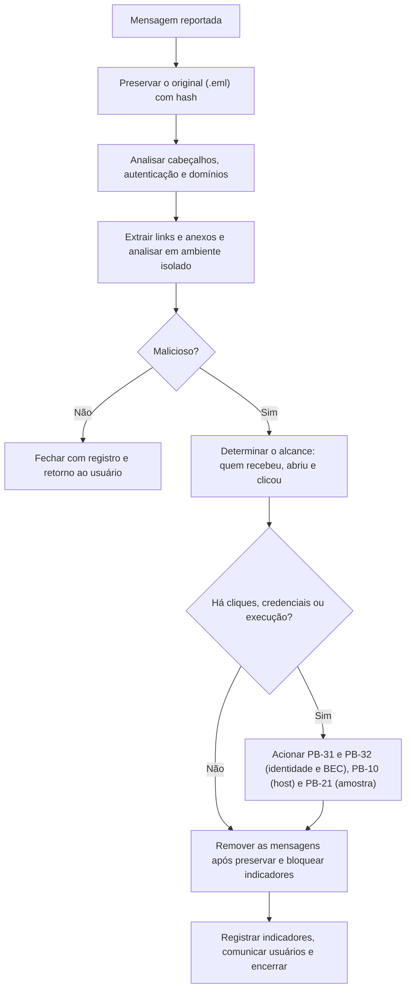

# Playbooks de E-mail, Rede, Web e Malware

> **Objetivo pedagógico:** executar os playbooks de e-mail e de ameaças de rede e de aplicação: triagem de phishing (PB-20), análise de amostra suspeita (PB-21), servidor web comprometido e webshell (PB-22), comunicação de rede suspeita ou beaconing (PB-23), exfiltração suspeita por volume (PB-24) e primeiras horas de ransomware (PB-25), com decisões, registros e escalonamentos.

## PB-20: Triagem de phishing e de e-mail suspeito

| Campo | Conteúdo |
|---|---|
| Gatilho | Mensagem reportada por usuário, alerta do gateway ou denúncia de fraude |
| Objetivo | Determinar se a mensagem é maliciosa, o alcance, e conter sem perder evidências |
| Papéis | Executor: analista de e-mail e SOC. Aprovador: líder. Informado: usuários afetados |
| Pré-requisitos | Acesso ao rastreamento de mensagens, ao gateway e ao EDR; ambiente isolado para análise |



**Passos**

1. Preservar o `.eml` original (não encaminhar como anexo), com hash e custódia.
2. Analisar o caminho (`Received`), o `Authentication-Results` (SPF, DKIM e DMARC), o `Reply-To` e domínios semelhantes (pasta 12).
3. Extrair URLs e anexos; **não abrir** em estação comum; neutralizar URLs nos registros.
4. Analisar os anexos e links em ambiente isolado (PB-21 se houver amostra).
5. Determinar o alcance: rastreamento de mensagens e eventos do gateway (destinatários, entregas e remoções).
6. Verificar aberturas, cliques (proxy, DNS, proteção de links e EDR) e execuções.
7. **Decisão:** se houver cliques ou credenciais inseridas, tratar as contas como potencialmente comprometidas (PB-31 e PB-32).
8. **Após preservar**, remover as mensagens das caixas (purge), registrando o que foi removido.
9. Bloquear indicadores (domínios, URLs, remetentes e hashes) em gateway, proxy e EDR.
10. Registrar os indicadores e comunicar aos usuários e à gestão, conforme o caso.

**Registros e saídas:** `.eml` com hash, análise de cabeçalho, lista de destinatários e de cliques, indicadores e ações de remoção.
**Escalonamento:** credenciais ou execução confirmadas; alvos executivos ou financeiros; fraude de pagamento em curso.
**Referências:** pastas 12, 15, 19 e 21.

## PB-21: Análise de amostra suspeita (malware)

| Campo | Conteúdo |
|---|---|
| Gatilho | Arquivo ou binário suspeito recebido de um host, de e-mail ou de um sistema |
| Objetivo | Caracterizar a amostra, extrair indicadores e orientar a contenção e a caça |
| Papéis | Executor: analista de malware. Aprovador: líder. Consultado: Jurídico (envio a serviços externos) |
| Pré-requisitos | Laboratório isolado, armazenamento seguro de amostras, ferramentas e política de compartilhamento |

**Passos**

1. Registrar a origem e coletar a amostra sem executá-la; calcular os hashes (SHA-256 e outros) na origem e no laboratório.
2. Neutralizar e armazenar a amostra (arquivo compactado com senha, volume criptografado, custódia).
3. **Portão de compartilhamento:** consultar reputação **por hash**; decidir com o líder e o Jurídico se a amostra pode ser enviada a serviços externos (risco de exposição de dados e de alerta ao adversário).
4. Restaurar o instantâneo limpo da VM de análise; verificar o isolamento da rede.
5. Triagem estática: tipo, strings, estrutura, empacotamento e capacidades.
6. Análise dinâmica em laboratório isolado, com monitoramento e rede simulada; capturar memória se necessário.
7. Extrair indicadores (hashes, domínios, caminhos, chaves e padrões de comportamento) e mapear ao ATT&CK.
8. Escrever regras (YARA e detecções de comportamento) e testá-las contra arquivos legítimos.
9. Caçar no ambiente (endpoints, rede, e-mail e nuvem) e delimitar o escopo.
10. Restaurar o laboratório e arquivar os registros e a amostra, com hash.

**Registros e saídas:** ficha da amostra, registros de análise estática e dinâmica, indicadores, regras e escopo.
**Escalonamento:** família conhecida de ransomware ou de ferramentas de acesso remoto; credenciais coletadas; persistência em controladores de domínio.
**Referências:** pastas 04 e 15.

## PB-22: Servidor web comprometido e webshell

| Campo | Conteúdo |
|---|---|
| Gatilho | Alerta de WAF ou de EDR, processo filho suspeito do servidor web, arquivo desconhecido no diretório do aplicativo ou denúncia |
| Objetivo | Preservar, determinar o acesso inicial, o alcance e as ações do atacante |
| Papéis | Executor: analista forense. Consultados: dono da aplicação e infraestrutura |
| Pré-requisitos | Acesso aos logs do servidor, do WAF e da rede; PB-02 executado |

**Passos**

1. Preservar os logs web, do sistema e do WAF do período (PB-01), com hash.
2. Isolar o servidor (PB-02); capturar a memória e o estado volátil (PB-12 e PB-11 ou PB-10).
3. Identificar arquivos novos ou alterados no diretório do aplicativo; copiar com metadados e hash, **sem executar**.
4. Identificar as requisições suspeitas: varredura, exploração, upload e uso do arquivo (POSTs repetidos, parâmetros codificados e agentes de usuário).
5. Determinar o **acesso inicial** (vulnerabilidade, credencial ou upload inseguro) e o primeiro horário.
6. Verificar processos filhos do servidor web, contas criadas, tarefas agendadas e conexões de saída.
7. Avaliar a **exfiltração** (volumes de saída) e os dados acessíveis ao aplicativo (bancos, segredos e armazenamentos).
8. Rotacionar credenciais e segredos acessíveis ao servidor; **reconstruir** o servidor a partir de código e imagens confiáveis.
9. Corrigir a vulnerabilidade e caçar o mesmo padrão em outros servidores.
10. Registrar a linha do tempo (PB-15) e os indicadores.

```bash
# Arquivos de script alterados recentemente no diretório do aplicativo (Linux; ajuste o caminho)
find /var/www -type f \( -name "*.php" -o -name "*.jsp" -o -name "*.aspx" \) -mtime -14 -printf "%TY-%Tm-%Td %TH:%TM  %p\n" | sort
```

**Escalonamento:** acesso a bancos com dados pessoais; credenciais de nuvem expostas; sinais de movimentação lateral.
**Referências:** pastas 11, 13, 15 e 17.

## PB-23: Comunicação de rede suspeita (C2 e beaconing)

| Campo | Conteúdo |
|---|---|
| Gatilho | Alerta de IDS ou de inteligência, tráfego periódico a destino suspeito ou DNS anômalo |
| Objetivo | Confirmar a comunicação, identificar o host e o processo e delimitar o escopo |
| Papéis | Executor: analista de rede e de SOC |
| Pré-requisitos | Acesso a fluxos, DNS, proxy, EDR e, se autorizado, captura de pacotes |

**Passos**

1. Registrar o indicador (IP, domínio, SNI, JA3 ou JA4) e o horário do primeiro e do último evento.
2. Consultar os logs de DNS, proxy e fluxos para identificar **todos** os hosts que se comunicaram com o destino.
3. Analisar a periodicidade (intervalos e variação), o volume e o tamanho das respostas.
4. Identificar o **processo** que origina a conexão (EDR, Sysmon ou conexões do host).
5. **Portão de privacidade:** capturar pacotes apenas com autorização, no menor escopo (por host e por destino).
6. Avaliar a reputação e a idade do domínio e do certificado, por indicadores.
7. Conter: bloquear o destino, isolar os hosts afetados e preservar (PB-02 e PB-10 ou PB-11).
8. Caçar o mesmo padrão e os mesmos indicadores no restante do ambiente.
9. Registrar indicadores e achados; alimentar detecções.

**Escalonamento:** múltiplos hosts afetados; servidores críticos; domínio comprometido.
**Referências:** pastas 11, 13, 15 e 20.

## PB-24: Exfiltração suspeita por volume

| Campo | Conteúdo |
|---|---|
| Gatilho | Alerta de volume de saída, DLP, upload a serviço de nuvem pessoal ou aviso de terceiros |
| Objetivo | Confirmar a exfiltração, identificar os dados e as contas, e apoiar as decisões legais |
| Papéis | Executor: analista forense. Consultados: Jurídico e DPO |
| Pré-requisitos | Fluxos e proxy, EDR, logs de acesso a arquivos e inventário de dados |

**Passos**

1. Confirmar o volume e o destino (fluxos, proxy e EDR); comparar com a linha de base.
2. Identificar a origem (host e conta) e o processo.
3. Localizar os artefatos de preparação (arquivos compactados, diretórios temporários e ferramentas de sincronização).
4. Determinar quais arquivos foram acessados e enviados (logs de acesso a arquivos, MFT e USN, auditoria do SharePoint e de armazenamentos).
5. Aplicar **retenção legal** e preservar (PB-01 e PB-10).
6. Classificar os dados envolvidos (pessoais, sensíveis e confidenciais) e estimar os titulares.
7. **Decisão com Jurídico e DPO:** avaliar notificações (ANPD, titulares, contratos e reguladores) e prazos.
8. Conter: bloquear o destino, revogar credenciais e restringir o acesso.
9. Se houver suspeita de ransomware ou de domínio comprometido, acionar PB-25.

**Referências:** pastas 13, 16, 19 e 22.

## PB-25: Ransomware, primeiras horas

| Campo | Conteúdo |
|---|---|
| Gatilho | Arquivos criptografados, nota de resgate ou alerta de criptografia em massa |
| Objetivo | Conter o avanço, preservar evidências críticas e estabilizar a crise |
| Papéis | Líder do incidente, líder forense, TI, Jurídico, DPO, comunicação e direção |
| Pré-requisitos | Plano de crise, canal fora de banda e contatos de fornecedores e de seguradora |

**Passos**

1. Declarar o incidente; abrir o livro de decisões; estabelecer o canal fora de banda (PB-00).
2. Isolar hosts e segmentos afetados; proteger **backups** e **controladores de domínio**.
3. Exportar logs prioritários (EDR, VPN, firewall, domínio, nuvem e e-mail) (PB-01).
4. Capturar a memória e preservar sistemas-chave (PB-02 e PB-12): paciente zero, controladores de domínio, servidores de arquivos e de backup.
5. Preservar a nota de resgate, arquivos criptografados de exemplo e a amostra do binário (PB-21).
6. Identificar o paciente zero e as contas comprometidas; planejar a contenção ampla e a redefinição de credenciais.
7. Acionar Jurídico, DPO, seguradora e fornecedores; avaliar a exfiltração (PB-24) e os prazos de notificação.
8. Identificar a família e as opções de recuperação (decifradores e backups).
9. Planejar a recuperação priorizada (identidade, backups e serviços críticos).
10. Emitir relatórios de situação periódicos (pasta 22).

**Referências:** pasta 16 (playbook completo e fundamentos) e pasta 22.

## Resumo dos playbooks deste arquivo

| ID | Playbook | Quando usar |
|---|---|---|
| PB-20 | Triagem de phishing | Mensagens reportadas ou alertas de e-mail |
| PB-21 | Amostra suspeita | Arquivos e binários suspeitos |
| PB-22 | Servidor web e webshell | Aplicações web comprometidas |
| PB-23 | Comunicação de rede suspeita | C2, beaconing e DNS anômalo |
| PB-24 | Exfiltração por volume | Saída anômala de dados |
| PB-25 | Ransomware, primeiras horas | Criptografia em massa |

## Exemplo prático: encadeamento de playbooks em uma campanha

| Etapa | Playbook | Resultado |
|---|---|---|
| Denúncia de um e-mail com anexo HTML | PB-20 | Malicioso; 38 destinatários, 6 aberturas e 2 execuções (EDR) |
| Anexo e ISO analisados | PB-21 | Loader com persistência por chave Run e C2 por HTTPS |
| Hosts com execução | PB-10 e PB-02 | Isolamento, memória e triagem |
| Destino de C2 e domínios | PB-23 | 3 hosts adicionais identificados |
| Contas que inseriram credenciais | PB-31 | Revogação de sessões e redefinições |
| Resultado | Purge das mensagens, bloqueios, indicadores compartilhados; sem criptografia |

## Casos de uso corporativos

- Resposta coordenada a campanhas de phishing e de malware.
- Tratamento padronizado de servidores web expostos.
- Interface clara entre as equipes de e-mail, rede, forense e malware.

## Normas e frameworks relevantes

- MITRE ATT&CK: T1566, T1204, T1190, T1505.003, T1071, T1041, T1486
- NIST SP 800-61 Rev. 3; NIST SP 800-83 Rev. 1; NIST SP 800-177 Rev. 1
- CIS Controls v8.1, controles 9, 10, 13 e 17
- LGPD, arts. 6º, 46 e 48

## Referências

- Pastas 11, 12, 13, 15, 16, 19, 20 e 22 deste repositório.
- CISA. Incident Response Playbook (2021); Microsoft. Incident response playbooks (phishing e BEC).
