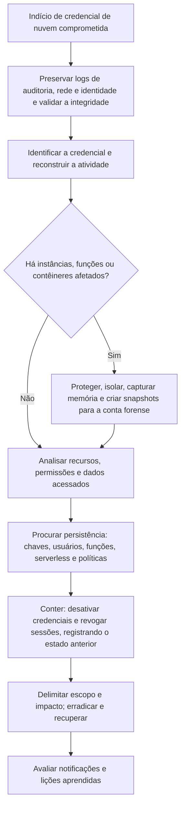

# Playbooks de Nuvem, Identidade e SaaS

> **Objetivo pedagógico:** executar os playbooks de nuvem e de identidade: credencial de nuvem comprometida (PB-30), conta do Entra ID comprometida (PB-31), BEC em caixa do Microsoft 365 (PB-32), exfiltração em SharePoint e OneDrive (PB-33), armazenamento exposto (PB-34), pod ou cluster Kubernetes comprometido (PB-35) e aplicativo OAuth malicioso (PB-36), com a ordem correta: **preservar, conter com registro do estado anterior, erradicar a persistência e avaliar o impacto**.

> As permissões e os nomes de recursos variam. Use contas de investigação com privilégios mínimos e registre cada ação, com o estado anterior.

## PB-30: Credencial de nuvem comprometida (IaaS)

| Campo | Conteúdo |
|---|---|
| Gatilho | Aviso do provedor, uso anômalo, custo anormal, chave em repositório público ou alerta de detecção |
| Objetivo | Determinar o uso indevido, conter a credencial e erradicar a persistência |
| Papéis | Executor: analista de nuvem. Aprovador: líder. Consultados: donos das contas e Jurídico |
| Pré-requisitos | Acesso de leitura aos logs de auditoria, conta forense e inventário de contas |



**Passos**

1. Preservar os logs de auditoria (trilhas organizacionais, atividade e rede) e validar a integridade (PB-01).
2. Identificar a credencial (chave de acesso, sessão ou usuário) e o primeiro uso indevido.
3. Consultar toda a atividade da credencial: reconhecimento, criação de recursos, alterações de permissões, acesso a dados e **regiões incomuns**.
4. Para credenciais temporárias, rastrear a origem (quem assumiu a função e de onde).
5. Procurar **persistência**: novas chaves, usuários, funções com confiança externa, funções serverless, políticas e aplicativos.
6. Se houver instâncias afetadas: proteger contra exclusão, isolar, capturar memória e criar snapshots para a conta forense (PB-11 e pasta 17).
7. **Conter com preservação:** desativar (e não excluir) as chaves; revogar sessões; registrar o estado anterior das configurações.
8. Avaliar os dados acessados e copiados (eventos de dados, rede e compartilhamentos de snapshots), declarando as lacunas de logs.
9. Erradicar a persistência, rotacionar credenciais e segredos relacionados, e restringir regiões e serviços por política.
10. Avaliar notificações e registrar lições aprendidas.

```bash
# Exemplos (AWS): desativar chave e registrar o último uso, preservando as informações
aws iam update-access-key --user-name usuario-exemplo --access-key-id AKIAEXEMPLO000000000 --status Inactive
aws iam get-access-key-last-used --access-key-id AKIAEXEMPLO000000000

# Atividade da chave no histórico de 90 dias
aws cloudtrail lookup-events --lookup-attributes AttributeKey=AccessKeyId,AttributeValue=AKIAEXEMPLO000000000 --output json > atividade_chave.json

# Google Cloud: desativar a chave de conta de serviço
gcloud iam service-accounts keys disable ID_DA_CHAVE --iam-account=sa-exemplo@projeto.iam.gserviceaccount.com
```

**Referências:** pastas 17 e 18.

## PB-31: Conta do Microsoft Entra ID comprometida

| Campo | Conteúdo |
|---|---|
| Gatilho | Entrada anômala, alerta do Identity Protection, relato do usuário ou atividade suspeita em recursos |
| Objetivo | Determinar o vetor, revogar o acesso, remover a persistência e delimitar o impacto |
| Papéis | Executor: analista de identidade. Aprovador: líder. Informado: usuário e gestor |
| Pré-requisitos | Acesso de leitura aos logs de entrada e de auditoria, e permissões de contenção sob aprovação |

**Passos**

1. Exportar os logs de entrada (**as quatro categorias**: interativas, não interativas, de entidades de serviço e de identidades gerenciadas), de auditoria e de risco (PB-01).
2. Analisar as entradas do usuário: IPs, aplicativos, dispositivos, desafios de MFA, sessões em mais de um IP (roubo de token).
3. Identificar o vetor: senha, fadiga de MFA, proxy reverso, token roubado ou aplicativo.
4. Revisar alterações da conta: métodos de MFA, funções, consentimentos de aplicativos, regras de acesso condicional e federação.
5. Exportar a configuração (usuário, métodos de autenticação, aplicativos e permissões) como **estado anterior**.
6. **Conter:** revogar as sessões e os tokens; redefinir a senha; remover os métodos de autenticação desconhecidos; remover os consentimentos maliciosos; bloquear o login se necessário.
7. Seguir para os recursos: log de atividade do Azure, caixa de e-mail (PB-32), arquivos (PB-33) e aplicativos.
8. Revisar outras contas acessadas pelos mesmos IPs ou que consentiram ao mesmo aplicativo.
9. Reforçar controles (MFA resistente a phishing, bloqueio de autenticação legada e dispositivos em conformidade).
10. Notificar, documentar e registrar as lições aprendidas.

```powershell
# Revogar as sessões de um usuário (somente após preservar logs e configuração; registrar a ação)
Connect-MgGraph -Scopes "User.ReadWrite.All"
Revoke-MgUserSignInSession -UserId "usuario@exemplo.com"
```

**Referências:** pastas 18 e 19.

## PB-32: BEC e comprometimento de caixa no Microsoft 365

| Campo | Conteúdo |
|---|---|
| Gatilho | Relato de fraude de pagamento, regra de caixa suspeita, mensagens estranhas enviadas da conta ou alerta de encaminhamento |
| Objetivo | Preservar, conter, avaliar o alcance e interromper perdas financeiras |
| Papéis | Executor: analista de e-mail e de identidade. Informados: Financeiro, banco e Jurídico |
| Pré-requisitos | Acesso à auditoria unificada, ao rastreamento de mensagens e ao Exchange Online |

**Passos**

1. Exportar a auditoria unificada do usuário e o rastreamento de mensagens (PB-01); aplicar retenção legal na caixa.
2. Exportar a configuração da caixa: regras, encaminhamento, permissões de delegado, conectores e regras de fluxo (**estado anterior**).
3. Identificar regras que ocultam respostas, encaminhamentos externos, delegações e conectores novos.
4. Identificar as mensagens enviadas pela conta, os destinatários e as alterações de dados bancários solicitadas.
5. **Ação financeira imediata:** avisar o Financeiro, o banco e os fornecedores afetados (tentativa de recall) conforme o procedimento; **não esperar** a conclusão da análise.
6. Conter a identidade (PB-31); remover regras, encaminhamentos, delegações e conectores maliciosos (após registrar).
7. Verificar a leitura de e-mail em massa (`MailItemsAccessed`) e a coleta de arquivos (PB-33).
8. Avaliar os dados pessoais e sigilosos acessados; decidir sobre notificações com o Jurídico e o DPO.
9. Remover mensagens fraudulentas dos destinatários internos (após preservar).
10. Registrar a linha do tempo e as recomendações.

```powershell
Connect-ExchangeOnline
# Estado anterior da caixa (salvar como evidência, com hash)
Get-InboxRule -Mailbox usuario@exemplo.com -IncludeHidden | Format-List * | Out-File .\regras_E030.txt
Get-Mailbox usuario@exemplo.com | Format-List ForwardingAddress,ForwardingSmtpAddress,DeliverToMailboxAndForward | Out-File .\encaminhamento_E030.txt
Get-MailboxPermission -Identity usuario@exemplo.com | Out-File .\permissoes_E030.txt
# Retenção legal da caixa
Set-Mailbox -Identity usuario@exemplo.com -LitigationHoldEnabled $true -LitigationHoldDuration 2555
```

**Referências:** pastas 12, 18, 19 e 22.

## PB-33: Exfiltração e coleta em SharePoint e OneDrive

| Campo | Conteúdo |
|---|---|
| Gatilho | Alerta de downloads em massa, links anônimos, desligamento com risco ou sincronização incomum |
| Objetivo | Determinar quais arquivos foram acessados, baixados e compartilhados, e proteger os dados |
| Papéis | Executor: analista de SaaS. Consultados: Jurídico, RH e DPO |
| Pré-requisitos | Auditoria unificada e permissões de eDiscovery e de administração, sob aprovação |

**Passos**

1. Aplicar retenção legal ao site e ao OneDrive do usuário; exportar a auditoria do período (PB-01).
2. **Portão legal:** confirmar a autorização e o escopo (principalmente em casos que envolvem colaboradores).
3. Listar os arquivos acessados, baixados, sincronizados, modificados, compartilhados e excluídos.
4. Identificar dispositivos, IPs e aplicativos usados; verificar se o dispositivo é gerenciado.
5. Verificar os compartilhamentos externos e os links anônimos; **exportar a lista** antes de removê-los.
6. Correlacionar com proxy, endpoint e DLP (PB-14, quando envolver colaborador).
7. Classificar os dados e avaliar o impacto (dados pessoais, sigilosos e confidenciais).
8. Conter: remover links anônimos e externos, bloquear a sincronização em dispositivos não gerenciados, revogar sessões.
9. Recuperar dados alterados ou excluídos (versões, lixeiras e restauração por ponto no tempo), preservando antes o estado atual.
10. Relatar fatos e limitações; avaliar notificações.

**Referências:** pastas 19 e 22.

## PB-34: Armazenamento exposto publicamente

| Campo | Conteúdo |
|---|---|
| Gatilho | Alerta de postura, aviso de terceiros ou descoberta na avaliação da superfície de ataque |
| Objetivo | Fechar a exposição, determinar o período e o acesso, e avaliar o impacto |
| Papéis | Executor: analista de nuvem. Informado: dono dos dados, Jurídico e DPO |
| Pré-requisitos | Acesso à configuração do recurso e a logs de acesso, quando habilitados |

**Passos**

1. **Exportar a configuração atual** (políticas, listas de controle de acesso, bloqueio de acesso público e regras de rede) como estado anterior, com hash.
2. Identificar quando e por quem a exposição foi criada (log de atividade ou de auditoria).
3. **Conter:** bloquear o acesso público; regenerar chaves e revogar URLs assinadas, quando aplicável.
4. Preservar os logs de acesso (se habilitados) e as informações do recurso.
5. Determinar o que estava acessível, o período e se houve acessos por não autenticados.
6. Classificar os dados (pessoais, sensíveis, confidenciais) e estimar os titulares.
7. Declarar a limitação quando os logs de acesso a dados não estavam habilitados: considerar o pior caso.
8. **Decisão com Jurídico e DPO:** avaliar notificações.
9. Corrigir a causa (políticas, processos e treinamento) e habilitar os logs de acesso.

**Referências:** pastas 17 e 18.

## PB-35: Pod ou cluster Kubernetes comprometido

| Campo | Conteúdo |
|---|---|
| Gatilho | Alerta do plano de controle, mineração, pod privilegiado inesperado ou imagem desconhecida |
| Objetivo | Preservar o pod e o nó, conter sem destruir evidências e determinar o acesso inicial |
| Papéis | Executor: analista de contêineres. Consultado: equipe de plataforma |
| Pré-requisitos | Acesso ao cluster com conta de investigação e logs de auditoria habilitados |

**Passos**

1. Exportar os logs de auditoria do plano de controle e as definições dos recursos suspeitos (PB-01).
2. Preservar a definição, a descrição e os logs do pod (incluindo o contêiner anterior).
3. Retirar o pod do serviço e do controlador por alteração de rótulos, mantendo-o para análise; o controlador cria um substituto.
4. Impedir novos pods no nó suspeito (`cordon`); tratar o nó como VM (snapshot e memória, PB-11).
5. Identificar o acesso inicial (painel exposto, credencial ou imagem), as permissões e os segredos montados.
6. Verificar a persistência: ligações de função, tarefas agendadas, conjuntos de daemons e webhooks.
7. Rotacionar segredos e credenciais acessíveis ao pod; reconstruir a partir de imagens confiáveis.
8. Corrigir a causa e restringir políticas (privilégios, rede e admissão).

```bash
kubectl get pod POD -n NS -o yaml > pod_E031.yaml
kubectl logs POD -n NS --all-containers --timestamps > pod_E031_logs.txt
kubectl label pod POD -n NS app- quarentena=DFL-2026-001 --overwrite
kubectl cordon NO_SUSPEITO
```

**Referências:** pastas 17 e 18.

## PB-36: Aplicativo OAuth malicioso ou consentimento indevido

| Campo | Conteúdo |
|---|---|
| Gatilho | Alerta de consentimento suspeito, relato de phishing de autorização ou acesso de aplicativo desconhecido |
| Objetivo | Identificar o aplicativo, o alcance, revogar o acesso e remover a persistência |
| Papéis | Executor: analista de identidade e de SaaS |
| Pré-requisitos | Acesso ao Entra ID, ao Graph e à auditoria |

**Passos**

1. Registrar o aplicativo (identificador, locatário do emissor, permissões e credenciais) e **exportar a configuração**.
2. Identificar **quem consentiu e quando**, e o tipo de concessão (usuário ou administrador).
3. Determinar o que o aplicativo acessou (auditoria unificada, `MailItemsAccessed` e logs de atividade do Graph).
4. Identificar os IPs de acesso e outros usuários que consentiram ao mesmo aplicativo.
5. **Conter:** revogar os consentimentos e remover a entidade de serviço do aplicativo; revogar as sessões dos usuários.
6. Avaliar os dados acessados (e-mail e arquivos) e decidir sobre notificações.
7. Restringir o consentimento de usuários e exigir aprovação de administrador.
8. Rotacionar segredos de aplicativos próprios relacionados.

**Referências:** pastas 18 e 19.

## Resumo dos playbooks deste arquivo

| ID | Playbook | Quando usar |
|---|---|---|
| PB-30 | Credencial de nuvem comprometida | Chaves, sessões ou funções de IaaS |
| PB-31 | Conta Entra ID comprometida | Entradas anômalas, tokens roubados |
| PB-32 | BEC e caixa M365 | Fraude de pagamento e regras suspeitas |
| PB-33 | Exfiltração em SharePoint e OneDrive | Downloads em massa e links anônimos |
| PB-34 | Armazenamento exposto | Buckets e contêineres públicos |
| PB-35 | Kubernetes | Pods e clusters comprometidos |
| PB-36 | Aplicativo OAuth malicioso | Consentimentos indevidos |

## Exemplo prático: encadeamento em um caso de BEC

| Etapa | Playbook | Resultado |
|---|---|---|
| Relato de fornecedor sobre dados bancários alterados | PB-32 | Preservação, regra de caixa e encaminhamento identificados; aviso imediato ao banco |
| Entrada com MFA de IP de hospedagem | PB-31 | Sessões revogadas; consentimento de aplicativo encontrado |
| Aplicativo com `Mail.Read` | PB-36 | Consentimentos revogados; 6 usuários adicionais afetados |
| Downloads do site Financeiro | PB-33 | 640 arquivos baixados; classificação e avaliação do impacto |
| Resultado | Pagamento interceptado pelo banco; notificações avaliadas |

## Casos de uso corporativos

- Resposta padronizada a comprometimentos de identidade e a fraudes por e-mail.
- Operação coordenada entre as equipes de nuvem, de identidade, de e-mail e de dados.
- Redução do tempo entre o alerta e a contenção com preservação.

## Normas e frameworks relevantes

- MITRE ATT&CK for Cloud: T1078.004, T1098, T1114, T1528, T1530, T1537, T1550.001, T1552, T1562.008, T1578, T1610, T1621
- NIST SP 800-201; NIST SP 800-61 Rev. 3; ISO/IEC 27017
- CIS Benchmarks (AWS, Azure, GCP, Microsoft 365 e Kubernetes); CIS Controls v8.1, controles 5, 6, 8 e 17
- LGPD, arts. 6º, 46 e 48

## Referências

- Pastas 12, 17, 18, 19 e 22 deste repositório.
- Microsoft. Incident response playbooks; AWS. Security Incident Response Guide; Google Cloud. Documentação de resposta a incidentes.
