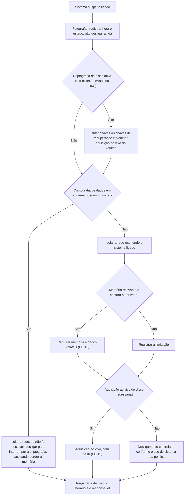

# Playbooks de Triagem, Preservação e Custódia

> **Objetivo pedagógico:** executar os playbooks transversais que iniciam qualquer caso forense: abertura e triagem (PB-00), preservação imediata de logs de retenção curta (PB-01), decisão sobre sistemas ligados (PB-02), coleta remota e triagem em escala (PB-03) e custódia e transferência de evidências (PB-04), com gatilhos, passos, decisões, registros e escalonamento.

> Os playbooks seguem o modelo do arquivo anterior. Os detalhes técnicos estão nas pastas indicadas em "Referências".

## PB-00: Abertura e triagem do caso

| Campo | Conteúdo |
|---|---|
| Gatilho | Solicitação, alerta, denúncia ou decisão de investigar |
| Objetivo | Abrir o caso com autorização, escopo, gravidade e responsáveis definidos |
| Papéis | Executor: analista de plantão. Aprovador: líder do laboratório. Consultados: Jurídico e DPO. Informado: solicitante |
| Pré-requisitos | Canal seguro, modelo de ficha de caso e matriz de gravidade |

**Passos**

1. Registrar a solicitação: data e hora (UTC), solicitante, canal e descrição.
2. **Portão legal:** verificar autorização, base legal e escopo (Jurídico e DPO). Se faltar, parar e solicitar.
3. Classificar o tipo (incidente, investigação interna, perícia, eDiscovery ou OSINT) e a gravidade (matriz do arquivo 1).
4. Atribuir o identificador (DFL-AAAA-NNN), o líder, a equipe e o canal seguro de comunicação (fora de banda, se houver suspeita de comprometimento de e-mail).
5. Identificar riscos de perda de evidência (dados voláteis, logs de retenção curta, dispositivos móveis e contas que podem ser alteradas).
6. **Decisão:** se houver risco iminente de perda, executar PB-01 e PB-02 imediatamente, em paralelo ao restante.
7. Definir a confidencialidade e o regime de privilégio com o Jurídico.
8. Abrir o livro de decisões e a linha do tempo do caso.
9. Selecionar os playbooks aplicáveis e comunicar ao solicitante o plano e os prazos.

| Registro e saídas | Onde |
|---|---|
| Ficha do caso, autorização e escopo | Repositório do caso |
| Plano inicial e lista de playbooks | Ficha do caso |
| Livro de decisões aberto | Repositório do caso |

**Escalonamento:** gravidade crítica ou alta aciona a direção, o Jurídico e o DPO imediatamente.
**Referências:** pastas 01, 02, 03 e 22.

## PB-01: Preservação imediata de logs e dados de retenção curta

| Campo | Conteúdo |
|---|---|
| Gatilho | Qualquer caso novo, e **sempre** em incidentes ativos |
| Objetivo | Exportar e proteger os dados com risco de expiração ou de alteração pelo adversário |
| Papéis | Executor: analista forense. Aprovador: líder do caso. Consultados: administradores dos sistemas e Jurídico |
| Pré-requisitos | Tabela de fontes e retenções, contas de investigador com privilégio mínimo e repositório de evidências |

**Tabela de fontes de retenção curta (referência; confirme no seu ambiente)**

| Fonte | Retenção típica | Ação |
|---|---|---|
| Telemetria de EDR | Dias a poucas semanas | Exportar eventos do período e dos hosts |
| Logs de proxy, DNS e firewall | Dias a semanas | Exportar do SIEM ou da fonte |
| Log de atividade do Azure | 90 dias | Exportar e enviar ao armazenamento imutável |
| Logs de entrada e de auditoria do Entra ID | 7 dias (Free) ou 30 dias (P1 e P2) | Exportar imediatamente |
| Histórico de eventos do CloudTrail | 90 dias (eventos de gerenciamento) | Exportar e verificar a trilha |
| Auditoria unificada do Microsoft 365 | 180 dias (Audit Standard) | Exportar o `AuditData` bruto |
| Rastreamento de mensagens | Até 90 dias | Exportar ou iniciar pesquisa histórica |
| Logs de aplicações e de servidores locais | Variável; sobrescrita por rotação | Copiar antes da rotação |
| Instâncias e contêineres efêmeros | Minutos a horas | Preservar (ver playbooks de nuvem) |

**Passos**

1. Listar as fontes relevantes ao caso e a retenção de cada uma (tabela acima).
2. Ordenar por **prioridade de perda** (expira primeiro, exportar primeiro).
3. Exportar com conta nominal; registrar a consulta, o período, o horário (UTC) e o método.
4. Calcular o hash (SHA-256) de cada arquivo exportado e registrar no manifesto.
5. Armazenar em repositório com controle de acesso, criptografia e imutabilidade.
6. **Aplicar retenção legal** (litigation hold, retenção de caso ou ampliação da retenção) nas fontes que o permitem.
7. Registrar lacunas: logs que não existem ou já expiraram.
8. Informar o líder sobre o que foi preservado e sobre as lacunas.

```bash
# Hash e manifesto de uma pasta de exportações
find ./exportacoes_DFL-2026-001 -type f -print0 | sort -z | xargs -0 sha256sum > manifesto_DFL-2026-001.sha256
```

| Registro e saídas | Descrição |
|---|---|
| Manifesto de hashes | Lista de arquivos e hashes |
| Registro de exportações | Fonte, consulta, período e responsável |
| Registro de lacunas | Fontes ausentes ou expiradas |

**Escalonamento:** logs críticos expirando em menos de 24 horas e sem acesso: acionar o líder e o dono do sistema.
**Referências:** pastas 04, 11, 12, 17, 18 e 19.

## PB-02: Decisão sobre sistemas ligados (isolar, manter ou desligar)

| Campo | Conteúdo |
|---|---|
| Gatilho | Sistema suspeito de comprometimento, ligado, e com decisão pendente |
| Objetivo | Decidir e executar a ação que melhor equilibra preservação, contenção e continuidade |
| Papéis | Executor: analista forense. Aprovador: líder do caso (e dono do sistema, se crítico) |
| Pré-requisitos | Autorização de acesso, mídia de coleta confiável e energia |



**Passos**

1. Fotografar a tela, o equipamento e as conexões; registrar a hora do sistema e a diferença para UTC.
2. Não desligar nem reiniciar até decidir (o desligamento pode destruir a memória e acionar a criptografia de disco).
3. Verificar a criptografia de disco e obter as chaves de recuperação (AD, Entra ID, MDM ou cofre).
4. Avaliar se há criptografia de dados em andamento (ransomware): se sim, a prioridade é impedir o avanço.
5. Isolar a rede (por EDR, firewall ou desconexão do cabo e do Wi-Fi); preferir isolar a desligar.
6. Capturar memória e dados voláteis quando houver relevância e autorização.
7. Decidir sobre a aquisição ao vivo do disco ou o desligamento (em estações comuns sem criptografia e sem necessidade de memória, o desligamento por interrupção de energia preserva melhor o estado do disco do que o desligamento gracioso; em servidores críticos, seguir o procedimento do dono do sistema).
8. Registrar a decisão e a justificativa no livro de decisões.

**Escalonamento:** sistema crítico para o negócio ou para a segurança de pessoas: decisão do líder com o dono do sistema.
**Referências:** pastas 03, 09, 10 e 16.

## PB-03: Coleta remota e triagem em escala

| Campo | Conteúdo |
|---|---|
| Gatilho | Necessidade de avaliar muitos hosts (escopo de incidente, caça ou avaliação de comprometimento) |
| Objetivo | Coletar artefatos de triagem de forma consistente, rápida e proporcional |
| Papéis | Executor: analista forense. Aprovador: líder. Consultados: TI e DPO |
| Pré-requisitos | Ferramenta de coleta remota validada (EDR, Velociraptor ou coletor offline), conjunto de artefatos definido e repositório central |

**Passos**

1. Definir o escopo (lista de hosts, período e critérios de prioridade) e o **conjunto mínimo de artefatos** necessário às perguntas do caso (minimização).
2. **Portão de privacidade:** confirmar que o conjunto de artefatos não inclui conteúdo pessoal desnecessário (por exemplo, e-mails e documentos).
3. Testar a coleta em um host de baixo risco; medir o impacto de desempenho.
4. Executar a coleta em lotes, com limite de tempo; registrar hosts concluídos, falhos e offline.
5. Transferir os resultados ao repositório central; calcular hashes.
6. Processar e priorizar os hosts por indicadores (empilhamento, IOCs e regras).
7. Selecionar os hosts para aquisição aprofundada (PB-10 ou PB-11).
8. Registrar a cobertura: o que foi coletado, o que falhou e por quê.

```powershell
# Exemplo de coleta de triagem com o KAPE (licenciamento conforme o uso; ajuste caminhos e alvos)
kape.exe --tsource C: --tdest E:\coleta\%COMPUTERNAME% --target !SANS_Triage
```

| Registro e saídas | Descrição |
|---|---|
| Lista de hosts e status | Concluídos, falhos e offline |
| Pacotes de coleta com hashes | Repositório central |
| Priorização de hosts | Entrada para análise aprofundada |

**Escalonamento:** hosts críticos sem acesso ou com sinais de adulteração das ferramentas.
**Referências:** pastas 03, 07, 08, 15 e 20.

## PB-04: Custódia e transferência de evidências

| Campo | Conteúdo |
|---|---|
| Gatilho | Qualquer coleta, recebimento, transferência, devolução ou descarte de evidência |
| Objetivo | Manter a cadeia de custódia contínua, rastreável e auditável |
| Papéis | Executor: custodiante. Aprovador: líder. Informado: solicitante |
| Pré-requisitos | Formulários de custódia, material de embalagem e lacre, local de armazenamento seguro |

**Passos**

1. Identificar cada item com um código único (DFL-AAAA-NNN-ENNN); fotografar antes da embalagem.
2. Registrar origem, data e hora (UTC), estado e quem coletou.
3. Calcular o hash (para itens digitais) e registrar.
4. Embalar com material adequado (antiestático, bolsa de Faraday para dispositivos móveis); **lacrar** com lacre numerado; registrar o número do lacre.
5. Preencher o formulário de custódia no momento de cada movimentação (quem entrega, quem recebe, data, hora, motivo).
6. No recebimento, **verificar** o lacre e o hash; registrar divergências e comunicar o líder.
7. Armazenar em local com acesso controlado e registro de acessos; manter energia quando necessário (dispositivos móveis).
8. Registrar cada acesso, e cada abertura de lacre, com motivo e responsável.
9. Ao encerrar, devolver ou descartar conforme a decisão formal, com registro.

| Registro e saídas | Descrição |
|---|---|
| Formulários de custódia | Anexo A dos relatórios (pasta 22) |
| Registro de acessos ao armazenamento | Auditoria |
| Termo de devolução ou de descarte | Encerramento |

**Escalonamento:** lacre rompido, divergência de hash, item faltante ou acesso não registrado: comunicar o líder e o Jurídico imediatamente e documentar.
**Referências:** pastas 02 e 04; CPP, arts. 158-A a 158-F.

## Resumo dos playbooks deste arquivo

| ID | Playbook | Quando usar |
|---|---|---|
| PB-00 | Abertura e triagem do caso | Todo caso novo |
| PB-01 | Preservação imediata de logs | Todo caso, e sempre em incidentes ativos |
| PB-02 | Decisão sobre sistemas ligados | Sistemas suspeitos ligados |
| PB-03 | Coleta remota e triagem em escala | Muitos hosts, escopo amplo |
| PB-04 | Custódia e transferência | Toda movimentação de evidência |

## Exemplo prático: sequência de uso em um incidente

| Hora (UTC) | Ação | Playbook |
|---|---|---|
| 14:05 | Alerta do EDR sobre ransomware em um servidor de arquivos; caso aberto, gravidade crítica | PB-00 |
| 14:10 | Exportação dos logs de EDR, VPN e controladores de domínio; retenção legal onde possível | PB-01 |
| 14:15 | Isolamento do servidor e dos segmentos; decisão de manter ligado para capturar memória | PB-02 |
| 14:40 | Coleta de triagem nos 30 servidores críticos | PB-03 |
| 15:20 | Memória do servidor preservada, lacrada e registrada na custódia | PB-04 e PB-12 |

## Casos de uso corporativos

- Padronização do início de todos os casos pelo plantão forense.
- Garantia de que a preservação de logs ocorre antes de qualquer outra atividade.
- Treinamento de equipes de TI e de segurança nas primeiras horas de um incidente.

## Normas e frameworks relevantes

- ISO/IEC 27037:2012; NIST SP 800-86; NIST IR 8387; NIST SP 800-61 Rev. 3
- CPP, arts. 158-A a 158-F; LGPD, arts. 6º e 46
- CIS Controls v8.1, controles 8 e 17

## Referências

- Pastas 02 (cadeia de custódia), 03 (coleta), 04 (hash) e 22 (relatórios) deste repositório.
- ISO/IEC 27037:2012; NIST SP 800-86.
