# 24 Forense de IA

## Objetivo

Investigar sistemas de inteligência artificial como ativos, alvos e fontes de decisão: reconstruir o ciclo de vida de ML e o conjunto de versões de um momento, coletar evidências de pipelines MLOps e de infraestrutura, verificar a integridade e a proveniência de modelos e de dados, investigar ataques (envenenamento, extração, cadeia de suprimentos e infraestrutura exposta), tratar o uso não autorizado de IA e o vazamento de dados, e auditar decisões automatizadas com base em registros, reprodução e documentação de governança, com integridade, proporcionalidade, base legal e limitações declaradas.

## Trilha de estudo recomendada

```mermaid
flowchart LR
    A["1. Fundamentos e ciclo de vida de ML"] --> B["2. Pipelines MLOps e infraestrutura"]
    B --> C["3. Integridade e proveniência"]
    C --> D["4. Ataques e incidentes de segurança"]
    D --> E["5. Uso não autorizado e shadow AI"]
    E --> F["6. Governança, regulação e auditoria de decisões"]
    F --> G["7. Ferramentas e checklist"]
    G --> H["8. Casos e erros comuns"]
```

## Conteúdo da pasta

| Ordem | Arquivo | Objetivo |
|---|---|---|
| 1 | [fundamentos-de-forense-de-ia-e-ciclo-de-vida-de-ml.md](fundamentos-de-forense-de-ia-e-ciclo-de-vida-de-ml.md) | Anatomia de sistemas de IA, evidências por etapa, referenciais e aspectos legais |
| 2 | [evidencias-em-pipelines-mlops-e-infraestrutura-de-ia.md](evidencias-em-pipelines-mlops-e-infraestrutura-de-ia.md) | Fontes de MLOps e de infraestrutura, conjunto de versões e preservação |
| 3 | [integridade-e-proveniencia-de-modelos-e-dados.md](integridade-e-proveniencia-de-modelos-e-dados.md) | Formatos, hashes, inspeção segura, assinatura, comparação e cadeia de suprimentos |
| 4 | [ataques-e-incidentes-de-seguranca-em-sistemas-de-ia.md](ataques-e-incidentes-de-seguranca-em-sistemas-de-ia.md) | Envenenamento, extração, privacidade e infraestrutura, com ATLAS |
| 5 | [uso-nao-autorizado-de-ia-vazamento-de-dados-e-shadow-ai.md](uso-nao-autorizado-de-ia-vazamento-de-dados-e-shadow-ai.md) | Vazamento por ferramentas de IA, limites do recuperável e proporcionalidade |
| 6 | [governanca-regulacao-e-auditoria-de-decisoes-de-ia.md](governanca-regulacao-e-auditoria-de-decisoes-de-ia.md) | Reconstrução de decisões, viés, explicabilidade, regulação e diligência |
| 7 | [ferramentas-fluxo-modelos-e-checklist-de-forense-de-ia.md](ferramentas-fluxo-modelos-e-checklist-de-forense-de-ia.md) | Ferramentas, modelos de registro e checklist |
| 8 | [casos-de-uso-e-erros-comuns-em-forense-de-ia.md](casos-de-uso-e-erros-comuns-em-forense-de-ia.md) | Sete cenários, erros comuns e exercícios |

## Princípios

- Tratar modelos como artefatos potencialmente executáveis: nunca carregar artefatos não confiáveis fora de ambiente isolado
- Congelar versões (modelo, dados, código, ambiente e configurações) antes de qualquer retreinamento ou restauração
- Reconstruir o conjunto de versões de um momento, com hashes e registros imutáveis
- Considerar hipóteses alternativas legítimas (deriva, falhas e mudanças) antes de concluir por ataque
- Declarar não determinismo, opacidade e limites de explicabilidade; não usar detectores de texto de IA como prova
- Aplicar minimização e base legal aos dados de treinamento, aos registros de inferência e às investigações sobre pessoas
- Responder ao uso não autorizado de IA com proporcionalidade, orientação e alternativas corporativas seguras
- Registrar entradas, saídas, versões e supervisão humana de decisões críticas, para permitir auditoria e revisão

## Relação com outras pastas

- 02, 03 e 04: custódia, coleta e hashes de artefatos de IA
- 11, 13 e 20: logs, proxy e caça a ameaças em ambientes de ML
- 15: cadeia de suprimentos e análise de código malicioso
- 17, 18 e 19: nuvem, Azure e Microsoft 365 (serviços de ML, Copilot e auditoria)
- 21: proveniência e OSINT de conteúdo e de mídia
- 22 e 23: relatórios e playbooks (PB-44 e PB-45)
- 25: forense de prompts e de interações com modelos de linguagem
- 26: investigação de incidentes com LLM e agentes
- 27: investigação de deepfakes e de mídias sintéticas

## Referências

- MITRE ATLAS; NIST AI 100-2 (Adversarial Machine Learning); NIST AI RMF 1.0 (2023); NIST AI 600-1 (2024)
- ISO/IEC 42001:2023; ISO/IEC 23894:2023; ISO/IEC 22989:2022; ISO/IEC 27037, 27041, 27042 e 27043
- OWASP. Top 10 para aplicações com LLM e Machine Learning Security Top 10; Google SAIF
- CycloneDX (ML-BOM); SPDX 3.0 (perfil de IA)
- Regulamento (UE) 2024/1689 (AI Act); PL nº 2338/2023 (em tramitação)
- Brasil. LGPD (Lei nº 13.709/2018), arts. 6º, 20, 37, 38, 46 e 48
- Mitchell, M. et al. Model Cards for Model Reporting (2019); Gebru, T. et al. Datasheets for Datasets (2018)
- Carlini, N. et al. (2021); Tramèr, F. et al. (2016); Shokri, R. et al. (2017)
- Responsible AI Collaborative. AI Incident Database
