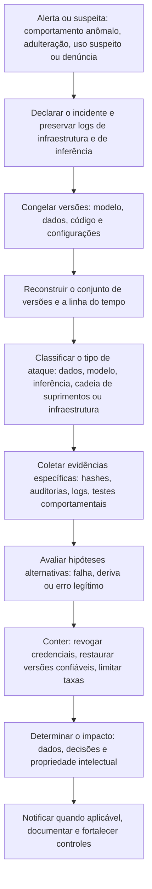

# Ataques e Incidentes de Segurança em Sistemas de IA

> **Objetivo pedagógico:** reconhecer e investigar os principais ataques a sistemas de IA (envenenamento de dados e de modelos, evasão, extração de modelos, ataques à privacidade, comprometimento da cadeia de suprimentos e ataques à infraestrutura de ML), identificando os indícios, as fontes de evidência, o mapeamento a MITRE ATLAS e as ações de resposta, com foco em **detecção, investigação e contenção**.

> Os ataques específicos a modelos de linguagem (injeção de prompts, vazamento de instruções, agentes) são tratados nas pastas 25 e 26.

## 1. Taxonomia resumida (NIST AI 100-2 e MITRE ATLAS)

| Categoria | Objetivo do atacante | Fase do ciclo de vida |
|---|---|---|
| Envenenamento (poisoning) | Degradar o modelo ou inserir comportamento oculto, alterando dados de treinamento, rótulos ou o próprio modelo | Treinamento, ajuste fino, retreinamento |
| Porta dos fundos (backdoor) | Fazer o modelo se comportar de forma específica diante de um gatilho | Treinamento ou adulteração do modelo |
| Evasão (evasion) | Alterar entradas para que o modelo erre (exemplos adversariais) | Inferência |
| Extração de modelo | Reproduzir o modelo ou seus parâmetros por consultas | Inferência (API) |
| Ataques à privacidade | Inferir dados de treinamento (inferência de pertencimento, inversão e memorização) | Inferência |
| Cadeia de suprimentos | Comprometer modelos, dados ou bibliotecas de terceiros | Aquisição e implantação |
| Ataques à infraestrutura de ML | Explorar notebooks, painéis, clusters e credenciais | Todo o ciclo |
| Abuso de recursos | Usar GPUs e créditos para mineração ou para treinar modelos próprios | Infraestrutura |
| Abuso do serviço | Uso em larga escala para fraude, spam ou geração de conteúdo ilícito | Inferência |

Os identificadores do MITRE ATLAS mudam entre versões; consulte a versão vigente. Exemplos de técnicas: AML.T0010 (comprometimento da cadeia de suprimentos de ML), AML.T0018 (porta dos fundos), AML.T0020 (envenenamento de dados de treinamento), AML.T0043 (criação de dados adversariais) e AML.T0024 (exfiltração por meio da API de inferência).

## 2. Matriz ataque, indícios e fontes de evidência

| Ataque | Indícios | Fontes de evidência | Ação |
|---|---|---|---|
| Envenenamento de dados | Alterações em conjuntos de dados fora do processo; mudança abrupta de distribuição ou de rótulos; amostras com padrões repetidos; queda de desempenho em subgrupos | Auditoria do armazenamento e do versionamento de dados; registros de pipelines; comparação entre versões; métricas por subgrupo | Congelar a versão; restaurar a versão de dados confiável; retreinar; investigar acesso |
| Porta dos fundos ou adulteração do modelo | Divergência de hash; escrita no artefato fora do registro; comportamento anômalo diante de entradas específicas | Hashes, auditoria do registro e do armazenamento, testes comportamentais | Preservar; restaurar versão confiável; investigar a origem do acesso |
| Evasão (exemplos adversariais) | Entradas com perturbações sutis; picos de erros; padrões de consulta repetitivos com pequenas variações | Logs de inferência (entradas, saídas, confiança), monitoramento | Registrar e analisar entradas; reforçar validações e controles |
| Extração de modelo | Volume alto de consultas sistemáticas por poucas contas ou IPs; cobertura metódica do espaço de entradas; consultas com variação controlada | Logs de gateway e de API; limites de taxa; telemetria por identidade | Limitar taxa; bloquear credenciais; preservar logs; avaliar impacto contratual e de propriedade intelectual |
| Ataques à privacidade (pertencimento e inversão) | Consultas que exploram a confiança das saídas; tentativas de reconstruir registros específicos | Logs de inferência; análise de padrões; resultados de testes de privacidade | Reduzir informação nas saídas; aplicar controles de privacidade; avaliar notificações (LGPD) |
| Cadeia de suprimentos (modelo ou pacote malicioso) | Artefatos de origem recente ou enganosa; execução de código ao carregar; conexões de rede inesperadas do ambiente de treinamento | Hashes e proveniência; logs de rede e de processos; varredura de artefatos (arquivo 3) | Isolar o ambiente; revogar credenciais; investigar impacto (pastas 15 e 17) |
| Infraestrutura de ML exposta | Acessos não autenticados a notebooks, rastreadores, painéis de orquestração e de clusters; execução de comandos; criação de trabalhos desconhecidos | Logs de acesso, de nuvem e de Kubernetes; processos e conexões nos nós | Fechar a exposição; rotacionar segredos; investigar movimentação (pastas 13, 17 e 18) |
| Abuso de GPU (mineração) | Uso de GPU constante fora do padrão; processos desconhecidos; custos elevados | Telemetria de GPU, logs de nuvem e de contêineres, alertas de custo | Preservar, remover e fechar a causa (PB-30 e PB-35) |
| Abuso do serviço de inferência | Picos de uso por contas novas; conteúdo gerado ilícito; uso fora do contrato | Logs de gateway, de identidade e de conteúdo | Revogar contas; limitar taxa; avaliar medidas legais |

## 3. Investigação de envenenamento de dados e de modelos

| Passo | Descrição |
|---|---|
| 1 | Definir a janela de interesse: quando o comportamento mudou (monitoramento e métricas) |
| 2 | Reconstruir o conjunto de versões de cada treinamento no período (arquivo 2) |
| 3 | Comparar as versões de dados: o que foi adicionado, removido ou alterado; por quem e por qual conta |
| 4 | Verificar o acesso e a integridade do armazenamento e do pipeline (auditoria, hashes e logs) |
| 5 | Avaliar as fontes de dados externas ou coletadas da web e de usuários (ciclos de feedback) |
| 6 | Aplicar testes de desempenho por subgrupo e por tipo de entrada, em versões antes e depois |
| 7 | Procurar padrões repetidos (gatilhos) nas amostras novas, em conjunto com a equipe de ciência de dados |
| 8 | Preservar versões, congelar o pipeline e documentar |
| 9 | Restaurar a versão confiável e retreinar, quando adequado |
| 10 | Relatar com o grau de confiança: indícios de adulteração, e não conclusão sobre a intenção, salvo evidências claras |

Cuidado: queda de desempenho ou comportamento estranho podem ter causas **não maliciosas** (deriva natural dos dados, erros de pipeline, mudanças legítimas). A investigação deve considerar as hipóteses alternativas.

## 4. Investigação de extração de modelo

| Indicador | Descrição |
|---|---|
| Volume e regularidade | Número elevado de requisições de uma conta ou de um conjunto de IPs, em intervalos regulares |
| Cobertura do espaço de entradas | Entradas que variam sistematicamente (grades de valores, palavras ou imagens geradas por algoritmo) |
| Consultas de fronteira | Entradas próximas aos limites de decisão, para mapear o comportamento |
| Uso de múltiplas contas | Distribuição das consultas para evitar limites |
| Armazenamento dos resultados | Padrões de uso que sugerem construção de um conjunto de treinamento a partir das saídas |

```kusto
// Exemplo de análise de logs de um gateway de inferência normalizados em uma tabela "InferenciaLogs"
// (colunas: TimeGenerated, ContaId, IpOrigem, ModeloVersao, Tokens, StatusCode)
InferenciaLogs
| where TimeGenerated > ago(7d)
| summarize Requisicoes = count(), IPs = dcount(IpOrigem), PrimeiroUso = min(TimeGenerated), UltimoUso = max(TimeGenerated)
    by ContaId, bin(TimeGenerated, 1h)
| where Requisicoes > 5000
| order by Requisicoes desc
```

Os limiares são exemplos: compare com a linha de base de cada conta e cliente; usuários legítimos (testes e integrações) também geram volumes altos.

## 5. Infraestrutura de ML exposta e abuso de recursos

Ferramentas de ciência de dados são frequentemente implantadas com **autenticação fraca ou ausente** (notebooks, rastreadores de experimentos e painéis de orquestração e de clusters), o que as torna alvos de exploração e de mineração. Campanhas públicas contra clusters de computação distribuída de ML expostos mostraram o risco.

| Passo de investigação | Fonte |
|---|---|
| Identificar a exposição (portas, URLs e autenticação) | Configuração de rede, balanceadores e inventário |
| Identificar os acessos e os comandos executados | Logs de acesso dos serviços, de processos e de contêineres |
| Verificar trabalhos e contêineres criados | Orquestrador, Kubernetes e logs de nuvem |
| Verificar o acesso a dados e a modelos | Auditoria do armazenamento e do registro |
| Verificar credenciais e segredos expostos | Notebooks, variáveis de ambiente e arquivos de configuração |
| Preservar e conter | Playbooks de nuvem e de contêineres (PB-30, PB-35) |
| Erradicar e corrigir | Autenticação, segmentação, privilégio mínimo e rotação de segredos |

## 6. Ataques à privacidade e vazamento de dados de treinamento

| Aspecto | Observação |
|---|---|
| Memorização | Modelos podem reproduzir trechos de dados de treinamento, em especial dados repetidos ou raros |
| Inferência de pertencimento | Determinar se um registro foi usado no treinamento, a partir do comportamento do modelo |
| Inversão e reconstrução | Reconstruir atributos ou exemplos a partir de saídas |
| Evidências | Logs de consultas, resultados de testes de privacidade, exemplos de saídas que contenham dados pessoais |
| Implicações legais | Se dados pessoais são recuperáveis do modelo, avaliar o tratamento e eventual incidente (LGPD, arts. 6º, 46 e 48) |
| Mitigações | Minimização e deduplicação de dados, técnicas de privacidade no treinamento, limitação de informações nas saídas e controles de acesso |

## 7. Fluxo geral de investigação de um incidente de segurança de IA



## 8. Resposta e contenção (após preservar)

| Ação | Cuidado |
|---|---|
| Congelar versões e preservar | Antes de restaurar ou retreinar |
| Restaurar a versão confiável do modelo | Registrar o estado anterior; verificar o hash e o comportamento |
| Retreinar a partir de dados confiáveis | Em ambiente limpo e com a linhagem registrada |
| Revogar credenciais, chaves e sessões | Pastas 17 e 18 |
| Limitar taxa e bloquear contas abusivas | Equilibrar com clientes legítimos |
| Corrigir a exposição de infraestrutura | Autenticação, segmentação e privilégio mínimo |
| Avaliar o impacto nas decisões já tomadas | Possível revisão de decisões afetadas (LGPD, art. 20) |
| Comunicar | Jurídico, DPO, clientes e reguladores, conforme o caso |

## 9. Exemplo prático: extração de modelo por API

| Etapa | Resultado |
|---|---|
| Alerta | Aumento de 40 vezes no volume de requisições de 3 contas criadas na mesma semana |
| Logs do gateway | Entradas geradas por grade sistemática, concentradas perto das fronteiras de decisão; distribuição entre 120 IPs |
| Impacto | O modelo é um ativo valioso; os termos de uso proíbem a engenharia reversa |
| Preservação | Exportação dos logs de inferência e de identidade; congelamento da configuração do serviço |
| Contenção | Contas suspensas; limites de taxa e detecção por padrão de consulta; redução da granularidade das saídas |
| Conclusão | Padrão compatível com extração de modelo (confiança moderada a alta); intenção e destino do modelo extraído indeterminados; Jurídico avalia medidas contratuais |

## 10. Casos de uso corporativos

- Resposta a incidentes que envolvem modelos, dados e infraestrutura de ML.
- Detecção e investigação de extração de modelos e de abuso de APIs de inferência.
- Revisão da exposição de ferramentas de ciência de dados.

## 11. Normas e frameworks relevantes

- MITRE ATLAS; NIST AI 100-2 (Adversarial Machine Learning); NIST AI RMF 1.0
- OWASP Machine Learning Security Top 10; OWASP Top 10 para LLM (dados e modelos, consumo ilimitado e cadeia de suprimentos)
- MITRE ATT&CK (infraestrutura: T1190, T1496, T1078, T1552)
- ISO/IEC 27035; ISO/IEC 42001:2023; NIST SP 800-61 Rev. 3
- LGPD, arts. 6º, 20, 46 e 48

## 12. Referências

- MITRE. ATLAS: matriz, técnicas e estudos de caso. https://atlas.mitre.org
- Vassilev, A. et al. NIST AI 100-2 (edição vigente).
- OWASP. Machine Learning Security Top 10 e Top 10 para aplicações com LLM.
- Carlini, N. et al. Extracting Training Data from Large Language Models. USENIX Security, 2021 (memorização).
- Tramèr, F. et al. Stealing Machine Learning Models via Prediction APIs. USENIX Security, 2016.
- Shokri, R. et al. Membership Inference Attacks Against Machine Learning Models. IEEE S&P, 2017.
- Relatórios públicos de segurança sobre a exploração de clusters de ML expostos.
