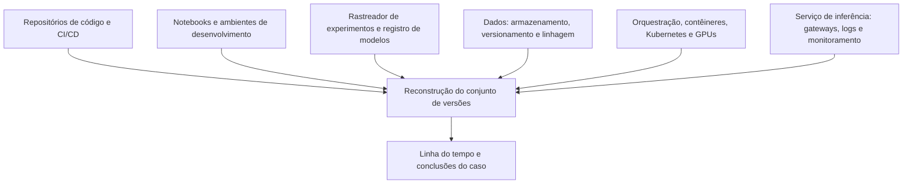

# Evidências em Pipelines MLOps e Infraestrutura de IA

> **Objetivo pedagógico:** identificar, coletar e preservar as evidências geradas pelos pipelines de MLOps e pela infraestrutura que sustenta sistemas de IA (repositórios, notebooks, rastreadores de experimentos, registros de modelos, orquestradores, contêineres, GPUs, serviços de ML em nuvem e gateways de inferência), reconstruindo o "conjunto de versões" de um momento e tratando o volume e a efemeridade desses ambientes.

## 1. Mapa das fontes de evidência



| Fonte | O que contém | Valor forense |
|---|---|---|
| Repositórios (Git) e CI/CD | Código, configurações, histórico de commits, execuções de pipelines | Quem alterou o quê e quando; alterações fora do processo |
| Notebooks (Jupyter) | Código, saídas, ordem de execução e metadados | Atividade interativa de cientistas de dados; credenciais e dados expostos |
| Rastreadores de experimentos (por exemplo, MLflow e Weights & Biases) | Execuções, parâmetros, métricas, artefatos e usuários | Reconstrução do treinamento; autoria |
| Registro de modelos | Versões, estágios ou aliases, hashes, aprovações e auditoria | Quem promoveu ou substituiu uma versão |
| Armazenamento de dados e de artefatos | Conjuntos de dados, pesos, checkpoints e logs | Origem, integridade e acessos |
| Versionamento de dados (por exemplo, DVC) | Arquivos de controle com hashes e referências | Provar a versão exata dos dados |
| Feature stores e bases vetoriais | Características e embeddings usados em produção | Contaminação e vazamento de dados |
| Orquestradores (Airflow, Kubeflow e similares) | Execuções, tarefas, parâmetros e falhas | Sequência e responsáveis pelas etapas |
| Contêineres e Kubernetes | Imagens, manifestos, logs e eventos | Ambiente exato de treinamento e de serviço |
| GPUs e clusters | Registros de uso, trabalhos e utilização | Abuso de recursos e atividades fora do padrão |
| Serviços de ML em nuvem (por exemplo, SageMaker, Azure Machine Learning e Vertex AI) | Logs de auditoria, trabalhos, endpoints e artefatos | Alterações de recursos de ML e acessos |
| Gateways e logs de inferência | Requisições, respostas, identidades, volumes e erros | Quem consultou; padrões de extração e de abuso |
| Monitoramento | Métricas de deriva, de desempenho e de segurança | Quando o comportamento mudou |
| Segredos e identidades | Chaves de API, tokens e contas de serviço | Persistência e movimentação do atacante |

## 3. O conjunto de versões de um momento

Para responder "o que estava em produção em determinado instante e por quê", reconstrua o conjunto de versões:

| Elemento | Como determinar |
|---|---|
| Versão do modelo em produção | Histórico do registro; manifestos de implantação; digest da imagem; logs do serviço |
| Hash dos pesos e dos artefatos | Registro de modelos e armazenamento; cálculo do hash |
| Versão do código de serviço e de pré e pós-processamento | Commit do repositório e imagem do contêiner |
| Configurações de inferência (limiares, parâmetros de geração e filtros) | Arquivos de configuração e variáveis de ambiente |
| Versão dos dados de treinamento e de teste | Arquivos de controle do versionamento de dados; hashes |
| Ambiente de treinamento | Imagem, lista de bibliotecas, versões de drivers e do sistema |
| Hiperparâmetros e sementes | Registros do rastreador de experimentos |
| Responsáveis e aprovações | Auditoria do registro, do CI/CD e do repositório |
| Janela de tempo | Horários em UTC de cada implantação e alteração |

## 4. Coleta e preservação: exemplos

### 4.1 Rastreador de experimentos (MLflow)

```python
# Inventário de execuções recentes por experimento (somente leitura; ajuste o endereço do servidor)
import mlflow

cliente = mlflow.tracking.MlflowClient(tracking_uri="http://mlflow.interno:5000")
for exp in cliente.search_experiments():
    execucoes = cliente.search_runs([exp.experiment_id], order_by=["attributes.start_time DESC"], max_results=20)
    for r in execucoes:
        print(exp.name, r.info.run_id, r.info.user_id, r.info.start_time, r.info.status, r.data.params)
```

Exporte também a lista de versões do registro de modelos, com autores, datas e aliases; preserve o banco de metadados e o armazenamento de artefatos do servidor (cópia com hash).

### 4.2 Versionamento de dados (DVC) e repositório

```bash
# Estado do versionamento de dados e diferenças entre versões
dvc status
dvc diff HEAD~1
git log --date=iso --pretty=format:"%H|%an|%ad|%s" -n 50 > historico_commits.txt

# Hashes registrados no arquivo de bloqueio (dvc.lock) e cópia do repositório
cp dvc.lock evidencia_dvc.lock
git bundle create repo_DFL-2026-001.bundle --all
sha256sum repo_DFL-2026-001.bundle evidencia_dvc.lock > hashes_repo.sha256
```

### 4.3 Notebooks

```bash
# Extrair o código das células de um notebook sem executá-lo
jq -r '.cells[] | select(.cell_type=="code") | .source | join("")' analise.ipynb > analise_codigo.txt

# Metadados e ordem de execução
jq '.metadata, [.cells[] | select(.cell_type=="code") | .execution_count]' analise.ipynb
```

Notebooks podem conter credenciais, dados pessoais e saídas de dados sensíveis; trate-os como evidências sensíveis.

### 4.4 Contêineres e Kubernetes

```bash
# Digests das imagens em uso (identificam o conteúdo de forma imutável)
kubectl get pods -n ml -o jsonpath='{range .items[*]}{.metadata.name}{"\t"}{.status.containerStatuses[*].imageID}{"\n"}{end}'

# Preservar a definição e os logs de um trabalho de treinamento ou de serviço (ver pasta 17)
kubectl get pod POD -n ml -o yaml > pod_E040.yaml
kubectl logs POD -n ml --all-containers --timestamps > pod_E040_logs.txt
```

### 4.5 GPUs

```bash
# Instantâneo do uso de GPU e de processos (execute no nó; salve com hash)
nvidia-smi -q > gpu_estado_E040.txt
nvidia-smi --query-compute-apps=pid,process_name,used_memory --format=csv > gpu_processos_E040.csv
```

### 4.6 Serviços de ML em nuvem

| Provedor | Fontes (exemplos) |
|---|---|
| AWS (SageMaker) | CloudTrail (criação e alteração de trabalhos, endpoints e modelos), S3 (artefatos e dados), CloudWatch |
| Azure (Azure Machine Learning) | Log de atividade, logs de recursos, registros de modelos e de dados |
| Google Cloud (Vertex AI) | Cloud Audit Logs, Cloud Storage, registros de modelos |

Siga os playbooks de nuvem (pastas 17 e 18, e PB-30 a PB-35 na pasta 23): preservar logs, desativar credenciais (e não excluir), criar snapshots e copiar artefatos para o ambiente forense.

## 5. Preservação de artefatos grandes

| Desafio | Prática |
|---|---|
| Arquivos de gigabytes a terabytes | Hash em fluxo (`sha256sum`), manifesto de arquivos e verificação por amostragem apenas quando justificada e declarada |
| Pesos e checkpoints | Preservar o arquivo exato, os metadados e o registro de modelos; congelar a versão (tag imutável) |
| Conjuntos de dados | Preservar a versão e a lista de hashes; quando impossível copiar tudo, preservar o manifesto e as referências, com o fundamento da decisão |
| Dados pessoais | Aplicar minimização e controle de acesso; preferir análises em ambiente seguro, sem extração desnecessária |
| Recursos efêmeros | Reter trabalhos e contêineres antes da reciclagem; exportar logs de execução |
| Imutabilidade | Armazenamento com retenção imutável (WORM) e registro de acesso |

```bash
# Manifesto de hashes de um diretório de artefatos (preserva a lista, mesmo quando a cópia completa for inviável)
find ./artefatos_modelo -type f -print0 | sort -z | xargs -0 sha256sum > manifesto_artefatos_DFL-2026-001.sha256
```

## 6. Registro e retenção para prontidão forense em IA

| Controle | Descrição |
|---|---|
| Registro de modelos com auditoria e imutabilidade de versões | Impede substituição silenciosa de artefatos |
| Hash e assinatura dos artefatos de modelo e de dados | Verificação de integridade (arquivo seguinte) |
| Registro de proveniência de dados e de código por execução | Reproduzir e responsabilizar |
| Logs de inferência com identificação do usuário, da versão do modelo e dos parâmetros | Reconstrução de decisões (equilibrar com a privacidade) |
| Centralização e retenção de logs de ML e de infraestrutura | Pasta 11 e prontidão em nuvem |
| Controle de acesso e segregação de funções | Quem treina, quem promove e quem opera são papéis distintos |
| Inventário de sistemas de IA, modelos e dados | Escopo de qualquer investigação |
| Retenção legal e plano de preservação | Procedimento de congelamento de versões em caso de incidente |

## 7. Exemplo prático: reconstrução do conjunto de versões

| Pergunta | Fonte | Resultado |
|---|---|---|
| Qual modelo atendia as requisições em 02/11, às 14:00 UTC? | Manifesto de implantação e digest da imagem | Imagem `sha256:ab12...` com o modelo v18 |
| Quando a v18 foi promovida e por quem? | Auditoria do registro | 01/11, 22:41 UTC, pela conta `svc-ml-ci`, fora da janela de implantação |
| Que dados e código a produziram? | Execução vinculada no rastreador e `dvc.lock` | Dados v7 (hash `9f3a...`), commit `c41e...` |
| O hash dos pesos corresponde ao registrado? | Cálculo do hash do artefato | Diverge: o arquivo no armazenamento foi substituído às 22:38 UTC |
| Conclusão | Indício de substituição do artefato antes da promoção; escalado como incidente de integridade de modelo (arquivos 3 e 4) |

## 8. Casos de uso corporativos

- Investigação de alterações não autorizadas em pipelines e em registros de modelos.
- Preparação da evidência para auditorias e para reclamações sobre decisões automatizadas.
- Definição de requisitos de registro, de versionamento e de retenção em projetos de IA.

## 9. Normas e frameworks relevantes

- MITRE ATLAS (cadeia de suprimentos e acesso a artefatos de ML); NIST AI RMF 1.0 (Mapear e Gerenciar)
- ISO/IEC 27037; ISO/IEC 27043; ISO/IEC 42001:2023 (controles de documentação e de rastreabilidade)
- NIST SP 800-92 (gestão de logs); NIST SP 800-201 (forense em nuvem)
- CIS Controls v8.1, controles 3, 8 e 16 (segurança de aplicações)
- LGPD, arts. 6º, 37 (registro das operações de tratamento) e 46

## 10. Referências

- Documentação do MLflow, do Weights & Biases, do DVC, do Kubeflow e do Apache Airflow.
- Documentação do Amazon SageMaker, do Azure Machine Learning e do Google Vertex AI (auditoria e segurança).
- Sculley, D. et al. Hidden Technical Debt in Machine Learning Systems. NeurIPS, 2015.
- MITRE ATLAS. Estudos de caso e técnicas de cadeia de suprimentos.
- Pastas 11, 17, 18 e 23 deste repositório.
