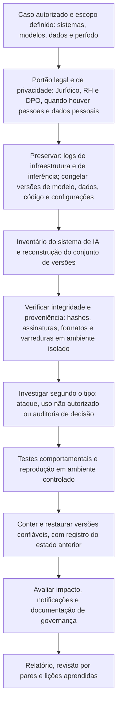

# Ferramentas, Fluxo, Modelos e Checklist de Forense de IA

> **Objetivo pedagógico:** padronizar as ferramentas, o fluxo de trabalho, os registros e a verificação de qualidade das investigações de IA (integridade de modelos e de dados, incidentes de segurança, uso não autorizado e auditoria de decisões), de modo que sejam seguras, reproduzíveis, proporcionais e defensáveis.

## 1. Ferramentas por finalidade

| Finalidade | Ferramentas |
|---|---|
| Hash, manifestos e integridade | `sha256sum`, `Get-FileHash`, `gpg`, manifestos e registros imutáveis |
| Inspeção de artefatos de modelo | `pickletools` (biblioteca padrão do Python), picklescan, ModelScan, fickling, leitura de metadados do safetensors |
| Rastreamento de experimentos e registro de modelos | MLflow e Weights & Biases (consulta somente leitura e exportação) |
| Versionamento de dados e de código | DVC, Git (inclusive `git bundle`), Git LFS |
| Inventário e listas de materiais | CycloneDX (ML-BOM) e SPDX 3.0 (perfil de IA) |
| Infraestrutura e nuvem | Ferramentas das pastas 17 e 18, `kubectl`, `docker`, `nvidia-smi` |
| Logs e análise | SIEM, KQL, DuckDB, Python (pastas 11 e 20) |
| Ataques a ML (conhecimento e testes autorizados) | MITRE ATLAS, bibliotecas de robustez adversarial e de avaliação de privacidade, em ambiente de teste |
| Justiça e explicabilidade | Fairlearn, AIF360, SHAP e LIME |
| Proxy, DLP e CASB | Ferramentas corporativas existentes (pasta 13) |
| Proveniência de mídia | ExifTool, FFmpeg e credenciais de conteúdo C2PA (pastas 21 e 27) |
| Documentação | Modelos deste arquivo, repositório versionado e Pandoc (pasta 22) |

Execute ferramentas que **carregam** artefatos de modelo somente em ambiente isolado e descartável.

## 2. Fluxo de trabalho padronizado

## 3. Dez perguntas e como respondê-las

| Pergunta | Onde responder |
|---|---|
| 1. Quais sistemas, modelos, dados e períodos estão no escopo, e há base legal? | Inventário e autorização |
| 2. O conjunto de versões do momento foi reconstruído? | Registro do conjunto de versões |
| 3. Os artefatos têm hash, assinatura e proveniência verificados? | Registro de integridade de modelo |
| 4. O formato dos artefatos foi inspecionado de forma segura? | Inspeção estática em ambiente isolado |
| 5. Há indícios de adulteração, de envenenamento ou de cadeia de suprimentos? | Matriz ataque e evidência |
| 6. Que acessos, credenciais e infraestrutura foram afetados? | Logs de nuvem, de contêineres e de armazenamento |
| 7. O comportamento difere entre versões e subgrupos? | Testes comportamentais e métricas |
| 8. A decisão pode ser reproduzida e a supervisão humana foi efetiva? | Reconstrução da decisão |
| 9. Há dados pessoais, obrigações de notificação e riscos legais? | Jurídico e DPO |
| 10. Que limitações precisam ser declaradas? | Dados não preservados, não determinismo e opacidade |

## 4. Modelo A: Inventário de Sistemas de IA

| ID | Sistema e finalidade | Dono e responsável técnico | Modelo (origem, versão e formato) | Dados (fontes e dados pessoais?) | Infraestrutura (nuvem, clusters e serviços) | Impacto e criticidade | Registros disponíveis (inferência, auditoria e retenção) | Documentação (cartão de modelo e RIPD) |
|---|---|---|---|---|---|---|---|---|
| IA-001 | | | | | | | | |
| IA-002 | | | | | | | | |

## 5. Modelo B: Registro do Conjunto de Versões (por momento)

| Campo | Preenchimento |
|---|---|
| Sistema e identificador | |
| Data e hora de referência (UTC) | |
| Versão do modelo e hash dos pesos | |
| Fonte da informação (registro, manifesto e imagem) | |
| Código de serviço (commit) e de pré e pós-processamento | |
| Imagem de contêiner (digest) e ambiente | |
| Configurações de inferência (limiares, parâmetros e filtros) | |
| Versão dos dados de treinamento e de teste (hash) | |
| Execução de treinamento (identificador, usuário e data) | |
| Aprovação e promoção (quem e quando) | |
| Lacunas e incertezas | |

## 6. Modelo C: Registro de Integridade de Modelo ou de Dados

| ID | Artefato (nome e caminho) | Formato real | Origem | Hash calculado | Hash de referência (fonte) | Assinatura verificada? | Inspeção (ferramenta e resultado) | Observações |
|---|---|---|---|---|---|---|---|---|
| M-001 | | | | | | | | |
| M-002 | | | | | | | | |

## 7. Modelo D: Matriz Ataque, Evidência e Ação

| Hipótese de ataque ou incidente | Técnica ATLAS ou ATT&CK | Indícios observados | Fontes de evidência | Corroboração | Hipóteses alternativas | Confiança | Ação |
|---|---|---|---|---|---|---|---|
| | | | | | | | |

## 8. Modelo E: Registro de Reconstrução de Decisão

| Campo | Preenchimento |
|---|---|
| Identificador da transação e do titular (pseudônimo) | |
| Data e hora (UTC) | |
| Conjunto de versões (referência ao modelo B) | |
| Entradas (referência e integridade) | |
| Saída, limiar e regra aplicada | |
| Supervisão humana (quem, quando e resultado) | |
| Reprodução (ambiente, sementes e resultado) | |
| Coincidência com a decisão original | |
| Análise de adequação e de viés (referências) | |
| Informações ao titular e contestações | |
| Limitações | |

## 9. Modelo F: Estrutura do Relatório de Forense de IA

| Seção | Conteúdo |
|---|---|
| 1. Escopo, autorização e base legal | Sistemas, período e restrições de privacidade |
| 2. Resumo e conclusões | Resultados, confiança e recomendações |
| 3. Inventário e conjunto de versões | Modelos, dados, código e infraestrutura |
| 4. Preservação e custódia | O que foi preservado, hashes e limitações |
| 5. Integridade e proveniência | Verificações de artefatos e resultados |
| 6. Análise do incidente ou da decisão | Fatos, hipóteses e interpretações separados |
| 7. Testes e reprodução | Metodologia, resultados e não determinismo |
| 8. Impacto | Dados, decisões, pessoas e obrigações legais |
| 9. Contenção e recomendações | Ações realizadas e propostas, com responsáveis e prazos |
| 10. Limitações | Dados ausentes, opacidade e incertezas |
| 11. Anexos | Hashes, consultas, manifestos e custódia |

## 10. Checklist operacional de forense de IA

**Caso:** DFL-AAAA-NNN
**Sistema de IA:** ____________________
**Analista:** ____________________
**Data e hora (UTC):** ____________________

### 10.1 Autorização e preservação

- [ ] Autorização, base legal e escopo definidos; Jurídico, RH e DPO consultados quando houver pessoas e dados pessoais
- [ ] Logs de infraestrutura, de nuvem e de inferência preservados com hash
- [ ] Versões de modelo, dados, código e configurações congeladas (tags imutáveis)
- [ ] Credenciais de pipelines e de serviços avaliadas (desativar, e não excluir)
- [ ] Custódia registrada; manifestos de hashes para artefatos grandes

### 10.2 Integridade e análise

- [ ] Conjunto de versões do momento reconstruído (modelo B)
- [ ] Hashes e assinaturas verificados; formatos identificados pelo conteúdo
- [ ] Artefatos baseados em serialização de objetos inspecionados **sem carregar**, em ambiente isolado
- [ ] Comparação entre versões (estrutural e comportamental) realizada
- [ ] Proveniência dos dados e histórico de alterações verificados
- [ ] Hipóteses alternativas (falha, deriva e erro) consideradas

### 10.3 Contenção e impacto

- [ ] Estado anterior registrado antes de restaurar versões ou alterar acessos
- [ ] Versão confiável restaurada e verificada
- [ ] Impacto em dados, em decisões e em pessoas avaliado; notificações avaliadas
- [ ] Controles corrigidos: autenticação, segmentação, registro e imutabilidade

### 10.4 Relato

- [ ] Fatos, inferências e opiniões separados; confiança declarada
- [ ] Limitações (não determinismo, opacidade e dados ausentes) declaradas
- [ ] Dados pessoais minimizados e protegidos no relatório
- [ ] Revisão por pares concluída (inclusive com a equipe de ciência de dados)

## 11. Resultado da verificação

| Resultado | Condição |
|---|---|
| Conforme | Todos os itens aplicáveis marcados |
| Conforme com ressalvas | Pendências sem impacto nas conclusões, com plano de ação |
| Não conforme | Carregamento de artefatos não confiáveis fora de ambiente isolado, versões não congeladas, hashes não verificados, conclusões sem corroboração ou dados pessoais expostos; comunicar o líder |

**Assinatura do analista:** ____________________
**Assinatura do revisor:** ____________________

## 12. Casos de uso corporativos

- Padronização das investigações de IA do laboratório forense e do time de segurança.
- Treinamento conjunto entre segurança, ciência de dados, jurídico e conformidade.
- Auditoria da prontidão forense dos sistemas de IA da organização.

## 13. Normas e frameworks relevantes

- MITRE ATLAS; NIST AI 100-2; NIST AI RMF 1.0 e AI 600-1; OWASP Top 10 para LLM e ML Security Top 10
- ISO/IEC 42001:2023; ISO/IEC 23894:2023; ISO/IEC 27037, 27041, 27042 e 27043
- CycloneDX (ML-BOM); SPDX 3.0 (perfil de IA)
- LGPD, arts. 6º, 20, 37, 38, 46 e 48

## 14. Referências

- Documentação do MLflow, do DVC, do picklescan, do ModelScan, do safetensors, do Fairlearn e do AIF360.
- MITRE ATLAS. https://atlas.mitre.org
- NIST. AI RMF 1.0 e AI 100-2.
- Pastas 11, 17, 18, 22 e 23 deste repositório.
