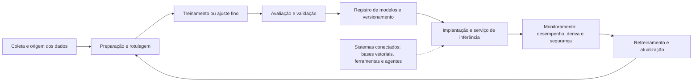

# Fundamentos de Forense de IA e Ciclo de Vida de ML

> **Objetivo pedagógico:** compreender o que é a forense de sistemas de inteligência artificial, a anatomia de um sistema de IA (dados, treinamento, modelo, serviço, monitoramento e agentes), as evidências geradas em cada etapa do ciclo de vida de aprendizado de máquina (ML), as diferenças em relação à forense tradicional (não determinismo, volume, versionamento e opacidade) e os referenciais (MITRE ATLAS, NIST AI 100-2, OWASP e NIST AI RMF) que orientam a investigação.

## 1. O que é forense de IA

A forense de IA aplica os princípios da forense digital (preservação, integridade, rastreabilidade e reprodutibilidade) a sistemas que **aprendem a partir de dados** e a incidentes que os envolvem. Há três frentes complementares:

| Frente | Pergunta típica | Exemplo |
|---|---|---|
| IA como alvo | Alguém atacou, alterou ou roubou o sistema de IA, os dados ou o modelo? | Modelo adulterado no registro; dados de treinamento envenenados; roubo de pesos |
| IA como instrumento | O sistema de IA foi usado para cometer ou facilitar uma conduta? | Fraude com mídia sintética; uso de IA para gerar documentos falsos |
| IA como fonte de decisão | Que decisão o sistema tomou, com que entradas, com qual versão e sob que supervisão? | Reclamação sobre crédito negado; auditoria de viés; incidente de segurança de um agente |

Esta pasta trata da **primeira e da terceira frentes**, e das bases comuns. A pasta 25 trata dos prompts e das interações com modelos de linguagem; a pasta 26, dos incidentes com LLM e agentes; a pasta 27, das mídias sintéticas (deepfakes).

## 2. Anatomia de um sistema de IA

| Componente | Função | Exemplos de ativos |
|---|---|---|
| Dados | Matéria-prima do aprendizado | Conjuntos de treinamento, de validação e de teste; rótulos; dados de produção reutilizados |
| Código e experimentos | Definem o treinamento e a avaliação | Repositórios, notebooks, scripts, configurações e hiperparâmetros |
| Ambiente de treinamento | Executa o treinamento | Contêineres, clusters com GPU, serviços de ML em nuvem |
| Modelo | Resultado do treinamento | Pesos, arquitetura, tokenizadores e configurações |
| Registro de modelos | Controla versões e promoções | Repositórios de modelos, registros de artefatos |
| Serviço de inferência | Disponibiliza o modelo | APIs, gateways, balanceadores e aplicações clientes |
| Monitoramento | Observa o comportamento em produção | Métricas, logs de entradas e saídas, alertas de deriva |
| Componentes conectados | Ampliam as capacidades do modelo | Bases vetoriais (RAG), ferramentas, plugins e agentes |

## 3. Evidências por etapa do ciclo de vida

| Etapa | Evidências | Perguntas que respondem |
|---|---|---|
| Dados | Origem, licença, versões, hashes, registros de acesso e transformações | De onde vieram os dados? Quem os alterou? Há dados pessoais ou protegidos? |
| Preparação e rotulagem | Scripts, listas de rotuladores e registros de qualidade | Houve manipulação de rótulos? |
| Treinamento | Registros de execução, parâmetros, sementes, versões de bibliotecas, métricas e logs de GPU | Como o modelo foi produzido? Foi reproduzível? |
| Avaliação | Conjuntos de teste, métricas, relatórios e aprovações | O modelo foi validado? Por quem? |
| Registro | Versões, hashes, assinaturas, histórico de promoção e auditoria do registro | Quem alterou ou promoveu o modelo? |
| Implantação | Manifestos, imagens de contêiner, configurações e registros de implantação | Que versão estava em produção em determinado momento? |
| Inferência | Logs de requisições e respostas, identidades, latência e erros | Que entrada gerou qual saída? Quem consultou? |
| Monitoramento | Métricas de deriva, alertas e incidentes | Quando o comportamento mudou? |
| Retreinamento | Dados de feedback e de produção usados, novas versões | O ciclo de feedback foi contaminado? |

## 4. Diferenças em relação à forense tradicional

| Característica | Efeito na investigação | Como lidar |
|---|---|---|
| Não determinismo | O mesmo modelo pode produzir saídas diferentes para a mesma entrada (amostragem, sementes e hardware) | Registrar parâmetros de geração, sementes e versões; aceitar reprodução estatística, e não idêntica |
| Volume | Dados e modelos têm de gigabytes a terabytes | Hash por arquivo e por manifesto; armazenamento endereçável por conteúdo; preservação seletiva e justificada |
| Versionamento múltiplo | Dados, código, ambiente e modelo mudam de forma independente | Reconstruir o "conjunto de versões" de cada momento |
| Opacidade | Pesos não explicam, por si, o comportamento | Testes comportamentais, interpretabilidade como apoio e declaração de limites |
| Dependências externas | Modelos de terceiros, serviços gerenciados e bibliotecas | Inventário e cadeia de suprimentos de IA |
| Efêmero e distribuído | Contêineres, trabalhos de treinamento e clusters são temporários | Preservar antes de reciclar (pasta 17) |
| Dados pessoais e propriedade intelectual | Dados de treinamento podem conter dados pessoais e conteúdo protegido | Minimização, base legal e cautela jurídica |
| Superfície de ataque própria | Envenenamento, extração, evasão e abuso de agentes | Taxonomias específicas (ATLAS e NIST AI 100-2) |
| Responsabilização | Decisões automatizadas afetam pessoas | Reconstrução da decisão e da supervisão humana |

## 5. Referenciais de apoio

| Referencial | Contribuição |
|---|---|
| MITRE ATLAS | Matriz de táticas e técnicas de ataque a sistemas de IA, análoga ao ATT&CK, com estudos de caso |
| NIST AI 100-2 (Adversarial Machine Learning) | Taxonomia e terminologia de ataques (evasão, envenenamento, ataques à privacidade e abuso) e mitigações |
| NIST AI RMF 1.0 e perfil de IA generativa (NIST AI 600-1) | Gestão de riscos de IA: Governar, Mapear, Medir e Gerenciar |
| OWASP Top 10 para aplicações com LLM e OWASP Machine Learning Security Top 10 | Riscos de aplicações com modelos de linguagem e de ML |
| ISO/IEC 42001:2023 e ISO/IEC 23894:2023 | Sistema de gestão de IA e gestão de riscos de IA |
| Google SAIF e orientações de cadeia de suprimentos de IA | Práticas de segurança de IA |
| Bases de incidentes de IA (por exemplo, a AI Incident Database) | Casos públicos para aprendizado |
| ISO/IEC 27037, 27041, 27042 e 27043 | Fundamentos da forense digital aplicáveis a artefatos de IA |

## 6. Tipos de investigação em IA

| Tipo | Gatilho | Evidências principais |
|---|---|---|
| Segurança (ataque ao sistema) | Alerta, comportamento anômalo ou denúncia de adulteração | Registros de acesso, hashes de modelos, auditoria do registro, infraestrutura |
| Integridade de modelo e de dados | Suspeita de adulteração, de envenenamento ou de cadeia de suprimentos | Hashes, proveniência, comparações de versões, registros de pipeline |
| Vazamento de dados por uso de IA | Divulgação de informações em ferramentas de IA | Proxy, DLP, registros corporativos de IA, endpoint |
| Auditoria de decisão automatizada | Reclamação, litígio ou regulador | Versão do modelo, entradas, saídas, limiares, supervisão humana |
| Abuso de recursos de IA | Custos anormais, mineração em GPU | Logs de nuvem e de GPU |
| Incidente de segurança ou de dano (safety) | Resultado danoso ou discriminatório | Avaliações, registros, relatórios de teste e documentação |

## 7. Aspectos legais, éticos e de privacidade

> **Aviso:** este material é técnico-educacional e não substitui parecer jurídico. Valide cada caso com o Jurídico e com o DPO.

| Tema | Orientação |
|---|---|
| Dados pessoais em dados de treinamento e em registros | Tratamento conforme a LGPD (finalidade, necessidade, segurança e bases legais, arts. 6º, 7º e 46); dados sensíveis exigem cuidado reforçado (art. 11) |
| Decisões automatizadas | O titular pode solicitar a revisão de decisões tomadas unicamente com base em tratamento automatizado que afetem seus interesses (LGPD, art. 20) |
| Relatório de impacto | O RIPD é exigido quando cabível (LGPD, art. 38) e é fonte de evidências de diligência |
| Propriedade intelectual | Conjuntos de dados e modelos podem ter licenças e restrições; cuidado ao copiar, compartilhar e analisar |
| Segredo comercial | Modelos e dados são ativos sigilosos; acordos de confidencialidade para peritos e terceiros |
| Regulação de IA | O Regulamento (UE) 2024/1689 (AI Act) prevê registros, supervisão humana e relato de incidentes graves para sistemas de alto risco, com cronograma escalonado (verifique o vigente); no Brasil, há projeto de lei em tramitação (PL nº 2338/2023; confirme o estágio) |
| Notificação de incidentes | Incidentes com dados pessoais seguem a LGPD (art. 48) e a regulamentação da ANPD |
| Ética | Evitar atribuir culpa a pessoas com base em evidências técnicas insuficientes; tratar vieses e danos com seriedade |

## 8. Exemplo prático: o que se pergunta em cada frente

| Cenário | Perguntas forenses |
|---|---|
| Modelo de pontuação de risco passou a negar crédito a um grupo | Que versão estava em produção e quando mudou? Quem promoveu? Que dados de retreinamento foram usados? Há evidência de adulteração ou de viés nos dados? |
| Suspeita de roubo do modelo | Quem acessou o armazenamento de pesos? Houve cópia para fora? Há consultas sistemáticas à API (extração)? |
| Colaborador colou dados de clientes em uma ferramenta de IA pública | Que dados? Quando? Por qual conta e dispositivo? O fornecedor retém? Há obrigação de notificação? |

## 9. Casos de uso corporativos

- Preparação do laboratório forense para investigar incidentes em sistemas de IA da organização.
- Definição dos requisitos de registro e de preservação dos pipelines de ML.
- Alinhamento entre segurança, ciência de dados, jurídico e conformidade.

## 10. Normas e frameworks relevantes

- MITRE ATLAS; NIST AI 100-2 (Adversarial Machine Learning); NIST AI RMF 1.0 e NIST AI 600-1
- ISO/IEC 42001:2023; ISO/IEC 23894:2023; ISO/IEC 22989:2022; ISO/IEC 27037, 27041, 27042 e 27043
- OWASP Top 10 para aplicações com LLM; OWASP Machine Learning Security Top 10; Google SAIF
- Regulamento (UE) 2024/1689 (AI Act); LGPD, arts. 6º, 7º, 11, 20, 38, 46 e 48

## 11. Referências

- MITRE. ATLAS: Adversarial Threat Landscape for Artificial-Intelligence Systems. https://atlas.mitre.org
- Vassilev, A. et al. NIST AI 100-2: Adversarial Machine Learning: A Taxonomy and Terminology of Attacks and Mitigations (edição vigente).
- NIST. AI Risk Management Framework 1.0 (2023) e Generative AI Profile, NIST AI 600-1 (2024).
- OWASP. Top 10 for LLM Applications e Machine Learning Security Top 10.
- ISO/IEC 42001:2023. Artificial intelligence: Management system.
- Responsible AI Collaborative. AI Incident Database.
