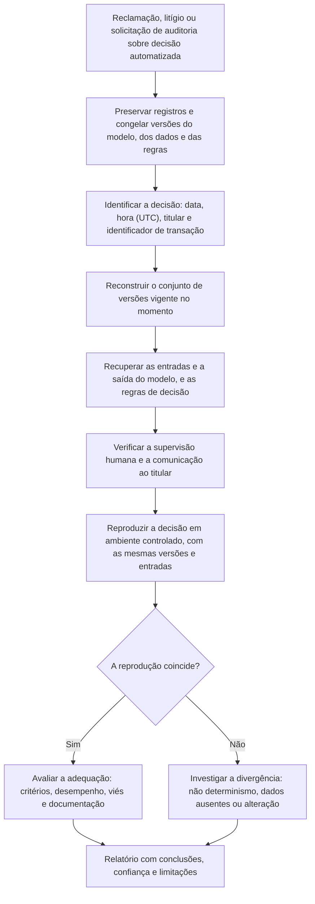

# Governança, Regulação e Auditoria de Decisões de IA

> **Objetivo pedagógico:** reconstruir e auditar decisões tomadas ou apoiadas por sistemas de IA (versão do modelo, entradas, saídas, limiares e supervisão humana), avaliar vieses e conformidade com métodos reconhecidos, entender as exigências de registro e de relato de incidentes em marcos regulatórios (LGPD, AI Act e normas de gestão de IA) e usar a documentação de governança como evidência de diligência, com os limites das técnicas de explicabilidade.

## 1. O contexto de uma auditoria de decisão

Pessoas afetadas por decisões automatizadas (crédito, emprego, seguros, saúde, benefícios e moderação de conteúdo) podem contestar, e reguladores e auditores podem exigir demonstrações. A forense de IA responde: **o que o sistema decidiu, com base em quê, sob qual versão e com qual supervisão**.

| Pergunta | Evidências |
|---|---|
| Qual sistema e qual versão tomaram a decisão? | Registros de inferência, manifestos de implantação, registro de modelos |
| Quais entradas foram usadas? | Logs de entrada, dados de cadastro e de contexto, versões de pré-processamento |
| Qual a saída e como foi usada? | Pontuação, classificação, limiar e regra de decisão |
| Houve intervenção humana? | Registros de revisão, de aprovação e de sobrescrita |
| O que o titular foi informado? | Comunicações, avisos e justificativas fornecidas |
| O sistema estava dentro das condições de uso e de validação? | Documentação do modelo, avaliações e monitoramento |
| Há viés ou tratamento desigual? | Análises de desempenho por grupo e dados históricos |

## 2. Fluxo de reconstrução de uma decisão

## 3. Reprodução de decisões

| Aspecto | Orientação |
|---|---|
| Mesmas versões | Modelo (hash), código de pré e pós-processamento, regras e configurações do momento |
| Mesmas entradas | Entradas registradas (ou reconstruídas com a justificativa), com o estado dos dados no momento da decisão |
| Não determinismo | Modelos determinísticos devem reproduzir a saída; outros exigem sementes e parâmetros registrados, ou a comparação estatística |
| Dados que mudam | Cadastros e variáveis externas mudam com o tempo: usar o instantâneo do momento da decisão, quando disponível |
| Registro da reprodução | Ambiente, comandos, sementes, resultados e hashes |
| Limites | Se as entradas ou as versões não foram preservadas, declarar que a reprodução exata não é possível |

Se a organização não registra as entradas e as saídas das decisões, a lacuna é um achado de governança: reduz a capacidade de defesa e pode violar exigências regulatórias.

## 4. Explicabilidade como apoio (e seus limites)

| Técnica | Uso | Limitações |
|---|---|---|
| Importância de variáveis globais | Entender quais variáveis influenciam o modelo em geral | Não explica uma decisão individual |
| Explicações locais (por exemplo, SHAP e LIME) | Aproximam a contribuição das variáveis em uma decisão | São aproximações; podem ser instáveis e depender de escolhas de parâmetros |
| Contrafactuais | "O que precisaria mudar para outra decisão" | Podem não ser viáveis ou realistas |
| Modelos interpretáveis | Regras, árvores e modelos lineares | Podem ter menor desempenho |
| Documentação do modelo (cartões) | Finalidade, dados, limitações e avaliações | Declaração do desenvolvedor, a ser verificada |

Em relatórios, apresente a explicação como **apoio técnico, com a metodologia e as limitações**, e não como prova de causalidade ou de intenção.

## 5. Avaliação de vieses e de justiça

| Elemento | Descrição |
|---|---|
| Definição do critério | Não existe uma única definição de justiça: escolha e justifique os critérios (por exemplo, paridade demográfica e igualdade de oportunidades ou de erros) |
| Dados por grupo | Desempenho (taxas de erro e de aprovação) por grupos relevantes, respeitando a LGPD e a legislação antidiscriminatória; o uso de dados sensíveis para auditoria exige base legal e salvaguardas |
| Proxies | Variáveis que substituem atributos protegidos (por exemplo, localização) |
| Dados históricos | Podem refletir decisões discriminatórias passadas |
| Ferramentas | Bibliotecas de avaliação de justiça (por exemplo, Fairlearn e AIF360) |
| Interpretação | Diferenças estatísticas não equivalem, por si, a discriminação ilícita; exigem análise jurídica e de contexto |
| Documentação | Metodologia, limitações, resultados por grupo e mitigações |

## 6. Marcos regulatórios e normativos (visão geral)

> **Aviso:** os textos e os cronogramas mudam. Confirme as versões vigentes com o Jurídico.

| Marco | Pontos relevantes para a evidência |
|---|---|
| LGPD (Brasil) | Princípios de transparência, não discriminação e prestação de contas (art. 6º); direito de solicitar a **revisão de decisões tomadas unicamente com base em tratamento automatizado** e de obter informações claras sobre critérios e procedimentos, respeitados os segredos comercial e industrial (art. 20); relatório de impacto (art. 38); registro das operações (art. 37); incidentes (art. 48) |
| Regulamento (UE) 2024/1689 (AI Act) | Para sistemas de alto risco: gestão de riscos, governança de dados, documentação técnica, **registro automático de eventos (logs)**, transparência, supervisão humana, exatidão e robustez; obrigações de retenção de logs pelos provedores e implantadores por, no mínimo, seis meses (conforme o texto vigente); relato de incidentes graves às autoridades; cronograma escalonado |
| Projeto de lei brasileiro sobre IA (PL nº 2338/2023) | Em tramitação: prevê avaliação de risco, direitos das pessoas afetadas e governança; acompanhe o estágio |
| ISO/IEC 42001:2023 | Sistema de gestão de IA: política, avaliação de impacto, controles do ciclo de vida, documentação e melhoria contínua; fonte de evidências de diligência |
| NIST AI RMF 1.0 | Funções Governar, Mapear, Medir e Gerenciar: orienta a documentação de riscos, de testes e de monitoramento |
| Regras setoriais | Crédito, seguros, saúde, trabalho e administração pública têm normas e fiscalizações próprias |

## 7. Registros mínimos para decisões auditáveis

| Registro | Conteúdo |
|---|---|
| Identificador da transação e do titular (ou pseudônimo) | Vincula decisão, entradas e saídas |
| Data e hora (UTC) | Linha do tempo e reprodução |
| Versão do modelo (hash), das regras e dos dados | Conjunto de versões |
| Entradas (ou referência imutável a elas) | Reprodução |
| Saída e pontuações, com limiares e regras aplicadas | Justificativa |
| Decisão final e responsável (sistema ou pessoa) | Responsabilização |
| Intervenção humana: quem, quando e o que mudou | Supervisão efetiva |
| Informações fornecidas ao titular | Transparência |
| Contestações e revisões | Atendimento de direitos (LGPD, art. 20) |
| Retenção e proteção desses registros | Minimização, segurança e prazos definidos |

Equilibre o registro com a minimização de dados pessoais: registre o necessário para a auditoria, com acesso restrito e retenção definida.

## 8. Documentação de governança como evidência de diligência

| Documento | Uso na investigação |
|---|---|
| Política e inventário de sistemas de IA | Escopo e responsabilidades |
| Avaliação de impacto e RIPD | Riscos conhecidos e medidas adotadas |
| Cartões de modelo e fichas de dados | Finalidade, desempenho e limitações declaradas |
| Relatórios de validação, de testes e de viés | Evidência de diligência técnica |
| Atas de comitês e aprovações | Quem decidiu a implantação e com quais informações |
| Planos de monitoramento e de resposta a incidentes | Prontidão |
| Treinamentos e capacitação | Competência da equipe |
| Contratos com fornecedores de modelos e de dados | Responsabilidades e auditorias |
| Registros de incidentes e de ações corretivas | Maturidade e transparência |

A ausência dessa documentação não prova irregularidade, mas dificulta a demonstração de diligência.

## 9. Incidentes de IA: relato e aprendizado

| Aspecto | Orientação |
|---|---|
| Definição | Eventos em que o sistema causa ou quase causa dano (segurança, discriminação, falhas graves ou violação de direitos) |
| Registro interno | Processo de reporte, classificação, investigação e correção |
| Relato externo | Obrigações conforme o setor e a regulação (por exemplo, incidentes graves de sistemas de alto risco na UE); incidentes com dados pessoais seguem a LGPD |
| Aprendizado | Análise de causa raiz sem atribuição de culpa individual; atualização de testes, de dados e de controles |
| Bases públicas | Estudos de casos reais (por exemplo, a AI Incident Database e o monitor de incidentes da OCDE) ajudam na prevenção |

## 10. Exemplo prático: reclamação sobre crédito negado

| Etapa | Resultado |
|---|---|
| Solicitação | Um titular solicita a revisão da negativa de crédito de 12/10, com base em decisão automatizada (LGPD, art. 20) |
| Preservação | Congelamento do registro de inferência, das versões e das regras |
| Conjunto de versões | Modelo v12 (hash registrado), regra de corte 0,62, dados de cadastro do dia 12/10 |
| Entradas e saída | Renda declarada e histórico de pagamentos; pontuação de 0,58 |
| Reprodução | A reprodução em ambiente controlado com as mesmas versões e entradas gera a mesma pontuação |
| Supervisão | Sem revisão humana, porque a pontuação estava abaixo do corte; a política previa revisão apenas para valores acima de determinada renda |
| Análise de viés | O monitoramento mostra uma taxa de negativa 9 pontos percentuais maior para um grupo; sem explicação documentada |
| Conclusão | A decisão é reproduzível e consistente com as regras; a análise de viés identifica uma disparidade sem justificativa documentada, que deve ser avaliada pelo Jurídico, pela governança de IA e pela área de negócio; o titular deve receber informações claras sobre os critérios e a possibilidade de revisão humana |

## 11. Casos de uso corporativos

- Resposta a solicitações de titulares sobre decisões automatizadas.
- Auditorias internas e externas de sistemas de IA de alto impacto.
- Preparação de evidências de diligência para reguladores, litígios e seguradoras.

## 12. Normas e frameworks relevantes

- ISO/IEC 42001:2023; ISO/IEC 23894:2023; NIST AI RMF 1.0; NIST AI 600-1
- Regulamento (UE) 2024/1689 (AI Act); PL nº 2338/2023 (em tramitação); LGPD, arts. 6º, 20, 37, 38 e 48
- ISO/IEC 27037; ISO/IEC 27042 (análise e interpretação); ISO/IEC 27001:2022
- Referências técnicas: Fairlearn e AIF360 (justiça); SHAP e LIME (explicabilidade)

## 13. Referências

- Brasil. Lei nº 13.709/2018 (LGPD), arts. 6º, 20, 37, 38 e 48.
- União Europeia. Regulamento (UE) 2024/1689.
- NIST. AI Risk Management Framework 1.0 (2023) e AI 600-1 (2024).
- Barocas, S.; Hardt, M.; Narayanan, A. Fairness and Machine Learning. 2019.
- Lundberg, S.; Lee, S.-I. A Unified Approach to Interpreting Model Predictions (SHAP). NeurIPS, 2017.
- Mitchell, M. et al. Model Cards for Model Reporting. 2019.
- Responsible AI Collaborative. AI Incident Database; OCDE. AI Incidents Monitor.
