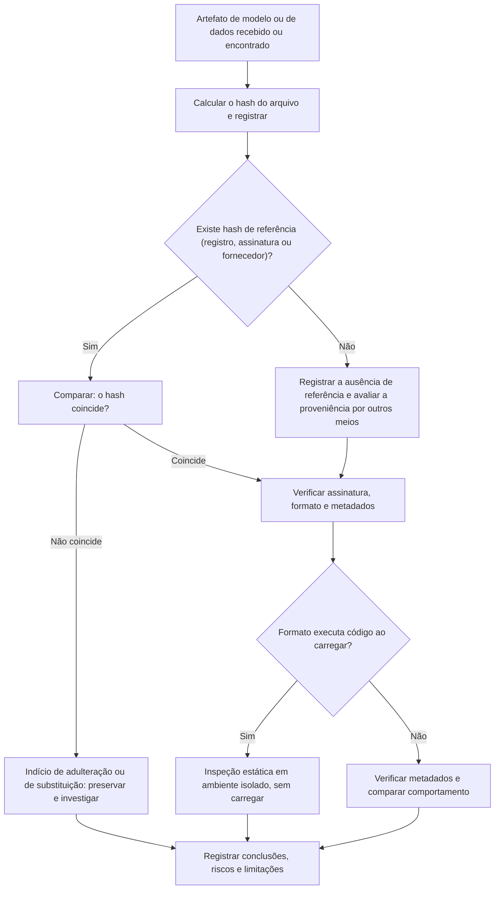

# Integridade e Proveniência de Modelos e Dados

> **Objetivo pedagógico:** verificar a integridade e a proveniência de modelos e de conjuntos de dados (formatos de arquivo, hashes, assinaturas e listas de materiais), reconhecer os riscos de formatos de serialização que executam código, inspecionar artefatos de forma segura, comparar versões e investigar indícios de adulteração e de cadeia de suprimentos comprometida.

> Este arquivo trata de **detecção e verificação**. Nunca carregue modelos de origem não confiável em ambiente de produção ou em estação de uso comum: use ambiente isolado.

## 1. Por que a integridade de modelos importa

Um modelo é um artefato executável de forma indireta: seus pesos determinam o comportamento, e alguns formatos de arquivo podem **conter código** que é executado ao carregar. Alterar um modelo, trocá-lo no registro ou distribuir uma versão adulterada pode causar decisões erradas, vazamentos ou execução de código malicioso, sem que o sistema "pareça" comprometido.

| Risco | Descrição |
|---|---|
| Execução de código ao carregar | Formatos baseados em serialização de objetos podem executar código arbitrário durante a desserialização |
| Adulteração dos pesos | Substituição por versão com comportamento alterado (portas dos fundos) |
| Cadeia de suprimentos | Modelos, conjuntos de dados e bibliotecas obtidos de repositórios públicos, com nomes enganosos ou conteúdo malicioso |
| Substituição silenciosa | Troca do artefato no armazenamento sem passar pelo registro |
| Dados de treinamento adulterados | Envenenamento que altera o comportamento aprendido |
| Metadados falsos | Cartões de modelo e documentação que não correspondem ao artefato |

## 2. Formatos de artefatos de modelo e riscos

| Formato (exemplos de extensões) | Característica | Risco forense |
|---|---|---|
| Serialização de objetos Python (`.pkl`, `.pickle`, `.joblib`; muitos `.pt` e `.pth` e `.ckpt`) | Armazena objetos; a desserialização pode **executar código** | Alto: tratar como potencialmente executável |
| Formatos de dados de tensores (`.safetensors`) | Armazena apenas tensores e metadados, sem execução de código por design | Baixo risco de execução; ainda é possível adulterar os pesos |
| `.h5`, `.keras` e SavedModel (TensorFlow) | Estruturas com possibilidade de camadas personalizadas e funções | Médio: verificar camadas personalizadas e pontos de execução |
| ONNX | Grafo computacional com operadores | Menor risco de execução; verificar operadores personalizados e dados externos |
| GGUF e formatos de modelos quantizados | Pesos e metadados para inferência local | Verificar a origem e os metadados; o formato em si não executa código arbitrário por design |
| Contêineres e pacotes (`.tar`, `.zip`, imagens) | Agrupam artefatos e scripts | Inspecionar o conteúdo e os scripts de instalação |

Princípio: ao receber um artefato, **identifique o formato real** (pelo conteúdo, e não pela extensão) e trate formatos baseados em serialização de objetos como código.

## 3. Verificação de integridade



```bash
# Hash do artefato e comparação com o registro (hash de referência registrado em manifesto)
sha256sum modelo_v18.safetensors
sha256sum -c manifesto_modelos.sha256

# Identificar o formato real do arquivo
file modelo.bin
```

## 4. Inspeção segura de arquivos baseados em serialização de objetos

**Não carregue** o arquivo com as bibliotecas de ML para "ver o que tem". Use análise estática.

```bash
# Desmontagem do fluxo de serialização do Python, sem executá-lo (biblioteca padrão)
python3 -m pickletools modelo.pkl | head -n 200

# Varredura de artefatos em busca de importações e chamadas perigosas (ferramentas de código aberto)
picklescan --path ./artefatos_recebidos
modelscan -p ./artefatos_recebidos
```

| Indício (em desmontagem ou varredura) | Interpretação |
|---|---|
| Importações de módulos de sistema, de rede ou de execução de processos | Potencial execução de código |
| Chamadas a funções de `eval`, de `exec` ou de criação de subprocessos | Alto risco |
| Importação de módulos não relacionados a ML | Anômalo |
| Estruturas com objetos de classes inesperadas | Verificar |

Observações: ferramentas de varredura têm limitações (podem ser contornadas, e a ausência de achados não prova segurança); em versões recentes de bibliotecas de ML, o carregamento seguro de pesos (somente tensores) é o padrão ou uma opção; ainda assim, prefira formatos que não executam código, e analise em ambiente isolado, sem credenciais e sem acesso à rede.

## 5. Metadados de tensores seguros

```python
# Ler apenas os metadados de um arquivo safetensors, sem carregar os pesos
from safetensors import safe_open

with safe_open("modelo_v18.safetensors", framework="pt") as f:
    print(f.metadata())          # metadados do cabeçalho
    for nome in list(f.keys())[:10]:
        print(nome)              # primeiros nomes de tensores
```

Compare os nomes, as formas (shapes) e os tipos dos tensores com os da versão de referência: diferenças inesperadas indicam alteração da arquitetura ou do conteúdo.

## 6. Proveniência e assinatura

| Mecanismo | Uso |
|---|---|
| Hash em manifesto no registro de modelos | Verificação contínua da integridade |
| Assinatura digital de artefatos (por exemplo, com GPG ou com ferramentas de assinatura de software e de modelos, como as de projetos Sigstore e OpenSSF) | Prova de origem e de integridade |
| Cartões de modelo e fichas de conjuntos de dados | Documentam finalidade, dados, limitações e avaliações; devem ser conferidos contra o artefato |
| Lista de materiais de IA (por exemplo, CycloneDX ML-BOM e o perfil de IA do SPDX 3.0) | Inventário de modelos, dados e dependências |
| Registros de linhagem de dados (por exemplo, DVC) | Versões e hashes de conjuntos de dados por execução |
| Registros de execução vinculados ao commit, ao ambiente e aos dados | Reprodutibilidade e responsabilização |

```bash
# Assinatura destacada e verificação (GPG) de um manifesto de hashes de modelos
gpg --armor --detach-sign manifesto_modelos.sha256
gpg --verify manifesto_modelos.sha256.asc manifesto_modelos.sha256
```

## 7. Comparação entre versões de modelos

| Técnica | Descrição | Limitação |
|---|---|---|
| Comparação de hashes | Detecta qualquer diferença binária | Não diz o que mudou nem se a mudança é maliciosa |
| Comparação estrutural (nomes, formas e tipos de tensores) | Identifica alterações de arquitetura | Não detecta mudanças sutis nos valores |
| Diferenças de pesos (normas por camada) | Mostra camadas alteradas e a magnitude | Retreinamento legítimo também altera os pesos |
| Testes comportamentais (conjunto fixo de entradas e comparação das saídas) | Detecta mudanças de comportamento | Exige conjuntos de teste relevantes; portas dos fundos só se ativam com gatilhos específicos |
| Avaliação de métricas e de desempenho por subgrupos | Revela degradações ou vieses | Não prova adulteração |
| Análise de gatilhos e de comportamento anômalo (investigação especializada) | Procura ativações incomuns | Complexa; inconclusiva em muitos casos |

Em um caso de suspeita de adulteração, o resultado típico é um **conjunto de indícios**: substituição do arquivo fora do processo, divergência de hash, alteração de acesso ao armazenamento e comportamento diferente em testes. Declare o grau de confiança e não afirme a existência de uma porta dos fundos sem evidências específicas.

```python
# Diferenças entre duas versões de pesos em formato seguro (norma da diferença por tensor)
from safetensors.torch import load_file

a = load_file("modelo_v17.safetensors")
b = load_file("modelo_v18.safetensors")
for nome in sorted(set(a) | set(b)):
    if nome not in a or nome not in b:
        print("Tensor presente em apenas uma versão:", nome)
        continue
    if a[nome].shape != b[nome].shape:
        print("Forma diferente:", nome, a[nome].shape, b[nome].shape)
        continue
    diff = (a[nome].float() - b[nome].float()).norm().item()
    print(f"{nome}: norma da diferença = {diff:.6f}")
```

## 8. Proveniência e qualidade dos dados

| Verificação | Descrição |
|---|---|
| Origem e licença | De onde vieram os dados; há direitos, consentimento ou base legal? |
| Versões e hashes | Qual versão foi usada em cada treinamento; os hashes conferem? |
| Alterações não autorizadas | Histórico de acesso e de modificação do armazenamento |
| Rótulos e anotações | Alterações suspeitas, concentração de rótulos incomuns e rotuladores com padrões anômalos |
| Duplicatas e contaminação | Itens do conjunto de teste presentes no treinamento; dados de produção usados sem controle |
| Dados pessoais e sensíveis | Presença não prevista; necessidade de anonimização ou de exclusão (LGPD) |
| Envenenamento | Amostras inseridas com padrões repetidos (gatilhos) ou de fontes não confiáveis; mudanças bruscas de distribuição |
| Ciclos de feedback | Dados gerados pelo próprio sistema ou por usuários realimentando o treinamento |

```bash
# Detecção simples de duplicatas exatas e de mudança de volume em um conjunto de dados CSV (exploração inicial)
sort dados_treino.csv | uniq -d | head
wc -l dados_treino_v6.csv dados_treino_v7.csv
sha256sum dados_treino_v6.csv dados_treino_v7.csv
```

## 9. Cadeia de suprimentos de IA

| Elemento | Verificações |
|---|---|
| Modelos de repositórios públicos | Publicador, histórico, assinaturas, formato, varredura de segurança e testes em ambiente isolado |
| Conjuntos de dados públicos | Licença, origem, integridade e dados pessoais |
| Bibliotecas e pacotes de ML | Nomes enganosos (typosquatting), versões novas e scripts de instalação (pasta 15) |
| Imagens de contêiner de ML | Origem, digest e varredura |
| Serviços de terceiros (APIs de modelos) | Contratos, retenção de dados, registros e responsabilidade |
| Plugins e ferramentas conectadas | Permissões e origem (pasta 26) |

## 10. Exemplo prático: substituição de um modelo no armazenamento

| Passo | Resultado |
|---|---|
| Alerta | O desempenho do modelo em produção caiu para um subgrupo, e a auditoria do registro mostra a promoção da v18 fora da janela |
| Hash | O hash do arquivo no armazenamento difere do registrado no manifesto da execução de treinamento |
| Logs | O armazenamento registra uma escrita no objeto às 22:38 UTC por uma chave de acesso de um usuário que não pertence ao time de ML |
| Formato | O arquivo é `safetensors`; metadados sem alterações aparentes; dois tensores têm normas de diferença muito altas em relação à v17 |
| Comportamento | Testes com um conjunto fixo mostram saídas diferentes em 6% das entradas, concentradas em um subgrupo |
| Conclusão | Substituição do artefato após o treinamento e antes da promoção; confiança alta sobre a substituição; propósito indeterminado; incidente de segurança aberto, com preservação, contenção da chave e restauração da v17 |

## 11. Casos de uso corporativos

- Verificação de modelos e de dados de terceiros antes do uso em produção.
- Investigação de substituição ou de adulteração de artefatos de ML.
- Implantação de assinatura, de manifestos e de listas de materiais de IA.

## 12. Normas e frameworks relevantes

- MITRE ATLAS (comprometimento da cadeia de suprimentos de ML; criação de porta dos fundos em modelos; envenenamento de dados)
- NIST AI 100-2; NIST AI RMF 1.0; NIST SP 800-161 Rev. 1 (cadeia de suprimentos)
- CycloneDX (ML-BOM); SPDX 3.0 (perfil de IA); OWASP Top 10 para LLM (cadeia de suprimentos e envenenamento)
- ISO/IEC 27037; ISO/IEC 42001:2023; CIS Controls v8.1, controle 16
- LGPD, arts. 6º e 46

## 13. Referências

- MITRE ATLAS. Técnicas AML.T0010 (comprometimento da cadeia de suprimentos de ML), AML.T0018 (porta dos fundos em modelo) e AML.T0020 (envenenamento de dados de treinamento), conforme a versão vigente.
- Vassilev, A. et al. NIST AI 100-2 (edição vigente).
- Documentação do `pickletools` (biblioteca padrão do Python), do picklescan, do ModelScan, do safetensors e do DVC.
- OWASP CycloneDX. Machine Learning Bill of Materials.
- Mitchell, M. et al. Model Cards for Model Reporting. 2019; Gebru, T. et al. Datasheets for Datasets. 2018.
