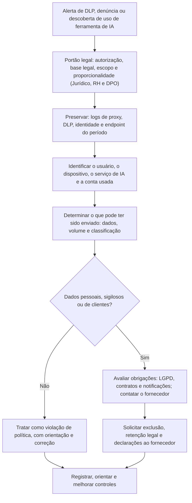

# Uso Não Autorizado de IA, Vazamento de Dados e Shadow AI

> **Objetivo pedagógico:** investigar o uso não autorizado de ferramentas de IA por colaboradores (shadow AI) e o vazamento de dados por esse canal, identificando as fontes de evidência corporativas e de endpoint, os limites do que é recuperável junto aos fornecedores, as obrigações legais e contratuais e a proporcionalidade necessária, bem como tratar documentos e conteúdos suspeitos de terem sido gerados por IA com cautela.

> **Aviso:** a investigação envolve conduta de pessoas e dados pessoais. Envolva o Jurídico, o RH e o DPO desde o início e siga o playbook PB-14 (portões legais e proporcionalidade).

## 1. O problema

Ferramentas de IA generativa de uso público e aplicativos incorporados em navegadores e em editores tornaram simples **colar dados corporativos em serviços de terceiros**: código-fonte, contratos, dados de clientes e planos estratégicos. Os riscos são:

| Risco | Descrição |
|---|---|
| Vazamento de dados confidenciais e pessoais | Dados saem do controle da organização e podem ser retidos pelo fornecedor |
| Uso em treinamento | Dependendo do serviço e da configuração, as entradas podem ser usadas para melhorar modelos |
| Violação de contratos e de sigilo | Cláusulas de confidencialidade de clientes e de parceiros |
| Violação da LGPD | Compartilhamento de dados pessoais sem base legal, sem contrato de operador ou sem transferência internacional adequada |
| Propriedade intelectual | Divulgação de segredos industriais e de código proprietário |
| Resultados não confiáveis | Decisões com base em saídas incorretas (alucinações) |
| Contas pessoais para fins corporativos | Falta de visibilidade, de retenção e de controle |

## 2. Fontes de evidência

| Fonte | O que mostra | Limitações |
|---|---|---|
| Proxy, CASB e filtros de DNS | Acessos a domínios de serviços de IA, volumes de upload, horários e usuários | Tráfego criptografado: metadados, e não conteúdo; uso fora da rede corporativa |
| DLP (rede, endpoint e nuvem) | Detecção de dados sensíveis em uploads e em colagens | Cobertura e regras variáveis; falsos positivos |
| EDR e telemetria de endpoint | Processos, extensões de navegador e aplicativos de IA instalados; conexões | Conteúdo geralmente indisponível |
| Histórico e cache de navegadores e arquivos do aplicativo | Páginas visitadas, conversas em cache, arquivos enviados e baixados | Perfis pessoais e modo privado; limpeza do histórico |
| Registros dos serviços corporativos de IA (inclusive Copilot e assistentes empresariais) | Interações auditáveis, usuários, recursos acessados e, conforme o caso, conteúdo (pasta 19) | Depende do licenciamento, da configuração e da retenção |
| Registros do provedor de identidade | Entradas em serviços por SSO, consentimentos de aplicativos de IA (pasta 18) | Contas pessoais não aparecem |
| Auditoria de arquivos e de e-mail | Acesso e envio dos documentos envolvidos | Não mostra o destino na IA |
| Dispositivos móveis e BYOD | Aplicativos de IA e uso fora do controle | Acesso restrito por privacidade (pasta 14) |
| Contratos e termos do fornecedor | Retenção, uso para treinamento e canais de exclusão | Mudam com o tempo |
| Registros do fornecedor (por solicitação) | Histórico de conversas, retenção e exclusão | Dependem de contrato, processo legal e política do fornecedor |

## 3. O que é recuperável (e o que não é)

| Pergunta | Resposta provável |
|---|---|
| Que dados foram colados e enviados? | Raramente é possível saber o conteúdo exato sem registros do serviço ou do endpoint; podem existir o histórico de conversas da conta, o cache do navegador e registros de DLP |
| O fornecedor retém os dados? | Depende do serviço, do plano e das configurações; contas empresariais costumam oferecer controles de retenção e de não uso para treinamento, e contas pessoais podem ter condições distintas; consulte os termos vigentes |
| Os dados foram usados para treinar modelos? | Depende dos termos e das configurações de privacidade; dificilmente verificável tecnicamente; solicite declarações e opções de exclusão ao fornecedor |
| É possível remover os dados do fornecedor? | Em geral, por solicitação de exclusão e por controles do titular da conta; a eficácia e o prazo variam; documentar o pedido |
| É possível identificar a conta usada? | Por SSO e por registros corporativos, sim; contas pessoais exigem evidências do endpoint e colaboração do usuário (com base legal) |

Princípio: **declare as limitações**. A ausência de evidência do conteúdo não significa ausência de vazamento; trate o pior caso plausível para decisões de risco.

## 4. Fluxo de investigação



**Passos**

1. **Portão legal:** autorização formal do Jurídico, do RH e do DPO; escopo definido (pessoa, período e sistemas); evitar acessar conteúdo pessoal do colaborador.
2. Preservar os logs relevantes (proxy, DLP, identidade e endpoint), e aplicar retenção legal, quando justificado.
3. Identificar o serviço de IA, a conta (corporativa ou pessoal), o dispositivo e os horários.
4. Determinar quais dados podem ter sido enviados (classificação, quantidade e titulares).
5. Verificar se há registros do serviço (contas empresariais) ou do endpoint que mostrem o conteúdo.
6. Avaliar a necessidade de contatar o fornecedor (exclusão, retenção e declarações) e as obrigações contratuais e legais.
7. Avaliar as notificações (ANPD, titulares e clientes) com o Jurídico e o DPO.
8. Tratar a conduta do colaborador com proporcionalidade: muitos casos decorrem de falta de orientação, e não de má-fé.
9. Documentar fatos, limitações e recomendações.

## 5. Análise de endpoint e de rede (exemplos)

```kusto
// Proxy normalizado em "ProxyLogs" (colunas: TimeGenerated, Usuario, Url, BytesEnviados, Categoria)
// Uploads relevantes para domínios de serviços de IA (lista de domínios mantida pela organização)
let dominiosIA = dynamic(["exemplo-ia-publica.com", "outra-ferramenta-ia.com"]);
ProxyLogs
| where TimeGenerated > ago(30d)
| extend Dominio = tostring(parse_url(Url).Host)
| where Dominio in (dominiosIA)
| summarize Acessos = count(), BytesEnviados = sum(BytesEnviados) by Usuario, Dominio, bin(TimeGenerated, 1d)
| order by BytesEnviados desc
```

```bash
# Extensões instaladas em um perfil de navegador (exemplo para o Chrome em Linux; ajuste o caminho e use cópia do perfil)
ls -la ~/.config/google-chrome/Default/Extensions/ | head
# Procurar por palavras-chave de serviços de IA no histórico exportado (use somente cópia e com autorização)
grep -i -E "chat|assistente|ia" historico_exportado.csv | head
```

Respeite a minimização: não examine conteúdo pessoal do colaborador além do estritamente necessário e autorizado.

## 6. Controles e política

| Controle | Descrição |
|---|---|
| Política de uso aceitável de IA | Define ferramentas aprovadas, tipos de dados permitidos e proibidos, e responsabilidades |
| Ferramentas corporativas aprovadas | Contas empresariais com controles de privacidade, de retenção e de auditoria |
| Classificação de dados e treinamento | Usuários sabem o que não pode ser colado em ferramentas externas |
| DLP e CASB | Detecção e bloqueio de dados sensíveis em serviços de IA |
| Controle de extensões e de aplicativos | Lista permitida para navegadores e dispositivos |
| Contratos com fornecedores de IA | Cláusulas de confidencialidade, de retenção, de não uso para treinamento, de localização dos dados e de auditoria |
| Registro e auditoria | Retenção dos logs corporativos de IA |
| Processo de exceções | Solicitação e aprovação para novos usos |
| Canal de reporte sem punição desproporcional | Incentiva a comunicação de incidentes |
| Avaliação de impacto (RIPD) | Para usos de IA que tratam dados pessoais (LGPD, art. 38) |

## 7. Aspectos legais e trabalhistas

> **Aviso:** orientações gerais; consulte o Jurídico.

| Tema | Orientação |
|---|---|
| LGPD | Compartilhar dados pessoais com um fornecedor de IA é tratamento, que exige base legal, finalidade, necessidade, contrato com o operador e salvaguardas; avaliar a transferência internacional (arts. 33 a 36) e as notificações em caso de incidente (art. 48) |
| Sigilo e contratos | Verificar obrigações de confidencialidade com clientes e parceiros |
| Monitoramento de colaboradores | Exige política comunicada, finalidade legítima e proporcionalidade; evitar acesso a comunicações privadas |
| Medidas disciplinares | Conduzir com o RH e o Jurídico, com base em evidências e na gravidade; considerar falta de orientação e de ferramentas alternativas |
| Evidências para o litígio | Preservar com cadeia de custódia, hash e minimização |
| Fornecedores | Solicitações de exclusão e de preservação devem ser documentadas; avaliar o foro e a lei aplicáveis |

## 8. Documentos e conteúdos suspeitos de geração por IA

| Aspecto | Orientação |
|---|---|
| Detecção automática de texto gerado por IA | Detectores são **pouco confiáveis** (falsos positivos e negativos) e não devem ser prova isolada |
| Evidências mais sólidas | Metadados do documento, histórico de versões, sistemas de origem, registros de criação e de edição, e provas de autoria (arquivos de rascunho e comunicações) |
| Indícios de fabricação | Inconsistências factuais, referências inexistentes e datas incoerentes; verificar fatos de forma independente |
| Proveniência de conteúdo | Credenciais de conteúdo (C2PA), quando presentes; a ausência não prova nada |
| Cautela | Não acusar uma pessoa de uso de IA com base no estilo do texto; conclusões sobre autoria exigem evidências técnicas e de contexto |

A análise de imagens, áudio e vídeo sintéticos é tratada na pasta 27.

## 9. Exemplo prático: dados de clientes em ferramenta pública de IA

| Etapa | Resultado |
|---|---|
| Alerta | O DLP detecta o envio de um arquivo com CPFs a um domínio de ferramenta de IA pública, por um analista de atendimento |
| Portão legal | Jurídico, RH e DPO autorizam a apuração, restrita aos registros corporativos |
| Evidências | O proxy mostra 3 envios em 2 dias, 1,2 MB cada; o DLP classificou o conteúdo como dados pessoais; a conta usada era pessoal |
| Conteúdo | Sem registro do conteúdo exato; o colaborador informa que colou planilhas para "resumir reclamações", com cerca de 400 registros |
| Fornecedor | Solicitação de exclusão e declaração sobre retenção e uso para treinamento, com protocolo registrado |
| Avaliação | Dados pessoais de aproximadamente 400 titulares enviados a terceiro sem base e sem contrato; DPO avalia o risco e a notificação |
| Medidas | Orientação e treinamento do colaborador; bloqueio de domínios de IA não aprovados; liberação de ferramenta corporativa com controles; ajuste do DLP |
| Conclusão | Violação de política e incidente de proteção de dados com baixo risco estimado, documentados; limitações declaradas (conteúdo exato e retenção não verificáveis) |

## 10. Casos de uso corporativos

- Investigação de vazamentos por ferramentas de IA e resposta proporcional.
- Definição de política, de controles técnicos e de contratos para o uso de IA.
- Avaliação de impacto e de risco de ferramentas de IA adotadas pelas áreas.

## 11. Normas e frameworks relevantes

- NIST AI RMF 1.0 e NIST AI 600-1; ISO/IEC 42001:2023 (política e controles operacionais); ISO/IEC 27002:2022, controles 5.10, 5.12 e 8.12 (prevenção de vazamento de dados)
- OWASP Top 10 para LLM (divulgação de informações sensíveis)
- CIS Controls v8.1, controles 3 e 13
- LGPD, arts. 6º, 7º, 33 a 36, 38, 46 e 48

## 12. Referências

- NIST. AI Risk Management Framework: Generative AI Profile (NIST AI 600-1). 2024.
- ISO/IEC 42001:2023; ISO/IEC 27002:2022.
- ANPD. Guias e orientações sobre tratamento de dados pessoais e sobre incidentes de segurança.
- Documentação de DLP, CASB e de serviços corporativos de IA dos fornecedores (retenção e privacidade).
- Pastas 11, 14, 18, 19 e 23 deste repositório.
