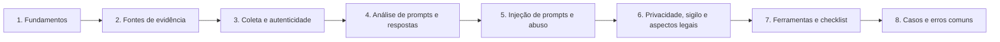

# 25 Forense de Prompts

## Objetivo

Investigar prompts e interações com modelos de linguagem como evidência: identificar as fontes de registro (provedores, nuvem, aplicações, observabilidade e endpoints), coletar e preservar conversas, contextos e respostas com integridade e autenticidade, reconstruir a interação (instruções vigentes, histórico, contexto recuperado e ferramentas), analisar e classificar o conteúdo, reconhecer indícios de injeção de prompts e de abuso, e tratar com rigor a privacidade, o sigilo e os limites legais, com autoria e intenção avaliadas com cautela e limitações declaradas.

## Trilha de estudo recomendada

## Conteúdo da pasta

| Ordem | Arquivo | Objetivo |
|---|---|---|
| 1 | [fundamentos-de-prompts-e-interacoes-com-llm-como-evidencia.md](fundamentos-de-prompts-e-interacoes-com-llm-como-evidencia.md) | Anatomia da interação, valor e limites probatórios |
| 2 | [fontes-de-evidencia-logs-de-provedores-aplicacoes-e-clientes.md](fontes-de-evidencia-logs-de-provedores-aplicacoes-e-clientes.md) | Fontes, retenções, observabilidade e projeto do registro |
| 3 | [coleta-preservacao-e-autenticidade-de-conversas-e-prompts.md](coleta-preservacao-e-autenticidade-de-conversas-e-prompts.md) | Coleta, estrutura de conversas, tempo, autenticidade e conteúdo sensível |
| 4 | [analise-de-prompts-contexto-e-respostas.md](analise-de-prompts-contexto-e-respostas.md) | Reconstrução, classificação, detecção de dados, correlação e autoria |
| 5 | [injecao-de-prompts-e-abuso-indicadores-forenses.md](injecao-de-prompts-e-abuso-indicadores-forenses.md) | Indicadores, fontes do conteúdo injetado e procedimento de investigação |
| 6 | [privacidade-sigilo-e-aspectos-legais-de-prompts.md](privacidade-sigilo-e-aspectos-legais-de-prompts.md) | LGPD, monitoramento, privilégio, retenção, fornecedores e admissibilidade |
| 7 | [ferramentas-fluxo-modelos-e-checklist-de-forense-de-prompts.md](ferramentas-fluxo-modelos-e-checklist-de-forense-de-prompts.md) | Ferramentas, especificação de registro, modelos e checklist |
| 8 | [casos-de-uso-e-erros-comuns-em-forense-de-prompts.md](casos-de-uso-e-erros-comuns-em-forense-de-prompts.md) | Sete cenários, erros comuns e exercícios |

## Princípios

- Preservar o registro original e o contexto completo; a reexecução de um prompt não substitui a evidência
- Registro prova que uma entrada foi enviada e uma saída foi gerada, e não a veracidade, a autoria ou a intenção
- Começar por metadados e por controles de rede; acessar o conteúdo apenas com autorização, base legal e proporcionalidade
- Nunca acessar contas pessoais sem consentimento ou ordem; preferir registros corporativos
- Corroborar a autoria por fontes independentes; não usar estilometria nem detectores de texto de IA como prova
- Preservar a fonte do conteúdo injetado (documento, e-mail ou página) e reconstruir como entrou no contexto
- Interromper e escalar ao Jurídico diante de conteúdo ilícito ou privilegiado; não copiar nem distribuir
- Registrar interações em camadas, com proteção e retenção definidas, para equilibrar segurança e privacidade

## Relação com outras pastas

- 02, 04 e 05: custódia, hash e normalização de tempo
- 06 e 22: valor probatório, perícia e relatórios
- 11, 13 e 20: logs, proxy, DLP e caça a ameaças
- 12 e 19: e-mail, Microsoft 365, Copilot e eDiscovery
- 17 e 18: registros de invocação de modelos em nuvem
- 21: preservação de conteúdo público (WARC e ata notarial)
- 23: playbooks PB-14, PB-42, PB-44, PB-45 e PB-46
- 24: forense de IA (modelos, dados e auditoria de decisões)
- 26: incidentes com LLM e agentes
- 27: deepfakes e mídias sintéticas

## Referências

- OWASP. Top 10 for LLM Applications (edição vigente); MITRE. ATLAS
- NIST AI 600-1 (2024); NIST AI 100-2 (edição vigente); NIST AI RMF 1.0
- Greshake, K. et al. Indirect Prompt Injection (2023)
- ISO/IEC 27037; ISO/IEC 27042; ISO/IEC 42001:2023; ISO/IEC 27701
- OpenTelemetry (convenções para IA generativa); documentação do Langfuse, do LangSmith e do Presidio
- Brasil. LGPD (Lei nº 13.709/2018); Marco Civil da Internet (Lei nº 12.965/2014); ECA (Lei nº 8.069/1990); Lei nº 8.906/1994
- CPP, arts. 158-A a 158-F; CPC, art. 384
- Termos e políticas de retenção dos fornecedores de IA (versões vigentes)
