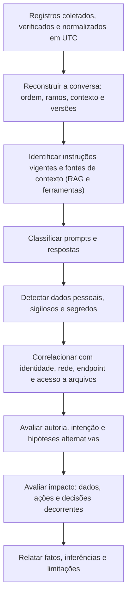

# Análise de Prompts, Contexto e Respostas

> **Objetivo pedagógico:** analisar interações com modelos de linguagem de forma metódica: reconstruir a conversa e o contexto, classificar entradas e saídas, detectar dados pessoais, sigilosos e segredos, correlacionar com outras fontes (proxy, endpoint, acesso a arquivos e identidade), avaliar autoria e intenção com cautela, medir volumes e padrões temporais, e distinguir o que o registro prova do que apenas sugere.

## 1. Fluxo de análise



## 2. Reconstrução da interação

| Passo | Descrição |
|---|---|
| 1. Linha do tempo | Ordenar as mensagens por horário (UTC), inclusive edições e regenerações |
| 2. Papéis | Identificar o que veio do usuário, do sistema, do contexto recuperado, das ferramentas e do modelo |
| 3. Instruções vigentes | Determinar a versão do prompt do sistema e das configurações na data (repositório versionado) |
| 4. Contexto recuperado | Listar os documentos e trechos inseridos, com identificadores e proveniência |
| 5. Parâmetros | Modelo, versão, temperatura, limites e ferramentas disponíveis |
| 6. Ações decorrentes | Chamadas de ferramentas e seus efeitos em outros sistemas |
| 7. Ramo utilizado | Identificar qual resposta foi efetivamente usada |
| 8. Lacunas | Mensagens removidas, logs ausentes e retenção expirada |

## 3. Classificação de prompts e respostas

| Categoria | Exemplos | Observação |
|---|---|---|
| Uso legítimo de trabalho | Resumos, redação e perguntas técnicas, sem dados sensíveis | Linha de base |
| Inclusão de dados pessoais | Nomes, CPFs, endereços, saúde e dados de clientes | Pode exigir avaliação de incidente (LGPD) |
| Inclusão de dados sigilosos ou confidenciais | Contratos, código proprietário, estratégias e dados financeiros | Avaliar classificação e obrigações contratuais |
| Segredos e credenciais | Chaves de API, senhas e tokens | Tratar como comprometidos |
| Tentativas de contornar regras | Pedidos para ignorar instruções ou obter conteúdo proibido | Ver arquivo 5 |
| Tentativas de extrair instruções internas ou dados de outros usuários | Pedidos para revelar o prompt do sistema ou documentos restritos | Ver arquivo 5 |
| Conteúdo de assédio, fraude ou ilícito | Pedidos para gerar mensagens enganosas ou conteúdo ofensivo | Conduta; escalar com RH e Jurídico |
| Saída com alucinação ou informação incorreta | Respostas falsas apresentadas como certas | Relevante em responsabilidade por saída |
| Saída com dados sensíveis | O modelo revelou dados de contexto indevidamente | Falha de controle de acesso ou de filtragem |

## 4. Detecção de dados pessoais, sigilosos e segredos

| Técnica | Ferramentas e abordagem | Limitações |
|---|---|---|
| Expressões regulares e validação | Padrões de identificadores (por exemplo, CPF e CNPJ, com verificação dos dígitos), e-mails, telefones e cartões | Falsos positivos; formatos variados |
| Reconhecimento de entidades | Bibliotecas como o Microsoft Presidio, com reconhecedores personalizados para identificadores brasileiros | Exige configuração; cobertura de idioma |
| Detecção de segredos | Ferramentas como Gitleaks e TruffleHog aplicadas a arquivos de logs e de exportações | Alguns formatos exigem regras próprias |
| Impressões digitais de documentos classificados (DLP) | Comparação com documentos controlados | Requer o sistema de DLP e a base de referência |
| Similaridade com documentos internos | Hashes de similaridade (ssdeep) e comparação de trechos | Alterações do texto reduzem a correspondência |

```python
# Validação de CPF (dígitos verificadores) para reduzir falsos positivos em buscas por padrão
import re

def cpf_valido(texto: str) -> bool:
    n = re.sub(r"\D", "", texto)
    if len(n) != 11 or n == n[0] * 11:
        return False
    def dv(base: str) -> int:
        soma = sum(int(d) * p for d, p in zip(base, range(len(base) + 1, 1, -1)))
        r = (soma * 10) % 11
        return 0 if r == 10 else r
    return dv(n[:9]) == int(n[9]) and dv(n[:10]) == int(n[10])

padrao = re.compile(r"\b\d{3}\.?\d{3}\.?\d{3}-?\d{2}\b")
with open("prompts_exportados.txt", encoding="utf-8") as f:
    for i, linha in enumerate(f, 1):
        for m in padrao.findall(linha):
            if cpf_valido(m):
                print(f"linha {i}: CPF válido detectado")   # não imprima o valor completo em relatórios
```

```bash
# Busca de segredos em uma pasta de exportações (use cópia de trabalho e proteja os resultados, que contêm segredos)
gitleaks detect --no-git --source ./exportacoes_ia_trabalho --report-path segredos_encontrados.json
trufflehog filesystem ./exportacoes_ia_trabalho
```

Resultados de detecção contêm dados sensíveis: **proteja-os** com o mesmo rigor das evidências e use-os para quantificar, e não para reproduzir o conteúdo em relatórios.

## 5. Análise quantitativa e temporal

```sql
-- DuckDB: volume de prompts e de tokens por usuário e por dia, a partir de um arquivo JSON Lines de registros (ajuste os nomes das colunas)
SELECT usuario,
       CAST(date_trunc('day', CAST(horario_utc AS TIMESTAMP)) AS DATE) AS dia,
       count(*) AS interacoes,
       sum(tokens_entrada) AS tokens_entrada,
       sum(tokens_saida) AS tokens_saida
FROM read_json_auto('registros_interacoes.jsonl')
GROUP BY usuario, dia
ORDER BY tokens_entrada DESC
LIMIT 50;
```

| Análise | Utilidade |
|---|---|
| Volume por usuário, por conta e por chave | Uso fora do padrão; abuso e fraude |
| Distribuição horária | Atividade fora do expediente ou automatizada |
| Tamanho dos prompts | Colagem de documentos grandes |
| Primeiras ocorrências | Novas contas, novos modelos e novos domínios |
| Sequência de interações | Padrões de coleta sistemática ou de tentativa e erro |
| Taxa de bloqueios e de filtros | Tentativas de contornar regras |

## 6. Correlação com outras fontes

| Pergunta | Fontes de correlação |
|---|---|
| O conteúdo do prompt veio de um arquivo que o usuário acessou? | Auditoria de arquivos (pasta 19), MFT e USN (pasta 07), DLP |
| O usuário copiou o texto de um documento classificado? | Correspondência de trechos e de hashes de similaridade |
| Quem estava na sessão? | Identidade, IP, dispositivo e horários de entrada |
| A interação ocorreu na rede corporativa? | Proxy, DNS e VPN |
| O que foi feito com a saída? | E-mails enviados, documentos criados, código executado, commits e tickets |
| Houve custos ou uso inusitado? | Faturamento e métricas do provedor |
| O aplicativo ou a extensão tem acesso a conteúdo? | Permissões, consentimentos (pasta 18) e inventário |

## 7. Autoria e intenção: limites da inferência

| Aspecto | Orientação |
|---|---|
| Conta não é pessoa | Contas compartilhadas, credenciais comprometidas e sessões abertas impedem concluir autoria apenas pela conta |
| Corroboração de autoria | Dispositivo, rede, horário, biometria de acesso físico, câmeras e outras evidências independentes |
| Estilometria (análise do estilo de escrita) | Pouco confiável para atribuição individual em textos curtos, e sujeita a vieses; não usar como prova isolada |
| Texto gerado por IA | A saída do modelo não revela, por si, quem a solicitou; o estilo "de IA" não prova autoria |
| Detectores de texto gerado por IA | Pouco confiáveis; não usar como evidência |
| Intenção | Prompts ambíguos têm explicações legítimas (testes, curiosidade e pesquisa); descreva os fatos e evite concluir sobre dolo |
| Contexto | Considerar a função do usuário, a política vigente e as ferramentas disponibilizadas |
| Hipóteses alternativas | Usuário legítimo, credencial comprometida, automação, teste e erro |

## 8. Análise da saída do modelo

| Pergunta | Procedimento |
|---|---|
| A saída contém dados sensíveis? | Detectar como nas entradas; identificar a origem (contexto recuperado ou memorização) |
| A saída é factual? | Verificar de forma independente; classificar como correta, incorreta ou não verificável |
| A saída gerou dano ou foi usada em decisão? | Rastrear as ações e os destinatários |
| A saída decorreu de instruções indevidas? | Avaliar o contexto e possíveis injeções (arquivo 5) |
| A saída é compatível com as instruções do sistema vigentes? | Comparar com a versão do prompt do momento |
| O comportamento é reproduzível? | Testes em ambiente controlado, com múltiplas amostras; declarar o não determinismo |

## 9. Exemplo prático: análise de um possível vazamento por assistente

| Etapa | Resultado |
|---|---|
| Registros | Proxy: 3 envios de 1,2 MB ao serviço de IA pela conta do analista A, entre 14:02 e 14:20 UTC |
| Conversa (exportada pelo titular, com consentimento) | Três mensagens com planilhas coladas e a instrução "resuma as reclamações por tema" |
| Detecção | 412 CPFs válidos (validação de dígitos) e 380 e-mails; classificação: dados pessoais |
| Correlação | A auditoria de arquivos mostra a abertura da planilha de reclamações às 13:55 UTC pelo mesmo usuário; o hash de similaridade confirma a correspondência do conteúdo |
| Autoria | Sessão do notebook do analista, rede corporativa, horário compatível; sem indício de credencial comprometida |
| Intenção | Compatível com uso para produtividade; sem indícios de intenção de divulgação; falta de orientação sobre a política |
| Saída | Resumo correto; sem dados pessoais na resposta |
| Conclusão | Dados pessoais de ~400 titulares enviados a serviço de terceiros sem controles; incidente a ser avaliado pelo DPO; conduta tratada como violação de política, com orientação |

## 10. Casos de uso corporativos

- Quantificação do impacto de vazamentos por assistentes de IA.
- Reconstrução de conversas de chatbots para disputas e auditorias.
- Detecção de padrões de abuso do uso de IA corporativa.

## 11. Normas e frameworks relevantes

- OWASP Top 10 para LLM (LLM02, informações sensíveis; LLM09, desinformação); MITRE ATLAS
- ISO/IEC 27042:2015 (análise e interpretação); NIST AI 600-1; NIST SP 800-86
- ISO/IEC 27002:2022, controles 5.12, 8.12 e 8.16
- LGPD, arts. 6º, 7º, 11, 46 e 48

## 12. Referências

- Documentação do Microsoft Presidio, do Gitleaks, do TruffleHog, do DuckDB e do ssdeep.
- OWASP. Top 10 for LLM Applications (edição vigente).
- Narayanan, A.; Shmatikov, V. Robust De-anonymization of Large Sparse Datasets. 2008 (riscos de reidentificação).
- Pastas 07, 11, 19, 22 e 24 deste repositório.
