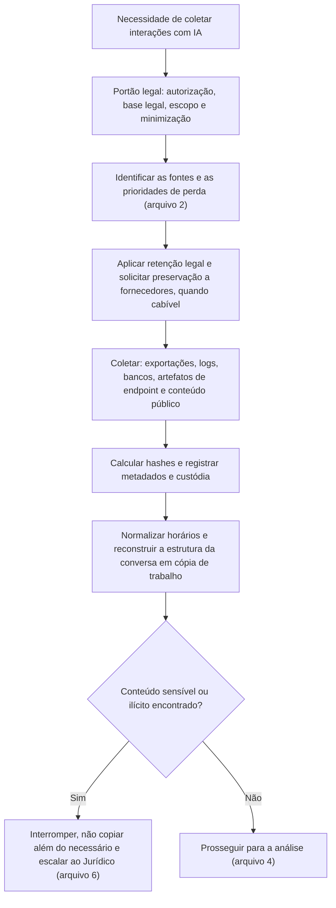

# Coleta, Preservação e Autenticidade de Conversas e Prompts

> **Objetivo pedagógico:** coletar e preservar conversas, prompts, contextos e respostas de forma íntegra e defensável (exportações, registros administrativos, bancos de dados, artefatos de endpoint e conteúdo compartilhado publicamente), reconstruir a estrutura das conversas (edições e ramificações), normalizar horários, autenticar o material por hash e por corroboração, e tratar com segurança o conteúdo sensível ou ilícito que possa surgir.

## 1. Princípios

| Princípio | Aplicação |
|---|---|
| Preservar o original | O registro original (exportação, banco ou log) é a evidência; reexecuções do prompt não a substituem |
| Contexto completo | Coletar o prompt do sistema, o histórico, o contexto recuperado, as chamadas de ferramentas e a resposta, e não apenas a pergunta e a resposta |
| Metadados | Identificadores, horários, modelo, versão e parâmetros |
| Hash e custódia | SHA-256 de cada arquivo exportado; cadeia de custódia (pasta 02) |
| Mínimo de alteração | Não editar nem reformatar o original; trabalhar em cópias |
| Minimização | Coletar o necessário ao escopo autorizado (pessoas, período e sistemas) |
| Legalidade | Autorização e base legal antes de acessar conteúdo de pessoas (arquivo 6 e PB-14) |
| Proteção | Armazenamento criptografado e com acesso restrito: o conteúdo é sensível |

## 2. Fluxo de coleta



## 3. Métodos de coleta por fonte

| Fonte | Método | Observações |
|---|---|---|
| Conta de serviço de consumo | Exportação de dados pela conta, realizada **pelo titular** ou com a colaboração e a autorização dele | A organização não deve acessar contas pessoais sem base legal e consentimento |
| Plano empresarial | Exportação por administradores ou por API de conformidade, com conta nominal e registro | Conforme o plano; documentar a consulta, o período e os filtros |
| API e plataformas de nuvem | Exportação de registros de invocação (S3, BigQuery e destinos de logs) | Preservar o destino e as políticas; exportar com hash |
| Banco de conversas da aplicação | Consulta somente leitura e exportação, ou cópia do banco e do backup | Preservar o esquema; considerar exclusões lógicas e versões anteriores |
| Observabilidade de LLM | Exportação de rastros pela interface ou pela API | Registrar o projeto, o período, os filtros e a versão da ferramenta |
| Repositório de prompts | `git bundle` ou clone espelhado, com histórico | Prova das versões de instruções por data |
| Endpoint | Imagem ou coleta direcionada (pastas 07, 08 e 10) | Navegador, aplicativos de IA e modelos locais |
| Proxy, DLP e identidade | Exportações do SIEM e das fontes (PB-01) | Retenção curta: prioridade |
| Conteúdo compartilhado publicamente (links de conversas) | Captura em WARC e hash (pasta 21 e PB-42) | Páginas compartilhadas podem mudar ou ser removidas; ata notarial para provas centrais |
| Capturas de tela | Último recurso, com fonte e data visíveis | Contestáveis isoladamente; complementar com registros |

```bash
# Hash de um conjunto de arquivos exportados e manifesto
find ./exportacoes_ia_DFL-2026-001 -type f -print0 | sort -z | xargs -0 sha256sum > manifesto_exportacoes_ia.sha256

# Cópia espelhada do repositório de prompts, com todo o histórico
git clone --mirror git@exemplo.interno:ia/prompts.git prompts_DFL-2026-001.git
git -C prompts_DFL-2026-001.git bundle create ../prompts_DFL-2026-001.bundle --all
sha256sum prompts_DFL-2026-001.bundle > prompts_DFL-2026-001.bundle.sha256
```

## 4. Estrutura das conversas: edições, regenerações e ramos

Muitas interfaces permitem editar mensagens e regenerar respostas, e os arquivos de exportação podem representar a conversa como uma **árvore de mensagens**, e não como uma lista linear. Isso importa:

| Aspecto | Consequência |
|---|---|
| Ramos alternativos | A resposta que o usuário viu e usou pode ser de um ramo, e não do ramo "principal" |
| Mensagens editadas | O prompt original e o editado podem coexistir; a ordem importa |
| Regenerações | Várias respostas para o mesmo prompt; identificar qual foi usada (cópias, ações subsequentes e feedback) |
| Marcas de tempo | Cada mensagem tem horário; diferenças entre criação e atualização |
| Mensagens ocultas ou de sistema | Podem aparecer apenas na exportação |

```bash
# Exemplo genérico de leitura de uma exportação JSON de conversas (a estrutura varia por serviço e versão: valide os campos)
jq -r '.[] | [.title, .create_time, .update_time] | @tsv' conversas.json | head

# Conversão de uma marca de tempo Unix para UTC
date -u -d @1730000000 +"%Y-%m-%dT%H:%M:%SZ"
```

Para cada exportação, documente o **esquema**, as chaves usadas e o método de reconstrução da ordem; preserve o JSON bruto e gere a visão linear como cópia derivada.

```python
# Esboço de reconstrução linear de uma conversa representada como árvore (adapte os nomes de campos ao formato real)
import json

with open("conversa.json", encoding="utf-8") as f:
    conv = json.load(f)

mapa = conv["mapping"]                    # nó -> {"id", "message", "parent", "children"}
no = conv.get("current_node")             # nó final do ramo atualmente exibido
ordem = []
while no:
    item = mapa[no]
    if item.get("message"):
        m = item["message"]
        ordem.append((m.get("create_time"), m["author"]["role"], m["content"]))
    no = item.get("parent")
ordem.reverse()
for t, papel, conteudo in ordem:
    print(t, papel, str(conteudo)[:200])
```

Esse código é ilustrativo: os campos dependem do serviço. Registre sempre qual ramo foi reconstruído e por quê, e liste os demais ramos.

## 5. Normalização de tempo

| Tarefa | Prática |
|---|---|
| Identificar o formato | Segundos ou milissegundos desde 1970 (Unix), texto ISO 8601 ou formato local |
| Converter para UTC | Registrar a fórmula e o fuso de origem |
| Distinguir eventos | Horário do usuário, do servidor da aplicação, do gateway e do provedor podem divergir |
| Correlacionar | Usar identificadores de requisição para ligar eventos de camadas diferentes |
| Declarar a precisão | Atrasos de ingestão e relógios não sincronizados (pasta 05) |

## 6. Autenticidade e integridade

| Medida | Descrição |
|---|---|
| Hash do material bruto | SHA-256 de cada exportação e de cada banco ou log copiado |
| Fonte primária | Preferir registros do sistema (banco, gateway ou provedor) a cópias intermediárias |
| Corroboração independente | Confirmar a interação por outra fonte (proxy, identidade, auditoria, endpoint, faturamento) |
| Consistência interna | Identificadores, horários e sequência coerentes; ausência de lacunas inexplicadas |
| Registro do método | Quem coletou, como, quando e com quais ferramentas |
| Preservação do ambiente | Esquema do banco, versões da aplicação e do prompt do sistema |
| Cadeia de custódia | Formulários e controle de acesso |
| Ata notarial ou certificação | Para conteúdo público ou prova central (CPC, art. 384) |

Quando não há como provar que o registro não foi alterado, declare o grau de confiança e as fontes de corroboração (escala de certeza, pasta 22).

## 7. Reexecução de prompts: cuidados

| Situação | Orientação |
|---|---|
| Reexecutar para "ver o que o modelo diz" | Útil para compreensão, mas **não** é prova do que foi respondido originalmente |
| Mesmo modelo e versão ainda disponíveis | Registrar versão, parâmetros e sementes; esperar variação, e documentar |
| Modelo atualizado ou descontinuado | A reexecução não reproduz o contexto histórico; declarar a limitação |
| Teste de capacidade de produzir um certo tipo de saída | Executar com amostras múltiplas e registrar a frequência, sem afirmar determinismo |
| Dados sensíveis na reexecução | Não reenviar dados reais a serviços externos; usar ambiente controlado e dados fictícios |

## 8. Conteúdo sensível ou ilícito nos registros

Ao coletar conversas, é possível encontrar conteúdo inesperado: dados pessoais sensíveis, segredos, comunicações privilegiadas ou material ilícito.

| Situação | Conduta |
|---|---|
| Dados pessoais sensíveis e segredos | Minimizar, restringir o acesso, redigir nos relatórios e registrar o tratamento |
| Comunicações com advogados | Interromper a revisão do trecho e acionar o Jurídico (privilégio) |
| Conteúdo que indique risco à vida ou à integridade de pessoas | Escalar imediatamente conforme o procedimento da organização e as autoridades competentes |
| Material ilícito, em especial envolvendo crianças e adolescentes | **Interromper**, não copiar, não compartilhar e não distribuir; preservar apenas o necessário sob orientação do Jurídico; comunicar por canais oficiais; a posse e o armazenamento de tal material têm tratamento legal específico (ECA, arts. 240 a 241-E) |
| Credenciais e chaves | Tratar como comprometidas; coordenar a rotação (PB-30) |

Registre a decisão e o escalonamento no livro de decisões. O analista deve ter acesso a apoio psicológico quando exposto a conteúdo perturbador.

## 9. Exemplo prático: coleta de uma conversa de chatbot corporativo contestada

| Passo | Resultado |
|---|---|
| Portão legal | Jurídico autoriza a coleta no litígio; escopo: conversas do cliente X, de 01 a 15/10 |
| Preservação | Retenção legal do banco de conversas e do repositório de prompts; `git bundle` do histórico |
| Coleta | Exportação somente leitura das mensagens e dos rastros de RAG; hashes calculados |
| Estrutura | O banco tem exclusões lógicas: 2 mensagens marcadas como removidas pelo cliente; preservadas com a marca |
| Versão do prompt | O repositório mostra que o prompt do sistema vigente em 12/10 foi atualizado em 14/10; a versão de 12/10 foi recuperada pelo histórico |
| Corroboração | Logs do gateway confirmam as requisições e o modelo usado; horários coerentes (UTC) |
| Observação | Reexecução em 20/11 gera resposta diferente: documentada como não determinismo e atualização do modelo; não usada como prova |
| Resultado | Dossiê com conversa original, versão do prompt, contexto recuperado, logs e hashes |

## 10. Casos de uso corporativos

- Coleta defensável de conversas de assistentes para litígios e investigações.
- Preservação de registros de provedores e de repositórios de prompts em incidentes.
- Procedimentos padronizados de exportação e de verificação.

## 11. Normas e frameworks relevantes

- ISO/IEC 27037:2012; ISO/IEC 27042:2015; NIST SP 800-86; NIST IR 8387; ISO/IEC 27050 (eDiscovery)
- CPP, arts. 158-A a 158-F (cadeia de custódia); CPC, art. 384 (ata notarial)
- ECA, arts. 240 a 241-E; LGPD, arts. 6º, 7º, 11 e 46

## 12. Referências

- Casey, E. Digital Evidence and Computer Crime. 3. ed. 2011.
- Documentação dos serviços sobre exportação de dados, APIs de conformidade e retenção (versões vigentes).
- Documentação do Git (`bundle` e `clone --mirror`) e do `jq`.
- Pastas 02, 04, 05, 21 e 22 deste repositório; PB-01, PB-14 e PB-42 (pasta 23).
