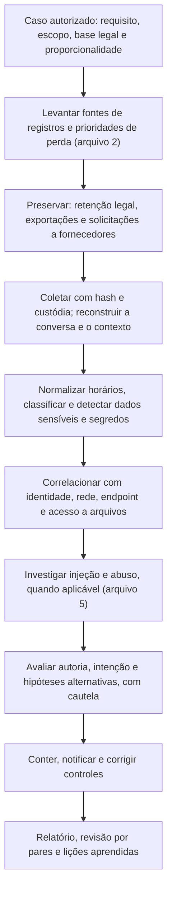

# Ferramentas, Fluxo, Modelos e Checklist de Forense de Prompts

> **Objetivo pedagógico:** padronizar as ferramentas, o fluxo de trabalho, os registros e a verificação de qualidade das investigações de prompts e de interações com LLM, incluindo a especificação do registro de interações (prontidão forense), de modo que sejam lícitas, proporcionais, reproduzíveis e defensáveis.

## 1. Ferramentas por finalidade

| Finalidade | Ferramentas |
|---|---|
| Preservação e integridade | `sha256sum`, `Get-FileHash`, `git bundle`, manifestos e armazenamento imutável |
| Exportação de conversas e de registros | Exportações de contas e de planos empresariais, APIs de conformidade, consultas a bancos e a destinos de logs em nuvem |
| Observabilidade de LLM | Langfuse, LangSmith, Helicone, Arize Phoenix e instrumentação com OpenTelemetry (exportação de rastros) |
| Análise de dados e de logs | `jq`, DuckDB, Python (pandas), KQL e SIEM (pastas 11 e 20) |
| Detecção de dados sensíveis | Expressões regulares com validação (por exemplo, CPF), Microsoft Presidio, Gitleaks e TruffleHog |
| Similaridade e correspondência | ssdeep e comparação de trechos; impressões digitais de DLP |
| Detecção de texto oculto | `grep -P` com intervalos Unicode, inspeção de HTML e de metadados (pasta 12) |
| Captura de conteúdo público | WARC, ata notarial (pasta 21 e PB-42) |
| Artefatos de endpoint | Ferramentas das pastas 07, 08, 10 e 14 |
| Testes autorizados em laboratório | Ferramentas de avaliação de segurança de LLM (por exemplo, garak, PyRIT e promptfoo), usadas **somente** em ambientes de teste autorizados para gerar dados de exercício |
| Documentação | Modelos deste arquivo, Pandoc e repositório versionado (pasta 22) |

Registre nome, versão e finalidade de cada ferramenta. Ferramentas que processam conteúdo de prompts devem rodar em ambiente controlado, pois o conteúdo é sensível.

## 2. Fluxo de trabalho padronizado

## 3. Dez perguntas e como respondê-las

| Pergunta | Onde responder |
|---|---|
| 1. O requisito, a base legal, o escopo e a proporcionalidade estão documentados? | Plano do caso (PB-14 e arquivo 6) |
| 2. As fontes foram mapeadas e as de retenção curta, preservadas primeiro? | Mapa de fontes |
| 3. O material tem hash, custódia, esquema documentado e horário em UTC? | Registro de coleta |
| 4. O contexto completo (instruções, histórico, RAG e ferramentas) foi coletado? | Reconstrução da interação |
| 5. A versão vigente do prompt do sistema e dos parâmetros foi estabelecida? | Repositório versionado e configurações |
| 6. Há dados pessoais, sigilosos ou segredos, e foram quantificados sem reproduzir o conteúdo? | Registro de detecção |
| 7. A interação foi corroborada por fontes independentes? | Proxy, identidade, endpoint e auditoria |
| 8. Há indícios de injeção, de abuso ou de ações induzidas, com a fonte do conteúdo preservada? | Matriz de indicadores |
| 9. A autoria e a intenção foram tratadas com cautela e com hipóteses alternativas? | Análise de autoria |
| 10. Que limitações (não determinismo, retenção, camadas ocultas) foram declaradas? | Relatório |

## 4. Modelo A: Ficha de Fonte de Registros de IA

| ID | Sistema e fornecedor | Camada (cliente, rede, aplicação, observabilidade, nuvem ou provedor) | Conteúdo registrado (metadados, conteúdo e contexto) | Retenção | Habilitado? | Acesso e responsável | Método de exportação | Prioridade de preservação | Limitações |
|---|---|---|---|---|---|---|---|---|---|
| F-001 | | | | | | | | | |
| F-002 | | | | | | | | | |

## 5. Modelo B: Registro de Coleta de Interações

| Campo | Preenchimento |
|---|---|
| Identificador | DFL-AAAA-NNN-ENNN |
| Sistema, fornecedor e conta | |
| Método (exportação, API, banco ou endpoint) e conta usada | |
| Período, usuários e filtros | |
| Data e hora da coleta (UTC) e coletor | |
| Autorização e base legal (referência) | |
| Arquivos gerados, esquema e hashes SHA-256 | |
| Estrutura da conversa (ramos, edições e mensagens removidas) | |
| Versão do prompt do sistema e das configurações (origem) | |
| Contexto recuperado e ferramentas (fontes) | |
| Conteúdo sensível ou ilícito encontrado e conduta adotada | |
| Limitações (retenção, lacunas e dependências) | |
| Custódia e armazenamento | |

## 6. Modelo C: Registro de Análise de Interação (linha do tempo)

| ID | Horário (UTC) | Origem (usuário, sistema, contexto, ferramenta ou modelo) | Conteúdo ou ação (resumo; dados sensíveis mascarados) | Fonte e referência | Classificação | Corroboração | Observações |
|---|---|---|---|---|---|---|---|
| I-001 | | | | | | | |
| I-002 | | | | | | | |

## 7. Modelo D: Matriz de Indicadores de Injeção e Abuso

| Indicador | Onde observado (prompt, contexto, resposta, ferramenta ou rede) | Fonte preservada (hash) | Interpretação | Hipóteses alternativas | Confiança | Ação |
|---|---|---|---|---|---|---|
| | | | | | | |

## 8. Modelo E: Especificação mínima do registro de interações com LLM (prontidão forense)

| Campo | Descrição | Camada e proteção |
|---|---|---|
| `id_requisicao` | Identificador único e propagado entre componentes | Metadados |
| `id_sessao` e `id_conversa` | Agrupamento das mensagens | Metadados |
| `usuario` (ou pseudônimo) e `origem` (IP e dispositivo) | Quem e de onde | Metadados |
| `horario_utc` | Horário em UTC, com a fonte do relógio | Metadados |
| `modelo` e `versao` | Identificação do modelo e da versão | Metadados |
| `parametros` | Temperatura, amostragem, limites e semente (se houver) | Metadados |
| `versao_prompt_sistema` e `versao_filtros` | Referência ao repositório versionado | Metadados |
| `ids_documentos_recuperados` (e hashes) | Fontes do contexto | Metadados |
| `ferramentas_chamadas` | Nome, identificador, parâmetros resumidos e resultado | Metadados (parâmetros sensíveis mascarados) |
| `tokens_entrada` e `tokens_saida`, `latencia` | Uso e desempenho | Metadados |
| `resultado_filtros` | Decisões de segurança e de moderação | Metadados |
| `hash_prompt` e `hash_resposta` | Integridade sem manter o texto | Metadados |
| `conteudo_prompt`, `conteudo_resposta` e `contexto` | Texto completo (conforme criticidade) | Acesso restrito, criptografia, retenção curta e redação de dados pessoais |

## 9. Modelo F: Estrutura do Relatório de Forense de Prompts

| Seção | Conteúdo |
|---|---|
| 1. Escopo, autorização e base legal | Requisito, proporcionalidade e restrições de privacidade |
| 2. Resumo e conclusões | Fatos, confiança e recomendações |
| 3. Fontes e preservação | Fontes, hashes, custódia e lacunas |
| 4. Reconstrução da interação | Linha do tempo, contexto, versões e ramos |
| 5. Análise | Classificação, dados sensíveis (quantificados), correlações e hipóteses |
| 6. Injeção e abuso | Indicadores, fontes e impacto (se aplicável) |
| 7. Autoria e intenção | O que se pode e o que não se pode concluir |
| 8. Impacto e obrigações | Dados, decisões, notificações e contratos |
| 9. Contenção e recomendações | Ações e controles |
| 10. Limitações | Não determinismo, retenção e camadas ocultas |
| 11. Anexos | Hashes, consultas e custódia |

## 10. Checklist operacional de forense de prompts

**Caso:** DFL-AAAA-NNN
**Sistema:** ____________________
**Analista:** ____________________
**Data e hora (UTC):** ____________________

### 10.1 Autorização e preservação

- [ ] Requisito, base legal, escopo e proporcionalidade documentados; Jurídico, RH e DPO envolvidos quando há pessoas
- [ ] Fontes de registros mapeadas; retenção curta preservada primeiro
- [ ] Retenção legal e solicitações de preservação a fornecedores realizadas
- [ ] Exportações com hash, esquema documentado e custódia
- [ ] Conta pessoal não acessada sem consentimento ou ordem

### 10.2 Reconstrução e análise

- [ ] Contexto completo coletado (instruções, histórico, RAG e ferramentas)
- [ ] Versão do prompt do sistema e parâmetros estabelecidos
- [ ] Estrutura da conversa (ramos, edições e remoções) reconstruída e documentada
- [ ] Horários normalizados para UTC e correlacionados com outras fontes
- [ ] Dados sensíveis e segredos detectados e quantificados, sem reproduzir o conteúdo no relatório
- [ ] Indicadores de injeção e de abuso avaliados, com a fonte do conteúdo preservada
- [ ] Autoria e intenção tratadas com cautela; hipóteses alternativas consideradas

### 10.3 Conteúdo sensível e conclusão

- [ ] Conteúdo privilegiado, ilícito ou de risco tratado conforme a orientação do Jurídico
- [ ] Reexecuções tratadas como testes, e não como prova do original
- [ ] Notificações e obrigações avaliadas (LGPD, contratos e reguladores)
- [ ] Limitações e grau de confiança declarados
- [ ] Revisão por pares realizada; acesso ao relatório restrito

## 11. Resultado da verificação

| Resultado | Condição |
|---|---|
| Conforme | Todos os itens aplicáveis marcados |
| Conforme com ressalvas | Pendências sem impacto na legalidade e nas conclusões, com plano de ação |
| Não conforme | Acesso sem autorização ou a conta pessoal sem base, perda de registros por demora na preservação, contexto incompleto, conclusões sobre intenção sem corroboração ou exposição de conteúdo sensível; comunicar o líder, o Jurídico e o DPO |

**Assinatura do analista:** ____________________
**Assinatura do revisor:** ____________________

## 12. Casos de uso corporativos

- Padronização das investigações sobre interações com IA no SOC, na segurança e no jurídico.
- Definição de um registro de interações com LLM para aplicações internas.
- Treinamento em ambiente de laboratório, com dados fictícios gerados em testes autorizados.

## 13. Normas e frameworks relevantes

- OWASP Top 10 para LLM; MITRE ATLAS; NIST AI 600-1; NIST AI RMF 1.0
- ISO/IEC 27037; ISO/IEC 27042; ISO/IEC 42001:2023; ISO/IEC 27701
- LGPD, arts. 6º, 7º, 11, 37, 38 e 46; CPP, arts. 158-A a 158-F

## 14. Referências

- Documentação do Langfuse, do LangSmith, do Helicone, do OpenTelemetry, do Presidio, do Gitleaks e do TruffleHog.
- Documentação das ferramentas de avaliação de segurança de LLM (garak, PyRIT e promptfoo) para uso em laboratório.
- OWASP. Top 10 for LLM Applications; MITRE. ATLAS.
- Pastas 02, 04, 11, 19, 22 e 23 deste repositório.
