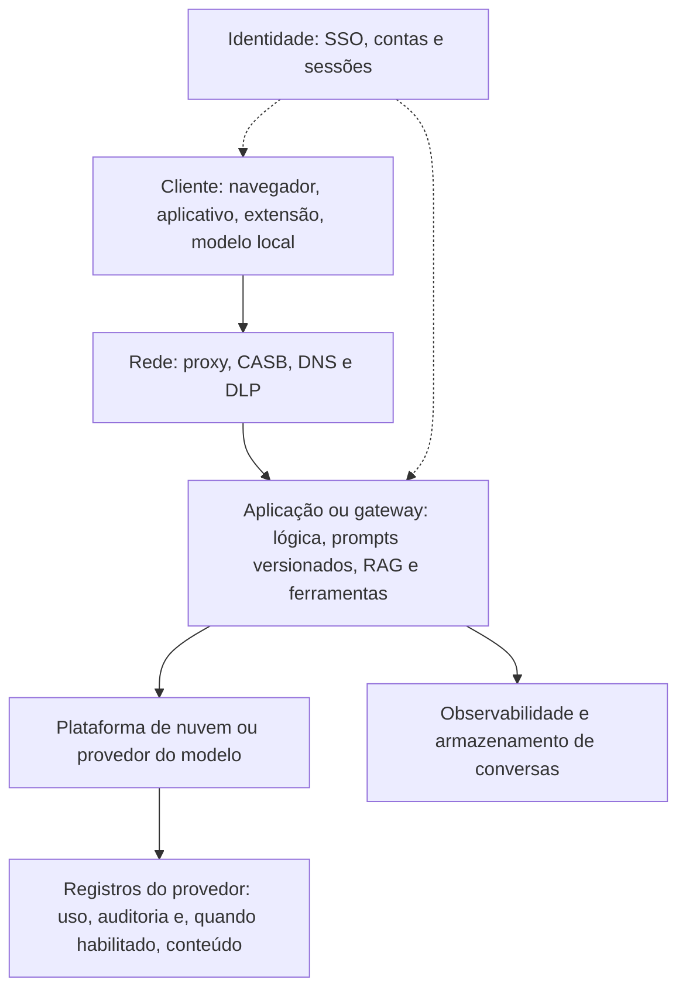

# Fontes de Evidência: Logs de Provedores, Aplicações e Clientes

> **Objetivo pedagógico:** conhecer as fontes onde prompts, contextos e respostas podem estar registrados (provedores de modelos, plataformas de nuvem, aplicações e gateways, ferramentas de observabilidade, endpoints, navegadores e modelos locais), suas retenções e limitações, e projetar o registro de interações de forma que seja útil à investigação e compatível com a privacidade.

> A disponibilidade, a retenção e o conteúdo dos registros dependem do serviço, do plano contratado e da configuração, e mudam com frequência. Confirme a documentação e os termos vigentes no início do caso.

## 1. Mapa das fontes



| Camada | Fontes | O que mostram |
|---|---|---|
| Cliente | Histórico e cache do navegador, extensões, aplicativos de IA, arquivos locais, modelos locais | Atividade do usuário, conversas em cache e arquivos enviados |
| Rede | Proxy, CASB, DNS, firewall e DLP | Domínios de IA acessados, volumes, horários e detecção de dados sensíveis |
| Identidade | Provedor de identidade, SSO, logs de entrada | Quem autenticou e de onde |
| Aplicação e gateway | Logs da aplicação, do gateway de API, bancos de conversas, repositório de prompts, registros de RAG e de ferramentas | Prompts, respostas, contexto, versões e ações |
| Observabilidade | Plataformas de rastreamento e de avaliação de LLM | Rastros completos de requisições, avaliações e erros |
| Plataforma de nuvem | Registros de invocação de modelos e de auditoria | Metadados e, quando habilitado, o conteúdo |
| Provedor do modelo | Painéis de uso, APIs de conformidade, exportações e registros de auditoria | Uso, usuários e, conforme o plano, conteúdo das conversas |
| Serviços corporativos de IA | Auditoria unificada e eDiscovery (pasta 19) | Interações e recursos acessados |
| Faturamento | Registros de uso e de custos | Volume por chave, por projeto e por horário |

## 2. Provedores de modelos e serviços de consumo

| Aspecto | Observação |
|---|---|
| Histórico de conversas da conta | Serviços de consumo mantêm o histórico acessível ao titular da conta, que pode **exportá-lo** (arquivo de exportação com as conversas); o histórico pode ser desativado ou excluído pelo usuário |
| Planos empresariais | Costumam oferecer controles administrativos, retenção configurável, **APIs de conformidade** e exportação por administradores, conforme o fornecedor e o plano |
| Uso por API | Os provedores registram o uso (volume, horários e identificadores de requisição); o conteúdo pode não ser retido, ou ser retido por prazo limitado para monitoramento de abuso, conforme os termos e as opções de retenção zero |
| Exclusão e retenção | A exclusão pelo usuário e as políticas de retenção do provedor limitam o que existe; consulte os termos e solicite a **preservação** quando houver base |
| Acesso pela organização | Contas pessoais usadas para fins corporativos são difíceis de acessar sem a colaboração do titular e sem base legal |
| Solicitações ao provedor | Preservação e fornecimento de dados dependem de contrato, de processo legal e da jurisdição |

## 3. Plataformas de nuvem

| Plataforma | Fontes (exemplos) | Observações |
|---|---|---|
| AWS (Amazon Bedrock) | Registro de invocação de modelos (entrega a S3 e a CloudWatch Logs), CloudTrail (chamadas de API) | O registro de invocação precisa ser **habilitado**; pode incluir o texto de entrada e de saída; avalie privacidade e acesso |
| Microsoft Azure (Azure OpenAI e serviços de IA) | Configurações de diagnóstico (categorias como auditoria e requisição e resposta), log de atividade, registros do filtro de conteúdo | O conteúdo das mensagens pode não ser registrado por padrão; verifique o que cada categoria contém e as opções de registro |
| Google Cloud (Vertex AI) | Cloud Audit Logs, registro de requisição e resposta de endpoints (quando habilitado), BigQuery | Habilite e proteja os destinos |
| Microsoft 365 Copilot | Auditoria unificada (eventos de interação) e eDiscovery (pasta 19) | O conteúdo e a retenção dependem do licenciamento e das políticas |

Aplique os princípios de preservação de nuvem (pastas 17 e 18): preservar logs, validar integridade, controlar o acesso e registrar as lacunas.

## 4. Aplicações, gateways e armazenamento de conversas

| Fonte | Conteúdo | Observações |
|---|---|---|
| Banco de dados de conversas | Mensagens por usuário e por sessão, horários e identificadores | Principal fonte em chatbots corporativos; verificar esquema, backups e exclusões lógicas |
| Logs de aplicação | Erros, tempos, chamadas de ferramentas e decisões da lógica | Podem conter prompts completos, a depender do nível de log |
| Gateway ou proxy de API | Metadados de requisição, identidade da chave e do usuário, volumes e limites | Ótimo para identificar uso e abuso, sem necessariamente conter o conteúdo |
| Repositório de prompts versionados | Instruções do sistema e modelos de prompt, com histórico | Prova qual instrução estava vigente em cada data |
| Registros de recuperação (RAG) | Consultas ao índice, documentos recuperados, pontuações e identificadores | Mostram de onde vieram os dados do contexto |
| Registros de ferramentas | Chamadas, parâmetros, resultados e erros | Ligam a saída do modelo a ações reais |
| Moderação e filtros | Detecções, categorias e decisões de bloqueio | Explicam bloqueios e permissões |
| Feedback de usuários | Avaliações e comentários | Contexto sobre qualidade e danos |
| Configuração de implantação | Parâmetros de geração, modelo e versão | Reprodutibilidade |

## 5. Observabilidade de LLM

Ferramentas de observabilidade e de avaliação de aplicações com LLM (por exemplo, Langfuse, LangSmith, Helicone, Arize Phoenix e instrumentação com OpenTelemetry) registram **rastros** (traces) de cada requisição: entradas, contexto, chamadas de ferramentas, saídas, latência e custos.

| Aspecto | Observação |
|---|---|
| Valor forense | Rastro completo e estruturado de cada interação, com identificadores de sessão e de usuário |
| Convenções | As convenções semânticas do OpenTelemetry para IA generativa definem atributos padronizados (por exemplo, sistema, modelo, parâmetros e uso de tokens); estão em evolução |
| Riscos | Esses sistemas armazenam conteúdo sensível: aplicar controle de acesso, redação de dados pessoais e retenção definida |
| Exportação | Preserve exportações com hash; registre a versão da ferramenta e o período |

## 6. Cliente: navegadores, aplicativos e modelos locais

| Fonte | O que pode conter | Cuidados |
|---|---|---|
| Histórico e cache do navegador | URLs e títulos de conversas, páginas em cache, arquivos baixados e enviados | Modo privado e limpeza reduzem os vestígios (pasta 07) |
| Armazenamento local do navegador (IndexedDB e Local Storage) | Dados de aplicações web, às vezes fragmentos de conversas | Exige extração cuidadosa e análise de bancos |
| Extensões de navegador | Assistentes de IA com acesso ao conteúdo das páginas; registros e permissões | Podem exfiltrar conteúdo; verificar as permissões |
| Aplicativos de desktop e móveis de IA | Bancos e caches locais com conversas | Localização e formato variam por aplicativo e versão |
| Modelos locais (por exemplo, Ollama, LM Studio e similares) | Registros do servidor, histórico de linha de comando, arquivos de conversas e de configuração | Por exemplo, o Ollama mantém logs do servidor e histórico de comandos no diretório do usuário; verifique a versão |
| Área de transferência e arquivos temporários | Conteúdo colado em prompts | Voláteis; coletar rapidamente quando autorizado |
| Documentos e e-mails de origem | Fontes do conteúdo inserido em prompts | Permitem comprovar a origem dos dados |
| Dispositivos móveis | Aplicativos de IA e navegadores | Pasta 14 |

```bash
# Modelos locais: exemplos de locais a verificar em um perfil de usuário (ajuste ao sistema e à versão; use cópia forense)
ls -la ~/.ollama/ 2>/dev/null
ls -la ~/.ollama/logs/ 2>/dev/null
cat ~/.ollama/history 2>/dev/null | head      # histórico de comandos da interface de linha de comando, quando existir
journalctl -u ollama --no-pager -o short-iso 2>/dev/null | head   # logs do serviço em Linux com systemd
```

## 7. Projeto do registro de interações (prontidão forense)

Registrar **tudo** gera risco de privacidade; registrar **pouco** impede a investigação. Defina um registro por camadas, com proteção proporcional:

| Camada | Conteúdo | Proteção e retenção |
|---|---|---|
| Metadados (sempre) | Identificador da requisição e da sessão, usuário (ou pseudônimo), horário em UTC, modelo e versão, parâmetros, contagem de tokens, latência, resultado de filtros, identificadores de documentos recuperados, chamadas de ferramentas (nome e identificador) | Retenção mais longa; acesso do SOC |
| Conteúdo (conforme a criticidade) | Prompts, respostas e contexto completo | Acesso restrito, criptografia, retenção curta e justificada; redação de dados pessoais quando possível |
| Hashes de conteúdo | Hash de prompts e de respostas | Permitem verificar a integridade sem manter o texto |
| Versões de configuração | Versão do prompt do sistema, de filtros e de ferramentas | Repositório versionado e imutável |
| Eventos de segurança | Detecções de injeção, bloqueios e anomalias | Integração com SIEM |

| Princípio | Descrição |
|---|---|
| Finalidade e minimização | Registrar o necessário para segurança, qualidade e conformidade, com base legal e transparência para os usuários |
| Integridade | Registros em armazenamento imutável, com hash e controle de acesso |
| Tempo | UTC e sincronização de relógios |
| Correlação | Identificadores que ligam o usuário, a requisição, o contexto recuperado e as ações |
| Separação de funções | Quem opera a aplicação não administra os registros de auditoria |
| Retenção | Prazos definidos, com retenção legal quando necessário |

## 8. Tabela resumo: fonte, conteúdo, retenção e limitação

| Fonte | Conteúdo típico | Retenção (referência) | Limitação |
|---|---|---|---|
| Histórico da conta do serviço de consumo | Conversas completas | Até a exclusão pelo usuário ou conforme o serviço | Acesso do titular; pode ser apagado |
| Console e API de conformidade empresarial | Conversas e metadados da organização | Conforme o plano e a política | Depende de licença e de configuração |
| Registro de invocação em nuvem | Metadados e, se habilitado, conteúdo | Definida pelo cliente no destino | Desabilitado por padrão em muitos serviços |
| Banco de conversas da aplicação | Mensagens e contexto | Definida pelo operador | Exclusões lógicas e esquema próprio |
| Gateway de API | Metadados de uso | Definida pelo cliente | Pode não conter conteúdo |
| Observabilidade de LLM | Rastros completos | Definida pelo cliente | Conteúdo sensível; cobertura limitada à instrumentação |
| Proxy e DLP | Domínios, volumes e alertas | Dias a meses | Sem conteúdo em tráfego criptografado |
| Navegador e aplicativos locais | Conversas em cache e artefatos | Até limpeza ou sobrescrita | Voláteis; modo privado |

## 9. Exemplo prático: levantamento de fontes para um caso

| Caso | Fontes identificadas | Prioridade de preservação |
|---|---|---|
| Suspeita de que um analista inseriu um contrato em um assistente público | Proxy (acessos e volumes), DLP, navegador do notebook (histórico e cache), conta do serviço (se corporativa) | Proxy e DLP (retenção curta); imagem do notebook; solicitação de colaboração e de preservação |
| Chatbot de atendimento orientou um cliente de forma incorreta | Banco de conversas, versão do prompt do sistema, registros de RAG, logs do gateway e da aplicação | Banco de conversas e versão do prompt (antes de alterações); retenção legal |
| Assistente de e-mail executou ação inesperada depois de ler uma mensagem externa | Registro de ferramentas, rastro do contexto (a mensagem de origem), auditoria do serviço | O e-mail de origem, o rastro e os logs de ferramentas |

## 10. Casos de uso corporativos

- Mapeamento prévio das fontes de registro de IA para investigações futuras.
- Definição do registro de interações com LLM equilibrando a segurança e a privacidade.
- Preservação rápida de registros de provedores e de aplicações em incidentes.

## 11. Normas e frameworks relevantes

- OpenTelemetry (convenções semânticas para IA generativa, em evolução); OWASP Top 10 para LLM (registro e monitoramento)
- NIST SP 800-92 (gestão de logs); NIST AI RMF 1.0 (Medir e Gerenciar); ISO/IEC 42001:2023
- ISO/IEC 27002:2022, controles 8.15, 8.16 e 5.34; CIS Controls v8.1, controle 8
- LGPD, arts. 6º, 37 e 46; Marco Civil da Internet, arts. 10 e 15 (quando aplicáveis)

## 12. Referências

- Documentação de registro e de auditoria do Amazon Bedrock, do Azure OpenAI, do Google Vertex AI e do Microsoft Purview.
- Documentação do OpenTelemetry (GenAI), do Langfuse, do LangSmith, do Helicone e do Arize Phoenix.
- Termos de serviço e políticas de privacidade e de retenção dos provedores de modelos (versões vigentes).
- Kent, K.; Souppaya, M. NIST SP 800-92. 2006.
- Pastas 11, 17, 18, 19 e 24 deste repositório.
