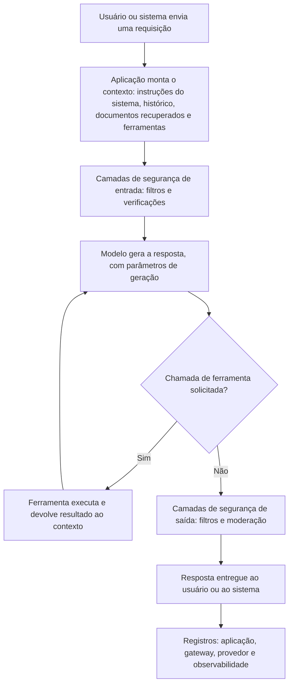

# Fundamentos de Prompts e Interações com LLM como Evidência

> **Objetivo pedagógico:** compreender a anatomia de uma interação com um modelo de linguagem (LLM): mensagens por papel, parâmetros, contexto recuperado, chamadas de ferramentas e resposta; identificar onde cada componente é registrado; reconhecer o valor e os limites probatórios dessas interações (não determinismo, atualização de modelos, camadas ocultas e proveniência); e delimitar as perguntas que uma investigação de prompts procura responder.

## 1. O que é a forense de prompts

A forense de prompts é a coleta, a preservação, a autenticação e a análise de **entradas, contextos e saídas** de interações com modelos de linguagem para estabelecer fatos: quem interagiu, quando, com que instruções e dados, que resposta foi produzida e que ações dela decorreram. Ela complementa a forense de IA (pasta 24) e é a base da investigação de incidentes com LLM e agentes (pasta 26).

| Tipo de caso | Exemplos |
|---|---|
| Vazamento de dados | Colaborador inseriu dados confidenciais ou pessoais em um assistente |
| Conduta indevida | Uso do assistente corporativo para assédio, fraude ou geração de conteúdo ilícito |
| Incidente de segurança | Injeção de instruções em documentos, e-mails ou páginas que alterou o comportamento de um assistente |
| Responsabilidade por saída | Resposta de um chatbot ao cliente com informação incorreta, danosa ou contratualmente relevante |
| Propriedade intelectual | Uso de conteúdo protegido em prompts ou em saídas |
| Conformidade e litígio | Demonstração do que foi perguntado e respondido em um processo regulado |
| Abuso de serviço | Uso em larga escala, fraude de créditos ou chaves de API vazadas |

## 2. Anatomia de uma interação

| Componente | Descrição | Relevância forense |
|---|---|---|
| Instruções do sistema (system prompt) | Regras e papel definidos pelo operador | Define o comportamento esperado; precisa da **versão vigente** no momento |
| Instruções do desenvolvedor | Camada intermediária de instruções, em alguns serviços | Complementa as regras do sistema |
| Mensagens do usuário | Entradas digitadas ou enviadas por integração | Conteúdo e autoria da interação |
| Histórico da conversa | Mensagens anteriores incluídas no contexto | A resposta depende do histórico; edições e regenerações alteram o contexto |
| Contexto recuperado (RAG) | Trechos de documentos, de bases e de páginas inseridos no contexto | Origem de dados sensíveis e de instruções indiretas |
| Definições e chamadas de ferramentas | Funções que o modelo pode acionar, e seus resultados | Ações reais decorrentes do modelo (pasta 26) |
| Parâmetros de geração | Modelo e versão, temperatura, amostragem, limite de tokens e sementes | Reprodutibilidade e interpretação |
| Resposta do modelo | Texto, código, chamadas de ferramentas e metadados (motivo de término) | O que foi dito e feito |
| Filtros e moderação | Resultados de verificações de segurança nas entradas e nas saídas | Por que algo foi bloqueado ou permitido |
| Metadados | Identificadores de requisição, usuário, horários, contagem de tokens e latência | Autenticação e correlação |

## 3. Valor probatório e limitações

| Característica | Efeito | Como lidar |
|---|---|---|
| Não determinismo | A mesma entrada pode gerar saídas diferentes | Preservar a saída **original**; não substituir por reexecução; registrar parâmetros |
| Atualização de modelos | O comportamento muda com novas versões, às vezes sem aviso | Registrar o modelo e a versão do momento; reexecutar somente como teste, com a ressalva |
| Camadas ocultas | Instruções do sistema, filtros e ferramentas podem não ser visíveis ao usuário | Obter as configurações do operador e a versão vigente |
| Contexto implícito | A resposta depende de documentos recuperados e de ferramentas, e não só do que o usuário digitou | Preservar o contexto completo, e não apenas a pergunta e a resposta |
| Autoria | Uma conta não identifica, por si, a pessoa que digitou | Corroborar com sessão, dispositivo, rede e outros registros |
| Edição e ramificação | Interfaces permitem editar mensagens e regenerar respostas, criando ramos | Exportar a estrutura completa e identificar o ramo relevante |
| Retenção variável | Provedores e aplicações retêm por prazos distintos | Preservação imediata e retenção legal (arquivos 2 e 6) |
| Capturas de tela | Fáceis de contestar | Preferir exportações e registros, com hash |
| Alucinações | O modelo pode gerar informações falsas com aparência de certeza | A saída prova o que foi **dito**, e não que é **verdadeiro** |
| Conteúdo sensível | Pode haver dados pessoais, sigilosos e conteúdo ilícito | Minimização, acesso restrito e protocolos de escalonamento (arquivo 6) |

Princípio: um registro de interação prova, no máximo, **que determinada entrada foi enviada e que determinada saída foi gerada, naquele momento, por aquele sistema**. Ele não prova a veracidade da saída, a intenção do usuário nem a identidade de quem digitou, sem corroboração.

## 4. Perguntas que a investigação responde

| Pergunta | Fontes principais |
|---|---|
| Quem interagiu (conta, dispositivo e rede)? | Identidade, gateway, proxy, endpoint |
| Quando (UTC)? | Metadados das mensagens, logs e linhas do tempo |
| Com que sistema, modelo e versão? | Registros do operador, do gateway e do provedor |
| Com que instruções do sistema e configurações? | Registro de prompts versionados, manifestos e configurações |
| Que dados foram incluídos (pelo usuário e pelo contexto recuperado)? | Registros de interação e de recuperação |
| O que o modelo respondeu e fez? | Resposta registrada e logs de ferramentas |
| Houve filtros, bloqueios ou exceções? | Logs de segurança e de moderação |
| Que consequências decorreram (ações, mensagens e decisões)? | Logs de sistemas integrados |
| O conteúdo corresponde a documentos ou dados protegidos? | Correspondência com a classificação de dados e DLP |
| O registro é autêntico e completo? | Hash, fontes independentes e lacunas de retenção |

## 5. Conceitos úteis

| Termo | Definição |
|---|---|
| Injeção de prompts | Instruções inseridas em dados (documentos, páginas e e-mails) ou em entradas que alteram o comportamento do modelo; investigada no arquivo 5 |
| Jailbreak | Tentativa de contornar as regras de segurança de um modelo por meio de entradas |
| Vazamento do prompt do sistema | Exposição das instruções internas do operador |
| RAG (geração aumentada por recuperação) | Arquitetura em que trechos de uma base são inseridos no contexto |
| Agente | Sistema que usa o modelo para planejar e acionar ferramentas (pasta 26) |
| Alucinação | Saída plausível, porém falsa |
| Token | Unidade de texto processada; base do faturamento e dos limites |
| Janela de contexto | Quantidade máxima de tokens que o modelo processa de uma vez |

## 6. Aspectos legais e de privacidade (visão geral)

> **Aviso:** este material é técnico-educacional e não substitui parecer jurídico. Valide cada caso com o Jurídico e com o DPO.

| Tema | Orientação |
|---|---|
| Prompts e respostas como dados pessoais | Podem conter dados pessoais (do usuário e de terceiros) e dados sensíveis: aplicam-se os princípios e as bases legais da LGPD (arts. 5º a 7º e 11) |
| Monitoramento de uso de IA por colaboradores | Exige política comunicada, finalidade legítima, proporcionalidade e minimização |
| Comunicações privilegiadas e sigilo | Prompts podem conter comunicações com advogados, segredos comerciais e informações de clientes |
| Conteúdo ilícito nos registros | Pode surgir conteúdo que exija escalonamento imediato e tratamento especial (arquivo 6) |
| Retenção e retenção legal | Prazos de retenção devem equilibrar a necessidade investigativa e a minimização; ordens judiciais podem exigir a preservação |
| Decisões automatizadas | O titular pode solicitar a revisão de decisões baseadas unicamente em tratamento automatizado (LGPD, art. 20) |
| Evidência em juízo | A prova deve ser lícita, íntegra e autêntica; a cadeia de custódia (CPP, arts. 158-A a 158-F) e a ata notarial (CPC, art. 384) podem ser úteis |

## 7. Exemplo prático: o que um registro prova e o que não prova

| Registro | O que prova | O que não prova |
|---|---|---|
| Log do gateway: usuário X enviou, às 14:02 UTC, uma requisição de 3.100 tokens ao modelo M, versão V | Houve uma requisição da conta X, naquela hora, ao modelo indicado | Quem estava no teclado; o conteúdo exato (se não registrado); a veracidade da resposta |
| Exportação da conversa: mensagem do usuário com o texto de um contrato e a resposta com um resumo | O texto foi inserido e o resumo foi gerado | Que o contrato era confidencial (depende da classificação); que o usuário agiu com má-fé |
| Reexecução do mesmo prompt hoje, com resposta diferente | Que o modelo não é determinístico ou foi atualizado | Que o registro original é falso |

## 8. Casos de uso corporativos

- Investigação de vazamentos de dados e de usos indevidos de assistentes de IA.
- Reconstrução do que um chatbot corporativo respondeu a um cliente em um litígio.
- Definição dos requisitos de registro de interações com LLM para segurança e para conformidade.

## 9. Normas e frameworks relevantes

- OWASP Top 10 para aplicações com LLM (LLM01 a LLM10); MITRE ATLAS (AML.T0051, injeção de prompts em LLM)
- NIST AI RMF 1.0 e NIST AI 600-1 (perfil de IA generativa); NIST AI 100-2
- ISO/IEC 42001:2023; ISO/IEC 27037; ISO/IEC 27042
- LGPD, arts. 5º, 6º, 7º, 11, 20, 37 e 46; CPP, arts. 158-A a 158-F; CPC, art. 384

## 10. Referências

- OWASP. Top 10 for LLM Applications (edição vigente).
- MITRE. ATLAS: Adversarial Threat Landscape for Artificial-Intelligence Systems.
- NIST. AI 600-1: Generative Artificial Intelligence Profile (2024); AI 100-2 (edição vigente).
- Greshake, K. et al. Not what you've signed up for: Compromising Real-World LLM-Integrated Applications with Indirect Prompt Injection. 2023.
- Documentação dos provedores de modelos e das plataformas de nuvem sobre registro e retenção (consultar a versão vigente).
