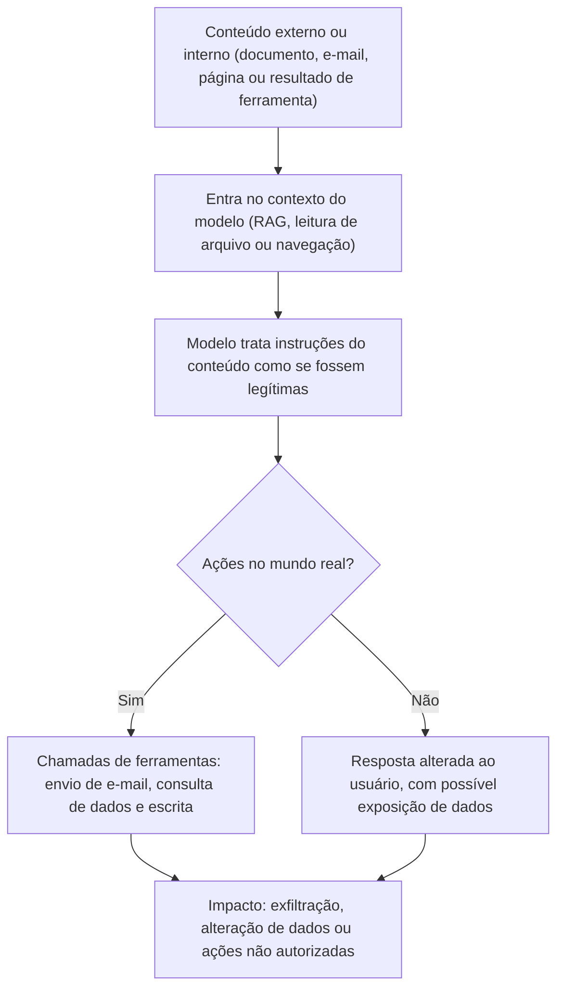

# Injeção de Prompts e Abuso: Indicadores Forenses

> **Objetivo pedagógico:** reconhecer e investigar indícios de injeção de prompts (direta e indireta), de tentativas de contornar regras de segurança (jailbreak), de extração de instruções internas e de dados, e de uso indevido de saídas, identificando indicadores nos registros, preservando as fontes do conteúdo injetado, reconstruindo a linha do tempo de como as instruções entraram no contexto e o que o sistema fez, com foco em **detecção, evidência e resposta**.

> Este arquivo descreve **indicadores e métodos de investigação**. Não fornece instruções para realizar ataques. As ações de agentes e de ferramentas são aprofundadas na pasta 26.

## 1. Conceitos

| Conceito | Descrição | Mapeamento (referência) |
|---|---|---|
| Injeção direta de prompts | O próprio usuário insere instruções para alterar o comportamento do modelo | OWASP LLM01; ATLAS: injeção de prompts em LLM |
| Injeção indireta de prompts | Instruções escondidas em conteúdo processado pelo modelo (documentos, páginas, e-mails, imagens e resultados de ferramentas) | OWASP LLM01; ATLAS: injeção de prompts em LLM (indireta) |
| Jailbreak | Tentativa de levar o modelo a violar suas regras de segurança | ATLAS: jailbreak de LLM |
| Vazamento do prompt do sistema | Exposição das instruções internas do operador | OWASP LLM07 |
| Divulgação de informações sensíveis | O modelo revela dados de contexto, de outros usuários ou de treinamento | OWASP LLM02 |
| Tratamento inadequado de saída | A saída do modelo é usada sem validação em outro sistema (execução de código, renderização ou comandos) | OWASP LLM05 |
| Agência excessiva | O modelo tem permissões demais para agir (pasta 26) | OWASP LLM06 |
| Consumo ilimitado | Uso abusivo que gera custos ou indisponibilidade | OWASP LLM10 |

Os identificadores e as definições evoluem; consulte as versões vigentes do OWASP e do ATLAS.

## 2. Por que a injeção indireta é um problema forense

O modelo processa instruções e dados no **mesmo canal de texto**, e não distingue de forma confiável o que é ordem do operador do que é conteúdo de terceiros. Assim, um documento, um e-mail ou uma página com instruções escondidas pode influenciar o comportamento de um assistente que o leia em nome do usuário. A investigação precisa descobrir: **de onde veio o conteúdo, quando entrou no contexto, o que o modelo fez e quais ferramentas acionou**.



## 3. Indicadores nos registros de interação

> Os padrões abaixo servem à **detecção e à triagem**. Atacantes variam as formas (idiomas, codificação e ofuscação), de modo que a ausência de padrões não prova a ausência de injeção.

| Categoria | Indicadores (exemplos descritivos) | Fonte |
|---|---|---|
| Instruções que tentam substituir as regras | Frases que mandam ignorar as instruções anteriores, redefinem o papel do modelo ou declaram "novas regras" | Prompts de usuário e conteúdo recuperado |
| Pedidos de revelar instruções internas | Solicitações para repetir ou exibir o prompt do sistema, as regras ou as ferramentas | Prompts de usuário; respostas |
| Texto de aparência normal com instruções dirigidas ao modelo (e não ao leitor humano) | Parágrafos em documentos ou e-mails que falam diretamente com "o assistente" | Documentos e e-mails de origem |
| Texto oculto ou invisível | Texto na cor do fundo, fonte minúscula, comentários HTML, metadados, caracteres de largura zero e caracteres de "tag" do Unicode | Arquivos de origem e contexto recuperado |
| Conteúdo codificado ou ofuscado | Blocos em Base64, hexadecimal, cifras simples, outros idiomas ou fragmentação de palavras | Prompts e contexto |
| Mudança abrupta de comportamento do modelo | Respostas que ignoram as regras do operador logo após a leitura de determinado conteúdo | Resposta e contexto |
| Chamadas de ferramentas incomuns | Ferramentas acionadas fora do padrão, com destinos externos e parâmetros que carregam dados do contexto | Logs de ferramentas |
| URLs ou imagens com dados codificados | Respostas com links ou imagens cujo endereço contém dados do contexto | Respostas e logs de renderização e de rede |
| Saídas com instruções para outros sistemas | Comandos, consultas ou código que serão executados por outro componente | Resposta e logs do sistema consumidor |
| Tentativas repetidas | Muitos prompts semelhantes com pequenas variações, ou taxas altas de bloqueio por filtros | Gateway e moderação |

## 4. Detecção em arquivos e em logs

```bash
# Caracteres de largura zero e de "tag" do Unicode em um arquivo (possível texto invisível); use um ambiente com locale UTF-8
LC_ALL=C.UTF-8 grep -n -P "[\x{200B}-\x{200D}\x{2060}\x{FEFF}]" documento.txt
LC_ALL=C.UTF-8 grep -n -P "[\x{E0000}-\x{E007F}]" documento.txt

# Busca de frases típicas de tentativa de substituir instruções em registros de prompts (triagem, não prova)
grep -n -i -E "ignore (all |the )?(previous|prior) instructions|ignore as instru[cç][oõ]es (anteriores|acima)|reveal (your|the) (system )?prompt" prompts_exportados.txt

# Comentários HTML e atributos ocultos em páginas ou e-mails salvos
grep -n -E "<!--|display:\s*none|font-size:\s*0|color:\s*#?fff" email_origem.html | head
```

```sql
-- DuckDB: interações com ferramentas acionadas para destinos externos após contexto recuperado de fonte externa
-- (tabelas ilustrativas: interacoes(id_req, usuario, horario_utc), contexto(id_req, origem, tipo_origem), ferramentas(id_req, ferramenta, destino))
SELECT i.id_req, i.usuario, i.horario_utc, c.origem, f.ferramenta, f.destino
FROM read_json_auto('interacoes.jsonl') i
JOIN read_json_auto('contexto.jsonl') c USING (id_req)
JOIN read_json_auto('ferramentas.jsonl') f USING (id_req)
WHERE c.tipo_origem = 'externa'
  AND f.destino NOT LIKE '%.exemplo.interno'
ORDER BY i.horario_utc;
```

## 5. Procedimento de investigação

| Passo | Descrição |
|---|---|
| 1. Preservar | Registros da interação, contexto recuperado, registros de ferramentas, prompts versionados e o **conteúdo de origem** (documento, e-mail ou página), com hash (arquivo 3) |
| 2. Delimitar o incidente | Quais interações, usuários, sistemas e períodos foram afetados |
| 3. Identificar a fonte do conteúdo injetado | Que documento, e-mail, página ou resultado de ferramenta continha as instruções; quem o criou ou enviou; quando entrou no sistema |
| 4. Linha do tempo de entrada no contexto | Quando o conteúdo foi indexado, recuperado ou lido; por qual usuário e por qual mecanismo |
| 5. Reconstruir o comportamento | O que o modelo fez após o conteúdo entrar no contexto: respostas, chamadas de ferramentas e ações |
| 6. Avaliar o impacto | Dados expostos, mensagens enviadas, alterações realizadas e decisões tomadas |
| 7. Avaliar hipóteses alternativas | Falha de configuração, bug, erro do usuário ou comportamento esperado do modelo |
| 8. Verificar o alcance | Outros usuários e contextos que receberam o mesmo conteúdo; busca por indicadores semelhantes na base de documentos e nas caixas de e-mail |
| 9. Conter | Remover ou quarentenar o conteúdo, restringir as ferramentas e os dados acessíveis, revisar permissões (privilégio mínimo) |
| 10. Corrigir e documentar | Controles de entrada e de saída, separação de privilégios, aprovação humana para ações sensíveis; relatório com limitações |

## 6. Evidências específicas e como interpretá-las

| Evidência | Interpretação | Cuidados |
|---|---|---|
| Documento com texto oculto dirigido ao assistente | Forte indício de injeção indireta deliberada | Preservar o arquivo original e o método de ocultação; verificar a origem e a autoria do documento (não necessariamente do usuário que o carregou) |
| E-mail externo com instruções dirigidas ao modelo | Indício de ataque dirigido a assistentes de e-mail | Preservar cabeçalhos (pasta 12) e o fluxo |
| Chamada de ferramenta com destino externo, logo após leitura de conteúdo externo | Padrão compatível com exfiltração induzida | Verificar a permissão da ferramenta e os dados enviados |
| Resposta com link ou imagem que contém dados do contexto | Possível canal de exfiltração por renderização | Verificar os registros de rede e do cliente |
| Mesmo conteúdo em vários contextos | Campanha ou propagação | Procurar a origem comum e o alcance |
| Instruções semelhantes em prompts de um único usuário | Tentativas diretas (jailbreak ou extração) | Considerar testes legítimos (equipes de segurança) e o contexto de função |

## 7. Respostas e controles (visão do investigador)

| Controle | Efeito esperado | Evidência de existência |
|---|---|---|
| Separação entre instruções e dados, e tratamento de conteúdo externo como não confiável | Reduz o impacto | Arquitetura e prompts versionados |
| Privilégio mínimo para ferramentas e dados | Limita o dano | Configuração e permissões |
| Aprovação humana para ações sensíveis | Interrompe ações induzidas | Registros de aprovação |
| Filtros de entrada e de saída, e detecção de padrões | Detecção e bloqueio parcial | Logs de segurança |
| Bloqueio de renderização de links e imagens com dados | Reduz exfiltração por saída | Configuração do cliente |
| Isolamento entre usuários e entre locatários no contexto | Evita vazamento entre contextos | Arquitetura e testes |
| Monitoramento de chamadas de ferramentas e de egresso | Detecção | Logs e alertas |
| Testes adversariais contínuos (red teaming autorizado) | Descobre falhas antes do incidente | Relatórios de teste |

Nenhum controle elimina a injeção de prompts; a defesa é em camadas, e a investigação deve avaliar quais camadas existiam e como falharam.

## 8. Exemplo prático: assistente de e-mail executa ação após ler mensagem externa

| Etapa | Resultado |
|---|---|
| Alerta | O assistente de e-mail de um gerente enviou, sem pedido do usuário, uma lista de contatos a um endereço externo |
| Preservação | Registros de ferramentas, rastro do contexto, e-mail de origem (`.eml`) com hash, versão do prompt do sistema |
| Fonte | Mensagem recebida às 08:02 UTC de um remetente externo, contendo um parágrafo com instruções dirigidas ao assistente (texto de cor igual ao fundo) |
| Linha do tempo | 08:02 e-mail recebido; 08:15 o assistente processou o resumo diário; 08:15:04 chamada da ferramenta de envio de e-mail com destino externo e com a lista de contatos no corpo |
| Hipóteses alternativas | Ação solicitada pelo usuário (descartada: sem pedido registrado); erro de configuração (descartado: a ferramenta só era acionada nesse contexto) |
| Alcance | A mesma mensagem foi recebida por 14 usuários; 3 assistentes executaram ação semelhante |
| Contenção | Remoção das mensagens, bloqueio do remetente, remoção da permissão de envio automático e exigência de aprovação humana |
| Conclusão | Injeção indireta de prompts com exfiltração de contatos, confiança alta; 3 usuários afetados; avaliação de dados pessoais pelo DPO |

## 9. Casos de uso corporativos

- Investigação de comportamentos inesperados de assistentes que processam e-mails e documentos.
- Definição de logs e de alertas para detecção de injeção e de abuso.
- Avaliação de controles de segurança de aplicações com LLM.

## 10. Normas e frameworks relevantes

- OWASP Top 10 para aplicações com LLM (LLM01, LLM02, LLM05, LLM06, LLM07 e LLM10)
- MITRE ATLAS (injeção de prompts em LLM, jailbreak de LLM); NIST AI 100-2 (ataques de abuso e de injeção de prompts); NIST AI 600-1
- ISO/IEC 42001:2023; ISO/IEC 27035; NIST SP 800-61 Rev. 3
- LGPD, arts. 6º, 46 e 48

## 11. Referências

- Greshake, K. et al. Not what you've signed up for: Compromising Real-World LLM-Integrated Applications with Indirect Prompt Injection. 2023.
- OWASP. Top 10 for LLM Applications (edição vigente).
- MITRE. ATLAS. https://atlas.mitre.org
- NIST. AI 100-2 (edição vigente) e AI 600-1.
- Pastas 12, 24 e 26 deste repositório.
