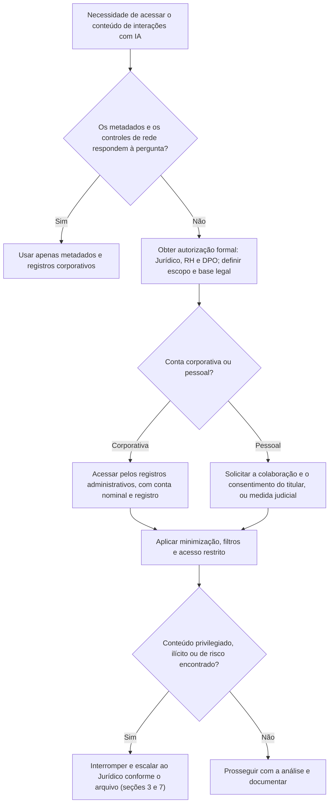

# Privacidade, Sigilo e Aspectos Legais de Prompts

> **Objetivo pedagógico:** tratar, de forma lícita e proporcional, os aspectos de privacidade, de sigilo e legais da investigação de prompts e de interações com IA: prompts como dados pessoais, bases legais, monitoramento de colaboradores, comunicações privilegiadas e segredos, retenção e retenção legal, direitos dos titulares, transferências internacionais, conteúdo ilícito, contratos com fornecedores e admissibilidade das provas.

> **Aviso:** este material é técnico-educacional e não substitui parecer jurídico. Valide cada caso com o Jurídico e com o DPO. As normas e a jurisprudência sobre IA evoluem rapidamente.

## 1. Prompts e respostas como dados pessoais

| Aspecto | Orientação |
|---|---|
| Conteúdo | Prompts e respostas podem conter dados pessoais do usuário e de terceiros (clientes, colegas e candidatos), inclusive dados sensíveis (saúde, biometria, religião e outros) |
| Identificabilidade | Metadados (conta, IP e horário) ligam o conteúdo à pessoa; o conteúdo sozinho também pode identificar |
| Princípios | Finalidade, adequação, necessidade, transparência, segurança, prevenção e responsabilização (LGPD, art. 6º) |
| Bases legais | Obrigação legal, legítimo interesse (com avaliação), execução de contrato, exercício regular de direitos e outras (art. 7º); dados sensíveis, art. 11 |
| Segurança | Medidas técnicas e administrativas proporcionais (art. 46): criptografia, controle de acesso e registro de acessos |
| Registro das operações e relatório de impacto | Mapear o tratamento de registros de IA (art. 37) e avaliar o impacto quando cabível (art. 38) |
| Crianças e adolescentes | Tratamento no melhor interesse (art. 14); atenção em serviços acessíveis a menores |

## 2. Monitoramento do uso de IA por colaboradores

| Tema | Orientação |
|---|---|
| Política | Política de uso aceitável de IA, comunicada, que informe o monitoramento, a finalidade e as consequências |
| Finalidade legítima | Segurança da informação, proteção de dados e de segredos, conformidade e prevenção a fraudes |
| Proporcionalidade | Começar por metadados e por controles de rede e de DLP; acessar o conteúdo apenas quando necessário e autorizado |
| Contas pessoais | Não acessar contas pessoais sem consentimento ou ordem; usar registros corporativos |
| Separação entre uso pessoal e profissional | Quando houver mistura, minimizar o acesso ao conteúdo pessoal |
| Participação do RH e do Jurídico | Obrigatória em investigações sobre condutas de pessoas |
| Direito de defesa | Informar o colaborador e permitir explicações, conforme o procedimento disciplinar |
| Proibição de discriminação e de perfilamento indevido | Evitar usos dos registros para avaliar traços pessoais irrelevantes |
| Registro do acesso | Quem acessou os registros, quando e por quê |

## 3. Sigilo, privilégio e segredos

| Situação | Conduta |
|---|---|
| Comunicações entre advogado e cliente em prompts | Proteção do sigilo profissional da advocacia (Lei nº 8.906/1994, art. 7º): interromper a revisão do trecho e acionar o Jurídico |
| Segredos comerciais e industriais | Tratar como confidenciais; acesso restrito e acordos de confidencialidade para peritos e terceiros |
| Informações de clientes e parceiros | Verificar obrigações contratuais de confidencialidade e de notificação |
| Informações classificadas ou regulamentadas | Seguir a regulação setorial (financeiro, saúde e administração pública) |
| Dados de investigações internas | Distribuição restrita, com marcação de confidencialidade |
| Uso de IA por advogados e peritos | Atenção ao sigilo ao usar ferramentas de terceiros; avaliar contratos e configurações |

## 4. Retenção, minimização e retenção legal

| Tema | Orientação |
|---|---|
| Definir prazos | Prazos de retenção de registros de IA por camada: metadados mais longos; conteúdo mais curto e justificado (arquivo 2) |
| Minimização | Redação ou pseudonimização de dados pessoais nos registros, quando compatível com a finalidade |
| Retenção legal | Ordens judiciais, litígios previstos e investigações podem exigir a suspensão do descarte; registrar a decisão e a abrangência |
| Eliminação | Descartar com segurança ao fim do prazo (LGPD, arts. 15 e 16); atentar para cópias de segurança e para registros em provedores |
| Registros em provedores | Verificar as políticas de retenção e os procedimentos de exclusão e de preservação |
| Marco Civil da Internet | Provedores de aplicações de internet com atividade econômica, organizada e profissional devem guardar registros de acesso por 6 meses (art. 15); verifique a aplicabilidade a serviços internos |
| Decisões judiciais | Tribunais em diferentes países têm determinado a preservação de registros de interações com IA em litígios; considere o risco de pedidos de preservação e de exibição |

## 5. Direitos dos titulares e decisões automatizadas

| Direito | Implicação para os registros |
|---|---|
| Acesso, correção e eliminação (LGPD, art. 18) | Capacidade de localizar e tratar registros de IA que contenham dados do titular |
| Informação sobre compartilhamento | Mapear fornecedores de IA com quem os dados são compartilhados |
| Revisão de decisões automatizadas (art. 20) | Capacidade de reconstruir a decisão e a interação (pasta 24) |
| Oposição e revogação | Processos para interromper o tratamento, quando cabível |
| Transparência | Informar quando o titular interage com um sistema de IA e como os dados são tratados |

## 6. Fornecedores de IA e transferências internacionais

| Tema | Orientação |
|---|---|
| Papel do fornecedor | Operador ou controlador, conforme o caso; contrato com cláusulas de proteção de dados |
| Retenção e uso para treinamento | Verificar nos termos e nas configurações; contratar opções de não retenção e de não uso para treinamento, quando necessário |
| Localização dos dados e transferência internacional | LGPD, arts. 33 a 36 e regulamentação da ANPD (confirme a norma vigente): mecanismos de transferência e cláusulas |
| Auditoria e cooperação | Cláusulas de acesso a registros, de preservação e de cooperação em investigações |
| Notificação de incidentes | Prazos e conteúdo exigidos do fornecedor |
| Subprocessadores | Lista e controle de terceiros que tratam os dados |
| Término do contrato | Devolução e eliminação dos dados |

## 7. Conteúdo ilícito e de risco nos registros

| Situação | Conduta |
|---|---|
| Material ilícito, em especial envolvendo crianças e adolescentes | Interromper imediatamente; não copiar, não compartilhar e não visualizar além do estritamente necessário; acionar o Jurídico para comunicar por canais oficiais e preservar conforme a orientação; o tratamento legal da posse e do armazenamento desse material é específico (ECA, arts. 240 a 241-E) |
| Ameaças e risco à vida ou à integridade | Escalar imediatamente, conforme o procedimento da organização, às autoridades competentes |
| Fraudes, extorsão e outros crimes | Preservar com cadeia de custódia e avaliar a comunicação às autoridades, com o Jurídico |
| Assédio e discriminação | Preservar e encaminhar ao RH e ao Jurídico, observando a proporcionalidade e o sigilo |
| Apoio ao investigador | Limitar a exposição a conteúdo perturbador e oferecer apoio psicológico |

## 8. Admissibilidade e valor probatório

| Tema | Orientação |
|---|---|
| Licitude | A prova obtida por meios ilícitos (acesso indevido a contas, violação de sigilo) pode ser invalidada: respeitar os portões legais |
| Autenticidade e integridade | Exportações com hash, fonte primária e corroboração independente; cadeia de custódia (CPP, arts. 158-A a 158-F) |
| Ata notarial | Útil para conteúdo público e para provas centrais (CPC, art. 384) |
| Perícia | Laudo com método, limitações e grau de confiança (pasta 22); atenção ao não determinismo |
| Valor da saída do modelo | A saída prova o que foi dito, e não a veracidade; pode ser relevante como fato (por exemplo, "o chatbot informou X ao cliente"), com a versão e o contexto |
| Responsabilidade por saída | Questões de responsabilidade civil e consumerista por informações do chatbot dependem do caso; a prova técnica da versão, do contexto e da resposta é central |
| Exigência de produção | Em litígios, interações com IA podem ser objeto de pedidos de exibição; planeje a localização e a revisão (eDiscovery, pasta 19 e PB-46) |

## 9. Fluxo de decisão para acesso a conteúdo de prompts

## 10. Exemplo prático: pedido de investigação sobre um colaborador

| Pedido | Avaliação | Conduta |
|---|---|---|
| "Quero ler todas as conversas do colaborador com a IA nos últimos 6 meses." | Desproporcional; sem requisito específico | Definir o requisito (por exemplo, divulgação de um contrato em determinada data); limitar o período, os sistemas e as palavras-chave; começar por metadados |
| "Ele usou uma conta pessoal." | O acesso direto não é permitido sem base | Solicitar colaboração e consentimento, ou avaliar medida judicial; usar os registros corporativos (proxy e DLP) |
| Durante a revisão, aparecem mensagens com um advogado externo | Possível comunicação privilegiada | Interromper, acionar o Jurídico e excluir do material de revisão |
| Aparece conteúdo ilícito com envolvimento de menores | Situação de escalonamento imediato | Interromper, não copiar e acionar o Jurídico para a comunicação por canais oficiais |

## 11. Casos de uso corporativos

- Elaboração de política e de procedimentos para o acesso a registros de IA em investigações.
- Avaliação de contratos de fornecedores de IA quanto a retenção, a exclusão e a cooperação.
- Preparação para pedidos de preservação e de exibição de interações com IA em litígios.

## 12. Normas e frameworks relevantes

- LGPD, arts. 5º, 6º, 7º, 11, 14, 15, 16, 18, 20, 33 a 36, 37, 38, 46 e 48
- CF, art. 5º, X e XII; Marco Civil da Internet, arts. 7º, 10, 15 e 22; Lei nº 8.906/1994, art. 7º; ECA, arts. 240 a 241-E
- CPP, arts. 158-A a 158-F; CPC, art. 384; ISO/IEC 27050; ISO/IEC 27701 (privacidade)
- ISO/IEC 42001:2023; NIST AI RMF 1.0 e NIST Privacy Framework

## 13. Referências

- Brasil. Lei nº 13.709/2018 (LGPD); Lei nº 12.965/2014 (Marco Civil da Internet); Lei nº 8.069/1990 (ECA); Lei nº 8.906/1994.
- ANPD. Guias e regulamentos sobre tratamento de dados pessoais, incidentes e transferência internacional.
- ISO/IEC 27701:2019; NIST. Privacy Framework 1.0.
- Termos de serviço e acordos de tratamento de dados dos fornecedores de IA (versões vigentes).
- Pastas 02, 06, 19, 22 e 24 deste repositório.
