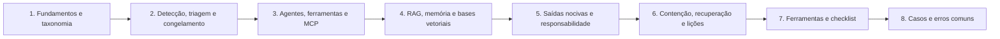

# 26 Investigação de Incidentes com LLM

## Objetivo

Investigar incidentes com aplicações de modelos de linguagem e com agentes: detectar, triar e classificar; congelar o estado do sistema; reconstruir traces e correlacionar com os registros dos sistemas de destino; analisar permissões, identidades, ferramentas e servidores MCP (agência excessiva); investigar contaminação e vazamento em RAG, memórias e bases vetoriais; tratar saídas nocivas, alucinações e responsabilidade por resultados; e conter, recuperar, notificar e aprender, com preservação de evidências, proporcionalidade e base legal.

## Trilha de estudo recomendada

## Conteúdo da pasta

| Ordem | Arquivo | Objetivo |
|---|---|---|
| 1 | [fundamentos-de-incidentes-com-llm-e-agentes.md](fundamentos-de-incidentes-com-llm-e-agentes.md) | Arquitetura, taxonomia, superfície de ataque, ciclo de resposta e aspectos legais |
| 2 | [deteccao-triagem-e-classificacao-de-incidentes-com-llm.md](deteccao-triagem-e-classificacao-de-incidentes-com-llm.md) | Detecção, triagem, gravidade, congelamento de estado e contenção inicial |
| 3 | [investigacao-de-agentes-ferramentas-e-mcp.md](investigacao-de-agentes-ferramentas-e-mcp.md) | Traces, correlação com sistemas de destino, permissões, identidades e MCP |
| 4 | [rag-memoria-e-bases-vetoriais-contaminacao-e-vazamento.md](rag-memoria-e-bases-vetoriais-contaminacao-e-vazamento.md) | Contaminação do índice e da memória, falhas de ACL e vazamentos |
| 5 | [saidas-nocivas-alucinacoes-e-responsabilidade-por-resultados.md](saidas-nocivas-alucinacoes-e-responsabilidade-por-resultados.md) | Saídas incorretas ou nocivas, código gerado, diligência e responsabilidade |
| 6 | [contencao-recuperacao-e-licoes-aprendidas-em-incidentes-com-llm.md](contencao-recuperacao-e-licoes-aprendidas-em-incidentes-com-llm.md) | Catálogo de ações, validação, notificações e lições aprendidas |
| 7 | [ferramentas-fluxo-modelos-e-checklist-de-incidentes-com-llm.md](ferramentas-fluxo-modelos-e-checklist-de-incidentes-com-llm.md) | Ferramentas, modelos de registro e checklist |
| 8 | [casos-de-uso-e-erros-comuns-em-incidentes-com-llm.md](casos-de-uso-e-erros-comuns-em-incidentes-com-llm.md) | Sete cenários, erros comuns e exercícios |

## Princípios

- Congelar o estado (modelo, prompt, ferramentas, índice, memória, traces e auditorias) antes de corrigir
- Contenção proporcional e reversível: desabilitar ferramentas e credenciais antes de desligar tudo; desativar, e não excluir
- Corroborar o trace com os registros de auditoria dos sistemas de destino
- Analisar a arquitetura e as permissões: muitos danos decorrem da agência excessiva, e não do modelo
- Aprovar ferramentas e servidores MCP por versão e hash, e monitorar alterações de manifestos
- Aplicar controles de acesso na camada de dados do RAG; limitar o escopo e as gravações da memória
- Distinguir falha, abuso e ataque; considerar hipóteses alternativas e causas combinadas
- Validar a recuperação com testes de regressão e de segurança e reativar de forma gradual
- Comunicar com fatos verificados e converter as lições em testes, detecções e playbooks

## Relação com outras pastas

- 02, 03 e 04: custódia, coleta e hashes dos artefatos congelados
- 11, 13 e 20: logs, egresso e caça a ameaças
- 12, 15 e 17 a 19: e-mail, malware, nuvem, identidade e Microsoft 365 (registros dos sistemas de destino)
- 16 e 22: resposta a incidentes, relatórios e comunicação
- 23: playbooks PB-35, PB-36 e PB-45
- 24: forense de IA (modelos, dados e auditoria de decisões)
- 25: forense de prompts e injeção de prompts
- 27: deepfakes e mídias sintéticas
- 30: lições aprendidas

## Referências

- OWASP. Top 10 for LLM Applications e GenAI Security Project (IA agêntica); MITRE. ATLAS
- NIST AI 600-1 (2024); NIST AI 100-2 (edição vigente); NIST AI RMF 1.0; NIST SP 800-61 Rev. 3 (2025)
- ISO/IEC 27035; ISO/IEC 42001:2023; ISO/IEC 27037
- Documentação e orientações de segurança do Model Context Protocol (versão vigente)
- Greshake, K. et al. Indirect Prompt Injection (2023)
- Brasil. LGPD (Lei nº 13.709/2018); Resolução CD/ANPD nº 15/2024; CDC (Lei nº 8.078/1990); Código Civil
- Regulamento (UE) 2024/1689 (AI Act), arts. 50 e 73
- Responsible AI Collaborative. AI Incident Database
