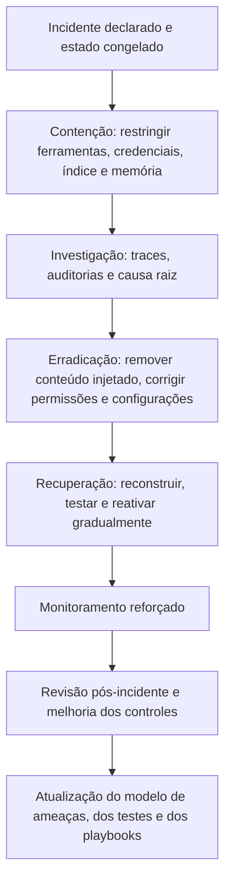

# Contenção, Recuperação e Lições Aprendidas em Incidentes com LLM

> **Objetivo pedagógico:** conter, erradicar e recuperar aplicações com LLM e agentes após um incidente (catálogo de ações por tipo de incidente), validar a recuperação com testes de regressão e de segurança, decidir sobre notificações e comunicação, coordenar com fornecedores e transformar o aprendizado em controles, testes e playbooks.

## 1. Ciclo de resposta para LLM e agentes

## 2. Catálogo de ações por tipo de incidente

| Tipo de incidente | Contenção | Erradicação | Recuperação e validação |
|---|---|---|---|
| Injeção direta ou indireta com ações | Desabilitar ferramentas de escrita; aprovação humana; bloquear a origem do conteúdo | Remover o conteúdo injetado; corrigir fluxos que tratam conteúdo externo como confiável | Testes de injeção em ambiente de teste; reativar com privilégio mínimo |
| Exfiltração por saída ou por ferramenta | Bloquear egresso e destinos; revogar tokens | Restringir destinos, remover permissões, mascarar dados no contexto | Verificação de egresso; testes de vazamento |
| Contaminação do índice | Quarentena de documentos; suspender a ingestão | Reconstruir o índice a partir da fonte de verdade, com permissões | Testes de acesso por perfil; verificação de hashes |
| Vazamento por falha de ACL no índice ou isolamento | Retirar o índice do ar ou restringir a recuperação | Reconstruir com filtros por usuário e por locatário | Testes de acesso negativo e de isolamento |
| Contaminação da memória | Desativar a memória de longo prazo; exportar | Limpar entradas e corrigir o fluxo de gravação | Testes de regressão; reativação com revisão de gravações |
| Envenenamento de ferramentas ou servidor MCP | Desabilitar o servidor; revogar tokens | Remover o servidor, verificar a origem, fixar versões e hashes dos manifestos | Aprovação formal e inventário antes de reabilitar |
| Agência excessiva (ações indevidas) | Modo somente leitura; revogar permissões | Aplicar privilégio mínimo, limites de valor e de volume, e aprovações | Testes de limites; simulações de ações negadas |
| Consumo ilimitado e custos | Limites de taxa, de iteração e de orçamento; bloquear abuso | Corrigir laços, validações e limites; rotacionar chaves vazadas | Testes de carga e de limites |
| Chave de API vazada | Revogar e rotacionar imediatamente | Remover do código, dos logs e do contexto | Varredura de segredos |
| Saída nociva ou incorreta | Ajustar o prompt e os filtros; restringir o escopo | Corrigir a base, adicionar validações determinísticas e supervisão | Testes de segurança e de qualidade (conjuntos de referência) |
| Código inseguro adotado | Reverter commits; bloquear dependências | Remover vulnerabilidades e segredos; revisão e análise estática | Testes e varreduras no pipeline |

Em todos os casos: **preservar e registrar o estado anterior** antes de alterar (arquivo 2, seção 5).

## 3. Validação da recuperação

| Teste | Descrição |
|---|---|
| Regressão funcional | O sistema mantém o desempenho esperado em um conjunto de referência (casos dourados) |
| Segurança e injeção | Casos de teste de injeção, de vazamento e de abuso de ferramentas executados em ambiente de teste |
| Controle de acesso | Usuários sem permissão não recebem conteúdo restrito; isolamento entre locatários |
| Limites e custos | Limites de taxa e de iteração funcionam |
| Ferramentas | Ações sensíveis exigem aprovação; destinos externos são bloqueados conforme a política |
| Registro e detecção | Os traces e os alertas funcionam e cobrem o cenário do incidente |
| Reativação gradual | Liberar por grupos e por funções, com monitoramento e condições de reversão (canário) |

Ferramentas de avaliação de segurança e de qualidade de LLM (por exemplo, promptfoo, garak, PyRIT e ferramentas de avaliação de RAG) são úteis para automatizar esses testes **em ambientes autorizados**.

## 4. Notificações e comunicação

> **Aviso:** os prazos e o conteúdo dependem da norma e do caso. O Jurídico e o DPO conduzem.

| Destinatário | Gatilho e conteúdo |
|---|---|
| ANPD e titulares | Incidente com dados pessoais que possa acarretar risco ou dano relevante (LGPD, art. 48; Resolução CD/ANPD nº 15/2024) |
| Reguladores setoriais | Conforme a norma aplicável |
| Autoridades da UE | Incidentes graves de sistemas de alto risco (AI Act, art. 73), conforme o cronograma vigente |
| Clientes e parceiros | Conforme contratos: o que ocorreu, o que foi afetado, medidas e contato |
| Usuários afetados por saídas incorretas | Correção da informação e orientação |
| Seguradora | Conforme a apólice |
| Fornecedores de modelos e de plataformas | Chamado de incidente, pedido de preservação e de cooperação |
| Imprensa e público | Declaração coordenada, com fatos verificados |

Use os modelos de SITREP, de relatório executivo e de comunicações da pasta 22. Evite afirmações categóricas (por exemplo, "nenhum dado foi acessado") sem evidências.

## 5. Coordenação com fornecedores

| Aspecto | Prática |
|---|---|
| Canal de incidentes | Identificar previamente os contatos e os procedimentos de escalonamento |
| Preservação | Solicitar a preservação de registros relevantes (requisições, filtros e abuso) |
| Informações técnicas | Solicitar identificadores de requisição, versões de modelos e detalhes de incidentes do lado do fornecedor |
| Correções | Acompanhar correções e mudanças de comportamento do modelo |
| Contrato | Verificar obrigações de notificação, de cooperação e de acesso a registros |
| Comunicação | Alinhar mensagens quando o incidente envolver o fornecedor |

## 6. Revisão pós-incidente e lições aprendidas

| Item | Conteúdo |
|---|---|
| Linha do tempo | Do primeiro desvio à recuperação, em UTC |
| Causa raiz e fatores contribuintes | Técnicos (permissões, isolamento e validações), de processo (aprovações e versionamento) e de governança (inventário e testes) |
| O que funcionou e o que falhou | Detecção, desligamento, congelamento, comunicação e recuperação |
| Impacto | Dados, usuários, custos, decisões e reputação |
| Ações corretivas e preventivas | Com responsáveis, prazos e verificação |
| Novos testes | Casos de regressão e de segurança derivados do incidente |
| Novas detecções | Alertas e regras (traces, ferramentas, egresso e custos) |
| Atualização do modelo de ameaças e dos playbooks | PB-45 e demais |
| Compartilhamento | Lições internas e, quando adequado, com a comunidade (sem dados sensíveis), em bases de incidentes |
| Cultura | Revisão sem atribuição de culpa individual; foco em sistemas e processos |

## 7. Indicadores para a gestão

| Indicador | Uso |
|---|---|
| Tempo entre o primeiro desvio e a detecção | Eficácia da detecção |
| Tempo até a contenção | Prontidão |
| Tempo até a recuperação validada | Eficiência |
| Número de usuários e de decisões afetados | Impacto |
| Cobertura de testes de segurança derivados | Aprendizado |
| Percentual de agentes com privilégio mínimo e aprovação em ações sensíveis | Maturidade |
| Tempo de resposta de fornecedores | Gestão de terceiros |

## 8. Exemplo prático: recuperação após contaminação do índice e da memória

| Fase | Ações |
|---|---|
| Contenção | Ferramentas de escrita desabilitadas; memória de longo prazo suspensa; documentos suspeitos em quarentena |
| Erradicação | Documentos injetados removidos; índice reconstruído a partir da fonte, com ACL por documento; entradas de memória contaminadas excluídas após exportação |
| Validação | 120 casos de regressão; 40 casos de injeção; testes de acesso por perfil (todos aprovados); verificação de hashes entre fonte e índice |
| Reativação | Liberação para 10% dos usuários por 3 dias, com monitoramento; depois, total |
| Melhorias | Verificação de origem de documentos, varredura de texto oculto na ingestão, escopo de memória por usuário, aprovação humana para envio externo, registros de recuperação |
| Notificações | Avaliação pelo DPO; comunicação interna e a clientes afetados, conforme contrato |

## 9. Casos de uso corporativos

- Execução de recuperação validada de aplicações de IA após incidentes.
- Construção de bibliotecas de testes de segurança alimentadas por incidentes reais.
- Gestão de incidentes com fornecedores de modelos e de plataformas.

## 10. Normas e frameworks relevantes

- NIST SP 800-61 Rev. 3; ISO/IEC 27035; NIST CSF 2.0 (Responder e Recuperar); NIST AI 600-1; ISO/IEC 42001:2023
- OWASP Top 10 para LLM; OWASP GenAI Security Project; MITRE ATLAS
- CIS Controls v8.1, controle 17; ISO 22301
- LGPD, arts. 46, 48 e 52; Resolução CD/ANPD nº 15/2024; Regulamento (UE) 2024/1689 (art. 73)

## 11. Referências

- NIST SP 800-61 Rev. 3 (2025); NIST AI 600-1 (2024); NIST SP 800-84.
- Documentação do promptfoo, do garak, do PyRIT e de ferramentas de avaliação de RAG.
- Responsible AI Collaborative. AI Incident Database.
- Pastas 16, 22, 23 e 24 deste repositório.
