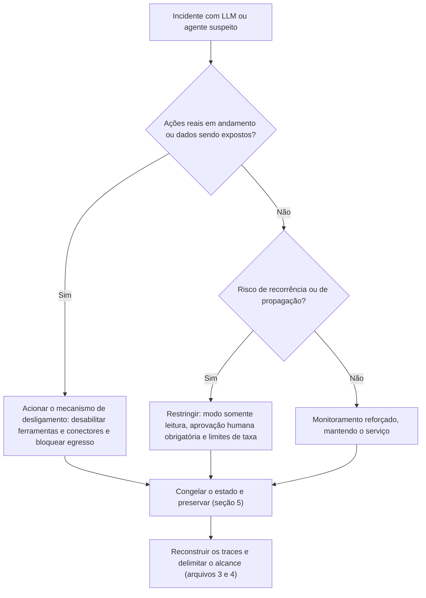

# Detecção, Triagem e Classificação de Incidentes com LLM

> **Objetivo pedagógico:** identificar as fontes de detecção de incidentes com aplicações de LLM e agentes, conduzir a triagem inicial (distinguindo falha, abuso e ataque), classificar a gravidade, congelar o estado do sistema para preservar as evidências, tomar decisões iniciais de contenção (incluindo o desligamento controlado) e comunicar de forma adequada nas primeiras horas.

## 1. Fontes de detecção

| Fonte | Sinais | Observações |
|---|---|---|
| Guardrails e filtros de segurança | Bloqueios, alertas de injeção, de dados sensíveis e de conteúdo proibido | Taxas incomuns de bloqueio indicam tentativas |
| Monitoramento de ferramentas | Chamadas de ferramentas fora do padrão, destinos externos, sequências incomuns | Compare com a linha de base por aplicação |
| Monitoramento de egresso e de rede | Conexões do ambiente do agente a destinos novos; envio de dados | Pasta 13 |
| Custos e consumo | Picos de tokens, de requisições e de custos; laços de agentes | Alertas de faturamento |
| DLP e CASB | Dados sensíveis em entradas e saídas | Pasta 24 |
| Relatos de usuários e de suporte | Respostas estranhas, dados de outras pessoas, ações inesperadas | Canal de reporte facilitado |
| Equipes de teste e de red team autorizado | Falhas descobertas em testes | Convertê-las em itens de risco |
| Avaliações contínuas | Queda em testes de segurança e de qualidade após mudanças | Testes de regressão |
| Fornecedores de modelos e de plataformas | Avisos de incidentes, de abuso ou de vazamento | Acompanhar canais oficiais |
| Auditoria dos sistemas de destino | Ações atribuídas à conta do agente | Nuvem, SaaS e repositórios |
| Inteligência de ameaças e bases de incidentes | Novas técnicas e campanhas | MITRE ATLAS e bases públicas |

## 2. Triagem inicial: perguntas

| Pergunta | Por que importa |
|---|---|
| O que foi observado e quando começou? | Define a janela de interesse e a urgência |
| Que aplicação, modelo, versão e agente estão envolvidos? | Escopo e congelamento |
| Há ações reais em sistemas externos ou apenas respostas de texto? | Diferencia incidente de ações e de conteúdo |
| Há dados pessoais, sigilosos ou credenciais envolvidos? | Obrigações legais e prioridade |
| O problema é recorrente, dirigido (ataque) ou aleatório (falha)? | Estratégia de contenção |
| Quantos usuários e sistemas podem estar afetados? | Raio de impacto |
| Há conteúdo externo (e-mail, documento ou página) no contexto? | Pista de injeção indireta |
| O agente tem aprovação humana nas ações sensíveis? | Controles existentes |
| Houve mudanças recentes (modelo, prompt, ferramenta ou índice)? | Causa provável |

## 3. Distinguir falha, abuso e ataque

| Tipo | Indícios | Tratamento |
|---|---|---|
| Falha (bug, erro de configuração ou limitação do modelo) | Ocorre sem agente adversário; relacionada a mudança recente; reproduzível em testes | Correção e testes de regressão |
| Abuso por usuário legítimo ou interno | Uso fora da política; padrões de tentativa e erro; credenciais próprias | Apuração com RH e Jurídico; orientação ou medidas |
| Ataque externo ou dirigido | Conteúdo de origem externa com instruções; infraestrutura do atacante; exfiltração | Resposta de incidente de segurança completa |
| Dano sem ataque (safety) | Saída nociva por limitação do modelo ou do sistema | Arquivo 5; mitigação e comunicação |
| Falso positivo | Alerta sem impacto real | Documentar e ajustar a detecção |

Muitos incidentes têm **causas combinadas** (por exemplo, falha de permissão que torna a injeção grave). Evite concluir antes de reconstruir o trace.

## 4. Classificação da gravidade (modelo)

| Nível | Critérios (exemplos) | Resposta |
|---|---|---|
| Crítico | Ações irreversíveis em sistemas críticos; exposição de dados sensíveis em larga escala; exfiltração em curso; dano a pessoas; agente fora de controle | Desligamento imediato de ferramentas ou do sistema; equipe de crise; Jurídico e DPO |
| Alto | Ações indevidas limitadas; dados pessoais expostos; injeção confirmada com efeito; custo muito elevado | Contenção prioritária em horas; investigação formal |
| Médio | Respostas indevidas sem dados sensíveis; tentativas bloqueadas; falhas com impacto contido | Correção programada; monitoramento reforçado |
| Baixo | Eventos isolados sem impacto | Registro e melhoria |

Fatores que elevam a gravidade: autonomia sem aprovação humana, permissões amplas, acesso a dados de clientes, múltiplos usuários afetados, persistência (memória ou índice) e prazos legais.

## 5. Congelamento do estado (preservação inicial)

Antes de alterar o sistema, **congele o estado** para preservar as evidências (PB-45 e PB-01):

| Item | Ação |
|---|---|
| Versão do modelo | Registrar a versão exata e fixá-la (sem atualização automática) durante a investigação |
| Prompt do sistema e configurações | Exportar do repositório e do ambiente; hash; tag imutável |
| Definições de ferramentas e de conectores | Exportar esquemas, descrições, permissões e versões dos servidores de ferramentas; hash |
| Índice de recuperação (RAG) | Instantâneo do índice e dos metadados (origem e hashes dos documentos) |
| Memória do agente | Exportar o conteúdo atual (curto e longo prazo) antes de limpar |
| Traces e logs | Exportar traces, logs de ferramentas, de gateway, de guardrails e de nuvem do período; hash |
| Credenciais e escopos | Registrar as credenciais usadas pelo agente e seus escopos; **desativar (e não excluir)** quando necessário |
| Conteúdo de origem suspeito | Preservar documentos, e-mails e páginas (com hash) que entraram no contexto |
| Custos e faturamento | Exportar o consumo por chave e por projeto |
| Retenção legal | Aplicar nos registros de aplicação e solicitar a preservação a fornecedores |

```bash
# Hash e manifesto dos artefatos de congelamento
find ./congelamento_DFL-2026-001 -type f -print0 | sort -z | xargs -0 sha256sum > manifesto_congelamento.sha256

# Instantâneo do repositório de configuração e de prompts, com histórico
git bundle create prompts_config_DFL-2026-001.bundle --all
sha256sum prompts_config_DFL-2026-001.bundle > prompts_config_DFL-2026-001.bundle.sha256
```

## 6. Decisões iniciais de contenção



| Medida | Quando usar | Impacto |
|---|---|---|
| Desligar a aplicação inteira | Dano grave e incontido | Alto impacto no negócio |
| Desabilitar ferramentas e conectores (manter apenas respostas de texto) | Ações indevidas ou exfiltração | Reduz funcionalidade, mantém o atendimento básico |
| Modo somente leitura e aprovação humana para ações | Risco de ações indevidas, mas necessidade de continuidade | Mais lento, porém seguro |
| Revogar tokens e credenciais do agente | Credenciais comprometidas ou uso indevido | Interrompe ações; rotacionar depois |
| Colocar o índice em quarentena ou desabilitar documentos suspeitos | Suspeita de contaminação | Reduz a qualidade das respostas |
| Limitar a taxa e o consumo | Consumo ilimitado ou abuso | Afeta usuários legítimos |
| Bloquear contas ou IPs abusivos | Abuso externo | Cuidado com falsos positivos |
| Fixar a versão do modelo e do prompt | Preservar o estado | Pode impedir correções rápidas; usar ambiente espelho |

Mecanismos de **desligamento seletivo** (por exemplo, sinalizadores de recursos) devem existir antes do incidente e ser testados.

## 7. Comunicação inicial

| Público | Conteúdo |
|---|---|
| Equipe de crise | O que se sabe, o que não se sabe, gravidade, ações em curso e decisões necessárias |
| Direção | Impacto, riscos e decisões (por exemplo, desligamento) |
| Usuários e clientes | Mensagem factual quando houver impacto: serviço limitado, orientação e canais de apoio; sem afirmações categóricas |
| Jurídico e DPO | Dados envolvidos e prazos |
| Fornecedores | Abertura de chamado e pedido de preservação e de cooperação |

Use os modelos de SITREP da pasta 22, com as seções "o que sabemos" e "o que não sabemos".

## 9. Exemplo prático: triagem de um alerta de custos

| Passo | Resultado |
|---|---|
| Alerta | Custo diário de tokens 18 vezes acima do normal em um assistente interno de análise |
| Triagem | Poucas contas de usuário; chamadas de ferramenta de busca na web em laço; sem dados pessoais envolvidos |
| Classificação | Médio (custo elevado, sem exposição de dados), com possibilidade de elevação |
| Congelamento | Traces, prompt do sistema, definição da ferramenta e faturamento exportados com hash |
| Contenção | Limite de iterações do agente e de taxa; ferramenta de busca restrita a lista de domínios |
| Hipóteses | Falha (laço sem condição de parada) versus injeção em página web visitada |
| Resultado | Os traces mostram que uma página continha texto que induzia o agente a continuar pesquisando; tratado como injeção indireta com impacto de custo (arquivo 3) |

## 10. Casos de uso corporativos

- Montagem de painéis e de alertas para aplicações de IA, com limiares por aplicação.
- Treinamento do plantão para triagem e congelamento de estado em incidentes de IA.
- Testes periódicos do mecanismo de desligamento seletivo.

## 11. Normas e frameworks relevantes

- OWASP Top 10 para LLM; OWASP GenAI Security Project (IA agêntica); MITRE ATLAS
- NIST SP 800-61 Rev. 3; ISO/IEC 27035; NIST AI 600-1; ISO/IEC 42001:2023
- CIS Controls v8.1, controles 8 e 17; LGPD, arts. 46 e 48

## 12. Referências

- OWASP. Top 10 for LLM Applications (edição vigente).
- NIST SP 800-61 Rev. 3 (2025); NIST AI 600-1 (2024).
- Documentação de sinalizadores de recursos (por exemplo, OpenFeature) e de observabilidade de LLM.
- Pastas 22, 23 (PB-01 e PB-45) e 25 deste repositório.
