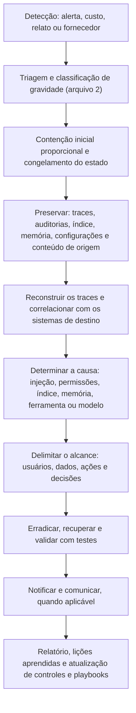

# Ferramentas, Fluxo, Modelos e Checklist de Incidentes com LLM

> **Objetivo pedagógico:** padronizar as ferramentas, o fluxo de trabalho, os registros e a verificação de qualidade das investigações de incidentes com LLM e agentes, de modo que sejam rápidas, seguras, reproduzíveis, proporcionais e defensáveis.

## 1. Ferramentas por finalidade

| Finalidade | Ferramentas |
|---|---|
| Traces e observabilidade de LLM e de agentes | Langfuse, LangSmith, Helicone, Arize Phoenix, OpenTelemetry e rastros de frameworks de agentes |
| SIEM e análise de logs | Sentinel, Splunk, Elastic, DuckDB, `jq` e Python (pastas 11 e 20) |
| Auditoria de sistemas de destino | CloudTrail, Activity Log, Cloud Audit Logs, auditoria do Microsoft 365 e logs de SaaS (pastas 17 a 19) |
| Preservação e integridade | `sha256sum`, `git bundle`, manifestos, armazenamento imutável |
| Análise de contêineres e de ambientes de execução | `kubectl`, `docker`, logs de contêineres (pastas 13 e 17) |
| Segredos e dados sensíveis | Gitleaks, TruffleHog, Presidio e DLP |
| Verificação de índice e de documentos | Hashes, comparação de manifestos, bancos vetoriais e consultas SQL |
| Testes de segurança e de regressão (somente em ambientes autorizados) | promptfoo, garak, PyRIT, ferramentas de avaliação de RAG e conjuntos de referência |
| Mecanismos de desligamento seletivo | Sinalizadores de recursos (por exemplo, OpenFeature) e políticas de gateway |
| Documentação e comunicação | Modelos da pasta 22; Pandoc; repositório versionado |

Registre nome, versão e finalidade das ferramentas; execute testes ofensivos e de segurança apenas em ambientes de teste autorizados.

## 2. Fluxo de trabalho padronizado

## 3. Dez perguntas e como respondê-las

| Pergunta | Onde responder |
|---|---|
| 1. O incidente foi classificado e o estado do sistema foi congelado? | Registro do incidente e de congelamento |
| 2. Qual a aplicação, o modelo, o agente e as versões envolvidas? | Inventário e registro de versões |
| 3. O trace foi reconstruído, com o primeiro ponto de desvio identificado? | Linha do tempo de ações do agente |
| 4. As ações foram corroboradas pelos registros dos sistemas de destino? | Matriz de correlação |
| 5. Que permissões, identidades e aprovações existiam? | Inventário de ferramentas e permissões |
| 6. Houve conteúdo externo, índice ou memória contaminados, com fonte preservada? | Registros de RAG e de memória |
| 7. Houve exposição de dados, e de quais categorias e titulares? | Avaliação de impacto |
| 8. A causa raiz e os fatores contribuintes foram identificados, com hipóteses alternativas? | Relatório |
| 9. A recuperação foi validada com testes e com reativação gradual? | Registro de validação |
| 10. As notificações, as comunicações e as lições aprendidas foram tratadas? | Matriz de notificações e plano de ação |

## 4. Modelo A: Registro do Incidente com LLM

| Campo | Preenchimento |
|---|---|
| Identificador | DFL-AAAA-NNN |
| Data e hora de detecção e de início provável (UTC) | |
| Fonte da detecção | |
| Aplicação, modelo, agente e versões | |
| Tipo (confidencialidade, integridade, disponibilidade, agência excessiva, safety ou conformidade) | |
| Gravidade e critérios | |
| Dados envolvidos (categorias e titulares estimados) | |
| Ações reais em sistemas externos? | |
| Contenção realizada (hora e responsável) | |
| Congelamento realizado (referência ao modelo B) | |
| Fornecedores acionados | |
| Responsáveis (líder, forense, engenharia e jurídico) | |

## 5. Modelo B: Registro de Congelamento do Estado

| Item | Referência e hash | Data e hora (UTC) | Responsável |
|---|---|---|---|
| Versão do modelo e parâmetros | | | |
| Prompt do sistema e políticas (commit) | | | |
| Definições e manifestos de ferramentas e de servidores | | | |
| Instantâneo do índice e dos metadados | | | |
| Exportação da memória | | | |
| Traces e logs (período) | | | |
| Auditorias de sistemas de destino | | | |
| Credenciais e escopos (inventário) | | | |
| Conteúdo de origem suspeito | | | |
| Faturamento e consumo | | | |

## 6. Modelo C: Inventário de Ferramentas, Permissões e Identidades do Agente

| ID | Ferramenta ou servidor (versão e origem) | Função | Identidade usada (conta, delegação ou chave) | Escopos e permissões | Destinos permitidos | Aprovação humana exigida? | Limites (taxa, valor e volume) | Registros disponíveis | Observações |
|---|---|---|---|---|---|---|---|---|---|
| T-001 | | | | | | | | | |
| T-002 | | | | | | | | | |

## 7. Modelo D: Linha do Tempo de Ações do Agente (com correlação)

| Hora (UTC) | Execução e etapa (trace) | Evento (decisão, chamada ou observação) | Entrada de contexto relevante (origem e hash) | Sistema de destino e registro de auditoria correspondente | Aprovação | Interpretação | Confiança |
|---|---|---|---|---|---|---|---|
| | | | | | | | |

## 8. Modelo E: Matriz de Contenção e de Recuperação

| Ação | Alvo | Data e hora (UTC) | Estado anterior preservado | Responsável | Impacto | Teste de validação | Resultado |
|---|---|---|---|---|---|---|---|
| Desabilitar ferramenta de escrita | | | | | | | |
| Revogar credencial | | | | | | | |
| Quarentena de documentos | | | | | | | |
| Limpeza de memória | | | | | | | |
| Reconstrução do índice | | | | | | | |

## 9. Modelo F: Estrutura do Relatório de Incidente com LLM

| Seção | Conteúdo |
|---|---|
| 1. Resumo executivo | O que ocorreu, impacto, estado atual e decisões |
| 2. Escopo e autorização | Sistemas, período, base legal e restrições |
| 3. Arquitetura e ativos | Aplicação, modelo, ferramentas, índice, memória e identidades |
| 4. Linha do tempo | Do primeiro desvio à recuperação |
| 5. Reconstrução e análise | Traces, correlação com auditorias, causa e fatores contribuintes |
| 6. Impacto | Dados, usuários, decisões, custos e reputação |
| 7. Contenção, erradicação e recuperação | Ações, validações e reativação |
| 8. Notificações e comunicação | Obrigações e mensagens |
| 9. Recomendações | Controles, testes, detecções e playbooks, com responsáveis e prazos |
| 10. Limitações | Dados ausentes, não determinismo e incertezas |
| 11. Anexos | Hashes, consultas, manifestos e custódia |

## 10. Checklist operacional de incidentes com LLM

**Caso:** DFL-AAAA-NNN
**Aplicação:** ____________________
**Analista:** ____________________
**Data e hora (UTC):** ____________________

### 10.1 Triagem e contenção

- [ ] Gravidade classificada; equipe de crise acionada quando necessário
- [ ] Mecanismo de desligamento seletivo usado de forma proporcional (ferramentas, credenciais ou índice)
- [ ] Estado congelado (modelo, prompt, ferramentas, índice, memória, traces e auditorias) com hashes
- [ ] Credenciais do agente avaliadas; desativadas (e não excluídas) quando necessário
- [ ] Retenção legal aplicada e fornecedores acionados

### 10.2 Investigação

- [ ] Traces reconstruídos; primeiro ponto de desvio identificado
- [ ] Ações corroboradas pelos registros dos sistemas de destino
- [ ] Permissões, identidades, aprovações e limites analisados (agência excessiva)
- [ ] Conteúdo externo, índice, memória e ferramentas/servidores MCP verificados (hashes e manifestos)
- [ ] Alcance delimitado: usuários, dados e ações
- [ ] Hipóteses alternativas (falha, abuso e ataque) consideradas

### 10.3 Recuperação e relato

- [ ] Estado anterior registrado antes de cada alteração
- [ ] Recuperação validada com testes de regressão e de segurança; reativação gradual
- [ ] Notificações e comunicações avaliadas (LGPD, contratos e reguladores)
- [ ] Causa raiz, limitações e grau de confiança declarados
- [ ] Lições aprendidas incorporadas em testes, detecções e playbooks
- [ ] Revisão por pares realizada; dados pessoais minimizados no relatório

## 11. Resultado da verificação

| Resultado | Condição |
|---|---|
| Conforme | Todos os itens aplicáveis marcados |
| Conforme com ressalvas | Pendências sem impacto na contenção e nas obrigações, com plano de ação |
| Não conforme | Estado não congelado, credenciais excluídas antes da preservação, reativação sem validação, conclusões sem corroboração ou notificações sem avaliação; comunicar o líder, o Jurídico e o DPO |

**Assinatura do analista:** ____________________
**Assinatura do revisor:** ____________________

## 12. Casos de uso corporativos

- Padronização da resposta a incidentes com assistentes, RAG e agentes.
- Treinamento do plantão com exercícios de mesa e simulações em laboratório.
- Auditoria da prontidão de aplicações de IA (logs, permissões, desligamento e testes).

## 13. Normas e frameworks relevantes

- OWASP Top 10 para LLM; OWASP GenAI Security Project; MITRE ATLAS; NIST AI 600-1
- NIST SP 800-61 Rev. 3; ISO/IEC 27035; ISO/IEC 42001:2023; ISO/IEC 27037
- LGPD, arts. 6º, 46 e 48; Resolução CD/ANPD nº 15/2024

## 14. Referências

- Documentação do Langfuse, do LangSmith, do OpenTelemetry, do promptfoo, do garak e do PyRIT.
- OWASP. Top 10 for LLM Applications (edição vigente).
- Pastas 11, 17 a 19, 22, 23, 24 e 25 deste repositório.
