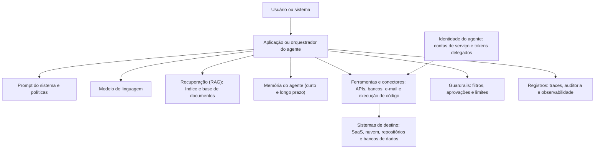

# Fundamentos de Incidentes com LLM e Agentes

> **Objetivo pedagógico:** compreender a arquitetura de aplicações com modelos de linguagem e de agentes (planejamento, ferramentas, memória, recuperação de dados, identidade e protocolos de integração), a taxonomia dos incidentes que podem ocorrer (confidencialidade, integridade, disponibilidade, segurança e conformidade), a superfície de ataque e de falha, e como adaptar o ciclo de resposta a incidentes a esses sistemas.

## 1. Do assistente ao agente

| Nível | Característica | Risco típico |
|---|---|---|
| Assistente de conversa | Responde a perguntas, sem acesso a sistemas | Saída incorreta ou nociva; vazamento de dados do contexto |
| Assistente com recuperação (RAG) | Consulta bases de documentos e inclui trechos no contexto | Exposição de documentos; contaminação do índice; injeção indireta |
| Assistente com ferramentas | Chama funções (buscar, enviar e-mail e consultar bancos) | Ações indevidas; abuso de permissões |
| Agente | Planeja passos, usa ferramentas em ciclos e pode manter memória | Cadeias de ações com efeitos reais; persistência de instruções na memória |
| Sistema multiagente | Vários agentes que delegam entre si | Propagação de erros e de instruções entre agentes; responsabilidade difusa |

Quanto mais autonomia, ferramentas e permissões, maior o **raio de impacto** de um incidente.

## 2. Arquitetura de referência e pontos de investigação

| Componente | O que investigar |
|---|---|
| Orquestrador e prompt do sistema | Versão vigente, regras e permissões declaradas |
| Modelo | Versão, parâmetros e provedor |
| RAG e índice | Origem e integridade dos documentos; controles de acesso; consultas |
| Memória | O que foi gravado, por quem e quando; instruções persistentes |
| Ferramentas e conectores | Definições, permissões, parâmetros e resultados |
| Identidade | Quais credenciais o agente usa e com que escopo |
| Guardrails | Que controles existiam e como foram contornados ou falharam |
| Sistemas de destino | Registros de auditoria das ações realizadas |

## 3. Taxonomia de incidentes

| Categoria | Exemplos | Referência |
|---|---|---|
| Confidencialidade | Vazamento de dados do contexto, do índice ou da memória; vazamento do prompt do sistema; exposição entre usuários ou locatários; exfiltração induzida | OWASP LLM02 e LLM07 |
| Integridade | Injeção de instruções (direta e indireta); contaminação do índice e da memória; ações não autorizadas; saídas manipuladas | OWASP LLM01, LLM04 e LLM05 |
| Disponibilidade e custos | Consumo ilimitado, laços de agentes, negação de carteira (custos), indisponibilidade de serviço | OWASP LLM10 |
| Agência excessiva | Agente com permissões ou autonomia além do necessário e efeitos indevidos em sistemas | OWASP LLM06 |
| Cadeia de suprimentos | Modelos, plugins, servidores de ferramentas e dependências comprometidos | OWASP LLM03; pasta 24 |
| Segurança e dano (safety) | Conselhos perigosos, conteúdo discriminatório, difamação e reprodução de conteúdo protegido | NIST AI 600-1 |
| Informação incorreta | Alucinações com consequências contratuais, regulatórias ou de saúde | OWASP LLM09 |
| Conformidade | Uso sem base legal, falta de transparência, ausência de supervisão humana exigida | LGPD; AI Act |
| Abuso por atores externos | Uso do serviço para fraude, spam ou geração de conteúdo ilícito | Pastas 21 e 25 |

## 4. Superfície de ataque e de falha

| Superfície | Descrição |
|---|---|
| Entradas do usuário | Prompts diretos, anexos e parâmetros |
| Conteúdo de terceiros processado | E-mails, documentos, páginas e resultados de ferramentas, com possíveis instruções ocultas |
| Índice de documentos | Documentos injetados ou alterados; falhas de permissões no índice |
| Memória | Gravação de instruções ou de dados falsos de forma persistente |
| Descrições e esquemas de ferramentas | Metadados de ferramentas que o modelo lê e interpreta |
| Servidores de ferramentas e plugins | Código e serviços de terceiros com acesso a dados e a ações |
| Credenciais e escopos | Chaves e tokens com privilégios amplos |
| Saídas do modelo consumidas por outros sistemas | Execução de código, comandos, consultas e renderização |
| Infraestrutura de execução de código | Ambientes de execução do agente sem isolamento |
| Cadeia de suprimentos de modelos e bibliotecas | Pasta 24 |

## 5. Referenciais

| Referencial | Uso |
|---|---|
| OWASP Top 10 para aplicações com LLM | Taxonomia de riscos (LLM01 a LLM10) |
| OWASP GenAI Security Project: ameaças e mitigações para IA agêntica | Riscos específicos de agentes, memória, ferramentas e identidades |
| MITRE ATLAS | Táticas e técnicas contra sistemas de IA, com estudos de caso |
| NIST AI 600-1 (perfil de IA generativa) e NIST AI 100-2 | Riscos de IA generativa e taxonomia de ataques |
| NIST SP 800-61 Rev. 3 e ISO/IEC 27035 | Ciclo de resposta a incidentes |
| Google SAIF e orientações do CoSAI (Coalition for Secure AI) | Práticas de segurança de IA |
| AI Incident Database | Casos públicos de incidentes de IA |

## 6. Adaptação do ciclo de resposta a incidentes

| Fase | Adaptações para LLM e agentes |
|---|---|
| Preparação | Inventário de aplicações de IA e de agentes; registros de traces; matriz de permissões; mecanismo de desligamento (kill switch); contatos de fornecedores; playbook PB-45 |
| Detecção e análise | Fontes específicas (guardrails, anomalias de ferramentas, custos); congelamento de versões; reconstrução dos traces; separação entre falha, abuso e ataque |
| Contenção | Desabilitar ferramentas e conectores, restringir a modo de leitura, revogar tokens, quarentena de documentos e de memória, limitar a taxa |
| Erradicação | Remover o conteúdo injetado, reconstruir o índice, limpar a memória, corrigir permissões e prompts |
| Recuperação | Validação por testes de regressão e de segurança antes de reativar; reintrodução gradual |
| Lições aprendidas | Atualização do modelo de ameaças, dos testes, dos guardrails e dos playbooks |

## 7. Papéis e equipes

| Papel | Responsabilidade |
|---|---|
| Líder do incidente | Coordena e decide |
| Analista forense | Preservação, reconstrução e análise |
| Engenheiros de IA e de plataforma | Conhecimento do sistema, desligamento, correções e testes |
| Segurança de aplicações e de nuvem | Controles, identidades e logs |
| Proprietário do negócio | Impacto, decisões e comunicação com usuários |
| Jurídico, DPO e conformidade | Obrigações legais, notificações e privilégio |
| Fornecedores de modelos e de plataformas | Cooperação, registros e correções |
| Comunicação | Mensagens a usuários, clientes e imprensa |

## 8. Aspectos legais e regulatórios (visão geral)

> **Aviso:** este material é técnico-educacional e não substitui parecer jurídico. Valide cada caso com o Jurídico e com o DPO.

| Tema | Orientação |
|---|---|
| Incidentes com dados pessoais | Comunicação à ANPD e aos titulares quando houver risco ou dano relevante (LGPD, art. 48; Resolução CD/ANPD nº 15/2024) |
| Decisões automatizadas | Direito à revisão (LGPD, art. 20) e dever de transparência |
| Responsabilidade por falhas do serviço | O fornecedor de serviços responde por defeitos e vícios do serviço (Código de Defesa do Consumidor, arts. 14 e 20); outras responsabilidades civis aplicam-se conforme o caso |
| AI Act (UE) | Provedores de sistemas de alto risco devem relatar incidentes graves às autoridades (art. 73); obrigações de transparência para sistemas que interagem com pessoas (art. 50); verifique o cronograma vigente |
| Contratos e fornecedores | Cláusulas de notificação, de cooperação e de acesso a registros |
| Seguros | Condições de apólices cibernéticas e de responsabilidade para IA |
| Privacidade da investigação | Minimização e proporcionalidade no acesso a conversas e a registros (pasta 25) |

## 9. Exemplo prático: leitura de um incidente pela arquitetura

| Evento | Componente envolvido | Pergunta forense |
|---|---|---|
| Um agente de suporte enviou dados de clientes a um endereço externo | Ferramenta de e-mail, RAG, entrada de terceiros | Que conteúdo entrou no contexto? Que permissão permitiu o envio? Quem aprovou? |
| O assistente passou a responder de forma estranha a todos os usuários | Memória, índice ou prompt do sistema | O que foi alterado e quando? Quem tinha acesso? |
| Os custos de IA dispararam | Orquestrador, ferramentas e chaves | Houve laço de agente, abuso externo ou chave vazada? |

## 10. Casos de uso corporativos

- Estruturação da capacidade de resposta a incidentes com aplicações de IA generativa e agentes.
- Definição de requisitos de registro, de desligamento e de permissões para agentes.
- Alinhamento entre segurança, engenharia de IA, jurídico e negócio.

## 11. Normas e frameworks relevantes

- OWASP Top 10 para LLM; OWASP GenAI Security Project (IA agêntica); MITRE ATLAS
- NIST AI 600-1; NIST AI 100-2; NIST AI RMF 1.0; NIST SP 800-61 Rev. 3; ISO/IEC 27035; ISO/IEC 42001:2023
- Google SAIF; CoSAI
- LGPD, arts. 6º, 20, 46 e 48; CDC, arts. 14 e 20; Regulamento (UE) 2024/1689

## 12. Referências

- OWASP. Top 10 for LLM Applications e GenAI Security Project (edições vigentes).
- MITRE. ATLAS. https://atlas.mitre.org
- NIST. AI 600-1 (2024); AI 100-2 (edição vigente); SP 800-61 Rev. 3.
- Responsible AI Collaborative. AI Incident Database.
- Pastas 24, 25 e 23 (PB-45) deste repositório.
