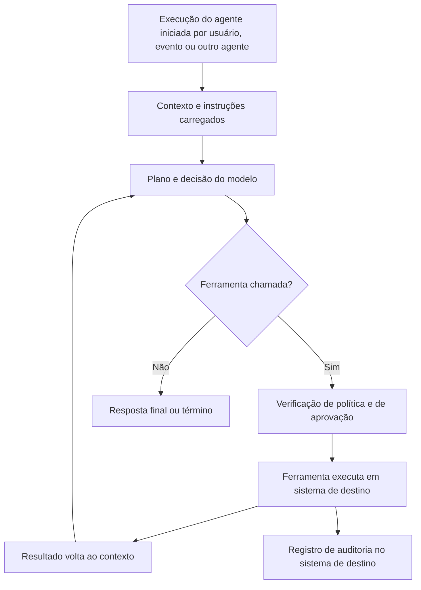

# Investigação de Agentes, Ferramentas e MCP

> **Objetivo pedagógico:** reconstruir o que um agente fez (objetivo, plano, chamadas de ferramentas, observações e memória), correlacionar os traces com os registros de auditoria dos sistemas de destino, analisar permissões, identidades e aprovações (agência excessiva), e investigar ferramentas, plugins e servidores de ferramentas (inclusive o Model Context Protocol), com atenção a envenenamento de descrições, alterações posteriores à aprovação e uso indevido de credenciais.

## 1. Reconstrução do trace de um agente

Um **trace** é o registro estruturado de uma execução do agente: cada etapa (raciocínio resumido, decisão, chamada de ferramenta e resultado) com horários e identificadores.

| Elemento do trace | Pergunta |
|---|---|
| Objetivo e entrada inicial | Quem iniciou, com que pedido e em que contexto? |
| Instruções vigentes | Qual versão do prompt do sistema e das políticas? |
| Contexto recuperado | Que documentos, e-mails e páginas entraram e de onde vieram? |
| Decisões e planos | Que passos o agente planejou? Houve mudança de objetivo? |
| Chamadas de ferramentas | Qual ferramenta, com quais parâmetros, quando e com qual resultado? |
| Observações | O que a ferramenta devolveu e como o agente reagiu? |
| Leituras e gravações de memória | O que foi lido e gravado? |
| Aprovações humanas | Que ações pediram aprovação, quem aprovou e quando? |
| Término | Motivo de parada, limites atingidos, erros |



**Procedimento**

1. Preservar os traces e os registros do orquestrador (arquivo 2, seção 5).
2. Ordenar os eventos por horário (UTC) e por identificador de execução.
3. Marcar o **primeiro ponto de desvio**: onde o comportamento passou a divergir do esperado, e o que entrou no contexto imediatamente antes.
4. Identificar todas as chamadas de ferramentas e seus destinos; separar leituras de escritas.
5. Correlacionar cada ação de escrita com o registro de auditoria do sistema de destino.
6. Identificar as aprovações e os controles que existiam e o que ocorreu em cada um.
7. Avaliar a causa: injeção, erro de configuração, falha do modelo, permissões excessivas ou uso legítimo.
8. Delimitar o alcance: outras execuções, usuários e agentes com o mesmo contexto ou configuração.

```bash
# Traces em JSON Lines: sequência de chamadas de ferramentas de uma execução (campos ilustrativos; ajuste ao formato real)
jq -r 'select(.id_execucao=="exec-8841" and .tipo=="tool_call") | [.horario_utc, .ferramenta, (.parametros|tostring)] | @tsv' traces.jsonl
# Resumo de ferramentas acionadas por execução, com destinos
jq -r 'select(.tipo=="tool_call") | [.id_execucao, .ferramenta, .destino] | @tsv' traces.jsonl | sort | uniq -c | sort -nr | head -30
```

## 2. Correlação com os sistemas de destino

As ações do agente deixam rastros nos sistemas em que ele atua. Esses registros são **independentes do trace** e servem para corroborar (e para descobrir ações que o trace não registrou).

| Sistema de destino | Onde procurar | Identificação do agente |
|---|---|---|
| Nuvem (AWS, Azure e Google Cloud) | CloudTrail, log de atividade e Cloud Audit Logs | Conta de serviço, função assumida ou identidade gerenciada do agente |
| Microsoft 365 | Auditoria unificada, `MailItemsAccessed`, `Send` e atividade de arquivos | Aplicativo ou conta delegada; `ApplicationId` |
| SaaS (CRM, tickets e mensageria) | Logs de auditoria da plataforma | Token do aplicativo ou usuário delegado |
| Repositórios de código | Logs de auditoria, commits e pull requests | Conta de serviço ou token de aplicativo |
| Bancos de dados | Auditoria de consultas e de alterações | Conta do conector |
| Gateways de API e proxies | Registros de requisições e de egresso | Chave de API ou identidade da carga de trabalho |
| Ambiente de execução de código | Logs de contêineres, processos e rede | Identificador do contêiner e do trabalho |

```sql
-- Amazon Athena: ações de uma função de serviço usada por um agente, no período de interesse
SELECT eventtime, eventname, eventsource, sourceipaddress, useragent, errorcode
FROM cloudtrail_logs
WHERE useridentity.sessioncontext.sessionissuer.arn = 'arn:aws:iam::111122223333:role/agente-suporte'
  AND eventtime BETWEEN '2026-11-03T08:00:00Z' AND '2026-11-03T12:00:00Z'
ORDER BY eventtime;
```

Cada ação encontrada deve ser ligada a uma etapa do trace; ações **sem** correspondência no trace indicam registro incompleto, uso das credenciais fora do agente ou outro ator.

## 3. Agência excessiva: análise de permissões

| Dimensão | Perguntas | Evidência |
|---|---|---|
| Funcionalidade | O agente precisava de todas as ferramentas disponíveis? | Definições de ferramentas e requisitos |
| Permissões | Os escopos das credenciais eram os mínimos necessários? | Políticas de IAM, escopos de OAuth e permissões do conector |
| Autonomia | As ações sensíveis exigiam aprovação humana? | Configuração e registros de aprovação |
| Identidade | O agente agia com a identidade do usuário (delegação) ou com uma conta própria com privilégios amplos? | Fluxo de autenticação e tokens |
| Limites | Havia limites de taxa, de valor e de volume? | Políticas e configuração |
| Isolamento | O ambiente de execução era isolado e sem acesso a segredos desnecessários? | Configuração de contêineres e de rede |
| Monitoramento | Havia alertas para ações incomuns? | Regras de detecção |

Um achado frequente: **o dano decorre menos da falha do modelo e mais das permissões** que o agente possuía. O relatório deve distinguir as causas e recomendar privilégio mínimo.

## 4. Identidade, credenciais e delegação

| Modelo | Característica | Risco forense |
|---|---|---|
| Conta de serviço própria do agente | Privilégios atribuídos ao agente | Se for ampla, qualquer injeção ganha esse poder; ações aparecem como a conta de serviço, sem distinguir o usuário solicitante |
| Delegação em nome do usuário (por exemplo, fluxos OAuth delegados) | O agente age com as permissões do usuário | Ações atribuídas ao usuário nos logs; necessário o trace para saber que foi o agente |
| Chaves de API embutidas | Segredos no contexto, na configuração ou em ferramentas | Vazamento por saída, por memória ou por logs |
| Tokens de curta duração | Reduzem a janela de abuso | Exigem rastrear a emissão e o uso |

Procure ainda **credenciais expostas no contexto** (prompts, memória, descrições de ferramentas e logs), pois o modelo pode repeti-las e as saídas podem vazá-las. Considere comprometidas as credenciais que apareceram no contexto durante o incidente.

## 5. Ferramentas, plugins e servidores MCP

O Model Context Protocol (MCP) padroniza a conexão entre aplicações com LLM e **servidores** que expõem ferramentas, recursos e instruções. Esse modelo aumenta a conveniência e a **superfície de ataque**: o modelo lê descrições e esquemas de ferramentas fornecidos por terceiros e decide, com base neles, o que chamar.

| Risco | Descrição | Evidência a buscar |
|---|---|---|
| Envenenamento de descrições de ferramentas | A descrição ou o esquema de uma ferramenta contém instruções dirigidas ao modelo, que alteram seu comportamento ou induzem ações | Comparação das descrições com a versão aprovada; hashes dos manifestos |
| Alteração posterior à aprovação (rug pull) | O servidor muda o comportamento ou as descrições depois que o usuário ou o administrador aprovou | Histórico de versões, hashes e datas dos manifestos; registros de atualização |
| Confused deputy (delegado confuso) | O servidor usa privilégios próprios ou do usuário para fazer algo que o solicitante não poderia | Mapeamento entre solicitante, token e ação; registros do servidor |
| Passagem de tokens | Tokens do usuário repassados a serviços sem validação adequada | Logs do servidor e do provedor de identidade |
| Servidores maliciosos ou comprometidos | Código de terceiros com acesso a dados e a ações | Origem, assinatura, dependências e comportamento de rede |
| Ferramentas com efeitos amplos | Execução de comandos, acesso a arquivos e a rede | Permissões e isolamento |
| Instruções ocultas em recursos retornados | Resultados de ferramentas carregam injeções | Conteúdo dos resultados (arquivo 4 da pasta 25) |
| Nomes enganosos e substituição | Ferramenta com nome semelhante a outra, escolhida pelo modelo | Inventário e nomes de ferramentas |

**Inventário e verificação de ferramentas**

| Item | Como verificar |
|---|---|
| Lista de servidores e de ferramentas habilitadas por aplicação e por usuário | Configuração do cliente e do orquestrador |
| Versão e origem de cada servidor | Registro de pacotes, imagens e repositórios; assinaturas |
| Manifesto de ferramentas (nomes, descrições e esquemas) | Exportação e hash por versão; comparação com a anterior |
| Permissões e segredos de cada servidor | Configuração e cofre de segredos |
| Registros do servidor | Requisições recebidas, ações e erros |
| Tráfego de rede do servidor | Destinos e volumes (pasta 13) |
| Aprovações de usuários e de administradores | Registros de consentimento e de habilitação |

```bash
# Hash do manifesto de ferramentas de cada servidor, por data, para detectar alterações (formato do manifesto ilustrativo)
for f in manifestos/*.json; do sha256sum "$f"; done > manifestos_$(date -u +%Y%m%d).sha256
diff <(jq -S . manifestos/servidor_a_v1.json) <(jq -S . manifestos/servidor_a_v2.json)
```

## 6. Código executado por agentes (ambientes de execução)

| Aspecto | Evidências |
|---|---|
| Código gerado e executado | Registro do código, entradas, saídas e arquivos criados |
| Isolamento | Configuração do contêiner ou da máquina virtual (privilégios, montagens e rede) |
| Rede e egresso | Conexões do ambiente de execução a destinos externos |
| Segredos presentes no ambiente | Variáveis de ambiente, arquivos e volumes montados |
| Persistência | Arquivos e processos que sobreviveram à execução |
| Dependências instaladas | Pacotes baixados durante a execução (cadeia de suprimentos) |

Trate o ambiente de execução como um sistema comprometível: preserve-o (PB-35 e PB-11) quando houver suspeita de abuso.

## 7. Sistemas multiagente

| Desafio | Prática |
|---|---|
| Propagação de instruções entre agentes | Traces correlacionados por identificador da execução raiz; mensagens entre agentes registradas |
| Responsabilidade difusa | Mapear qual agente decidiu e qual executou; identificar o ponto de entrada |
| Delegação e identidades | Verificar com qual identidade cada agente agiu |
| Laços e consumo | Limites de profundidade e de iterações; registros de cada chamada |

## 8. Exemplo prático: agente de suporte envia dados a endereço externo

| Etapa | Resultado |
|---|---|
| Alerta | Envio de uma tabela de clientes a um endereço externo, às 08:15:04 UTC |
| Trace | Execução iniciada pelo resumo diário; contexto com e-mail externo recebido às 08:02; chamada da ferramenta de envio com destino externo e corpo com dados |
| Auditoria do destino | Auditoria do Microsoft 365 confirma `Send` pelo aplicativo do agente às 08:15:05 |
| Permissões | A ferramenta de envio permitia destinos externos sem aprovação; a conta tinha acesso de leitura ao CRM completo |
| Causa | Injeção indireta no e-mail, agravada por permissões e ausência de aprovação |
| Alcance | 3 execuções semelhantes em 14 usuários que receberam o e-mail |
| Contenção | Ferramenta de envio restrita a destinos internos e com aprovação humana; escopo de leitura reduzido; mensagens removidas após preservação |
| Conclusão | Incidente de exfiltração por injeção indireta, com confiança alta; avaliação de dados pessoais pelo DPO |

## 9. Casos de uso corporativos

- Investigação de ações indevidas realizadas por agentes e por assistentes com ferramentas.
- Revisão de permissões, de identidades e de aprovações em implantações de agentes.
- Governança de servidores MCP e de plugins (inventário, verificação e aprovação).

## 10. Normas e frameworks relevantes

- OWASP Top 10 para LLM (LLM01, LLM03, LLM05, LLM06); OWASP GenAI Security Project (IA agêntica); MITRE ATLAS
- Especificação e práticas de segurança do Model Context Protocol; NIST AI 600-1; NIST SP 800-61 Rev. 3
- MITRE ATT&CK (T1078.004, T1098, T1114, T1530, T1537); CIS Controls v8.1, controles 5, 6 e 8
- LGPD, arts. 6º, 46 e 48

## 11. Referências

- OWASP. Top 10 for LLM Applications e GenAI Security Project (edições vigentes).
- Anthropic e comunidade MCP. Documentação e orientações de segurança do Model Context Protocol (versão vigente).
- MITRE. ATLAS. https://atlas.mitre.org
- Documentação de auditoria de nuvem e do Microsoft 365 (pastas 17 a 19).
- Pastas 24 e 25 deste repositório.
