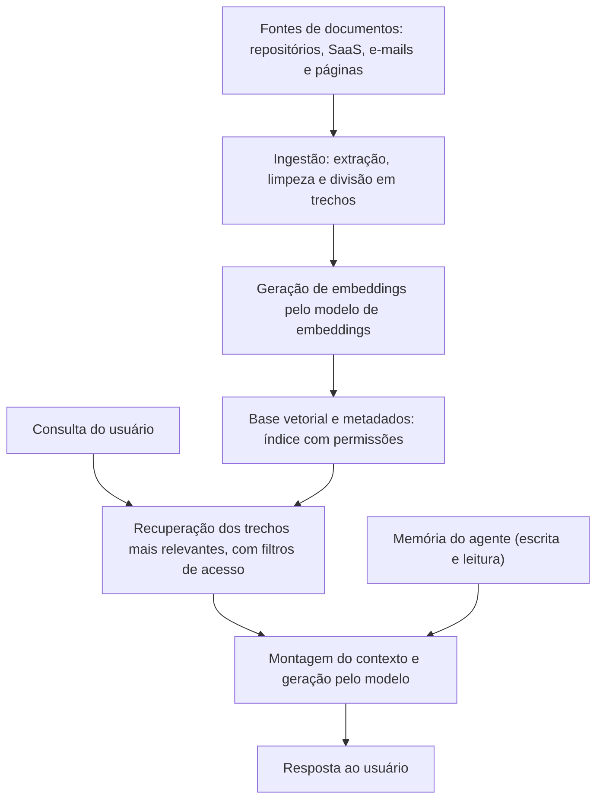

# RAG, Memória e Bases Vetoriais: Contaminação e Vazamento

> **Objetivo pedagógico:** investigar incidentes em sistemas de recuperação aumentada (RAG), em memórias de agentes e em bases vetoriais: contaminação (documentos injetados ou alterados, instruções persistentes), vazamento (falhas de controle de acesso, de isolamento entre usuários e de segregação de locatários), reconstrução da linhagem dos documentos, verificação de integridade do índice e contenção e recuperação seguras.

## 1. Pipeline de RAG e pontos de falha



| Etapa | Falha ou ataque possível |
|---|---|
| Fontes | Documento malicioso ou alterado por terceiros; conteúdo de fontes não confiáveis |
| Ingestão | Ingestão de arquivos sem verificação; metadados de permissão perdidos; texto oculto preservado |
| Embeddings | Troca de modelo de embeddings sem reindexação; vazamento de informação por vetores |
| Base vetorial | Acesso indevido ao banco; ausência de segregação entre locatários; exposição pela internet |
| Recuperação | Falta de filtro por permissão do usuário; consultas que exploram o índice |
| Contexto e geração | Trechos com instruções (injeção indireta); exposição de dados na resposta |
| Memória | Gravação de instruções ou de informações falsas que persistem |

## 2. Contaminação do índice

| Tipo | Descrição | Indícios |
|---|---|---|
| Documento injetado | Novo documento com conteúdo manipulado ou com instruções para o modelo | Documentos recentes de origem incomum; trechos com linguagem dirigida ao assistente; texto oculto |
| Documento alterado | Substituição ou edição de um documento legítimo | Divergência entre o conteúdo do índice e o da fonte (hash); alteração fora do processo |
| Envenenamento por volume | Muitos documentos para dominar a recuperação de determinados assuntos | Aumento súbito de documentos sobre um tema; alta similaridade entre eles |
| Contaminação de caches | Cache semântico que devolve respostas indevidas a consultas semelhantes | Respostas idênticas a consultas distintas; origem do cache |
| Contaminação da memória | Gravação persistente de instruções ou de fatos falsos | Entradas de memória criadas durante execuções suspeitas |

**Verificações**

| Verificação | Método |
|---|---|
| Linhagem dos trechos | Cada trecho tem origem (URI), hash do conteúdo, data de ingestão, conta e pipeline responsáveis |
| Integridade em relação à fonte | Comparar o hash do trecho no índice com o do documento atual na fonte |
| Novos documentos no período | Listar ingestões da janela de interesse, por origem e por conta |
| Busca por padrões de injeção | Procurar frases, texto oculto e caracteres invisíveis nos trechos (pasta 25) |
| Recuperações envolvidas | Consultas e trechos recuperados nas execuções afetadas |
| Alcance | Quais usuários e agentes receberam trechos contaminados |

```sql
-- Exemplo (PostgreSQL com tabela de trechos; nomes ilustrativos): ingestões recentes por origem e por conta
SELECT origem_uri, conta_ingestao, count(*) AS trechos, min(criado_em) AS primeira, max(criado_em) AS ultima
FROM trechos_rag
WHERE criado_em > now() - interval '14 days'
GROUP BY origem_uri, conta_ingestao
ORDER BY ultima DESC;
```

```bash
# Comparar manifestos de hashes: documentos na fonte versus trechos indexados (formato "hash caminho")
sort fonte_manifesto.sha256 > a.txt
sort indice_manifesto.sha256 > b.txt
diff a.txt b.txt | head -50
```

```bash
# Procurar texto invisível e comentários em documentos de origem exportados (use locale UTF-8)
LC_ALL=C.UTF-8 grep -rn -P "[\x{200B}-\x{200D}\x{2060}\x{FEFF}\x{E0000}-\x{E007F}]" ./documentos_origem | head
```

## 3. Vazamento por falhas de controle de acesso

A falha mais comum em RAG corporativo não é o modelo: é a **ausência de propagação das permissões do documento de origem para o índice**.

| Falha | Descrição | Evidência |
|---|---|---|
| Índice construído com conta ampla | A ingestão usa conta com acesso a tudo e perde as permissões por documento | Configuração da ingestão; metadados sem campos de acesso |
| Ausência de filtro por usuário na recuperação | Qualquer usuário recupera qualquer trecho | Consultas de recuperação sem filtros; trechos de documentos restritos devolvidos a usuários sem permissão |
| Permissões desatualizadas | A permissão do documento mudou, mas o índice não | Divergência entre ACL da fonte e do índice; data da última sincronização |
| Falta de segregação entre locatários | Dados de clientes distintos em um mesmo índice sem separação | Esquema e filtros por locatário; consultas cruzadas |
| Memória compartilhada entre usuários | Memória do agente acessível por outros usuários | Identificador de escopo da memória |
| Cache compartilhado | Respostas de um usuário entregues a outro | Chaves de cache sem escopo de usuário |
| Exposição direta da base vetorial | Banco acessível sem autenticação ou por credenciais vazadas | Logs de acesso e de rede (pastas 13 e 17) |

**Procedimento de investigação de vazamento**

1. Identificar o conteúdo exposto (o trecho ou o documento) e o usuário que o recebeu.
2. Confirmar nos registros de recuperação **qual trecho foi devolvido, em qual consulta e a quem**.
3. Verificar a permissão do usuário no sistema de origem no momento da consulta.
4. Determinar a causa (ACL não propagada, filtro ausente, cache ou memória).
5. Delimitar o alcance: todas as consultas que devolveram trechos restritos a usuários sem permissão, no período.
6. Classificar os dados expostos (pessoais, sigilosos e confidenciais) e os titulares.
7. Avaliar obrigações de notificação e comunicar ao DPO e ao Jurídico.

```sql
-- Exemplo: recuperações que devolveram trechos restritos a usuários sem permissão (tabelas ilustrativas)
SELECT r.horario_utc, r.usuario, t.origem_uri, t.nivel_acesso
FROM recuperacoes r
JOIN trechos_rag t ON t.id = r.id_trecho
LEFT JOIN permissoes p ON p.origem_uri = t.origem_uri AND p.usuario = r.usuario
WHERE t.nivel_acesso = 'restrito' AND p.usuario IS NULL
ORDER BY r.horario_utc;
```

## 4. Embeddings e privacidade

| Aspecto | Observação |
|---|---|
| Vetores não são anonimização | Embeddings podem preservar informação do texto original e, em certos cenários, permitir inferência ou reconstrução parcial; trate-os como dados com a mesma sensibilidade do conteúdo |
| Acesso à base vetorial | Quem acessa os vetores acessa informação sensível; aplicar controles de acesso e criptografia |
| Retenção e exclusão | Exclusão de um documento deve remover seus vetores e metadados (e caches), para atender a direitos e a políticas |
| Troca de modelo de embeddings | Exige reindexação; índices com modelos misturados degradam a recuperação e confundem a investigação |

## 5. Memória de agentes

| Tipo | Característica | Risco forense |
|---|---|---|
| Memória de curto prazo (contexto da conversa) | Existe durante a sessão | Registrada nos traces |
| Memória de longo prazo (armazenamento persistente) | Fatos e preferências guardados entre sessões | Contaminação persistente; vazamento entre sessões e usuários |
| Memória compartilhada entre agentes | Estado comum | Propagação entre agentes |
| Resumos automáticos | O modelo resume e grava | Distorção e inserção de instruções |

**Investigação da memória**

1. Exportar o conteúdo atual e o histórico (criação, alteração, origem e escopo) **antes** de limpar.
2. Identificar quando e por qual execução cada entrada suspeita foi gravada.
3. Verificar se a gravação foi induzida por conteúdo externo (arquivo 3 e pasta 25).
4. Verificar o escopo (por usuário, por equipe ou global) e quem pode ler.
5. Determinar quais execuções leram a entrada contaminada e o efeito.
6. Limpar a entrada, registrar a ação e validar o comportamento (testes de regressão).

## 6. Contenção e recuperação

| Ação | Cuidado |
|---|---|
| Preservar: instantâneo do índice, dos metadados, dos registros de ingestão e de recuperação, e da memória | Antes de qualquer alteração |
| Colocar documentos suspeitos em quarentena (desabilitar a recuperação) | Registrar o estado anterior |
| Suspender a ingestão de fontes não confiáveis | Revisar o pipeline |
| Reconstruir o índice a partir da fonte de verdade, com permissões por documento e filtros por usuário | Validar com testes de acesso |
| Revogar credenciais da ingestão e da base vetorial | Rotacionar segredos |
| Limpar caches e memórias afetados | Após exportar |
| Reintroduzir de forma gradual, com monitoramento | Testes de regressão e de segurança |
| Atualizar controles | Verificação de origem, varredura de conteúdo, escopo de memória e registros de recuperação |

## 7. Registros recomendados em RAG

| Registro | Conteúdo |
|---|---|
| Ingestão | Origem, hash, conta, pipeline, versão de extração, versão do modelo de embeddings e data |
| Permissões | ACL da origem e dos trechos, com data de sincronização |
| Recuperação | Consulta (ou hash), usuário, trechos devolvidos (identificadores e pontuações), filtros aplicados e horário |
| Memória | Entradas gravadas, origem, escopo, usuário e horário; leituras |
| Acesso à base vetorial | Autenticações, consultas e administração |
| Alterações do índice | Reindexações, exclusões e migrações |

## 8. Exemplo prático: vazamento por permissões não propagadas

| Etapa | Resultado |
|---|---|
| Relato | Um colaborador recebeu trechos de uma política de remuneração restrita ao RH |
| Registros de recuperação | O trecho foi devolvido à consulta do colaborador, sem filtro de permissão |
| Fonte | O documento original estava em uma pasta restrita; o índice foi construído por uma conta de serviço com acesso amplo, sem metadados de acesso |
| Alcance | 37 usuários receberam trechos restritos em 3 semanas |
| Classificação | Dados pessoais e sensíveis de colaboradores; avaliação do DPO |
| Contenção | Documentos retirados do índice; reconstrução com permissões por documento e filtros por usuário; testes de acesso |
| Conclusão | Falha de controle de acesso do índice (não do modelo); confiança alta; recomendações de registros de recuperação e de revisão periódica de ACL |

## 9. Casos de uso corporativos

- Investigação de vazamentos em assistentes corporativos com RAG.
- Verificação da integridade e da linhagem de bases de conhecimento.
- Definição de controles de acesso e de registros para índices e memórias de agentes.

## 10. Normas e frameworks relevantes

- OWASP Top 10 para LLM (LLM02, LLM04 e LLM08, fraquezas de vetores e de embeddings); MITRE ATLAS
- NIST AI 600-1; ISO/IEC 42001:2023; ISO/IEC 27002:2022, controles 5.15, 5.18 e 8.3 (restrição de acesso à informação)
- LGPD, arts. 6º, 18, 46 e 48; CIS Controls v8.1, controles 3 e 6

## 11. Referências

- OWASP. Top 10 for LLM Applications (edição vigente).
- Greshake, K. et al. Indirect Prompt Injection (2023).
- Documentação de bancos vetoriais e de mecanismos de busca com recursos vetoriais (controle de acesso e auditoria).
- Pastas 17, 24 e 25 deste repositório.
