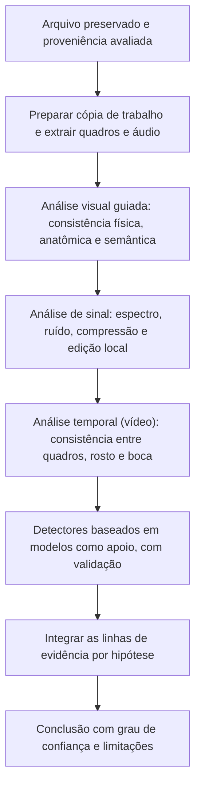

# Análise Técnica de Imagens e Vídeos Sintéticos

> **Objetivo pedagógico:** conduzir a análise técnica de imagens e vídeos suspeitos com múltiplas linhas de evidência independentes (consistência física e anatômica, sinais estatísticos e espectrais, ruído de sensor, histórico de compressão e consistência temporal), usar detectores baseados em modelos como apoio (e não como prova isolada), documentar métodos e limitações e formular conclusões por hipóteses.

> A análise técnica é a camada **mais frágil** da investigação, por causa da compressão e da rápida evolução dos geradores. Ela complementa a proveniência (arquivo 2) e a corroboração de contexto.

## 1. Princípios

| Princípio | Aplicação |
|---|---|
| Trabalhar sobre a melhor cópia disponível | A análise de uma cópia recomprimida perde sinais; registrar a qualidade |
| Múltiplas linhas independentes | Nenhum indício isolado é conclusivo; busque convergência |
| Hipóteses, e não "falso ou verdadeiro" | Avaliar H1 a H5 (arquivo 1) |
| Reprodutibilidade | Documentar ferramentas, versões, parâmetros e comandos |
| Declarar limitações | Compressão, resolução, curta duração e geradores desconhecidos |
| Considerar a direção inversa | Anomalias podem decorrer de compressão e de iluminação reais |
| Revisão por pares | Segunda avaliação independente das conclusões |

## 2. Fluxo de análise



## 3. Preparação da cópia de trabalho

```bash
# Extrair um quadro por segundo (visão geral) e, separadamente, os quadros-chave (tipo I)
mkdir -p quadros quadros_chave
ffmpeg -i midia_suspeita.mp4 -vf "fps=1" quadros/quadro_%04d.png
ffmpeg -i midia_suspeita.mp4 -vf "select='eq(pict_type,I)'" -vsync vfr quadros_chave/chave_%04d.png

# Extrair o áudio em formato sem perdas para análise (arquivo 4)
ffmpeg -i midia_suspeita.mp4 -vn -ac 1 -ar 16000 -c:a pcm_s16le audio_E050.wav

# Tipos de quadro e horários (estrutura de grupos de imagens; útil para detectar regravação)
ffprobe -v error -select_streams v:0 -show_entries frame=pict_type,best_effort_timestamp_time -of csv=p=0 midia_suspeita.mp4 | head -n 100
```

Registre que os quadros extraídos são **derivados**; o original permanece intacto e com hash.

## 4. Análise visual guiada (imagens e quadros)

| Categoria | O que observar | Observações |
|---|---|---|
| Iluminação e sombras | Direção, intensidade e dureza das luzes; sombras coerentes entre objetos e pessoas | Inconsistências podem indicar composição ou edição |
| Reflexos | Olhos, óculos, superfícies e espelhos: o reflexo deve corresponder à cena | Reflexos incoerentes são um indício forte, porém não decisivo |
| Geometria e perspectiva | Linhas de fuga, proporções e escalas | Colagens e geração integral podem violar a perspectiva |
| Anatomia e detalhes | Mãos, dedos, dentes, orelhas, cabelos, joias e acessórios | Geradores mais recentes corrigem muitos desses defeitos |
| Texto e símbolos | Letras, placas e logotipos legíveis e coerentes | Texto ilegível ou deformado é um indício clássico, em declínio |
| Bordas e transições | Contorno do rosto, cabelo e pescoço; halos e desfoque localizado | Típico de trocas de rosto |
| Textura e pele | Suavização excessiva, repetição de padrões ou textura homogênea | Filtros de beleza e compressão também suavizam |
| Fundo e contexto | Coerência de objetos, placas, vestuário e clima com o local e a data | Corroborar com fontes externas |
| Consistência entre regiões | Nitidez, ruído e granulação semelhantes em toda a imagem | Regiões geradas ou coladas diferem das demais |

Cada observação deve ser documentada com a imagem de apoio, a coordenada da região e a explicação, evitando o viés de confirmação (revisar também as regiões que **não** apresentam anomalias).

## 5. Análise de sinal em imagens

| Técnica | O que revela | Limitações |
|---|---|---|
| Espectro de frequência (transformada de Fourier) | Padrões periódicos associados a aumento de resolução e a certos geradores | Redimensionamento e compressão também geram picos |
| Resíduo de ruído e padrão de ruído do sensor (PRNU) | Ausência ou incompatibilidade com o padrão de uma câmera de referência; diferenças de ruído entre regiões | Exige imagens de referência da câmera candidata; degradada por compressão |
| Análise de compressão dupla (JPEG) e inconsistências locais de compressão | Regiões com histórico de compressão diferente do restante (colagem) | Recompressões legítimas confundem |
| Detecção de clonagem e de colagem (copy-move e splicing) | Regiões duplicadas ou importadas | Gerações por IA não necessariamente deixam tais vestígios |
| Análise de nível de erro (ELA) | Variações locais de compressão | Considerada pouco confiável isoladamente; muitos falsos positivos |
| Análise de cor e de ruído cromático | Diferenças entre regiões e transformações | Dependente do fluxo de processamento |

```python
# Espectro de frequência de uma imagem em escala de cinza (apoio visual; interpretar com cautela)
import numpy as np
from PIL import Image

img = Image.open("imagem_trabalho.png").convert("L")
a = np.asarray(img, dtype=np.float32)
f = np.fft.fftshift(np.fft.fft2(a))
espectro = np.log1p(np.abs(f))
esp_norm = (255 * (espectro - espectro.min()) / (espectro.max() - espectro.min())).astype(np.uint8)
Image.fromarray(esp_norm).save("espectro_fft_E050.png")
# Picos periódicos regulares podem sugerir aumento de resolução ou processamento; não são conclusivos por si sós.
```

Sempre que possível, compare com **imagens de referência autênticas** da mesma câmera, do mesmo ambiente e da mesma pessoa, e com **imagens sintéticas conhecidas** de geradores prováveis, em condições de compressão semelhantes (validação do método).

## 6. Análise temporal de vídeos

| Aspecto | O que observar | Observações |
|---|---|---|
| Consistência entre quadros | Cintilação do rosto, mudança súbita de textura, bordas que oscilam | Típico de trocas de rosto e de reencenação |
| Movimento da cabeça e do rosto | Coerência entre a pose da cabeça, o corpo e o fundo | Cabeça e corpo desalinhados são indícios |
| Boca, dentes e língua | Correspondência entre fonemas e movimentos labiais; formas dos dentes | A sincronização pode ser imprecisa por compressão e por edição legítima |
| Piscadas e olhar | Frequência e naturalidade; direção do olhar | Critério histórico, **não confiável** hoje: geradores aprendem a piscar |
| Iluminação ao longo do tempo | Sombras e reflexos acompanham o movimento | Inconsistências entre quadros |
| Oclusões | Mãos, objetos ou cabelos passando à frente do rosto | Pontos de falha clássicos de trocas de rosto |
| Sinais fisiológicos sutis (por exemplo, variações de cor da pele associadas ao pulso) | Linha de pesquisa para apoio | Experimental e sensível à compressão |
| Estrutura do vídeo (grupos de imagens e quadros duplicados) | Sinais de regravação, montagem e interpolação | Plataformas reencodificam |
| Alinhamento entre áudio e vídeo | Desvios constantes ou variáveis | Possíveis edições legítimas |

Analise o vídeo em **câmera lenta e por quadros**, nas regiões de maior risco (rosto, boca, mãos e transições de corte), e registre os horários dos quadros com anomalias.

## 6.1 Interferência de compressão e de plataformas

| Efeito | Consequência |
|---|---|
| Recompressão por redes sociais e por mensageiros | Apaga ruído de sensor e padrões espectrais; cria artefatos que imitam anomalias |
| Redução de resolução | Esconde detalhes e dificulta a detecção |
| Filtros e embelezamento aplicados por aplicativos | Alteram a pele e as bordas |
| Videochamadas | Compressão adaptativa e ruído de rede geram artefatos transitórios |

Registre a qualidade do material e **não superinterprete** anomalias em arquivos muito degradados.

## 7. Detectores baseados em modelos

| Aspecto | Orientação |
|---|---|
| Natureza | Classificadores treinados para distinguir mídias reais e sintéticas, ou para localizar regiões manipuladas |
| Desempenho | Variam muito entre geradores, resoluções e níveis de compressão; modelos treinados em um conjunto podem falhar em geradores novos (problema de generalização) |
| Calibração | Pontuações não são probabilidades de falsidade; escolha de limiares gera falsos positivos e negativos |
| Robustez | Podem ser enganados por edição simples, por recompressão ou por ataques adversariais |
| Viés | Desempenho pode variar entre grupos demográficos e condições de captura |
| Transparência | Muitos produtos comerciais não revelam método, dados de treinamento e taxas de erro |
| Uso apropriado | **Triagem e apoio**, combinado com outras evidências; não usar a pontuação como prova isolada |
| Validação | Testar a ferramenta com amostras autênticas e sintéticas conhecidas, em condições semelhantes às do caso; registrar versão, limiar e resultados |
| Privacidade | Não enviar mídias sensíveis a serviços externos sem autorização e contrato adequado |

Registre: nome e versão da ferramenta, data, parâmetros, entradas, saída, validação realizada e interpretação. Avaliações públicas (por exemplo, conjuntos e desafios de detecção, como FaceForensics++ e o Deepfake Detection Challenge, e programas de avaliação do NIST) mostram que o desempenho em condições reais é inferior ao de benchmarks controlados.

## 8. Integração das evidências por hipótese

| Linha de evidência | H1 autêntica | H2 edição convencional | H3 parcialmente sintética | H4 totalmente sintética |
|---|---|---|---|---|
| Proveniência e metadados | Coerentes | Ferramentas de edição | Inconsistências ou software de IA | Metadados de gerador ou ausência de assinatura de câmera |
| Consistência física e anatômica | Coerente | Coerente | Anomalias locais | Anomalias globais ou textura característica |
| Sinais de ruído e de compressão | Uniformes | Alterações locais convencionais | Diferenças entre regiões, borda de mistura | Padrões espectrais atípicos, ausência de ruído de sensor |
| Consistência temporal (vídeo) | Coerente | Cortes visíveis | Cintilação, boca e bordas | Inconsistências entre quadros |
| Detectores | Baixa pontuação | Variável | Alta em regiões | Alta |
| Contexto e corroboração | Corroborado | Corroborado, com ajustes | Contradições com o contexto | Evento impossível ou não corroborado |

Documente o **peso** de cada linha (forte, moderada ou fraca) e a razão. Conclua com o grau de confiança (arquivo 1, seção 7).

## 9. Exemplo prático: vídeo de um executivo com declaração polêmica

| Etapa | Resultado |
|---|---|
| Proveniência | Primeira ocorrência em um perfil anônimo; sem C2PA; sem arquivo original; busca reversa não encontra a gravação-fonte |
| Metadados | Contêiner reencodificado por plataforma; metadados genéricos |
| Visual | Contorno do rosto com halo leve em rotações da cabeça; dentes com formas inconsistentes em alguns quadros; reflexo nos óculos não mostra o ambiente da gravação |
| Sinal | Ruído do rosto mais suave que o do fundo; diferença persistente ao longo do vídeo |
| Temporal | Cintilação de textura nas laterais do rosto em movimentos rápidos; desalinhamento entre a boca e certos fonemas |
| Detectores | Dois detectores diferentes (validados com amostras de teste) atribuem pontuação alta; validação mostra desempenho moderado em vídeos comprimidos |
| Contexto | A agenda e os registros mostram que o executivo estava em um evento fechado, sem gravação, na data alegada; nenhuma fonte independente corrobora a declaração |
| Conclusão | Alta confiança de manipulação parcial (troca de rosto e áudio sintético provável); limitações: ausência do original e compressão; recomendações: comunicado oficial, pedidos de remoção e preservação para medidas legais |

## 10. Casos de uso corporativos

- Triagem e análise de vídeos e imagens que atingem a reputação da organização ou de seus executivos.
- Avaliação de provas apresentadas em disputas internas e trabalhistas.
- Validação de ferramentas de detecção antes da adoção.

## 11. Normas e frameworks relevantes

- SWGDE (autenticação de imagem e de vídeo); ISO/IEC 27041 e 27042; ISO 21043
- NIST AI 100-4; programa NIST GenAI (avaliação de detectores); DARPA SemaFor (forense semântica)
- C2PA; Protocolo de Berkeley
- CPC, arts. 422 e 439 a 441; CPP, arts. 158-A a 158-F

## 12. Referências

- Verdoliva, L. Media Forensics and DeepFakes: An Overview. 2020.
- Wang, S.-Y. et al. CNN-generated images are surprisingly easy to spot... for now. CVPR, 2020.
- Rössler, A. et al. FaceForensics++. ICCV, 2019; Dolhansky, B. et al. DFDC. 2020.
- Lukáš, J.; Fridrich, J.; Goljan, M. Digital Camera Identification from Sensor Pattern Noise. IEEE TIFS, 2006 (PRNU).
- Farid, H. Photo Forensics. MIT Press, 2016.
- Documentação do FFmpeg, do ExifTool, do ImageMagick e das ferramentas de análise utilizadas.
