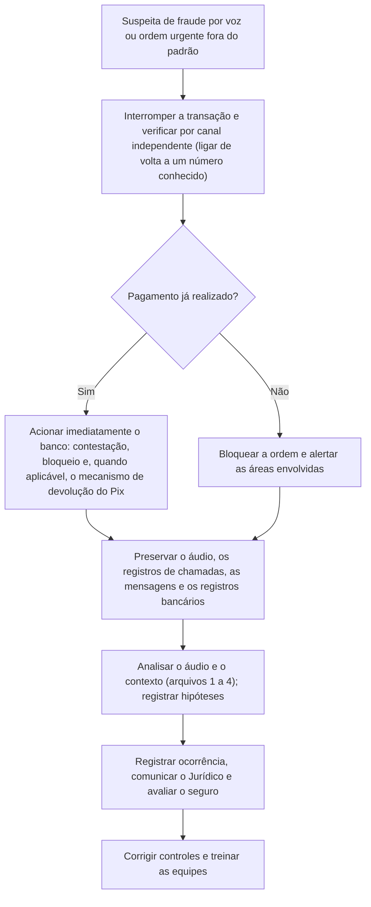

# Áudio Sintético, Clonagem de Voz e Fraudes por Voz

> **Objetivo pedagógico:** investigar áudios suspeitos de síntese ou de clonagem de voz e fraudes por telefone e mensageiros: obter e preservar o áudio original, compreender o efeito de codecs e de canais de telefonia, aplicar análise espectral e de prosódia com cautela, reconhecer os limites da comparação de voz e dos detectores, correlacionar com registros de operadoras, de plataformas e de transações, e executar a resposta financeira e de prevenção.

## 1. Cenários de fraude por voz

| Cenário | Descrição | Alvos típicos |
|---|---|---|
| Fraude do executivo (CEO fraud, por voz) | Ligação ou áudio com a voz do diretor ordenando transferência urgente e sigilosa | Financeiro, tesouraria e assistentes |
| Falso familiar em emergência | Voz de parente pedindo dinheiro por situação inventada | Pessoas físicas e idosos |
| Fraude de suporte e de instituições financeiras | Voz sintética de atendente ou de gerente solicitando códigos e transferências | Clientes de bancos |
| Contorno de biometria de voz | Uso de voz clonada para autenticação por voz | Centrais de atendimento |
| Áudios forjados como prova | Gravações atribuídas a alguém, em disputas trabalhistas, familiares ou comerciais | Processos e investigações internas |
| Campanhas de desinformação | Áudios falsos de figuras públicas | Reputação e mercado |

## 2. Canais e codecs: o que muda para a análise

| Canal | Característica | Implicação forense |
|---|---|---|
| Telefonia tradicional (banda estreita) | Faixa aproximada de 300 a 3400 Hz; codecs como G.711 e AMR | Remove parte do espectro onde aparecem artefatos de síntese; dificulta a análise |
| Chamadas VoIP e aplicativos | Codecs como Opus; compressão adaptativa | Artefatos de rede; pacotes perdidos |
| Mensagens de voz de aplicativos | Frequentemente em contêineres como OGG com codec Opus | Reencodificação ao encaminhar; perda de qualidade |
| Gravações de chamadas por empresas | Formato e qualidade variados | Preferir a gravação original do sistema |
| Gravações de tela ou de celular de outro celular | Regravação com ruído ambiente | Muito degradado; pouca capacidade de análise |

Quanto mais o áudio foi comprimido, regravado ou encaminhado, **menor** a capacidade de análise técnica; registre a cadeia do arquivo.

## 3. Aquisição e preservação

| Passo | Descrição |
|---|---|
| 1 | Obter o arquivo mais próximo do original: gravação do sistema de telefonia, arquivo do aplicativo no dispositivo do destinatário, exportação da conversa |
| 2 | Registrar a origem, a data e a hora (UTC), o número e a conta de origem, o canal e a forma de obtenção |
| 3 | Calcular o hash e preservar com custódia; não editar nem converter o original |
| 4 | Preservar o contexto: mensagens que acompanharam o áudio, o histórico da conversa e os registros de chamadas |
| 5 | Solicitar às operadoras e plataformas a preservação de registros (arquivo 5 e pasta 25) |
| 6 | Registrar as pessoas que ouviram a chamada e suas percepções (depoimentos), o mais rápido possível |

```bash
# Informações técnicas e hash do arquivo de áudio
sha256sum audio_original.opus > audio_original.opus.sha256
ffprobe -v quiet -print_format json -show_format -show_streams audio_original.opus > ffprobe_audio_E051.json
exiftool -a -G1 -s audio_original.opus > exiftool_audio_E051.txt

# Cópia de trabalho sem perdas para análise (derivada; o original permanece intacto)
ffmpeg -i audio_original.opus -ac 1 -ar 16000 -c:a pcm_s16le audio_trabalho_E051.wav
soxi audio_trabalho_E051.wav
```

## 4. Análise do áudio

| Técnica | O que observar | Limitações |
|---|---|---|
| Espectrograma | Distribuição de energia ao longo do tempo e da frequência; cortes de banda, padrões periódicos e artefatos de síntese | Compressão e telefonia mascaram; interpretação exige experiência |
| Prosódia e ritmo | Entonação, pausas, ênfases e velocidade: naturalidade e coerência com o falante | Subjetiva; vozes sintéticas melhoram continuamente |
| Respiração, cliques e ruídos de boca | Presença e naturalidade | Podem ser removidos ou sintetizados |
| Ruído de fundo e acústica da sala | Consistência durante a gravação; reverberação coerente | Cortes e mixagens produzem descontinuidades |
| Descontinuidades e emendas | Mudanças abruptas de ruído, de fase ou de timbre | Edições legítimas também as produzem |
| Consistência do fundo elétrico (zumbido) | Frequência da rede elétrica e variações | Técnica especializada (análise de frequência da rede elétrica, ENF) para estimar horário e local, com base de referência; requer perito |
| Análise de fase e de artefatos de vocoder | Padrões associados a geradores de voz | Pesquisa; sensível à compressão |
| Metadados e estrutura do arquivo | Codificador, taxa de amostragem e histórico | Editáveis |

```bash
# Espectrograma para inspeção visual (execute sobre a cópia de trabalho)
sox audio_trabalho_E051.wav -n spectrogram -o espectrograma_E051.png

# Segmentos de silêncio e níveis (visão geral de edições e de pausas)
ffmpeg -i audio_trabalho_E051.wav -af silencedetect=noise=-40dB:d=0.3 -f null - 2> silencios_E051.txt
```

Registre a faixa de tempo de cada achado, a imagem do espectrograma e a explicação, e valide o método com **amostras de referência** autênticas e sintéticas, com compressão e canal semelhantes.

## 5. Comparação de voz: limites

| Aspecto | Orientação |
|---|---|
| Comparação forense de locutores | Exige perito especializado, material de referência adequado (mesmo canal, condições e fala espontânea) e uma estrutura de interpretação probabilística; segue boas práticas (por exemplo, a norma ISO 21043 e abordagens de razão de verossimilhança) |
| Voz clonada versus voz real | Sistemas de clonagem reproduzem timbre e estilo, de modo que a "semelhança" **não prova autenticidade** |
| Ouvir e "achar parecido" | Percepção subjetiva e enganosa; não usar como prova |
| Sistemas automáticos de verificação de locutor | Podem ser enganados por vozes sintéticas; seu resultado não substitui a análise |
| Detectores de voz sintética (anti-spoofing) | Desempenho depende do gerador, do canal e do codec (avaliações como o ASVspoof mostram limitações em condições reais) |
| Voz e dados pessoais | A voz é dado pessoal e, quando usada para identificação, biométrico e sensível (LGPD, arts. 5º, II, e 11) |

## 6. Registros que corroboram ou refutam

| Fonte | O que mostra |
|---|---|
| Registros de chamadas da operadora (CDR) | Origem, destino, data, hora, duração e rota da chamada |
| Registros do PABX, de telefonia IP e do SBC (controlador de borda) | Sinalização (SIP), endereços IP, codecs e identificador de chamada |
| Aplicativos de mensagens e VoIP | Metadados da conta, do dispositivo e do horário (quando disponíveis por processo legal) |
| Falsificação de identificador de chamada (caller ID spoofing) | A autenticação do número de origem depende da operadora e do canal; o número exibido pode não corresponder à origem real |
| Registros do banco e de sistemas de pagamento | Ordens de transferência, autenticações, contas de destino e horários |
| E-mails, mensagens e agendas | Contexto: o executivo estava disponível? Houve solicitações anteriores? |
| Registros de acesso e de localização do executivo | Presença em local incompatível com o alegado |
| Câmeras e controle de acesso | Corroboração física |

## 7. Resposta a uma fraude por voz



| Ação | Cuidado |
|---|---|
| Verificação por canal independente | Ligar de volta para um número cadastrado e confiável (e não para o número que ligou) |
| Ação financeira imediata | O tempo é decisivo; não aguardar a conclusão da análise para acionar o banco (PB-32) |
| Preservação | Áudios, registros de chamadas, mensagens, e-mails e registros bancários, com hash e custódia |
| Registro de ocorrência | Boletim de ocorrência e, quando cabível, comunicação às autoridades competentes e ao Banco Central, conforme o caso |
| Comunicação interna | Informar as áreas e orientar a equipe, sem expor dados desnecessários |
| Seguro | Verificar condições da apólice (por exemplo, cobertura de fraude e de engenharia social) |

## 8. Controles preventivos

| Controle | Descrição |
|---|---|
| Verificação independente para ordens financeiras | Confirmar por canal conhecido; regra de **nunca** aprovar apenas por voz ou por mensagem |
| Dupla aprovação e limites | Valores acima de um limite exigem duas pessoas e sistemas formais |
| Palavras-código e protocolos de urgência | Para executivos e equipes críticas, com revisão periódica |
| Treinamento e simulações | Conscientização sobre clonagem de voz e engenharia social |
| Redução de exposição de voz e de imagem de executivos | Atenção ao conteúdo público que pode ser usado para clonagem |
| Autenticação multifator para biometria de voz | Não confiar apenas na voz para autenticação |
| Detecção de anomalias de pagamento | Regras para beneficiários novos e valores atípicos |
| Procedimento de resposta e de contatos bancários | Contatos 24 horas e playbook PB-32 |

## 9. Exemplo prático: ordem de transferência por áudio

| Etapa | Resultado |
|---|---|
| Fato | Uma analista do financeiro recebeu uma mensagem de voz, em aplicativo de mensagens, com a voz do diretor, ordenando uma transferência urgente de R$ 480 mil |
| Verificação | A analista ligou para o número cadastrado do diretor, que negou a ordem; a transferência foi bloqueada antes do envio |
| Preservação | Áudio obtido do aparelho da analista, com hash; conversa exportada; registros do número de origem |
| Análise | Mensagem em contêiner Opus, reencodificada pelo aplicativo; espectrograma sem cortes aparentes, mas com prosódia uniforme e ausência de respiração; amostras públicas do diretor (entrevistas) disponíveis para clonagem |
| Contexto | O número de origem era recente e não pertencia ao diretor; a agenda mostrava uma reunião no horário da mensagem |
| Conclusão | Confiança moderada a alta de voz sintética, apoiada principalmente no contexto e nos registros; a análise técnica sozinha seria inconclusiva por causa da compressão; controles reforçados (dupla aprovação e verificação independente) e treinamento |

## 10. Casos de uso corporativos

- Prevenção e investigação de fraudes por voz contra o financeiro e contra clientes.
- Avaliação de áudios apresentados como prova em disputas internas.
- Revisão de processos de autenticação por voz em centrais de atendimento.

## 11. Normas e frameworks relevantes

- ISO 21043 (ciências forenses); ISO/IEC 27037, 27041 e 27042; SWGDE (forense de áudio)
- NIST AI 100-4; Regulamento (UE) 2024/1689, art. 50; programa ASVspoof (avaliação de anti-spoofing)
- CIS Controls v8.1 (controle 14, conscientização); ISO/IEC 27002:2022, controle 6.3
- CP, arts. 171 (§2º-A), 299 e 307; LGPD, arts. 5º, 6º, 11 e 46; CPC, arts. 422 e 439 a 441

## 12. Referências

- Documentação do FFmpeg, do SoX, do ExifTool e do Sonic Visualiser.
- ASVspoof. Desafios de contramedidas contra falsificação de voz (relatórios técnicos).
- Morrison, G. S. et al. Consensus on validation of forensic voice comparison. Science & Justice, 2021.
- Casos públicos de fraude por voz sintética relatados por autoridades e por empresas de segurança.
- Pastas 11, 22 e 25 deste repositório; PB-32 e PB-44 (pasta 23).
