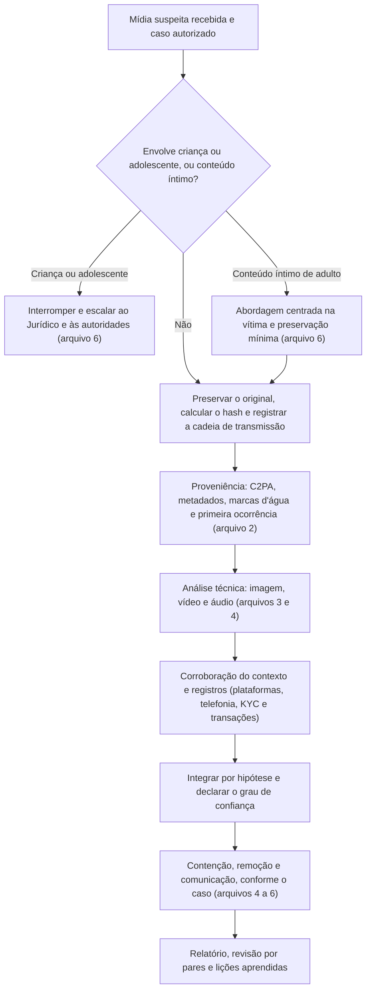

# Ferramentas, Fluxo, Modelos e Checklist de Deepfakes

> **Objetivo pedagógico:** padronizar as ferramentas, o fluxo de trabalho, os registros e a verificação de qualidade das investigações de mídias sintéticas e manipuladas (imagem, vídeo e áudio), garantindo preservação, proporcionalidade, raciocínio por hipóteses, validação de métodos, transparência sobre limitações e tratamento seguro de conteúdo sensível.

## 1. Ferramentas por finalidade

| Finalidade | Ferramentas |
|---|---|
| Preservação e integridade | `sha256sum`, `Get-FileHash`, WARC (pasta 21), manifestos e armazenamento com acesso restrito |
| Credenciais de conteúdo | `c2patool` (Content Authenticity Initiative) e verificadores de Content Credentials |
| Metadados e estrutura | ExifTool, MediaInfo, `ffprobe`, ImageMagick (`identify`) |
| Extração de quadros e de áudio | FFmpeg |
| Verificação de vídeo e busca reversa | Extensão InVID-WeVerify (quadros-chave e busca reversa), buscadores reversos de imagem |
| Análise de áudio | SoX (espectrograma), Sonic Visualiser, Audacity (visualização), FFmpeg |
| Análise de imagem | Ferramentas de análise forense de imagem (por exemplo, pacotes comerciais de autenticação e ferramentas de código aberto), Python com NumPy e Pillow |
| Hash perceptual e reutilização | `imagehash` (Python) e comparação de impressões |
| Detectores baseados em modelos | Plataformas comerciais e acadêmicas (por exemplo, serviços de detecção e plataformas abertas de avaliação), usados **como apoio**, com validação e com cuidado de privacidade |
| Marcas d'água de provedores | Verificadores oferecidos pelos próprios provedores (por exemplo, para o SynthID), conforme os termos |
| Registros de videoconferência e identidade | Auditorias das plataformas e do provedor de identidade (pasta 18) |
| Registros de KYC e antifraude | Logs do provedor de verificação, sistemas de antifraude e SIEM |
| Telefonia | Registros de chamadas (CDR) e de sinalização, via operadora e PABX |
| Documentação | Modelos deste arquivo, Pandoc e repositório versionado (pasta 22) |

Regras de uso: registre nome, versão e finalidade; **não envie mídias sensíveis** (conteúdo íntimo, imagens de menores, dados de clientes) a serviços de terceiros sem autorização, contrato e avaliação de privacidade; valide qualquer detector com amostras de teste antes de confiar em seus resultados.

## 2. Fluxo de trabalho padronizado

## 3. Dez perguntas e como respondê-las

| Pergunta | Onde responder |
|---|---|
| 1. O caso está autorizado, e há conteúdo de crianças e adolescentes ou íntimo que exija tratamento especial? | Ficha da mídia e protocolo do arquivo 6 |
| 2. O arquivo mais próximo do original foi obtido, com hash e cadeia de transmissão registrada? | Registro de aquisição |
| 3. As credenciais de conteúdo, os metadados e as marcas d'água foram verificados e interpretados corretamente? | Registro de proveniência |
| 4. A primeira ocorrência e o contexto foram investigados e corroborados por fontes independentes? | Linha do tempo de difusão |
| 5. As análises técnicas foram feitas sobre a melhor cópia, com métodos documentados? | Registro de análise |
| 6. Os detectores foram validados e usados apenas como apoio? | Registro de ferramentas |
| 7. Todas as hipóteses (H1 a H5) foram avaliadas, com evidências a favor e contra? | Matriz de hipóteses |
| 8. Os registros de plataformas, de telefonia, de KYC e de transações corroboram ou refutam? | Matriz de corroboração |
| 9. O grau de confiança e as limitações (compressão e ferramentas) foram declarados? | Declaração de confiança |
| 10. As medidas de contenção, remoção, comunicação e proteção foram tratadas? | Plano de resposta |

## 4. Modelo A: Ficha da Mídia Suspeita

| Campo | Preenchimento |
|---|---|
| Identificador | DFL-AAAA-NNN-ENNN |
| Tipo (imagem, vídeo ou áudio) e formato | |
| Origem (plataforma, conta, URL, canal e data) | |
| Como foi obtida e por quem | |
| Hash SHA-256 e data da aquisição (UTC) | |
| Cadeia de transmissão conhecida | |
| Alegação (o que a mídia supostamente mostra ou diz) | |
| Pessoas e organizações envolvidas | |
| Sensibilidade (conteúdo íntimo, menores ou dados pessoais) e tratamento definido | |
| Autorização, base legal e responsáveis | |

## 5. Modelo B: Registro de Proveniência e Metadados

| Verificação | Ferramenta e versão | Resultado | Interpretação | Limitações |
|---|---|---|---|---|
| Credenciais de conteúdo (C2PA) | | | | |
| Metadados (EXIF, XMP e contêiner) | | | | |
| Estrutura do arquivo e histórico de compressão | | | | |
| Marcas d'água de provedores | | | | |
| Busca reversa e primeira ocorrência | | | | |
| Hash perceptual e comparação com versões públicas | | | | |

## 6. Modelo C: Registro de Análise Técnica

| ID | Região ou intervalo (coordenadas ou tempo) | Técnica (visual, espectral, ruído, compressão, temporal ou áudio) | Observação | Imagem ou arquivo de apoio (hash) | Peso (forte, moderado ou fraco) | Explicações alternativas |
|---|---|---|---|---|---|---|
| A-001 | | | | | | |
| A-002 | | | | | | |

## 7. Modelo D: Registro de Detectores e Validação

| Ferramenta e versão | Data | Entrada (arquivo e hash) | Parâmetros e limiar | Saída | Validação (amostras autênticas e sintéticas de teste; condições) | Taxa de erro observada | Uso no relatório |
|---|---|---|---|---|---|---|---|
| | | | | | | | |

## 8. Modelo E: Matriz de Hipóteses e de Corroboração

| Hipótese | Evidências a favor | Evidências contra | Fontes de corroboração (telefonia, plataformas, KYC e transações) | Conclusão provisória |
|---|---|---|---|---|
| H1: autêntica | | | | |
| H2: edição convencional | | | | |
| H3: parcialmente sintética | | | | |
| H4: totalmente sintética | | | | |
| H5: indeterminada | | | | |

## 9. Modelo F: Declaração de Confiança

| Campo | Preenchimento |
|---|---|
| Conclusão (hipótese) | |
| Grau de confiança (escala adotada) | |
| Linhas de evidência independentes que convergem | |
| Principais limitações (compressão, ausência do original, ferramentas) | |
| O que mudaria a conclusão | |
| Revisor independente | |

## 10. Modelo G: Estrutura do Relatório

| Seção | Conteúdo |
|---|---|
| 1. Escopo, autorização e tratamento de conteúdo sensível | Requisito, base legal e restrições |
| 2. Resumo e conclusões | Conclusão por hipótese, confiança e recomendações |
| 3. Aquisição e preservação | Origem, hashes, cadeia de transmissão e custódia |
| 4. Proveniência | C2PA, metadados, marcas d'água e primeira ocorrência |
| 5. Análise técnica | Métodos, observações, validação de ferramentas e limitações |
| 6. Corroboração de contexto e registros | Plataformas, telefonia, KYC e transações |
| 7. Impacto e resposta | Danos, contenção, remoção e comunicação |
| 8. Aspectos legais | Obrigações e caminhos (com o Jurídico) |
| 9. Recomendações | Controles preventivos e melhorias |
| 10. Limitações | O que não pôde ser determinado |
| 11. Anexos | Hashes, imagens de apoio (sem conteúdo íntimo ou de menores), consultas e custódia |

## 11. Checklist operacional de investigação de deepfakes

**Caso:** DFL-AAAA-NNN
**Analista:** ____________________
**Data e hora (UTC):** ____________________

### 11.1 Tratamento inicial

- [ ] Autorização, base legal e escopo definidos
- [ ] Verificado se há crianças e adolescentes ou conteúdo íntimo; protocolos do arquivo 6 aplicados
- [ ] Arquivo mais próximo do original obtido; hash, cadeia de transmissão e custódia registrados
- [ ] Mídia sensível não enviada a serviços externos sem autorização

### 11.2 Proveniência e análise

- [ ] C2PA, metadados, estrutura e marcas d'água verificados e corretamente interpretados
- [ ] Primeira ocorrência e contexto investigados, com corroboração independente
- [ ] Análises técnicas sobre a melhor cópia, com métodos e versões documentados
- [ ] Detectores validados e usados como apoio, com limitações registradas
- [ ] Todas as hipóteses avaliadas, incluindo a possibilidade de mídia autêntica (dividendo do mentiroso)
- [ ] Registros de plataformas, telefonia, KYC e transações correlacionados

### 11.3 Resposta e relato

- [ ] Medidas de contenção financeira e de acesso tomadas sem aguardar a conclusão da análise, quando cabível
- [ ] Remoção, bloqueio e comunicação conduzidos com o Jurídico; vítima apoiada
- [ ] Grau de confiança e limitações declarados; sem afirmações categóricas indevidas
- [ ] Atribuição de autoria somente com evidências sólidas
- [ ] Revisão por pares realizada; relatório sem conteúdo íntimo ou de menores

## 12. Resultado da verificação

| Resultado | Condição |
|---|---|
| Conforme | Todos os itens aplicáveis marcados |
| Conforme com ressalvas | Pendências sem impacto na proteção de pessoas e nas conclusões, com plano de ação |
| Não conforme | Conteúdo de menores ou íntimo copiado ou compartilhado, uso de detector como prova isolada, conclusão categórica sem corroboração, atribuição de autoria sem base ou ausência de proveniência registrada; comunicar o líder e o Jurídico |

**Assinatura do analista:** ____________________
**Assinatura do revisor:** ____________________

## 13. Casos de uso corporativos

- Padronização da investigação de mídias sintéticas no SOC, no jurídico e na comunicação.
- Programa de validação de detectores e de treinamento de analistas.
- Auditoria da prontidão contra fraudes por voz, vídeo e identidade sintética.

## 14. Normas e frameworks relevantes

- ISO/IEC 27037, 27041, 27042; ISO 21043; SWGDE; Protocolo de Berkeley; C2PA
- NIST AI 100-4; NIST AI 600-1; programa NIST GenAI; ISO/IEC 30107
- LGPD, arts. 5º, 6º, 11, 20 e 46; CPP, arts. 158-A a 158-F; CPC, arts. 422 e 439 a 441

## 15. Referências

- Documentação do c2patool, do ExifTool, do MediaInfo, do FFmpeg, do SoX, do Sonic Visualiser e do imagehash.
- Extensão InVID-WeVerify (documentação).
- SWGDE. Best Practices for Image Authentication.
- Pastas 02, 04, 21, 22 e 23 (PB-42 e PB-44) deste repositório.
