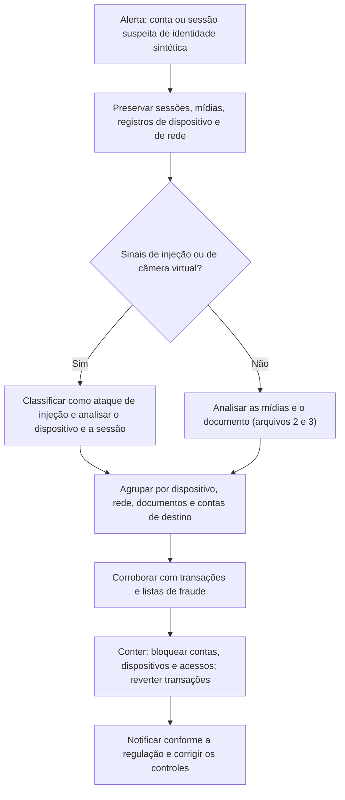

# Fraudes de Identidade, KYC e Videochamadas Sintéticas

> **Objetivo pedagógico:** investigar fraudes de identidade que usam mídias sintéticas em processos de verificação remota (KYC e prova de vida), em videochamadas corporativas e em processos de recrutamento: distinguir ataques de apresentação e ataques de injeção, identificar as evidências em plataformas de videoconferência, em dispositivos e em registros de provedores de verificação, agrupar casos por impressões digitais de dispositivos e documentos, verificar a consistência de documentos de identidade e propor controles preventivos.

## 1. Cenários

| Cenário | Descrição | Impacto |
|---|---|---|
| Abertura de contas e onboarding fraudulentos | Documentos e rostos sintéticos ou manipulados para passar pela verificação remota | Fraude, lavagem de dinheiro e contas de passagem |
| Tomada de contas | Contorno de verificação facial para recuperar acesso a contas legítimas | Perdas e danos às vítimas |
| Videochamadas com participantes sintéticos | Interlocutores com rosto e voz gerados ou trocados em tempo real, que se passam por executivos, fornecedores ou clientes | Autorização de pagamentos e vazamento de informações |
| Recrutamento fraudulento | Candidatos com identidade falsa e rosto ou voz sintéticos, para obter acesso a sistemas | Acesso indevido, fraude e espionagem |
| Suporte e help desk | Chamadas de vídeo ou voz para redefinir senhas e MFA | Tomada de contas corporativas |

Casos públicos relatados a partir de 2024 mostram videoconferências com participantes sintéticos levando a transferências de valor expressivo, e autoridades emitiram alertas sobre candidatos com identidades falsas em processos de contratação remota.

## 2. Ataques de apresentação e ataques de injeção

| Tipo | Descrição | Exemplos | Evidências típicas |
|---|---|---|---|
| Ataque de apresentação | Apresentar à câmera real uma representação falsa | Foto impressa, vídeo em tela, máscara | Sinais de moiré, reflexos de tela, bordas e perda de profundidade; detecção de prova de vida (liveness) do provedor |
| Ataque de injeção | Entregar à aplicação um fluxo de vídeo falso, sem passar pela câmera física | Câmera virtual, emulador, dispositivo comprometido, manipulação da API | Presença de câmera virtual ou emulador; inconsistências do dispositivo; falhas de atestação |
| Ataque a documentos | Apresentar documento falsificado ou sintético | Imagem de documento gerada ou alterada | Inconsistências de template, de fontes, de dígitos verificadores e de chip |

Ataques de injeção são mais difíceis de detectar apenas pela imagem, pois o vídeo chega "limpo" à aplicação; a detecção depende de **sinais do dispositivo e da sessão**.

## 3. Evidências em videochamadas corporativas

| Fonte | O que procurar |
|---|---|
| Registros da plataforma de videoconferência (Teams, Zoom, Meet e outras) | Lista de participantes, nomes exibidos, contas, endereços IP e dispositivos, horários de entrada e de saída, convidados externos, gravações e transcrições (conforme a configuração) |
| Registros de identidade e de acesso | Entradas da conta usada (pasta 18) e métodos de autenticação |
| Convite e canal de origem | Quem convidou, por qual canal e com que antecedência; domínios semelhantes |
| Gravação da reunião (se existir) | Preservar o arquivo original e analisar (arquivos 3 e 4) |
| Endpoint do participante interno | Aplicativos e drivers de câmera, extensões e atividade (pasta 07) |
| Registros de e-mail e mensagens | Instruções posteriores à reunião, pedidos de pagamento e confirmações |
| Registros financeiros | Ordens, aprovações e beneficiários (PB-32) |

```powershell
# Dispositivos de câmera e de áudio registrados em um endpoint Windows (para identificar câmeras virtuais; indicador, e não prova)
Get-CimInstance Win32_PnPEntity | Where-Object { $_.PNPClass -in @("Camera","Image") -or $_.Name -match "camera|virtual|webcam" } |
  Select-Object Name, Manufacturer, PNPClass, Status | Format-Table -AutoSize

# Programas de câmera virtual ou de captura em execução (indicador; também há uso legítimo)
Get-Process | Where-Object { $_.ProcessName -match "obs|manycam|camera" } | Select-Object ProcessName, Id, StartTime
```

O uso de câmeras virtuais é frequente em contextos legítimos (apresentações e filtros). Trate-o como **indicador a ser corroborado**, e não como prova de fraude.

## 4. Evidências em processos de KYC

| Fonte | Conteúdo | Uso |
|---|---|---|
| Registros do provedor de verificação (sessões) | Resultado da prova de vida, pontuações, motivos de recusa, sinais de injeção e de câmera virtual, versão do SDK | Distinguir ataque de falha técnica |
| Impressão digital do dispositivo e de rede | Identificadores de dispositivo, sistema operacional, emuladores, root ou jailbreak, endereço IP, VPN e proxies | Agrupar tentativas e contas |
| Imagens e vídeos enviados | Selfie, vídeo de prova de vida e documento | Análise técnica (arquivos 2 e 3) e reutilização entre contas |
| Dados do documento | Número, datas, MRZ, chip NFC, foto do documento | Validação de consistência |
| Linha do tempo de onboarding | Tentativas, tempos, falhas anteriores e repetições | Padrões de teste do atacante |
| Atividade pós-abertura | Transações, mudanças de dados e acessos | Objetivo da fraude |
| Dados de terceiros e listas | Consultas a bases e a listas de fraude | Corroboração |

```sql
-- Agrupar contas abertas a partir do mesmo dispositivo (tabelas ilustrativas)
SELECT impressao_dispositivo,
       count(DISTINCT id_cliente) AS clientes,
       min(horario_utc) AS primeira_sessao,
       max(horario_utc) AS ultima_sessao
FROM kyc_sessoes
WHERE horario_utc > now() - interval '30 days'
GROUP BY impressao_dispositivo
HAVING count(DISTINCT id_cliente) >= 5
ORDER BY clientes DESC;

-- Sessões com sinais de câmera virtual ou de emulador, e resultado da prova de vida
SELECT id_sessao, id_cliente, horario_utc, camera_virtual, emulador, pontuacao_prova_de_vida, resultado
FROM kyc_sessoes
WHERE (camera_virtual = true OR emulador = true)
  AND horario_utc > now() - interval '30 days'
ORDER BY horario_utc DESC;
```

## 5. Verificação de documentos de identidade (consistência)

| Verificação | Descrição |
|---|---|
| Template e elementos de segurança | Fontes, espaçamentos, brasões, microtextos e hologramas; comparar com modelos oficiais |
| Zona de leitura óptica (MRZ) | Os dígitos verificadores do padrão ICAO 9303 devem conferir |
| Chip e leitura NFC (documentos com chip) | A leitura do chip e a verificação de assinatura são muito mais robustas do que a imagem |
| Foto do documento versus selfie | Comparação facial automática ou assistida; sujeita a erros e a vieses |
| Reutilização de imagens | Mesmas fotos ou documentos em contas diferentes (hash perceptual) |
| Consistência dos dados | Datas, números, órgãos emissores e padrões |
| Consulta a bases oficiais | Validação com bases autorizadas, conforme a lei |

```python
# Dígito verificador de campos da MRZ (ICAO 9303): pesos 7, 3, 1; letras valem 10 a 35; "<" vale 0
def dv_mrz(campo: str) -> int:
    pesos = (7, 3, 1)
    valores = {str(i): i for i in range(10)}
    valores.update({chr(65 + i): 10 + i for i in range(26)})
    valores["<"] = 0
    return sum(valores[c] * pesos[i % 3] for i, c in enumerate(campo)) % 10

# Exemplo de uso: comparar com o dígito impresso na MRZ para cada campo (número do documento, nascimento e validade)
# print(dv_mrz("L898902C3"))
```

Documentos sintéticos de alta qualidade podem passar na inspeção visual; a **validação criptográfica do chip** e a consulta a bases oficiais são as defesas mais fortes.

## 6. Procedimento de investigação

| Passo | Descrição |
|---|---|
| 1. Preservar | Sessões do provedor, mídias enviadas, registros de dispositivo e de rede, registros da plataforma de videoconferência e transações (PB-01) |
| 2. Delimitar | Contas, sessões, períodos e participantes envolvidos |
| 3. Classificar o ataque | Apresentação, injeção, documento falso, ou tomada de conta |
| 4. Analisar as mídias | Proveniência e análise técnica (arquivos 2 e 3); reutilização entre contas |
| 5. Agrupar | Por impressão digital de dispositivo, rede, documentos, contas de destino e comportamento |
| 6. Corroborar | Dados bancários, listas de fraude, outras fontes |
| 7. Conter | Bloquear contas e dispositivos, reverter transações, bloquear acessos (PB-31 e PB-32) |
| 8. Notificar | Obrigações regulatórias (como a comunicação de operações suspeitas ao órgão competente, conforme a regulação aplicável) e coordenação com o Jurídico |
| 9. Corrigir | Controles de prova de vida, de injeção e de documentos |
| 10. Documentar | Relatório com hipóteses, evidências e limitações |



## 7. Controles preventivos

| Controle | Descrição |
|---|---|
| Detecção de ataques de injeção e de câmera virtual | Verificação do dispositivo, do SDK e do canal de captura |
| Atestação de dispositivo e de aplicativo | Confirma que o aplicativo e o dispositivo são íntegros |
| Prova de vida ativa e passiva | Desafios aleatórios e análise de sinais; combinar métodos |
| Leitura de chip de documentos (NFC) e validação criptográfica | Muito mais robusta do que fotos de documentos |
| Verificação cruzada e consulta a bases oficiais | Reduz a fraude por documentos sintéticos |
| Análise de risco e de comportamento | Dispositivo, rede, horário e comportamento |
| Limites e revisão humana para casos de risco | Para operações sensíveis |
| Videochamadas: verificação independente e protocolos | Confirmar a identidade de interlocutores por canal separado; códigos pré-acordados; nunca autorizar pagamentos apenas por videochamada |
| Recrutamento: verificação de identidade em etapas e presencial quando possível | Verificações de documentos, de referências e de acesso físico a equipamentos |
| Segregação de acessos de novos contratados | Privilégio mínimo e monitoramento reforçado nos primeiros meses |

## 8. Aspectos legais e de privacidade

| Tema | Orientação |
|---|---|
| Dados biométricos | Rosto e voz usados para identificação são dados pessoais sensíveis (LGPD, arts. 5º, II, e 11); definir base legal, finalidade, minimização e retenção; prevenção a fraudes é hipótese prevista para dados sensíveis (art. 11, II, g), observadas as condições legais |
| Transparência e direitos dos titulares | Informar sobre o tratamento; tratar solicitações de revisão de decisões automatizadas (art. 20) |
| Compartilhamento com provedores de verificação | Contratos, papéis de controlador e operador, e segurança (arts. 39 e 46) |
| Prevenção à lavagem de dinheiro | Obrigações de identificação de clientes e de comunicação de operações suspeitas, conforme a regulação setorial aplicável |
| Responsabilidade penal e civil | Falsidade ideológica (CP, art. 299), falsa identidade (art. 307), estelionato e fraude eletrônica (art. 171, §2º-A); responsabilidade civil por falhas de segurança, conforme o caso |
| Provas | Cadeia de custódia; mídias de vítimas e de titulares tratadas com minimização |

## 9. Exemplo prático: anel de contas abertas com identidade sintética

| Etapa | Resultado |
|---|---|
| Alerta | 64 contas abertas em 10 dias, com aprovação automática, apresentam movimentações semelhantes e rápidas |
| Sessões de KYC | 41 sessões com sinal de câmera virtual; 23 sem sinal explícito, mas com o mesmo modelo de dispositivo e padrões de tempo |
| Agrupamento | 9 impressões digitais de dispositivo explicam 52 contas; 6 contas de destino concentram os recursos |
| Mídias | Selfies e vídeos mostram o mesmo conjunto de rostos sintéticos com variações; hashes perceptuais agrupam as imagens; fotos de documentos com o mesmo template e erros de dígitos verificadores da MRZ |
| Resposta | Bloqueio das contas e dos dispositivos, retenção de valores quando possível, comunicação às áreas e aos órgãos competentes, conforme a regulação; revisão dos controles |
| Controles novos | Detecção de injeção, leitura de chip NFC para documentos compatíveis, revisão humana para sessões com sinais de risco |
| Conclusão | Fraude organizada com identidades sintéticas e ataques de injeção; confiança alta; recomendações priorizadas |

## 10. Casos de uso corporativos

- Investigação de aberturas de contas e de acessos fraudulentos com identidades sintéticas.
- Resposta a videochamadas fraudulentas e a candidatos com identidade falsa.
- Revisão de controles de KYC, de prova de vida e de recrutamento remoto.

## 11. Normas e frameworks relevantes

- ISO/IEC 30107 (detecção de ataques de apresentação em biometria); ISO/IEC 29115 (garantia de autenticação); ICAO Doc 9303 (documentos de viagem legíveis por máquina)
- NIST SP 800-63 (diretrizes de identidade digital); FIDO Alliance; ENISA (ameaças a identidade remota)
- MITRE ATT&CK (T1078, T1566 e engenharia social); CIS Controls v8.1, controles 5, 6 e 14
- LGPD, arts. 5º, 6º, 11, 20, 39 e 46; CP, arts. 171, 299 e 307

## 12. Referências

- ISO/IEC 30107-1/3. Biometric presentation attack detection.
- NIST. SP 800-63-4: Digital Identity Guidelines.
- ICAO. Doc 9303: Machine Readable Travel Documents.
- Alertas públicos de autoridades sobre candidatos com identidades falsas e sobre fraudes por videoconferência com mídia sintética.
- Pastas 07, 18, 22 e 25 deste repositório; PB-31, PB-32 e PB-44 (pasta 23).
