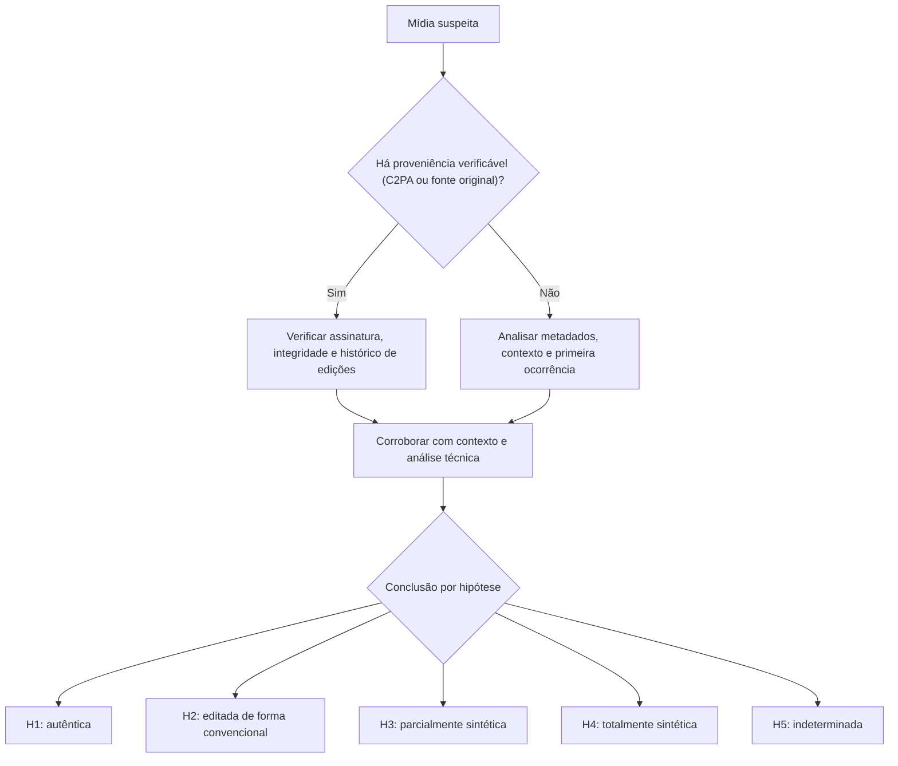

# Fundamentos de Mídias Sintéticas e Deepfakes

> **Objetivo pedagógico:** compreender o que são mídias sintéticas e deepfakes, em nível conceitual, como são produzidas e que vestígios tendem a deixar; mapear as ameaças corporativas e pessoais associadas; distinguir as perguntas forenses (autenticidade, proveniência, atribuição, linha do tempo e impacto); reconhecer o "dividendo do mentiroso" (a alegação falsa de que uma mídia real é sintética); e formular conclusões por hipóteses, com graus de confiança e limitações.

> Este material trata de **detecção, preservação e resposta**. Não fornece instruções para produzir mídias sintéticas enganosas.

## 1. Terminologia

| Termo | Definição |
|---|---|
| Mídia sintética | Imagem, vídeo ou áudio gerado ou alterado, total ou parcialmente, por modelos de IA |
| Deepfake | Mídia sintética ou manipulada por IA que representa, de forma convincente, uma pessoa dizendo ou fazendo algo que ela não disse nem fez |
| Troca de rosto (face swap) | Substituição do rosto de uma pessoa pelo de outra em imagem ou vídeo |
| Reencenação (face reenactment) | Transferência de expressões e movimentos de uma pessoa para o rosto de outra |
| Sincronização labial (lip-sync) | Alteração da boca para corresponder a um novo áudio |
| Clonagem de voz e conversão de voz | Geração de fala com a voz de uma pessoa a partir de texto ou de outra fala |
| Síntese completa | Geração integral de imagem, vídeo ou áudio por prompts (texto para imagem, vídeo ou áudio) |
| Edição parcial (inpainting) | Alteração de regiões de uma mídia real com conteúdo gerado |
| Cheapfake (shallowfake) | Manipulação sem IA sofisticada: edição simples, corte, mudança de legenda ou de contexto, câmera lenta |
| Mídia real fora de contexto | Mídia autêntica apresentada com data, local ou legenda falsos |
| Proveniência | Histórico verificável de origem e de edições de uma mídia |

## 2. Como surgem as mídias sintéticas (visão conceitual)

| Família de técnicas | Ideia geral | Vestígios que podem existir |
|---|---|---|
| Redes adversariais generativas (GAN) | Um gerador e um discriminador treinados em oposição | Padrões espectrais de aumento de resolução; inconsistências locais |
| Modelos de difusão | Geração por remoção progressiva de ruído, guiada por texto ou por imagem | Textura excessivamente suave, inconsistências de texto, mãos e detalhes; metadados do gerador |
| Autoencoders e troca de rosto | Codificam e reconstroem rostos para trocar identidades | Bordas de mistura, inconsistência de iluminação e de pose |
| Reencenação e sincronização labial | Ajustam movimentos faciais e da boca ao áudio | Inconsistências temporais; desalinhamento entre fonemas e lábios |
| Síntese de fala (TTS) e conversão de voz | Geram fala a partir de texto ou transformam uma voz em outra | Artefatos espectrais de vocoder; prosódia e respiração atípicas |
| Edição assistida por IA | Ferramentas de edição com remoção, preenchimento e extensão | Metadados de software; inconsistências de ruído entre regiões |

Os vestígios variam com o gerador, a versão, a compressão e o pós-processamento. **Nenhum vestígio isolado é conclusivo**, e geradores novos tendem a eliminar artefatos antes conhecidos.

## 3. Panorama de ameaças

| Ameaça | Exemplos | Impacto |
|---|---|---|
| Fraude financeira por voz ou por videochamada | Ordens de transferência com a voz ou a imagem de um executivo | Perdas financeiras diretas |
| Fraude de identidade e de KYC | Abertura de contas ou acesso com rostos e documentos sintéticos | Fraude, lavagem de dinheiro e tomada de contas |
| Conteúdo íntimo não consensual (NCII) | Imagens sexuais sintéticas de pessoas reais | Grave dano à pessoa; crimes (arquivo 6) |
| Assédio, extorsão e difamação | Mídias falsas para constranger, ameaçar ou prejudicar a reputação | Dano pessoal, trabalhista e reputacional |
| Desinformação e manipulação | Vídeos ou áudios falsos de figuras públicas, de candidatos ou de marcas | Dano à reputação, ao mercado e ao processo eleitoral |
| Fabricação de provas | Áudios e imagens forjados em disputas trabalhistas, familiares e comerciais | Prova falsa em processos |
| Engenharia social e recrutamento fraudulento | Candidatos e interlocutores com rosto e voz sintéticos | Infiltração, acesso indevido e fraude |
| Ataques à marca | Anúncios e comunicados falsos com porta-vozes sintéticos | Perda de confiança e de clientes |
| Material de abuso sexual infantil sintético | Imagens sexuais sintéticas ou manipuladas envolvendo crianças e adolescentes | Crime grave; escalonamento imediato (arquivo 6) |

## 4. O dividendo do mentiroso

À medida que mídias sintéticas se tornam conhecidas, **mídias autênticas podem ser desqualificadas** com a alegação "é um deepfake". O investigador deve tratar as duas direções do erro:

| Erro | Consequência |
|---|---|
| Aceitar como real uma mídia sintética | Fraude, prova falsa e decisões erradas |
| Rotular como falsa uma mídia autêntica | Negação de fatos reais e injustiças |

Por isso, a conclusão deve ser baseada em **evidências positivas** (proveniência, metadados, corroboração de contexto e análise técnica) e não apenas na "aparência de falsidade" ou na existência de um detector.

## 5. Perguntas forenses

| Pergunta | Significado | Fontes principais |
|---|---|---|
| Autenticidade | A mídia é autêntica, editada de forma convencional, parcialmente sintética ou totalmente sintética? | Proveniência, metadados, análise técnica, contexto |
| Proveniência | De onde veio, quando e por qual cadeia de transmissão? | Arquivo original, plataforma, credenciais de conteúdo, OSINT (pasta 21) |
| Primeira ocorrência | Quando e onde apareceu pela primeira vez? | Busca reversa, arquivos de plataformas e registros |
| Atribuição | Quem produziu ou divulgou? | Registros de plataformas, infraestrutura e investigação; raramente possível pela mídia isolada |
| Contexto | Os fatos representados são compatíveis com o que se sabe? | Corroboração independente (local, data, pessoas e eventos) |
| Impacto | Quem foi afetado e que danos ocorreram? | Registros de transações, de acessos e de difusão |
| Resposta | Que medidas de contenção e de remoção são cabíveis? | Plataformas, jurídico e autoridades |

## 6. Raciocínio por hipóteses

| Hipótese | Evidências que a sustentam | Evidências que a enfraquecem |
|---|---|---|
| H1: autêntica e sem edição relevante | Proveniência verificável; metadados coerentes; corroboração independente; ausência de anomalias | Inconsistências técnicas ou de contexto sem explicação |
| H2: autêntica com edição convencional (corte, cor, legenda, contexto) | Rastros de edição tradicional; mesma cena em fonte original | Evidências de geração de conteúdo |
| H3: parcialmente sintética (troca de rosto, sincronização labial ou voz) | Bordas e inconsistências localizadas; ruído diferente entre regiões; áudio sem correspondência com a boca | Proveniência íntegra; análise consistente em todas as regiões |
| H4: totalmente sintética | Metadados ou marcas do gerador; ausência de assinatura de câmera; anomalias de textura e de detalhes; contexto impossível | Corroboração de que o evento ocorreu |
| H5: indeterminada | Compressão intensa, pouca informação ou ferramentas não conclusivas | Qualquer evidência decisiva |

Registre, para cada hipótese, as evidências a favor e contra. Se várias permanecem plausíveis, a conclusão correta é "indeterminada", com a explicação das limitações.

## 7. Graus de confiança nas conclusões

Use uma escala explícita (por exemplo, a escala de certeza da pasta 22, de C0 a C6) e declare a base:

| Grau (exemplo) | Quando aplicar |
|---|---|
| Alta confiança de manipulação ou de síntese | Convergência de várias linhas independentes: proveniência, metadados, vestígios técnicos fortes e contexto |
| Confiança moderada | Indícios técnicos relevantes, mas sem proveniência conclusiva |
| Baixa confiança | Poucos indícios ou dependentes de uma única ferramenta |
| Indeterminada | Informação insuficiente, mídia degradada ou ferramentas inconclusivas |
| Alta confiança de autenticidade | Proveniência verificável, metadados coerentes e corroboração independente (a ausência de anomalias, por si só, não basta) |

## 8. Taxonomia visual

## 9. Aspectos legais (visão geral)

> **Aviso:** este material é técnico-educacional e não substitui parecer jurídico. Valide cada caso com o Jurídico e com o DPO. As normas sobre IA e sobre mídias sintéticas mudam com rapidez.

| Tema | Orientação |
|---|---|
| Imagem e voz como dados pessoais | Imagem e voz de pessoas identificáveis são dados pessoais; dados biométricos associados à pessoa natural são dados sensíveis (LGPD, arts. 5º, II, e 11) |
| Direitos da personalidade | Proteção da imagem, da honra e da privacidade (Constituição, art. 5º, X; Código Civil, arts. 20 e 21) |
| Fraude e falsidade | Estelionato e fraude eletrônica (Código Penal, art. 171, inclusive §2º-A), falsidade ideológica (art. 299) e falsa identidade (art. 307) |
| Conteúdo íntimo e violência psicológica | Divulgação de cena de nudez ou de sexo sem consentimento (Código Penal, art. 218-C); violência psicológica contra a mulher (art. 147-B), com alterações legislativas recentes que consideram o uso de IA (confirme a redação vigente) |
| Crianças e adolescentes | Simulação de participação de criança ou adolescente em cena de sexo explícito ou pornográfica por montagem ou modificação é crime (ECA, art. 241-C), e há tratamento legal específico para posse e armazenamento (ECA, arts. 240 a 241-E) |
| Eleições | Normas do TSE restringem o uso de conteúdo sintético enganoso na propaganda eleitoral (Resolução TSE nº 23.610/2019, com alterações de 2024; confirme o texto vigente) |
| Prova em juízo | Reprodução mecânica faz prova se sua conformidade não for impugnada (CPC, art. 422); documentos eletrônicos, arts. 439 a 441; cadeia de custódia (CPP, arts. 158-A a 158-F) |
| Regulação de IA | O AI Act (UE) prevê marcação de conteúdo sintético e divulgação de deepfakes (art. 50), conforme o cronograma vigente; no Brasil, projeto de lei sobre IA em tramitação (PL nº 2338/2023; confirme o estágio) |

## 10. Exemplo prático: formulando a pergunta certa

| Situação | Pergunta mal formulada | Pergunta bem formulada |
|---|---|---|
| Áudio atribuído ao diretor financeiro, ordenando uma transferência | "Esse áudio é deepfake?" | "Qual a origem do arquivo e do canal? O áudio é compatível com a voz do diretor? Há corroboração do contexto (agenda e localização)? Que hipóteses explicam o áudio e que evidências sustentam cada uma?" |
| Vídeo de um executivo com declaração polêmica | "Esse vídeo é falso?" | "Qual a primeira ocorrência? Há proveniência ou fonte original? Há inconsistências técnicas? O evento é corroborado por fontes independentes?" |

## 11. Casos de uso corporativos

- Estruturação da capacidade de triagem e de resposta a mídias suspeitas (pasta 23, PB-44).
- Prevenção de fraudes por voz e por videochamada com controles de verificação.
- Preparação para crises de reputação e para pedidos de remoção.

## 12. Normas e frameworks relevantes

- ISO/IEC 27037, 27041, 27042 e 27043; ISO 21043 (ciências forenses: interpretação e relato); SWGDE (autenticação de imagem e de vídeo)
- C2PA (Coalition for Content Provenance and Authenticity); Protocolo de Berkeley (investigações em fontes abertas)
- NIST AI 100-4 (redução de riscos de conteúdo sintético) e NIST AI 600-1; Regulamento (UE) 2024/1689, art. 50
- LGPD, arts. 5º, 6º, 11 e 46; CPP, arts. 158-A a 158-F; CPC, arts. 422 e 439 a 441

## 13. Referências

- Chesney, R.; Citron, D. Deep Fakes: A Looming Challenge for Privacy, Democracy, and National Security. California Law Review, 2019.
- Verdoliva, L. Media Forensics and DeepFakes: An Overview. IEEE Journal of Selected Topics in Signal Processing, 2020.
- Rössler, A. et al. FaceForensics++: Learning to Detect Manipulated Facial Images. ICCV, 2019.
- Dolhansky, B. et al. The DeepFake Detection Challenge (DFDC) Dataset. 2020.
- Partnership on AI. Responsible Practices for Synthetic Media; WITNESS. Prepare, Don't Panic.
- C2PA. Technical Specification (versão vigente).
- Pastas 21, 22, 23 (PB-44), 24 e 25 deste repositório.
