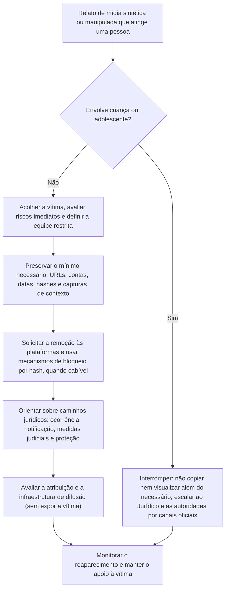

# Proteção de Vítimas, Resposta Jurídica e Desinformação

> **Objetivo pedagógico:** conduzir a resposta a incidentes em que mídias sintéticas ou manipuladas atingem pessoas (conteúdo íntimo não consensual, assédio, extorsão e difamação) e a organização (desinformação sobre executivos e marcas), com abordagem centrada na vítima, tratamento seguro e minimalista das evidências, pedidos de remoção, caminhos jurídicos e comunicação responsável.

> **Aviso:** este material é técnico-educacional e não substitui parecer jurídico nem apoio psicológico. Casos que envolvam **crianças e adolescentes** exigem escalonamento imediato ao Jurídico e às autoridades, sem copiar, visualizar além do estritamente necessário ou compartilhar o conteúdo.

## 1. Princípios da abordagem centrada na vítima

| Princípio | Aplicação |
|---|---|
| Dignidade e sigilo | Tratar o caso com a máxima confidencialidade; acesso restrito a poucas pessoas treinadas |
| Escuta sem julgamento | Não questionar a conduta da vítima nem exigir que ela "prove" a falsidade; nunca culpabilizar |
| Minimização da exposição | Reduzir o número de pessoas que veem o conteúdo e o número de vezes que a vítima precisa vê-lo ou relatá-lo |
| Autonomia | A vítima decide sobre denúncias e sobre medidas, com informação adequada |
| Segurança primeiro | Avaliar riscos imediatos (extorsão, ameaça, perseguição e risco à integridade) |
| Preservação mínima e suficiente | Preservar o necessário para a remoção e para os procedimentos legais, sem acumular cópias |
| Apoio | Oferecer apoio psicológico, jurídico e social |
| Não redistribuir | Jamais encaminhar, armazenar em locais de uso comum ou discutir o conteúdo em canais abertos |

## 2. Fluxo de resposta

## 3. Tratamento das evidências

| Prática | Orientação |
|---|---|
| Registrar URLs, nomes das contas, datas e horários (UTC) e o contexto da difusão | Suficiente para a remoção e para boa parte dos procedimentos legais |
| Preservar a página com captura de contexto e registro técnico (WARC) e hash | Pasta 21 e PB-42; avaliar o uso de ata notarial, que dispensa a vítima de repetir a exposição |
| Evitar guardar cópias do conteúdo íntimo | Se for indispensável, armazenar em local seguro, criptografado e com acesso restrito, com registro de acessos |
| Não enviar o conteúdo a serviços externos de análise sem autorização | Risco de nova exposição |
| Análise técnica | Realizada por poucos analistas treinados, com o mínimo de visualização; o relatório descreve os achados sem reproduzir o conteúdo |
| Registro de acessos | Quem acessou, quando e por quê |
| Cadeia de custódia | Mesmo para material mínimo (pasta 02) |

## 4. Remoção e bloqueio

| Mecanismo | Descrição | Observações |
|---|---|---|
| Denúncia às plataformas | Canais de denúncia para conteúdo íntimo não consensual, assédio e manipulação | Prazos e critérios variam; registrar protocolos |
| Bloqueio por hash (StopNCII.org) | A pessoa gera, no próprio dispositivo, uma impressão (hash) da imagem ou do vídeo e a compartilha com plataformas participantes, que passam a bloquear a difusão; o conteúdo não é enviado | Para pessoas maiores de 18 anos; depende da adesão das plataformas |
| Take It Down (NCMEC) | Mecanismo equivalente para imagens de pessoas que eram menores de 18 anos na época | Acionar com apoio especializado e jurídico |
| Notificação extrajudicial ao provedor | Pedido formal de remoção | Marco Civil da Internet, art. 21: o provedor pode responder subsidiariamente por divulgação, sem autorização, de imagens ou vídeos com nudez ou atos sexuais privados se, após notificação, não promover a remoção |
| Ordem judicial | Para remoção e fornecimento de dados | Marco Civil, art. 19 e seguintes; o STF ampliou, em 2025, a responsabilidade de plataformas em determinadas situações (Tema 987): confirme o alcance e a vigência |
| Remoção em buscadores | Solicitações de desindexação | Procedimentos próprios dos buscadores |
| Hospedagem e registradores | Pedidos de remoção ao provedor de hospedagem e ao registrador do domínio | Úteis para sites dedicados |

## 5. Caminhos jurídicos (visão geral)

> **Aviso:** as informações abaixo são gerais. O Jurídico e advogados especializados devem orientar o caso concreto.

| Via | Descrição |
|---|---|
| Registro de ocorrência | Boletim de ocorrência em delegacia (inclusive especializadas em crimes cibernéticos e em atendimento à mulher, quando existirem) |
| Crimes possíveis | Divulgação de cena de nudez ou de sexo sem consentimento (CP, art. 218-C); violência psicológica contra a mulher (CP, art. 147-B), com alterações legislativas recentes sobre o uso de IA (confirme a redação vigente); perseguição (art. 147-A); ameaça (art. 147); extorsão (art. 158); calúnia, difamação e injúria (arts. 138 a 140); falsidade ideológica (art. 299); invasão de dispositivo informático (art. 154-A) |
| Crianças e adolescentes | ECA, arts. 240 a 241-E, inclusive a simulação de participação por montagem ou modificação (art. 241-C) |
| Medidas protetivas | Lei Maria da Penha (Lei nº 11.340/2006), quando aplicável |
| Responsabilidade civil | Danos morais e materiais (Constituição, art. 5º, X; Código Civil, arts. 186, 927 e 20); obrigações de fazer (remoção) com tutela de urgência |
| Seara trabalhista e administrativa | Quando envolve colegas ou superiores: apuração interna, medidas disciplinares e proteção da vítima |
| Eleitoral | Normas do TSE sobre conteúdo sintético na propaganda eleitoral (confirme a resolução vigente) |
| Proteção de dados | Direitos do titular e comunicação à ANPD em incidentes envolvendo dados pessoais |

Canais de apoio e de denúncia (confirme os vigentes): Central de Atendimento à Mulher (Ligue 180), Disque 100 (direitos humanos, inclusive crianças e adolescentes) e SaferNet Brasil (canal de denúncia de crimes cibernéticos).

## 6. Casos dentro da organização

| Situação | Conduta |
|---|---|
| Colaboradora ou colaborador vítima de conteúdo íntimo sintético criado por colega | Acolhimento imediato; afastamento do suposto autor das interações com a vítima, conforme a política; apuração conduzida pelo RH e pelo Jurídico, com preservação mínima; apoio psicológico; comunicação restrita |
| Executivo vítima de vídeo ou áudio falso | Verificação de proveniência (arquivos 2 a 4); comunicado oficial coordenado; pedidos de remoção; avaliação jurídica |
| Fraude com uso da imagem de colaboradores em anúncios ou perfis falsos | Preservação, remoção e comunicação aos clientes, quando necessário |
| Alegação de que mídia real é "deepfake" | Avaliar com neutralidade; conclusões por hipóteses (arquivo 1) |
| Prova de áudio ou vídeo apresentada em disputa trabalhista | Verificar proveniência e autenticidade; garantir o contraditório; não presumir falsidade nem autenticidade |

## 7. Desinformação e comunicação de crise

| Etapa | Prática |
|---|---|
| 1. Verificar antes de comunicar | Concluir, com o grau de confiança, se a mídia é manipulada; evitar afirmações categóricas prematuras |
| 2. Preparar a mensagem | Comunicado factual: o que é falso, o que é verdadeiro, onde obter informações oficiais; sem amplificar o conteúdo falso |
| 3. Canais oficiais | Publicar no site e nos canais oficiais; avisar clientes, parceiros e imprensa |
| 4. Remoção e denúncia | Plataformas, hospedagens e registradores, com as evidências preservadas |
| 5. Monitoramento | Acompanhar a difusão e o reaparecimento; registrar |
| 6. Coordenação jurídica e regulatória | Medidas legais; comunicação a reguladores quando o mercado puder ser afetado |
| 7. Credenciais de conteúdo | Adotar assinatura e credenciais (C2PA) em comunicações oficiais, para facilitar a verificação futura |
| 8. Aprendizado | Atualizar o plano de crise e treinar porta-vozes |

Evite divulgar a mídia falsa no comunicado ("efeito de amplificação"), a menos que seja indispensável, e prefira descrever o conteúdo.

## 8. Atribuição e infraestrutura de difusão

| Aspecto | Orientação |
|---|---|
| Possibilidade | A atribuição de autoria raramente decorre da mídia isolada; depende de registros de plataformas, de infraestrutura e de investigação |
| Fontes | Registros de contas, endereços IP e dispositivos (por processo legal), domínios e hospedagens (pasta 21), pagamentos e comunicações |
| Cuidados | Evitar atribuir autoria a pessoas com base em indícios frágeis; não expor suspeitos publicamente |
| Coordenação | Autoridades policiais e Jurídico conduzem as medidas que exigem processo legal |
| Proteção da vítima | A investigação não deve expor ainda mais a vítima |

## 9. Exemplo prático: conteúdo íntimo sintético de uma colaboradora

| Etapa | Resultado |
|---|---|
| Relato | A colaboradora informa ao RH que imagens íntimas sintéticas com seu rosto circulam em um grupo de mensagens interno e em um perfil externo |
| Acolhimento | Reunião reservada com RH e Jurídico; apoio psicológico oferecido; a vítima decide quais medidas deseja |
| Preservação mínima | Registro de contas, URLs, datas e horários; captura de contexto sem armazenar o conteúdo; ata notarial para o perfil externo |
| Remoção | Denúncias às plataformas, com protocolos; a vítima gera hashes no StopNCII.org; notificação extrajudicial ao provedor |
| Apuração interna | Registros do grupo interno indicam quem compartilhou primeiro; Jurídico e RH conduzem o procedimento, com direito de defesa |
| Medidas | Afastamento do suposto autor das interações com a vítima durante a apuração; orientação para ocorrência policial; apoio contínuo |
| Resultado | Remoção do conteúdo em 48 horas; processo disciplinar concluído; vítima acompanhada; revisão das políticas de conduta e de canais de denúncia |

## 10. Casos de uso corporativos

- Protocolo de resposta a conteúdo íntimo sintético e a assédio com mídias manipuladas.
- Plano de comunicação de crise para desinformação com mídias sintéticas.
- Treinamento de RH, Jurídico e segurança para tratamento seguro de evidências sensíveis.

## 11. Normas e frameworks relevantes

- Protocolo de Berkeley; ISO/IEC 27037; ISO/IEC 27701; NIST AI 100-4; Regulamento (UE) 2024/1689, art. 50
- Constituição, art. 5º, X; Código Civil, arts. 20, 186 e 927; Código Penal, arts. 138 a 140, 147 a 147-B, 154-A, 158, 218-C e 299; ECA, arts. 240 a 241-E; Lei nº 11.340/2006
- Marco Civil da Internet, arts. 19 e 21; LGPD, arts. 5º, 6º, 11 e 46; Resolução TSE nº 23.610/2019 (com alterações)

## 12. Referências

- Brasil. Constituição Federal; Código Penal; Lei nº 8.069/1990 (ECA); Lei nº 12.965/2014 (Marco Civil); Lei nº 11.340/2006; Lei nº 13.709/2018.
- STF. Julgamento do Tema 987 (responsabilidade de provedores, art. 19 do Marco Civil), 2025: confirmar o alcance.
- StopNCII.org; NCMEC. Take It Down; SaferNet Brasil.
- WITNESS. Prepare, Don't Panic: Synthetic Media and Deepfakes.
- Pastas 02, 21, 22 e 23 (PB-42 e PB-44) deste repositório.
