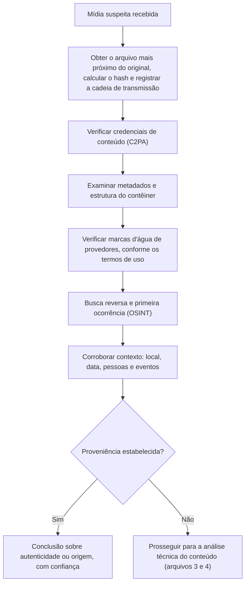

# Proveniência, Metadados, C2PA e Marcas d'Água

> **Objetivo pedagógico:** aplicar a abordagem "proveniência primeiro" na investigação de mídias suspeitas: obter o arquivo mais próximo do original, preservá-lo com integridade, verificar credenciais de conteúdo (C2PA), examinar metadados e a estrutura dos arquivos, reconhecer marcas d'água de provedores de IA e interpretar corretamente o que a presença ou a ausência de cada elemento significa.

## 1. Por que começar pela proveniência

A análise de artefatos visuais é frágil: a compressão das redes sociais, a regravação e os geradores novos destroem ou escondem vestígios. A **proveniência** (de onde veio, por quais mãos passou e que edições sofreu) é, quando disponível, mais robusta do que a inspeção da imagem. Ela também permite responder a pergunta inversa: **a mídia é autêntica?**

| Camada | O que oferece | Limitação |
|---|---|---|
| Arquivo original (da câmera, do aplicativo ou do dispositivo) | A melhor base para toda análise técnica | Frequentemente indisponível; cópias de plataformas são recomprimidas |
| Credenciais de conteúdo (C2PA) | Declarações assinadas sobre origem e edições | Podem ser removidas; só valem para quem as aplica |
| Metadados (EXIF, XMP, IPTC e contêineres de vídeo) | Equipamento, software, datas e parâmetros | São editáveis e frequentemente removidos por plataformas |
| Marcas d'água (visíveis e invisíveis) | Indicam geração por determinado provedor | Cobrem somente os provedores que as aplicam; podem ser degradadas |
| Contexto e OSINT | Primeira ocorrência, local, data e fontes | Requer corroboração independente |
| Registros de plataformas e de sistemas | Contas, horários e dispositivos de envio | Exigem preservação e processo legal |

## 2. Aquisição e preservação do arquivo

| Princípio | Aplicação |
|---|---|
| Obter o mais próximo do original | Pedir o arquivo ao titular do dispositivo ou ao autor; evitar capturas de tela e arquivos reenviados por mensageiros (que recomprimem) |
| Preservar o link e a página | Capturar a página de origem em WARC, com hash e data (pasta 21 e PB-42) |
| Registrar a cadeia de transmissão | Plataforma, conta, data e hora, URL exata e forma de obtenção |
| Hash imediato | SHA-256 do arquivo obtido; custódia (pasta 02) |
| Não converter, não recomprimir, não editar | Trabalhar em cópias; preservar o original intacto |
| Solicitar às plataformas | Preservação de registros e, quando houver base, fornecimento do arquivo original enviado |
| Ata notarial | Para mídia pública e prova central (CPC, art. 384) |

```bash
# Hash e extração de metadados do arquivo preservado (execute sobre a cópia de trabalho)
sha256sum midia_suspeita.mp4 > midia_suspeita.mp4.sha256
exiftool -a -G1 -s midia_suspeita.mp4 > exiftool_E050.txt
mediainfo --Output=JSON midia_suspeita.mp4 > mediainfo_E050.json
ffprobe -v quiet -print_format json -show_format -show_streams midia_suspeita.mp4 > ffprobe_E050.json
```

## 3. Credenciais de conteúdo (C2PA)

A especificação C2PA define um **manifesto assinado**, incorporado ao arquivo ou associado a ele, que registra declarações (assertions) sobre a origem (por exemplo, o dispositivo ou a ferramenta de criação), as ações de edição e, em alguns casos, a indicação de que o conteúdo foi gerado por IA (por exemplo, por meio de termos padronizados de tipo de fonte digital). O manifesto é **vinculado ao conteúdo por hash**: alterações posteriores sem novo manifesto quebram a verificação.

```bash
# Leitura do manifesto C2PA com a ferramenta de linha de comando da Content Authenticity Initiative
# (consulte `c2patool --help` para as opções da versão instalada)
c2patool midia_suspeita.jpg > c2pa_E050.txt 2>&1
```

| Resultado da verificação | Interpretação |
|---|---|
| Manifesto presente, assinatura válida e emissor confiável | As declarações são atribuíveis ao emissor; verifique as ações registradas (edição e geração por IA) e o vínculo com o conteúdo |
| Manifesto presente, mas hash do conteúdo não confere | O conteúdo foi alterado depois da assinatura |
| Assinatura inválida ou emissor desconhecido | As declarações não são confiáveis; tratá-las como alegações |
| Manifesto ausente | **Nenhuma conclusão**: a maioria das mídias não tem credenciais, e plataformas podem removê-las |
| Manifesto indicando geração por IA | Evidência forte de origem sintética, se válido |
| Manifesto indicando captura por câmera com credenciais | Evidência de origem, mas não elimina a possibilidade de edição posterior sem novo manifesto ou de uma cena encenada |

Pontos de atenção: credenciais comprovam **o que o emissor declarou**, e não a veracidade do que a cena mostra; a ausência de credenciais não indica falsidade; capturas de tela e reenvios as eliminam.

## 4. Marcas d'água e identificadores de provedores

| Tipo | Característica | Uso na investigação | Limitações |
|---|---|---|---|
| Marca visível | Selo ou texto aplicado pelo gerador | Evidência direta, se presente | Pode ser cortada ou removida |
| Marca invisível (por exemplo, SynthID, do Google DeepMind, e esquemas de outros provedores) | Sinal incorporado de forma imperceptível, com detector próprio | Alguns provedores oferecem verificação de seu próprio conteúdo | Cobre apenas o conteúdo daquele provedor; pode degradar com edições e compressão; ausência não prova autenticidade |
| Identificadores de metadados (campos de software e de ferramenta) | Registro do gerador ou do editor | Indício de origem | Editáveis e facilmente removidos |
| Impressões digitais de modelo (padrões estatísticos) | Pesquisa em atribuição de fontes | Apoio técnico | Pouco robustas e em evolução |

Use verificadores de provedores **somente conforme os termos e a política de privacidade** do serviço; não envie mídias sensíveis a serviços de terceiros sem autorização (arquivo 7).

## 5. Metadados: o que examinar

| Campo ou estrutura | O que pode indicar |
|---|---|
| Fabricante, modelo do dispositivo e número de série da câmera | Compatibilidade com um dispositivo real |
| Software e ferramenta de edição | Edição posterior ou geração por ferramenta de IA |
| Datas de criação, de modificação e de digitalização | Coerência com a data alegada; divergências entre campos |
| Coordenadas GPS, altitude e fuso | Compatibilidade com o local e a hora alegados |
| Miniatura embutida (thumbnail) | Divergência entre a miniatura e a imagem principal sugere edição posterior |
| Perfis de cor e tabelas de quantização (JPEG) | Histórico de compressão; padrões de ferramentas |
| Estrutura do contêiner de vídeo (átomos do MP4, trilhas e codecs) | Reencodificação, montagem e ferramentas usadas |
| Parâmetros de geração gravados por alguns geradores locais (por exemplo, textos incorporados em arquivos PNG com prompt e configurações, ou fluxos de trabalho embutidos) | Indício forte de geração por IA, quando presente |
| Metadados de áudio (codec, taxa de amostragem e codificador) | Origem e processamento do áudio |

```bash
# Procurar parâmetros de geração e campos de software em imagens
exiftool -a -G1 -s imagem.png | grep -i -E "parameters|prompt|workflow|software|comment|creator"
identify -verbose imagem.png | grep -i -E "parameters|prompt|workflow|software|date"

# Comparar miniatura embutida e imagem principal (JPEG)
exiftool -b -ThumbnailImage imagem.jpg > miniatura.jpg
```

| Regra de interpretação | Descrição |
|---|---|
| Metadados são evidência fraca de autenticidade | São facilmente forjados ou copiados |
| Metadados que contradizem a alegação são relevantes | Por exemplo, software de geração de IA ou data posterior ao evento |
| A ausência de metadados é comum | Plataformas e mensageiros os removem; não conclui nada |
| Verifique a coerência entre campos | Datas, fuso, dispositivo e conteúdo precisam fazer sentido juntos |

## 6. Estrutura do arquivo e histórico de compressão

| Análise | Utilidade | Cuidados |
|---|---|---|
| Estimativa de qualidade e de tabelas de quantização de JPEG | Indica compressões sucessivas e possíveis regravações | Redes sociais recomprimem; interpretar com cautela |
| Estrutura de contêiner e de codec de vídeo | Revela reencodificação, edição e ferramentas | Reencodificação por plataformas é normal |
| Comparação com versões públicas | Mostra se o arquivo é derivado de uma mídia conhecida | Usar hashes perceptuais |
| Cronologia de modificações | Ordem de criação, edição e envio | Dependente de metadados confiáveis |

```python
# Comparação por hash perceptual com uma imagem pública conhecida (para detectar reutilização e derivação)
from PIL import Image
import imagehash

h1 = imagehash.phash(Image.open("original_publico.jpg"))
h2 = imagehash.phash(Image.open("midia_suspeita.jpg"))
print("Distância de Hamming entre os hashes perceptuais:", h1 - h2)   # valores baixos indicam imagens muito semelhantes
```

## 7. Fluxo de verificação de proveniência



## 8. Exemplo prático: imagem atribuída a uma reunião

| Passo | Resultado |
|---|---|
| Alegação | Imagem circula como "foto da reunião secreta entre o diretor e um concorrente" |
| Preservação | Arquivo obtido da primeira publicação, com hash e captura da página (WARC) |
| C2PA | Manifesto ausente |
| Metadados | PNG com campo de texto incorporado contendo parâmetros de geração (prompt e configurações) |
| Busca reversa | Primeira ocorrência 3 dias antes, em um perfil anônimo; sem versão anterior |
| Contexto | A agenda e os registros de acesso mostram que o diretor estava em outra cidade no dia e hora alegados |
| Conclusão | Alta confiança de imagem sintética: metadados de geração, ausência de fonte original e contexto incompatível; o campo de metadados é editável, mas a convergência das linhas sustenta a conclusão; relatório para o Jurídico e a comunicação |

## 9. Casos de uso corporativos

- Triagem inicial de mídias suspeitas com foco em proveniência e em contexto.
- Adoção de credenciais de conteúdo em comunicações oficiais da organização.
- Política de preservação do arquivo original e de solicitação às plataformas.

## 10. Normas e frameworks relevantes

- C2PA (especificação técnica) e Content Credentials; IPTC (termos de tipo de fonte digital)
- ISO/IEC 27037; SWGDE Best Practices for Image Authentication; Protocolo de Berkeley
- NIST AI 100-4 (transparência de conteúdo sintético); Regulamento (UE) 2024/1689, art. 50
- CPC, art. 384; CPP, arts. 158-A a 158-F; LGPD, arts. 6º e 46

## 11. Referências

- C2PA. Technical Specification e documentação do c2patool (Content Authenticity Initiative).
- Documentação do ExifTool, do MediaInfo, do FFmpeg/ffprobe e do ImageMagick.
- Google DeepMind. Documentação do SynthID (verificação de conteúdo do próprio provedor).
- SWGDE. Best Practices for Image Authentication.
- Pastas 02, 04 e 21 deste repositório; PB-42 e PB-44 (pasta 23).
