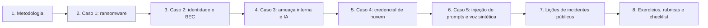

# 28 Estudos de Caso

## Objetivo

Integrar, em estudos de caso, as técnicas das pastas anteriores: cinco casos fictícios completos (ransomware com exfiltração, identidade e BEC no Microsoft 365, ameaça interna com uso de IA generativa, credencial de nuvem vazada e campanha com injeção de prompts e voz sintética), uma análise das lições forenses de incidentes públicos amplamente documentados, e o material de aplicação (exercícios, injetos de mesa, dados sintéticos, rubricas e checklist). Os casos treinam priorização, preservação, raciocínio por hipóteses, decisões sob incerteza, obrigações legais, comunicação e aprendizado.

## Trilha de estudo recomendada

## Conteúdo da pasta

| Ordem | Arquivo | Objetivo |
|---|---|---|
| 1 | [metodologia-de-estudos-de-caso-forenses.md](metodologia-de-estudos-de-caso-forenses.md) | Tipos de caso, estrutura, perguntas por fase, mapeamento e regras éticas |
| 2 | [caso-1-ransomware-com-exfiltracao-em-empresa-industrial.md](caso-1-ransomware-com-exfiltracao-em-empresa-industrial.md) | Ransomware com dupla extorsão, da preservação à recuperação |
| 3 | [caso-2-comprometimento-de-identidade-e-fraude-bec-no-microsoft-365.md](caso-2-comprometimento-de-identidade-e-fraude-bec-no-microsoft-365.md) | Roubo de sessão, regras de caixa, aplicativo OAuth e fraude de pagamento |
| 4 | [caso-3-ameaca-interna-vazamento-de-codigo-e-uso-de-ia-generativa.md](caso-3-ameaca-interna-vazamento-de-codigo-e-uso-de-ia-generativa.md) | Investigação interna proporcional, DLP e IA generativa pública |
| 5 | [caso-4-credencial-de-nuvem-vazada-e-abuso-de-recursos.md](caso-4-credencial-de-nuvem-vazada-e-abuso-de-recursos.md) | Chave exposta, persistência, abuso de recursos e lacuna de registros |
| 6 | [caso-5-campanha-com-injecao-de-prompts-e-voz-sintetica.md](caso-5-campanha-com-injecao-de-prompts-e-voz-sintetica.md) | Agente com ferramentas, injeção indireta e voz sintética |
| 7 | [licoes-forenses-de-incidentes-publicos.md](licoes-forenses-de-incidentes-publicos.md) | Dez incidentes públicos, padrões comuns e método de análise |
| 8 | [exercicios-rubricas-modelos-e-checklist-de-estudos-de-caso.md](exercicios-rubricas-modelos-e-checklist-de-estudos-de-caso.md) | Exercícios, injetos, dados sintéticos, rubrica, modelo e capstone |

## Princípios

- Casos fictícios e dados sintéticos: nenhum dado pessoal real, IPs e domínios em faixas reservadas
- Descrever o adversário apenas no nível necessário à detecção e à investigação
- Preservar antes de conter, na ordem de volatilidade, e registrar o estado anterior
- Raciocínio por hipóteses, com evidências a favor e contra e graus de confiança
- Declarar lacunas de registros e adotar o pior caso para a avaliação de impacto, com fundamento
- Avaliar decisões com a informação disponível à época; focar em sistemas e processos, e não em culpados
- Casos públicos: fontes primárias, datas, e distinção entre fato, relato e inferência
- Converter cada caso em controles, testes, detecções e melhorias de playbooks

## Relação com outras pastas

- 01 a 10: fundamentos, custódia, coleta, hashes, linha do tempo, Windows, Linux, memória e disco
- 11 a 15: logs, e-mail, rede, mobile e malware
- 16: ransomware
- 17 a 19: nuvem, Azure e Microsoft 365
- 20 e 21: caça a ameaças e OSINT
- 22 e 23: relatórios e playbooks
- 24 a 27: forense de IA, prompts, incidentes com LLM e deepfakes
- 29: laboratório de ferramentas forenses
- 30: lições aprendidas

## Referências

- NIST SP 800-61 Rev. 3 (2025); NIST SP 800-84; NIST SP 800-86; NIST IR 8374
- ISO/IEC 27035; ISO/IEC 27037; ISO/IEC 27043; ISO 21043
- MITRE ATT&CK e MITRE ATLAS; OWASP Top 10 para LLM
- CISA. #StopRansomware Guide, Tabletop Exercise Packages e relatórios do Cyber Safety Review Board
- FIRST. CSIRT Services Framework
- Brasil. LGPD (Lei nº 13.709/2018); Resolução CD/ANPD nº 15/2024; CPP, arts. 158-A a 158-F
- Documentação do DuckDB, do Microsoft Sentinel (KQL) e dos provedores de nuvem
