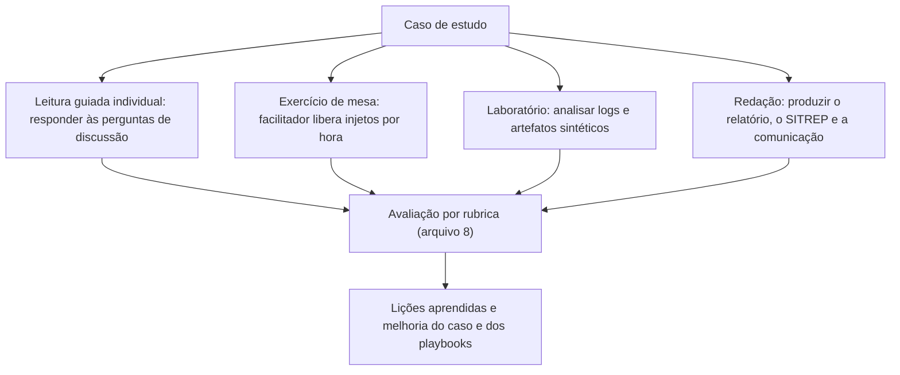

# Metodologia de Estudos de Caso Forenses

> **Objetivo pedagógico:** definir como estudar, escrever e usar estudos de caso forenses para treinamento: tipos de caso, estrutura padrão, perguntas de análise por fase, uso do raciocínio por hipóteses e do livro de decisões, mapeamento entre casos, pastas e playbooks, formatos de aplicação (leitura guiada, exercício de mesa, laboratório e redação de relatório), e regras éticas e legais para casos fictícios e públicos.

## 1. Por que estudar casos

Os fundamentos das pastas 01 a 27 ensinam técnicas isoladas. Em um incidente real, elas aparecem **combinadas, sob pressão, com informação incompleta e com decisões que não têm resposta única**. Os estudos de caso treinam:

| Competência | Como o caso a treina |
|---|---|
| Priorização | Decidir o que preservar primeiro quando tudo é urgente |
| Integração | Correlacionar fontes de naturezas diferentes (identidade, rede, endpoint, nuvem e IA) |
| Raciocínio por hipóteses | Sustentar e descartar hipóteses com evidências |
| Decisão sob incerteza | Escolher entre alternativas imperfeitas e registrar a justificativa |
| Comunicação | Informar direção, jurídico e usuários com fatos e incertezas |
| Conformidade | Identificar obrigações legais e contratuais e seus prazos |
| Aprendizado | Converter falhas em controles |

## 2. Tipos de estudo de caso

| Tipo | Descrição | Vantagens | Cuidados |
|---|---|---|---|
| Caso fictício completo | Cenário inventado, com cronologia, evidências e decisões, de ponta a ponta | Controle didático; sem risco de exposição de dados reais | Realismo: baseie-se em padrões documentados |
| Caso composto | Mistura de elementos de vários incidentes reais, anonimizados | Riqueza de detalhes | Garantir que ninguém seja identificável |
| Análise de incidente público | Estudo de um incidente amplamente documentado, a partir de fontes primárias | Autenticidade e discussão de decisões reais | Distinguir fato, relato e inferência; não especular (arquivo 7) |
| Caso de laboratório com dados sintéticos | Conjunto de logs e artefatos gerados para análise prática | Treino técnico prático | Documentar a geração dos dados |
| Caso de mesa (tabletop) | Cenário narrado com "injetos" de informação ao longo do tempo | Treino de decisão e de comunicação | Facilitação e objetivos claros |

## 3. Estrutura padrão de um estudo de caso

| Seção | Conteúdo |
|---|---|
| Resumo | Organização, ameaça, impacto, desfecho e pastas relacionadas |
| Contexto e ativos | Ambiente, sistemas, dados e controles existentes |
| Gatilho e abertura | Como o caso começou; classificação e autorização (PB-00) |
| Cronologia | Linha do tempo em UTC, com fontes |
| Evidências | Identificadores, fontes, hashes e custódia |
| Análise por fase | Reconstrução técnica com consultas e comandos de exemplo |
| Decisões críticas | Opções, critérios, decisão tomada e justificativa |
| Impacto e obrigações | Dados, pessoas, financeiro, legal e contratual |
| Resultado e recuperação | O que foi feito e o resultado |
| Trecho de relatório | Exemplo de resumo executivo e de achado com grau de confiança |
| O que funcionou e o que falhou | Balanço objetivo, sem culpabilizar pessoas |
| Lições aprendidas | Controles e melhorias |
| Mapeamento | Pastas e playbooks relacionados |
| Perguntas de discussão | Para estudo individual ou em grupo |
| Exercícios | Atividades práticas |

## 4. Perguntas de análise por fase

| Fase | Perguntas-guia |
|---|---|
| Detecção e abertura | Quem detectou, quando e como? Qual a gravidade? Há autorização e escopo? O que pode ser perdido nas próximas horas? |
| Preservação | Quais fontes expiram primeiro? O que foi congelado antes de qualquer alteração? Qual a ordem de volatilidade? |
| Reconstrução | Qual o primeiro indício de atividade? Qual o acesso inicial? Como o atacante se moveu? O que foi acessado e exfiltrado? |
| Hipóteses | Que hipóteses explicam os fatos? Que evidência discriminaria entre elas? Que explicação inocente existe? |
| Contenção | A ação preserva evidências e reduz o dano? Qual o estado anterior registrado? |
| Impacto | Que dados, pessoas e decisões foram afetados? Qual o pior caso plausível dado o que não se sabe? |
| Obrigações | Que notificações e prazos se aplicam? Quem decide? |
| Comunicação | O que sabemos e o que não sabemos? Quem precisa saber e quando? |
| Aprendizado | Que controle teria impedido ou detectado antes? Que lacuna de registro prejudicou a investigação? |

## 5. Ferramentas de trabalho do caso

| Ferramenta | Uso |
|---|---|
| Livro de decisões | Cada decisão, com data e hora, responsável, alternativas, critérios e justificativa |
| Linha do tempo em UTC | Eventos com fonte, confiança e corroboração (pasta 05) |
| Matriz de hipóteses | Hipótese, evidências a favor, evidências contra e conclusão provisória |
| Inventário de evidências | Identificador, origem, hash e custódia |
| Registro de lacunas | Logs ausentes, expirados ou não habilitados |
| Matriz de obrigações | Norma, gatilho, prazo, responsável e status |

## 6. Mapeamento dos casos para as pastas e os playbooks

| Caso | Tema central | Pastas principais | Playbooks principais |
|---|---|---|---|
| 1 | Ransomware com exfiltração | 03, 04, 05, 07, 09, 11, 13, 16, 22 | PB-00, PB-01, PB-02, PB-10, PB-12, PB-15, PB-24, PB-25 |
| 2 | Identidade e BEC no Microsoft 365 | 11, 12, 18, 19, 22 | PB-20, PB-31, PB-32, PB-36 |
| 3 | Ameaça interna e uso de IA | 06, 07, 11, 19, 24, 25 | PB-14, PB-33, PB-45, PB-46 |
| 4 | Credencial de nuvem e abuso | 11, 17, 18, 22 | PB-01, PB-30, PB-34 |
| 5 | Injeção de prompts e voz sintética | 12, 24, 25, 26, 27 | PB-20, PB-32, PB-44, PB-45 |
| Públicos | Lições de incidentes reais | Todas | Diversos |

## 7. Casos públicos: como estudá-los com responsabilidade

| Prática | Orientação |
|---|---|
| Fontes primárias | Priorize relatórios oficiais, comunicados das organizações, documentos judiciais, investigações de órgãos públicos e análises técnicas de equipes de resposta |
| Fato, relato e inferência | Separe o que está documentado, o que foi relatado por terceiros e o que é inferência; use expressões como "segundo o relatório X" |
| Datas e versões | Registre a data da fonte; fatos evoluem com novas investigações |
| Atribuição | Mencione a atribuição somente quando feita por fontes oficiais ou por equipes reconhecidas, como atribuição declarada, sem adotá-la como fato próprio |
| Sem especulação | Não conjecture sobre falhas internas, nem sobre culpados, além do que as fontes sustentam |
| Respeito às vítimas | Foque em lições de processo; evite sensacionalismo; não reproduza dados pessoais vazados |
| Direitos autorais | Cite as fontes; resuma com palavras próprias; não reproduza trechos extensos |
| Atualização | Revise o caso quando surgirem novos fatos |

## 8. Aspectos éticos e legais dos casos de treinamento

| Tema | Orientação |
|---|---|
| Dados reais | Nunca use dados pessoais reais em casos de treinamento; use dados sintéticos |
| Anonimização | Em casos compostos, altere detalhes de modo que nenhuma organização seja identificável |
| Intenção didática | Os casos fictícios devem declarar que são fictícios |
| Material ofensivo | Evite reproduzir conteúdo ilícito, íntimo ou ofensivo nos casos (pasta 27) |
| Técnicas ofensivas | Descreva os comportamentos do adversário no nível necessário para a detecção e a investigação; não inclua instruções operacionais de ataque |
| Confidencialidade | Casos baseados em experiências profissionais exigem autorização e anonimização |
| LGPD | Casos com dados sintéticos não sofrem a LGPD, mas treinam seus requisitos |

## 9. Formatos de aplicação

| Formato | Duração sugerida | Objetivo |
|---|---|---|
| Leitura guiada | 60 a 90 minutos | Compreensão e identificação de decisões |
| Exercício de mesa | 90 a 120 minutos | Decisão, comunicação e coordenação |
| Laboratório com dados sintéticos | 2 a 4 horas | Habilidade técnica de análise |
| Redação de relatório | 3 a 6 horas | Comunicação técnica e rigor |
| Apresentação executiva | 30 minutos | Síntese para a direção |

## 10. Rubrica geral de avaliação (resumo)

| Critério | O que se espera |
|---|---|
| Preservação e ordem de volatilidade | Prioriza fontes que expiram e preserva antes de conter |
| Rigor probatório | Hashes, custódia, UTC, corroboração e separação entre fato e inferência |
| Raciocínio por hipóteses | Considera explicações alternativas e declara confiança |
| Decisões justificadas | Critérios, alternativas e registro |
| Conformidade e privacidade | Identifica obrigações, portões legais e proporcionalidade |
| Comunicação | Clareza, honestidade sobre incertezas e adequação ao público |
| Lições e controles | Recomendações específicas, priorizadas e verificáveis |

A rubrica detalhada, com níveis de desempenho, está no arquivo 8.

## 11. Casos de uso corporativos

- Programa de capacitação do SOC, do DFIR, do jurídico e da conformidade com casos padronizados.
- Exercícios de mesa periódicos, com casos que refletem o perfil de ameaça da organização.
- Avaliação de candidatos e de novos analistas com casos práticos.

## 12. Normas e frameworks relevantes

- NIST SP 800-84 (testes, treinamento e exercícios); NIST SP 800-61 Rev. 3; ISO/IEC 27035
- CISA. Tabletop Exercise Packages; FIRST. CSIRT Services Framework
- ISO/IEC 27037, 27041, 27042 e 27043; ISO 21043 (interpretação e relato)
- LGPD, arts. 6º, 46 e 48

## 13. Referências

- Grance, T. et al. NIST SP 800-84: Guide to Test, Training, and Exercise Programs for IT Plans and Capabilities. 2006.
- CISA. Cybersecurity Tabletop Exercise Packages.
- Casey, E. Digital Evidence and Computer Crime. 3. ed. 2011.
- Pastas 22, 23 e 30 deste repositório.
