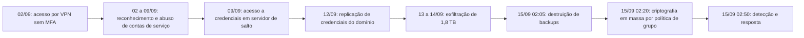

# Caso 1: Ransomware com Exfiltração em Empresa Industrial

> **Objetivo pedagógico:** estudar, de ponta a ponta, um incidente de ransomware com exfiltração de dados (dupla extorsão) em uma empresa industrial: acesso inicial por credencial sem MFA, movimentação e escalonamento de privilégios, exfiltração, destruição de backups e criptografia em massa; aplicar a preservação por ordem de volatilidade, a reconstrução da cronologia, as decisões de contenção e de recuperação, as obrigações legais e a comunicação.

> **Caso fictício, para treinamento.** Organizações, pessoas, endereços IP e domínios são inventados; os IPs pertencem a faixas reservadas para documentação.

## 1. Resumo

| Item | Descrição |
|---|---|
| Organização | Metalúrgica Aurora S.A. (fictícia): 1.800 colaboradores, 3 plantas, ERP e servidores de arquivos locais, virtualização, backups em disco e fita |
| Ameaça | Grupo de ransomware com extorsão dupla (criptografia e ameaça de divulgação) |
| Impacto | Cerca de 420 servidores e estações criptografados; 1,8 TB exfiltrados; parada parcial da produção por 6 dias |
| Detecção | Alertas de criptografia em massa do EDR, às 02:50 UTC de 15/09/2026 |
| Desfecho | Recuperação a partir de backups offline; sem pagamento; comunicações à ANPD e aos titulares; reforço de controles |
| Pastas | 03, 04, 05, 07, 09, 11, 13, 16 e 22 |
| Playbooks | PB-00, PB-01, PB-02, PB-10, PB-12, PB-15, PB-24 e PB-25 |

## 2. Contexto e ativos

| Elemento | Situação antes do incidente |
|---|---|
| Acesso remoto | VPN com perfil legado de um fornecedor de manutenção sem MFA |
| Identidade | Active Directory com contas de serviço com senhas antigas e privilégios amplos |
| Endpoints | EDR em 70% dos servidores; 100% das estações; alertas de severidade média sem triagem rápida |
| Rede | Segmentação parcial entre TI e produção; saída à internet permitida a partir de servidores de arquivos |
| Backups | Cópia em disco no domínio (alcançável pelo atacante) e fitas offline mensais |
| Registros | SIEM com logs de VPN, de firewall e de controladores de domínio; retenção de 90 dias |
| Plano de resposta | Existente, mas sem teste recente; sem contato com seguradora atualizado |

## 3. Cronologia (UTC)

| Data e hora | Evento | Fonte |
|---|---|---|
| 02/09 03:12 | Entrada na VPN com a conta `svc-manut`, a partir do IP 203.0.113.45 (hospedagem comercial) | Log da VPN |
| 02/09 a 08/09 | Reconhecimento da rede e consulta ao domínio; tráfego incomum de LDAP | Firewall e controladores de domínio |
| 08/09 22:40 | Solicitações de tíquetes de serviço com criptografia fraca para várias contas de serviço (padrão de Kerberoasting) | Eventos 4769 |
| 09/09 01:15 | Acesso à memória do processo de autenticação em um servidor de salto (alerta de severidade média do EDR, não tratado) | EDR |
| 12/09 04:30 | Replicação de credenciais do domínio por conta com privilégio (padrão de DCSync) | Eventos 4662 |
| 13/09 a 14/09 | Cópia de 1,8 TB de servidores de arquivos para um serviço de armazenamento externo, por ferramenta de sincronização | Firewall (saída), EDR |
| 15/09 02:05 | Exclusão de tarefas e de repositórios do servidor de backup | Logs do servidor de backup |
| 15/09 02:20 | Distribuição do executável de criptografia por política de grupo | Eventos de GPO e de criação de serviços (7045) |
| 15/09 02:50 | Alertas de criptografia em massa do EDR | EDR |
| 15/09 03:05 | Acionamento do plantão; abertura do caso DFL-2026-041 (gravidade crítica) | Livro de decisões |
| 15/09 03:40 | Isolamento de segmentos e desligamento de links entre plantas | Firewall |

## 4. Abertura e preservação (PB-00, PB-01 e PB-02)

| Hora (UTC) | Ação |
