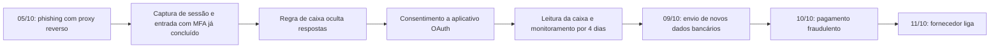

# Caso 2: Comprometimento de Identidade e Fraude BEC no Microsoft 365

> **Objetivo pedagógico:** estudar um caso de comprometimento de identidade por captura de sessão (phishing com proxy reverso) que levou a uma fraude de pagamento por e-mail (BEC): investigar os logs de entrada do Entra ID, a auditoria unificada e a caixa de e-mail, identificar regras de ocultação e um aplicativo OAuth malicioso, executar a ação financeira imediata, conter com preservação e avaliar o impacto.

> **Caso fictício, para treinamento.** Organizações, pessoas, endereços e domínios são inventados.

## 1. Resumo

| Item | Descrição |
|---|---|
| Organização | Distribuidora Horizonte Ltda. (fictícia): 340 colaboradores, Microsoft 365 com Entra ID e MFA por aplicativo |
| Ameaça | Phishing com proxy reverso (captura de sessão), regra de ocultação, aplicativo OAuth e fraude de pagamento |
| Impacto | Pagamento fraudulento de R$ 312.400 a conta de terceiro; 6 usuários com consentimento ao aplicativo malicioso |
| Detecção | Ligação de um fornecedor, 6 dias depois, perguntando sobre a alteração de dados bancários |
| Desfecho | Recuperação de R$ 187.000 por contestação bancária imediata; contenção de identidades; revisão de controles |
| Pastas | 11, 12, 18, 19 e 22 |
| Playbooks | PB-20, PB-31, PB-32 e PB-36 |

## 2. Contexto e ativos

| Elemento | Situação |
|---|---|
| Identidade | Entra ID, MFA por notificação em aplicativo, autenticação legada parcialmente bloqueada, sem MFA resistente a phishing |
| Auditoria | Auditoria unificada habilitada; licenças que incluem auditoria de acesso a e-mails (`MailItemsAccessed`) para parte dos usuários |
| E-mail | Exchange Online com proteção de gateway; regras de caixa não monitoradas |
| Aplicativos | Consentimento de usuário permitido para permissões de baixo risco |
| Processo de pagamento | Alteração de dados bancários por e-mail, com confirmação apenas por resposta |
| Retenção de logs | Entra ID: 30 dias; auditoria unificada: 180 dias |

## 3. Cronologia (UTC)

| Data e hora | Evento | Fonte |
|---|---|---|
| 05/10 12:41 | A analista de contas a pagar recebe e-mail de "compartilhamento de documento" com link para página que replica a tela de login | Rastreamento de mensagens |
| 05/10 12:44 | Autenticação da conta da analista, com MFA concluído, a partir do IP 198.51.100.77 (hospedagem) logo após a autenticação legítima | Logs de entrada |
| 05/10 12:52 | Criação de regra de caixa que move mensagens com "boleto", "pagamento" e "banco" para uma pasta pouco usada | Auditoria unificada (`New-InboxRule`) |
| 05/10 13:05 | Consentimento a aplicativo "Visualizador Docs" com permissões de leitura de e-mail e acesso offline | Auditoria (consentimento) |
| 05/10 13:10 a 15:40 | Leitura de mensagens em massa da caixa | `MailItemsAccessed` |
| 06/10 a 09/10 | Monitoramento da troca de e-mails com um fornecedor de embalagens | Auditoria e rastreamento |
| 09/10 14:20 | Envio, a partir da caixa da analista, de mensagem ao fornecedor com novos dados bancários | Auditoria (`Send`) e rastreamento |
| 10/10 11:00 | Pagamento de R$ 312.400 via Pix para a nova conta | Sistema financeiro |
| 11/10 08:15 | O fornecedor liga: "o pagamento ainda não chegou" | Relato |



## 4. Abertura e ações imediatas (PB-00 e PB-32)

| Hora (UTC) em 11/10 | Ação |
|---|---|
| 08:30 | Abertura do caso DFL-2026-052; gravidade alta (perda financeira em curso) |
| 08:35 | **Ação financeira imediata:** contato com o banco para contestação e solicitação de bloqueio e de devolução do Pix, sem esperar a análise |
| 08:50 | Exportação da auditoria unificada e do rastreamento de mensagens da conta; retenção legal da caixa (PB-01) |
| 09:10 | Exportação de logs de entrada do Entra ID (as quatro categorias) e de auditoria; exportação da configuração da caixa (regras, encaminhamentos, delegados e conectores) |
| 09:40 | Contenção da identidade: revogação de sessões, redefinição de senha, remoção de métodos desconhecidos (PB-31) |
| 10:00 | Remoção de regra e do consentimento do aplicativo, após registrar o estado anterior (PB-36) |

## 5. Análise

### 5.1 Entradas e sessão

```kusto
SigninLogs
| where UserPrincipalName == "analista.pagar@horizonte.example"
| where TimeGenerated between (datetime(2026-10-05T12:00:00Z) .. datetime(2026-10-05T16:00:00Z))
| project TimeGenerated, IPAddress, Location, AppDisplayName, ClientAppUsed, ResultType,
          AuthenticationRequirement, DeviceDetail, UserAgent
| order by TimeGenerated asc
```

**Achados:** autenticação legítima às 12:39 (IP corporativo) e outra às 12:44, do IP 198.51.100.77, com MFA satisfeito pela **sessão capturada** (o IP e o agente de usuário divergentes indicam roubo de token, e não falha do MFA). A resposta de MFA aparece como concluída, com a mesma sessão usada por outro dispositivo.

### 5.2 Auditoria da caixa e dos aplicativos

```kusto
OfficeActivity
| where TimeGenerated between (datetime(2026-10-05) .. datetime(2026-10-10))
| where UserId == "analista.pagar@horizonte.example"
| where Operation in ("New-InboxRule", "Set-InboxRule", "Add-MailboxPermission", "Consent to application", "Send", "MailItemsAccessed")
| project TimeGenerated, Operation, ClientIP, Parameters
| order by TimeGenerated asc
```

```powershell
Connect-ExchangeOnline
Get-InboxRule -Mailbox analista.pagar@horizonte.example -IncludeHidden | Format-List Name,Description,Enabled,MoveToFolder,SubjectOrBodyContainsWords
Get-Mailbox analista.pagar@horizonte.example | Format-List ForwardingAddress,ForwardingSmtpAddress,DeliverToMailboxAndForward
```

**Achados:** regra oculta (assuntos com "boleto", "pagamento" e "banco" movidos para uma pasta de feeds); consentimento ao aplicativo às 13:05, com permissão de leitura de e-mail; `MailItemsAccessed` mostrou leitura de 1.340 itens entre 13:10 e 15:40; `Send` em 09/10 às 14:20 do IP do atacante.

### 5.3 Alcance

| Verificação | Resultado |
|---|---|
| Outros usuários que receberam o mesmo e-mail | 17 destinatários; 6 abriram o link; 4 inseriram credenciais |
| Outros consentimentos ao mesmo aplicativo | 6 usuários (inclui os 4 anteriores e 2 que consentiram por link direto) |
| Regras semelhantes em outras caixas | 3 caixas com regras de ocultação |
| Acesso a arquivos | Consultas ao SharePoint do financeiro por 2 contas |

### 5.4 Fraude de pagamento

O fornecedor confirmou que não havia enviado alteração de dados bancários. O sistema financeiro mostrou a nova conta de destino, aberta 3 dias antes em outro banco. A mensagem de 09/10 foi enviada de dentro da conversa legítima, o que explica a ausência de suspeita.

## 6. Decisões críticas

| Decisão | Alternativas | Critérios | Decisão tomada |
|---|---|---|---|
| Quando acionar o banco | Após concluir a análise; imediatamente | O tempo é decisivo para devolução de recursos; a análise pode continuar em paralelo | Imediatamente, às 08:35 |
| Revogar sessões antes de preservar | Revogar já; preservar primeiro | Preservar os logs não impede a revogação; sem preservar, a investigação perde fontes | Exportar logs e configuração em 30 minutos, depois revogar |
| Remover o e-mail fraudulento dos 17 destinatários | Remover já; preservar antes | Remoção sem preservação perde evidências (PB-20) | Preservar as mensagens e remover após |
| Excluir o aplicativo ou desabilitá-lo | Excluir; desabilitar após exportar | Registrar o estado anterior para a análise | Exportar a configuração e remover o consentimento e a entidade de serviço |
| Notificar o fornecedor e os clientes | Aguardar; comunicar | Risco de novas fraudes com o mesmo fornecedor | Comunicar ao fornecedor com orientação de verificação por canal independente |

## 7. Impacto e obrigações

| Tema | Avaliação |
|---|---|
| Financeiro | R$ 312.400 pagos; R$ 187.000 recuperados; R$ 125.400 de perda líquida em análise com seguradora |
| Dados | A caixa continha contratos e dados de fornecedores e de colaboradores; risco de exposição de dados pessoais (dados de contato e financeiros) |
| LGPD | O DPO avaliou o risco como moderado; comunicação à ANPD por cautela, com base nos dados pessoais acessados e na incerteza do conteúdo exato lido |
| Contratos | Comunicação aos fornecedores afetados |
| Seguro | Acionamento da apólice de fraude de engenharia social |
| Autoridades | Boletim de ocorrência |

## 8. Trecho de relatório (modelo)

> **Achado F-03.** A conta `analista.pagar` foi acessada a partir de IP de hospedagem (198.51.100.77) em 05/10/2026, às 12:44 UTC, com MFA satisfeito, em menos de 5 minutos após a autenticação legítima por IP corporativo. **Interpretação:** captura de sessão por proxy reverso (adversary-in-the-middle). **Corroboração:** regra de caixa criada às 12:52 pelo mesmo IP (E002); consentimento ao aplicativo às 13:05 (E003); 1.340 acessos a itens de e-mail (E004). **Confiança alta.** **Limitação:** os logs de entrada anteriores a 30 dias não estão disponíveis, de modo que não se pode excluir acesso anterior a 05/10.

## 9. O que funcionou e o que falhou

| Funcionou | Falhou |
|---|---|
| Ação financeira em paralelo à análise recuperou parte do valor | MFA sem resistência a phishing |
| Auditoria unificada e `MailItemsAccessed` permitiram dimensionar o acesso | Regras de caixa e consentimentos não monitorados |
| Preservação antes da contenção | Processo de alteração de dados bancários sem verificação independente |
| Identificação de outras contas afetadas | Consentimento de usuário permitido sem governança |

## 10. Lições aprendidas e recomendações

| Prioridade | Recomendação |
|---|---|
| Alta | MFA resistente a phishing (chaves FIDO2 e métodos equivalentes) para funções sensíveis; acesso condicional com dispositivos conformes |
| Alta | Verificação independente (ligação para número cadastrado) e dupla aprovação para alteração de dados bancários |
| Alta | Alertas para criação de regras de caixa, encaminhamentos externos e consentimentos a aplicativos |
| Média | Restringir o consentimento de usuário; fluxo de aprovação de administradores |
| Média | Licenciamento e retenção de auditoria adequados; exportação regular para SIEM |
| Média | Treinamento de contas a pagar sobre BEC |

## 11. Mapeamento

| Etapa | Pastas e playbooks |
|---|---|
| Phishing e preservação do e-mail | Pasta 12; PB-20 |
| Entra ID e sessões | Pasta 18; PB-31 |
| Caixa, BEC e ação financeira | Pastas 12 e 19; PB-32 |
| Aplicativo OAuth | Pastas 18 e 19; PB-36 |
| Relatório e obrigações | Pasta 22 |

## 12. Perguntas para discussão

1. Por que o MFA não impediu o acesso, e como você demonstraria isso com os logs?
2. Que evidências distinguem o roubo de sessão de uma senha comprometida?
3. Por que a ordem "preservar, depois conter" é importante, e quando você abriria exceção?
4. Que lacunas de registro impediriam concluir que não houve acesso anterior?
5. Como você decidiria sobre a comunicação à ANPD quando não se sabe o conteúdo exato lido?

## 13. Exercícios

1. Escreva as consultas que detectariam regras de ocultação e consentimentos suspeitos em toda a organização.
2. Monte a matriz de hipóteses (roubo de sessão, senha vazada e insider) com evidências a favor e contra.
3. Elabore o procedimento de verificação de alteração de dados bancários para contas a pagar.
4. Redija o comunicado ao fornecedor e a mensagem aos 17 destinatários do phishing.

## 14. Normas e frameworks relevantes

- MITRE ATT&CK: T1566, T1557, T1539, T1550.001, T1564.008, T1114, T1098, T1528
- NIST SP 800-61 Rev. 3; NIST SP 800-63B; ISO/IEC 27035; CIS Controls v8.1 (controles 5, 6, 8 e 17)
- LGPD, arts. 6º, 46 e 48; Resolução CD/ANPD nº 15/2024

## 15. Referências

- Microsoft. Documentação de auditoria unificada, `MailItemsAccessed` e investigação de comprometimento de e-mail empresarial.
- CISA e FBI. Orientações sobre BEC e phishing com proxy reverso.
- Pastas 11, 12, 18, 19, 22 e 23 deste repositório.
