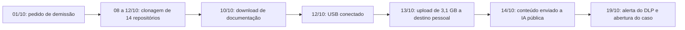

# Caso 3: Ameaça Interna, Vazamento de Código e Uso de IA Generativa

> **Objetivo pedagógico:** estudar uma investigação sobre um colaborador em desligamento que copiou código-fonte e documentos para destinos pessoais e inseriu trechos em uma ferramenta de IA generativa pública: aplicar os portões legais e a proporcionalidade, correlacionar registros de DLP, de proxy, de auditoria do SharePoint e do endpoint, tratar a conta pessoal e o conteúdo de prompts, avaliar riscos (segredos no código) e conduzir a comunicação com o RH e o Jurídico sem concluir sobre intenção.

> **Caso fictício, para treinamento.** Organizações, pessoas e endereços são inventados.

## 1. Resumo

| Item | Descrição |
|---|---|
| Organização | Nimbus Tecnologia Ltda. (fictícia): software de gestão, 220 colaboradores, repositórios internos e Microsoft 365 |
| Situação | Um engenheiro sênior (colaborador A) pediu demissão e entrou em aviso prévio para ir a um concorrente |
| Alerta | Regra de DLP sobre downloads em massa e envio de arquivos a destino pessoal, 18 dias antes do último dia |
| Impacto potencial | Código-fonte proprietário, documentos de arquitetura e credenciais embutidas no código |
| Desfecho | Fatos documentados; recuperação e declaração do colaborador; notificação extrajudicial; rotação de credenciais; sem processo criminal |
| Pastas | 06, 07, 11, 19, 24 e 25 |
| Playbooks | PB-14, PB-33, PB-45 e PB-46 |

## 2. Contexto e controles

| Elemento | Situação |
|---|---|
| Política | Política de uso aceitável e de confidencialidade assinada; cláusula de não concorrência e de proteção de segredos |
| Monitoramento | Política comunicada de monitoramento de recursos corporativos; DLP e proxy |
| Dispositivo | Notebook corporativo gerenciado, com EDR |
| Repositórios | Plataforma de código com logs de clonagem e de acesso |
| IA generativa | Ferramenta corporativa aprovada disponível; domínios de IA públicas não bloqueados |
| Auditoria | Auditoria unificada do Microsoft 365 com retenção de 180 dias |

## 3. Cronologia (UTC)

| Data e hora | Evento | Fonte |
|---|---|---|
| 01/10 | Colaborador A entrega a carta de demissão (aviso de 30 dias) | RH |
| 08/10 a 12/10 | Clonagem de 14 repositórios que não pertencem a seu time, em horário noturno | Logs da plataforma de código |
| 10/10 19:12 | Download de 2.300 arquivos de documentação de arquitetura do SharePoint | Auditoria unificada |
| 12/10 22:05 | Conexão de dispositivo USB de armazenamento ao notebook | EDR e registro do Windows |
| 13/10 21:40 | Upload de 3,1 GB a serviço de armazenamento pessoal | Proxy e DLP |
| 14/10 15:30 | Acessos a serviço de IA generativa pública, com envio de 2 mensagens de cerca de 40 KB cada | Proxy |
| 19/10 08:10 | Alerta do DLP ao SOC; revisão e escalonamento ao Jurídico | SOC |
| 19/10 11:00 | Abertura do caso DFL-2026-063 após autorização formal | Livro de decisões |



## 4. Portão legal e escopo (PB-14)

| Passo | Decisão |
|---|---|
| Autorização | Jurídico, RH e DPO autorizam a apuração, restrita a: contas e dispositivos corporativos, período de 01/09 a 19/10, sistemas de código, SharePoint, proxy, DLP e endpoint |
| Fora do escopo | Contas pessoais do colaborador, conteúdo de mensagens privadas e navegação pessoal sem relação com os fatos |
| Proporcionalidade | Iniciar por metadados e por registros corporativos; acessar conteúdo apenas de arquivos corporativos relacionados |
| Equipe | 2 analistas, com acesso restrito; relatório a Jurídico e RH |
| Privilégio | Comunicações do colaborador com seu advogado, se aparecerem, serão excluídas da revisão |

## 5. Preservação e coleta

| Hora (UTC) | Ação | Playbook |
|---|---|---|
| 19/10 11:30 | Exportação de logs da plataforma de código, da auditoria do SharePoint, do proxy, do DLP e da identidade; hash | PB-01 |
| 19/10 12:30 | Retenção legal da caixa de e-mail, do OneDrive e do site de projetos do colaborador | PB-46 |
| 19/10 14:00 | Coleta do notebook (memória, triagem e imagem) com o colaborador ainda empregado, conforme política; custódia | PB-10, PB-12 e PB-13 |
| 20/10 | Pedido de preservação ao fornecedor da ferramenta de IA pública não aplicável (conta pessoal): registrado como limitação | PB-45 |

## 6. Análise

### 6.1 Código-fonte

```bash
# Clonagens por usuário, repositório e horário (formato ilustrativo exportado da plataforma de código)
jq -r 'select(.usuario=="colab.a" and .acao=="clone") | [.horario_utc, .repositorio, .ip] | @tsv' auditoria_codigo.jsonl | sort
```

**Achados:** 14 repositórios clonados em 5 noites, 11 deles de times sem relação com as atividades do colaborador (comparação com a matriz de projetos do RH).

### 6.2 SharePoint e OneDrive

```kusto
OfficeActivity
| where TimeGenerated between (datetime(2026-10-01) .. datetime(2026-10-19))
| where UserId == "colab.a@nimbus.example"
| where Operation in ("FileDownloaded", "FileSyncDownloadedFull", "FileCopied")
| summarize Arquivos = count() by bin(TimeGenerated, 1d), Site_Url
| order by Arquivos desc
```

**Achados:** 2.300 arquivos baixados em 10/10, de um site de arquitetura ao qual o colaborador tinha acesso legítimo (o acesso não é, por si, indevido; a quantidade e o momento são os indicadores).

### 6.3 Endpoint

| Artefato | Resultado |
|---|---|
| Registro de dispositivos USB (pasta 07) | Dispositivo de armazenamento conectado em 12/10, às 22:05 UTC, com número de série registrado |
| Arquivos recentes e listas de atalhos | Acesso a arquivos de repositórios locais a partir do volume removível |
| Histórico do navegador corporativo | Acesso a um serviço de armazenamento pessoal e a uma ferramenta de IA pública |
| Linha do tempo (PB-15) | Sequência: clonagem, cópia para o USB, upload e uso de IA |

### 6.4 Rede e DLP

**Achados:** upload de 3,1 GB a um serviço de armazenamento pessoal em 13/10, às 21:40 UTC, a partir do notebook; o DLP classificou parte do conteúdo como "código-fonte proprietário". O proxy mostrou duas requisições de cerca de 40 KB cada a uma ferramenta de IA pública em 14/10, às 15:30 UTC.

### 6.5 Uso de IA generativa

| Aspecto | Resultado |
|---|---|
| Conta usada | Conta pessoal; sem acesso corporativo ao histórico |
| Conteúdo enviado | Não verificável pelos registros corporativos (somente volume e destino) |
| Colaboração do colaborador | Em entrevista conduzida pelo RH e pelo Jurídico, com direito de defesa, o colaborador declarou ter colado dois módulos para "pedir ajuda de refatoração" e exportou voluntariamente o histórico da conversa |
| Conteúdo do histórico | Dois módulos com credenciais de acesso a um serviço de teste embutidas no código |
| Fornecedor | Pedido de exclusão e de declaração sobre retenção e uso para treinamento, por solicitação do colaborador, com protocolo |
| Limitação declarada | Não é possível verificar a retenção ou o uso dos dados pelo fornecedor |

## 7. Decisões críticas

| Decisão | Alternativas | Critérios | Decisão tomada |
|---|---|---|---|
| Escopo do acesso a conteúdo | Acessar a caixa de e-mail inteira; limitar a metadados e a arquivos corporativos | Proporcionalidade; evitar conteúdo privado | Limitar a metadados e a arquivos corporativos; revisar mensagens apenas por palavras-chave autorizadas |
| Coletar o notebook imediatamente | Esperar o último dia; coletar já | Risco de apagamento e de perda; política permite | Coletar já, com custódia |
| Confrontar o colaborador | Confrontar antes de preservar; preservar primeiro | Evitar destruição de evidências | Preservar antes; entrevista posterior com RH e Jurídico |
| Conta pessoal de IA | Exigir acesso; solicitar colaboração | Não há base para acessar conta pessoal sem consentimento | Solicitar a exportação voluntária; registrar a limitação |
| Rotação de credenciais | Aguardar a conclusão; rotacionar já | Credenciais enviadas a terceiro devem ser consideradas comprometidas | Rotacionar imediatamente |
| Medidas contra o colaborador e o concorrente | Ação judicial imediata; notificação extrajudicial e acordo | Evidências, custo e relação com a política | Notificação extrajudicial pelo Jurídico, com declaração e devolução dos dados |

## 8. Impacto e obrigações

| Tema | Avaliação |
|---|---|
| Segredos industriais | Código e documentação de arquitetura copiados para destinos pessoais; risco de uso por concorrente |
| Dados pessoais | O conjunto copiado não continha dados pessoais de clientes (verificado por amostragem e DLP); credenciais de teste foram rotacionadas |
| LGPD | Sem incidente de dados pessoais confirmado; registro interno do incidente e do raciocínio |
| Contratos de trabalho | Cláusulas de confidencialidade e de propriedade intelectual; medidas pelo Jurídico |
| IA | Uso de ferramenta não aprovada com dados confidenciais; ajuste de política e de controles |

## 9. Trecho de relatório (modelo)

> **Achado F-02.** Entre 08 e 14/10/2026, a conta `colab.a` clonou 14 repositórios (11 sem relação com seu time), baixou 2.300 arquivos de documentação, conectou um dispositivo USB e enviou 3,1 GB a um serviço de armazenamento pessoal. **Corroboração:** plataforma de código (E001), auditoria do SharePoint (E002), endpoint (E010) e proxy e DLP (E003). **Confiança alta** quanto às ações realizadas pela conta no dispositivo corporativo; **não se conclui sobre a intenção**, que depende da apuração do RH e do Jurídico. **Limitação:** o conteúdo enviado à ferramenta de IA pública e sua retenção pelo fornecedor não puderam ser verificados pelos registros corporativos; a informação baseia-se na exportação voluntária do colaborador, com integridade não verificada de forma independente.

## 10. O que funcionou e o que falhou

| Funcionou | Falhou |
|---|---|
| Portão legal e escopo proporcional protegeram a validade da prova | Sem monitoramento específico para colaboradores em aviso prévio |
| Correlação de várias fontes sem acessar conteúdo pessoal | Domínios de IA públicas não bloqueados nem monitorados |
| Rotação imediata das credenciais | Credenciais embutidas no código |
| Colaboração voluntária e direito de defesa | Retenção do DLP e do proxy próxima do limite |

## 11. Lições aprendidas e recomendações

| Prioridade | Recomendação |
|---|---|
| Alta | Processo de desligamento com revisão de acessos, de downloads e de dispositivos; alertas reforçados em aviso prévio |
| Alta | Ferramenta de IA corporativa com controles, política clara e bloqueio ou monitoramento de IAs públicas para dados confidenciais |
| Alta | Varredura de segredos nos repositórios e cofre de credenciais |
| Média | Controle de dispositivos removíveis e de uploads a armazenamento pessoal |
| Média | Segregação de acesso a repositórios por necessidade |
| Média | Treinamento sobre classificação de dados e uso de IA |

## 12. Mapeamento

| Etapa | Pastas e playbooks |
|---|---|
| Portão legal, escopo e proporcionalidade | Pasta 06; PB-14 |
| SharePoint, auditoria e retenção | Pasta 19; PB-33 e PB-46 |
| Endpoint, USB e linha do tempo | Pastas 05 e 07; PB-10 e PB-15 |
| Rede, DLP e logs | Pasta 11 |
| IA generativa, prompts e privacidade | Pastas 24 e 25; PB-45 |

## 13. Perguntas para discussão

1. O que torna os downloads "suspeitos" se o acesso era legítimo? Que linha de base você usaria?
2. Que alternativas existem para investigar o uso de uma conta pessoal de IA sem acessá-la diretamente?
3. Por que o relatório não deve concluir sobre a intenção do colaborador?
4. Como balancear a urgência da preservação com o direito de defesa?
5. Que riscos existem em confiar na exportação voluntária do histórico de conversas?

## 14. Exercícios

1. Escreva as consultas de detecção de downloads em massa, clonagens fora do perfil e uploads a destinos pessoais.
2. Redija o plano de investigação com escopo, autorizações e exclusões (modelo da pasta 23, PB-14).
3. Monte a matriz de hipóteses (cópia para uso pessoal, cópia para o concorrente, trabalho remoto legítimo e erro).
4. Elabore a política de uso de IA e o plano de resposta a vazamentos por ferramentas de IA para a organização.

## 15. Normas e frameworks relevantes

- MITRE ATT&CK: T1567.002, T1052.001, T1530, T1213
- NIST SP 800-61 Rev. 3; ISO/IEC 27002:2022 (5.10, 5.12, 6.5, 8.12); ISO/IEC 42001:2023; NIST AI 600-1
- LGPD, arts. 6º, 7º, 46 e 48; Lei nº 9.279/1996 (propriedade industrial, concorrência desleal); CLT (aspectos de monitoramento e de justa causa, com o Jurídico)

## 16. Referências

- CERT/CMU. Common Sense Guide to Mitigating Insider Threats.
- NIST. AI 600-1 (2024).
- Pastas 06, 07, 11, 19, 23 (PB-14), 24 e 25 deste repositório.
