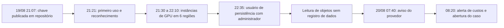

# Caso 4: Credencial de Nuvem Vazada e Abuso de Recursos

> **Objetivo pedagógico:** estudar um incidente em que uma chave de acesso de nuvem foi exposta em um repositório público e usada para criar recursos de computação, criar persistência e acessar armazenamento: reconstruir a atividade com os logs de auditoria, preservar antes de conter, procurar persistência, lidar com a lacuna de registros de acesso a dados e avaliar o impacto no pior caso, com decisões de notificação.

> **Caso fictício, para treinamento.** Organizações, contas, chaves e endereços são inventados.

## 1. Resumo

| Item | Descrição |
|---|---|
| Organização | Órbita Pagamentos S.A. (fintech fictícia), nuvem pública com várias contas e regiões |
| Evento | Chave de acesso de um usuário de integração contínua foi publicada em um repositório público |
| Atividade do atacante | Reconhecimento, criação de instâncias de GPU em várias regiões (mineração), criação de usuário e de política de administrador, leitura de objetos de armazenamento |
| Impacto | Custo de cerca de US$ 41 mil em 36 horas; usuário administrativo de persistência; acesso a um bucket com logs que continham dados pessoais (não verificável) |
| Detecção | Aviso do provedor sobre credencial exposta e alerta de custos |
| Pastas | 11, 17, 18 e 22 |
| Playbooks | PB-01, PB-30 e PB-34 |

## 2. Contexto e controles

| Elemento | Situação |
|---|---|
| Identidade | Usuário IAM de integração contínua com chave de longa duração e política de administrador (por conveniência), sem MFA |
| Registros | Trilha organizacional de eventos de gerenciamento habilitada; **eventos de dados do armazenamento desabilitados** |
| Detecção | Serviço de detecção de ameaças habilitado em uma conta de três; alertas de custo com limite alto |
| Segredos | Varredura de segredos nos repositórios apenas em alguns projetos |
| Proteções | Sem restrições de região por política; sem limites de serviço para criação de instâncias |
| Contas | Produção, desenvolvimento e logs separadas, com acesso cruzado por funções |

## 3. Cronologia (UTC)

| Data e hora | Evento | Fonte |
|---|---|---|
| 19/08 21:07 | Commit de arquivo de configuração com a chave de acesso em repositório público | Histórico do Git |
| 19/08 21:21 | Primeiro uso da chave, a partir do IP 192.0.2.88: consulta de identidade e listagem de buckets | Trilha de eventos |
| 19/08 21:30 a 22:10 | Criação de instâncias de GPU em 6 regiões; criação de chaves de acesso adicionais | Trilha de eventos |
| 19/08 22:35 | Criação do usuário `backup-svc2` e anexação de política de administrador | Trilha de eventos |
| 19/08 23:00 a 20/08 06:00 | Leitura de objetos do bucket de logs de aplicação | Sem registro (eventos de dados desabilitados); inferido por tráfego e métricas |
| 20/08 07:40 | Aviso do provedor sobre credencial exposta publicamente | Painel de saúde da conta |
| 20/08 08:20 | Alerta de custos; abertura do caso DFL-2026-071 | SOC |
| 20/08 09:00 | Início da contenção, após a preservação | Livro de decisões |



## 4. Preservação e contenção (PB-01 e PB-30)

| Hora (UTC) em 20/08 | Ação | Racional |
|---|---|---|
| 08:30 | Exportação da trilha de eventos e de logs de rede e de detecção; hash (PB-01) | Retenção curta do histórico e risco de alteração |
| 08:50 | Exportação do estado do usuário, das chaves e das políticas (estado anterior) | Evidência e reversão |
| 09:00 | **Desativação** (e não exclusão) da chave comprometida; revogação de sessões do usuário | Contenção com preservação |
| 09:10 | Desativação do usuário `backup-svc2` e de suas chaves; proteção contra exclusão nas instâncias | Persistência |
| 09:30 | Criação de snapshots dos volumes de 3 instâncias representativas para análise e encerramento das demais | Evidência e custo |
| 10:00 | Restrição de regiões e de tipos de instância por política organizacional | Prevenção de recorrência |

## 5. Análise

### 5.1 Reconstrução da atividade da chave

```bash
# Atividade por chave de acesso no histórico de eventos (90 dias)
aws cloudtrail lookup-events --lookup-attributes AttributeKey=AccessKeyId,AttributeValue=AKIAEXEMPLO000000000 \
  --max-results 1000 --output json > atividade_chave_E001.json
jq -r '.Events[] | [.EventTime, .EventName, (.CloudTrailEvent|fromjson|.sourceIPAddress), (.CloudTrailEvent|fromjson|.awsRegion)] | @tsv' atividade_chave_E001.json | sort
```

```sql
-- Amazon Athena: ações da chave e do usuário de persistência (tabela de trilha organizacional)
SELECT eventtime, eventname, awsregion, sourceipaddress, useragent, errorcode
FROM cloudtrail_logs
WHERE useridentity.accesskeyid = 'AKIAEXEMPLO000000000'
   OR useridentity.username = 'backup-svc2'
ORDER BY eventtime;
```

**Achados:** o primeiro uso ocorreu 14 minutos após o commit, a partir de IP externo; a sequência (identidade, listagem de buckets, criação de instâncias em 6 regiões, criação de usuário e anexação de política) é compatível com automação de abuso de credenciais expostas; a criação de chaves e de usuário caracterizou persistência.

### 5.2 Recursos criados e custos

| Recurso | Quantidade | Observações |
|---|---|---|
| Instâncias de GPU | 48 em 6 regiões | Processos de mineração nos 3 snapshots analisados |
| Usuário IAM `backup-svc2` | 1 | Política de administrador; 2 chaves |
| Chaves adicionais da conta original | 2 | Criadas em 19/08 |
| Funções e políticas novas | 0 | Verificado por comparação com a linha de base |
| Alterações em registros e detecção | Nenhuma | Ausência de tentativas de desabilitar a trilha |

### 5.3 Acesso a dados: a lacuna

A trilha de eventos de gerenciamento registrou a listagem de buckets, mas **os eventos de dados do armazenamento (leitura de objetos) não estavam habilitados**. Evidências indiretas: métricas de saída do bucket de logs e tráfego de rede mostraram 38 GB transferidos para o IP do atacante entre 23:00 e 06:00. O bucket continha **logs de aplicação com e-mails e endereços IP de usuários finais**, sem dados de cartão ou de documentos.

| Hipótese | Evidências a favor | Evidências contra |
|---|---|---|
| H1: leitura e cópia do bucket de logs | Métricas de saída e tráfego de 38 GB; chave com permissão de leitura; listagem de buckets | Sem registro de objetos lidos |
| H2: transferência para outro destino | Nenhuma | Sem indícios de outra origem de tráfego |
| H3: nenhuma leitura | Ausência de eventos de dados | Métricas de saída incompatíveis |

**Conclusão:** H1 com confiança moderada a alta; adota-se o **pior caso** (acesso a todo o conteúdo do bucket) para a avaliação de impacto.

## 6. Decisões críticas

| Decisão | Alternativas | Critérios | Decisão tomada |
|---|---|---|---|
| Desativar ou excluir a chave | Excluir; desativar | Preservar a rastreabilidade e permitir a análise de último uso | Desativar e exportar o estado |
| Encerrar todas as instâncias de imediato | Encerrar; preservar antes | Custos crescentes; necessidade de evidências | Snapshots de 3 instâncias representativas e encerramento das demais após o registro do inventário |
| Notificar a ANPD | Aguardar prova de acesso; comunicar com base no pior caso | Lacuna de registros; dados pessoais no bucket | O DPO avaliou risco baixo a moderado (e-mails e IPs) e decidiu comunicar por cautela, com a limitação declarada |
| Contestar custos junto ao provedor | Pagar; abrir chamado | Evidências do abuso e da exposição | Abrir chamado com relatório; solicitar ajuste de cobrança |
| Revisar privilégios | Manter administrador de integração; aplicar privilégio mínimo | Causa raiz | Substituir por funções de curta duração e privilégio mínimo |

## 7. Impacto e obrigações

| Tema | Avaliação |
|---|---|
| Financeiro | Cerca de US$ 41 mil em recursos de computação em 36 horas, em negociação com o provedor |
| Dados pessoais | E-mails e IPs de usuários finais no bucket de logs; sem dados financeiros |
| LGPD | Comunicação à ANPD e avaliação sobre os titulares, conforme o risco (art. 48; Resolução CD/ANPD nº 15/2024) |
| Contratos e regulação financeira | Verificar obrigações de comunicação de incidentes a parceiros e a reguladores do setor |
| Reputação | Comunicação a clientes sobre o evento, com linguagem factual |

## 8. Trecho de relatório (modelo)

> **Achado F-01.** A chave `AKIA...` foi publicada em repositório público em 19/08/2026 às 21:07 UTC e usada pela primeira vez às 21:21 UTC a partir do IP 192.0.2.88 (E001). **Confiança alta.** **Achado F-04.** Houve transferência de cerca de 38 GB para o IP do atacante entre 23:00 e 06:00 UTC, compatível com a leitura do bucket de logs (E005). **Confiança moderada a alta**, com a **limitação** de que os eventos de dados do armazenamento não estavam habilitados, de modo que não foi possível identificar os objetos lidos. Para fins de impacto, adotou-se o pior caso.

## 9. O que funcionou e o que falhou

| Funcionou | Falhou |
|---|---|
| A trilha de gerenciamento permitiu reconstruir a atividade | Eventos de dados do armazenamento desabilitados |
| Desativação com preservação e snapshots | Chave de longa duração com política de administrador |
| Restrição de regiões após o incidente | Alertas de custo com limite alto; detecção em apenas parte das contas |
| Aviso do provedor | Varredura de segredos parcial; sem restrições de região |

## 10. Lições aprendidas e recomendações

| Prioridade | Recomendação |
|---|---|
| Alta | Eliminar chaves de longa duração; usar credenciais temporárias e identidades de carga de trabalho |
| Alta | Privilégio mínimo para funções de integração contínua; políticas de limite de permissões |
| Alta | Habilitar eventos de dados para buckets sensíveis e centralizar logs em conta de auditoria com imutabilidade |
| Alta | Varredura de segredos com bloqueio antes do commit e em todo o histórico |
| Média | Restringir regiões e serviços por política organizacional; limites de instâncias |
| Média | Alertas de custo e de anomalias com limites baixos; detecção de ameaças em todas as contas |
| Média | Exercício de resposta a credenciais expostas (PB-30) |

## 11. Mapeamento

| Etapa | Pastas e playbooks |
|---|---|
| Preservação de logs | Pasta 11; PB-01 |
| Reconstrução e contenção em nuvem | Pastas 17 e 18; PB-30 |
| Armazenamento e exposição de dados | Pasta 17; PB-34 |
| Relatório e obrigações | Pasta 22 |

## 12. Perguntas para discussão

1. Que decisões o tempo de 14 minutos até o primeiro uso implica para o processo de resposta?
2. Como você dimensionaria o impacto sem registros de acesso a dados, e como justificaria o pior caso?
3. Por que desativar, e não excluir, a chave e o usuário de persistência?
4. Que controles preventivos teriam evitado ou reduzido o dano em cada fase?
5. Como você comunicaria o incidente aos clientes?

## 13. Exercícios

1. Escreva as consultas para detectar criação de usuários, chaves e políticas de administrador, e criação de instâncias em regiões incomuns.
2. Elabore a política de restrição de regiões e de serviços e a de credenciais temporárias.
3. Monte o inventário de recursos criados pelo atacante e o plano de limpeza.
4. Redija a comunicação ao provedor e a mensagem a clientes.

## 14. Normas e frameworks relevantes

- MITRE ATT&CK for Cloud: T1078.004, T1136.003, T1098, T1496, T1530, T1552.001
- NIST SP 800-61 Rev. 3; NIST SP 800-201; ISO/IEC 27017; CIS Benchmarks (AWS); CIS Controls v8.1 (controles 5, 6, 8 e 16)
- LGPD, arts. 6º, 46 e 48; Resolução CD/ANPD nº 15/2024

## 15. Referências

- AWS. Documentação do CloudTrail, do IAM e do guia de resposta a incidentes de segurança.
- Pastas 11, 17, 18, 22 e 23 (PB-30 e PB-34) deste repositório.
