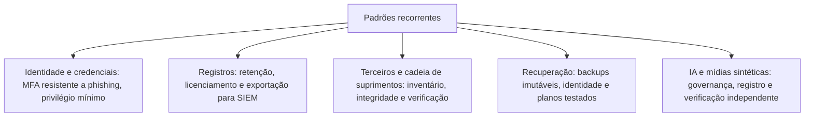

# Lições Forenses de Incidentes Públicos

> **Objetivo pedagógico:** extrair lições forenses de incidentes públicos amplamente documentados (cadeia de suprimentos, ransomware, nuvem, engenharia social, identidade e IA), concentrando-se no que cada caso ensina sobre evidências, detecção, preservação, decisões e governança, com cuidado na distinção entre fato, relato e inferência.

> **Aviso sobre as fontes:** os resumos abaixo se baseiam em relatos públicos de organizações, de órgãos governamentais, de decisões e de equipes de resposta, e foram simplificados. Detalhes, números e atribuições podem ter sido atualizados. **Consulte as fontes primárias indicadas** antes de citar qualquer informação e registre a data da consulta. Atribuições a grupos ou a Estados são **declarações das fontes citadas**, e não conclusões deste material.

## 1. Como usar este arquivo

Para cada incidente, trabalhe em quatro passos: (1) leia as fontes primárias; (2) construa a sua própria linha do tempo; (3) identifique as evidências que sustentaram a detecção e a investigação; (4) formule as lições e verifique que controles e playbooks deste repositório se aplicam. Compare o resultado com a síntese abaixo.

## 2. Quadro-resumo

| Incidente | Ano | Tema forense | Pastas relacionadas |
|---|---|---|---|
| SolarWinds (SUNBURST) | 2020 | Comprometimento da cadeia de suprimentos de software e abuso de identidade | 15, 17, 18, 20 |
| Colonial Pipeline | 2021 | Ransomware, acesso remoto por credencial e decisões de continuidade | 16, 22, 23 |
| Capital One | 2019 | Configuração de nuvem, credenciais de função e logs de auditoria | 17, 18 |
| NotPetya e Maersk | 2017 | Malware destrutivo via atualização, movimentação lateral e recuperação de identidade | 07, 15, 16 |
| Uber | 2022 | Fadiga de MFA, engenharia social e credenciais em scripts | 18, 19, 23 |
| Okta (sistema de suporte) | 2023 | Arquivos de sessão (HAR), tokens e detecção por clientes | 18, 19 |
| Microsoft e a chave de assinatura (Storm-0558) | 2023 | Falsificação de tokens e valor dos logs de auditoria | 18, 19 |
| Air Canada (chatbot) | 2024 | Responsabilidade por saída de assistente de IA | 25, 26 |
| Samsung (código em chatbot) | 2023 | Vazamento por uso de IA generativa | 24, 25 |
| Arup (videochamada sintética) | 2024 | Fraude com mídia sintética em videoconferência | 27 |

## 3. SolarWinds (SUNBURST), 2020

| Aspecto | Resumo |
|---|---|
| O que se reportou | Atualizações do software de gerenciamento de TI Orion foram comprometidas na cadeia de build, distribuindo um componente com porta dos fundos a milhares de clientes; o caso foi revelado em dezembro de 2020 por uma empresa de segurança que investigava o próprio comprometimento |
| Características técnicas relatadas | Código malicioso em um componente assinado do produto; atividade adiada após a instalação; comunicação por DNS e por tráfego que imitava protocolos legítimos; uso posterior de identidades e de tokens de autenticação em ambientes de vítimas selecionadas |
| Atribuição | Governos ocidentais atribuíram a campanha a um serviço de inteligência estrangeiro (declaração oficial) |
| Evidências que importaram | Análise de binários e de assinaturas; logs de DNS; registros de autenticação e de emissão de tokens; auditoria de nuvem e de identidade; linha do tempo de build |
| Lições forenses | (1) O software confiável é vetor: verificar a integridade de atualizações e a cadeia de build; (2) logs de identidade e de nuvem são essenciais para dimensionar a atividade pós-comprometimento; (3) a detecção veio de uma investigação de outro incidente, mostrando o valor de registros e de análise aprofundada; (4) a dimensão de escopo exige inventário de ativos e de fornecedores |
| Controles relacionados | Integridade de build, assinatura e verificação, segmentação de servidores de gerenciamento, monitoramento de identidade e de egresso, inventário de terceiros |
| Fontes | Relatórios da empresa de segurança que revelou o caso; avisos da CISA e do NSA; relatórios da própria SolarWinds e da Microsoft sobre o caso |

## 4. Colonial Pipeline, 2021

| Aspecto | Resumo |
|---|---|
| O que se reportou | Ataque de ransomware que levou a empresa a interromper preventivamente operações de seu oleoduto nos EUA; foi paga uma quantia em criptomoeda aos criminosos, e autoridades americanas anunciaram a recuperação de parte do valor |
| Acesso inicial relatado | Uso de uma credencial de VPN de uma conta que não estava em uso, sem autenticação multifator, em depoimento da empresa de resposta ao Congresso americano |
| Evidências que importaram | Logs de VPN, credenciais vazadas, análise do ransomware, transações em blockchain |
| Lições forenses | (1) Contas legadas e acesso remoto sem MFA são vetores de entrada; (2) decisões de continuidade operacional (interromper o sistema de operação) devem considerar a separação entre TI e tecnologia operacional e a incerteza sobre o alcance; (3) o pagamento envolve aspectos legais e de sanções, e a rastreabilidade de transações pode apoiar as autoridades; (4) planos de crise precisam definir decisões de parada e de retomada |
| Controles relacionados | MFA, gestão de contas legadas, segmentação TI e OT, backups testados, exercícios de crise |
| Fontes | Depoimentos ao Congresso americano; comunicados do Departamento de Justiça; avisos da CISA e do FBI |

## 5. Capital One, 2019

| Aspecto | Resumo |
|---|---|
| O que se reportou | Acesso indevido a dados de dezenas de milhões de clientes e de solicitantes de cartão, armazenados em serviços de nuvem, por uma pessoa que explorou uma configuração incorreta de um firewall de aplicações web; houve condenação em 2022 |
| Mecanismo relatado | Exploração de uma requisição do lado do servidor para obter credenciais temporárias de uma função associada à instância, que tinha permissões amplas de leitura em armazenamento |
| Detecção relatada | Alerta de um terceiro que havia visto os dados publicados, e não por detecção interna imediata |
| Evidências que importaram | Registros de auditoria da nuvem, logs do firewall de aplicações, registros de acesso ao armazenamento, publicação em repositório |
| Lições forenses | (1) A função associada à carga de trabalho com permissões amplas amplia o dano; (2) logs de auditoria e de dados permitiram reconstruir a atividade; (3) a detecção por terceiros mostra a importância de monitorar atividades anômalas de funções e de acesso a dados; (4) configurações de borda e metadados de instâncias exigem proteção |
| Controles relacionados | Privilégio mínimo para funções, versão reforçada do serviço de metadados de instâncias, monitoramento de acesso a dados, revisão de configurações |
| Fontes | Acusação do Departamento de Justiça americano; documentos do processo; comunicados da empresa; análises técnicas de provedores |

## 6. NotPetya e Maersk, 2017

| Aspecto | Resumo |
|---|---|
| O que se reportou | Malware com aparência de ransomware, mas destrutivo, distribuído principalmente por uma atualização comprometida de um software de contabilidade usado na Ucrânia, que se espalhou globalmente em empresas com operações no país |
| Efeitos relatados | Grande interrupção em empresas multinacionais; a Maersk relatou a reinstalação de dezenas de milhares de estações e de milhares de servidores; relatos públicos indicam que a recuperação do domínio dependeu de um controlador de domínio que, por acaso, estava desligado e preservado |
| Atribuição | Governos atribuíram o ataque a um serviço militar de inteligência estrangeiro (declaração oficial) |
| Evidências que importaram | Análise do malware, logs de propagação, cópias de controladores de domínio, inventário de sistemas |
| Lições forenses | (1) A identidade (Active Directory) é o ponto único de falha: backups isolados e testados do diretório são críticos; (2) atualizações de terceiros são vetor; (3) propagação lateral com credenciais e vulnerabilidades exige segmentação e correção; (4) a recuperação em larga escala exige priorização e logística, e não apenas técnica |
| Controles relacionados | Backups imutáveis de controladores de domínio, segmentação, gestão de credenciais, planos de recuperação testados |
| Fontes | Declarações públicas da empresa; análises das equipes de segurança; comunicados de governos; reportagens investigativas (verificar com cautela) |

## 7. Uber, 2022

| Aspecto | Resumo |
|---|---|
| O que se reportou | Um invasor obteve acesso a sistemas internos após conseguir credenciais de um prestador de serviços e vencer o MFA por repetidas solicitações de aprovação e por contato direto com o funcionário; a empresa publicou um relato e a atribuição a um grupo foi declarada em comunicados |
| Evidências que importaram | Logs de autenticação e de MFA, registros de acesso a sistemas internos e de gerenciamento de acessos privilegiados, mensagens de comunicação |
| Lições forenses | (1) A fadiga de MFA e a engenharia social por mensageiros contornam fatores fracos; (2) credenciais embutidas em scripts expõem sistemas de gerenciamento de privilégios; (3) acessos de terceiros e de dispositivos pessoais exigem controles e monitoramento; (4) a comunicação pública e a contenção rápida (revogação de acessos) fazem parte da resposta |
| Controles relacionados | MFA com correspondência de número e métodos resistentes a phishing, limites de tentativas, cofres de segredos, monitoramento de acesso privilegiado |
| Fontes | Comunicados e atualizações publicados pela empresa; análises de equipes de resposta |

## 8. Okta, 2023 (sistema de suporte)

| Aspecto | Resumo |
|---|---|
| O que se reportou | Um agente malicioso acessou o sistema de gestão de casos de suporte da empresa e obteve arquivos enviados por clientes, entre os quais arquivos de captura de tráfego do navegador (HAR) que continham tokens de sessão; a empresa e clientes relataram tentativas de sequestro de sessões |
| Detecção relatada | Alguns clientes informaram ter detectado atividade suspeita com tokens obtidos, e a empresa informou sua investigação e a ampliação do escopo ao longo do tempo |
| Evidências que importaram | Registros de acesso ao sistema de suporte, logs de autenticação de clientes, análise de sessões e de tokens |
| Lições forenses | (1) Arquivos HAR e capturas contêm credenciais e tokens: sanitizar antes de compartilhar; (2) o comprometimento de fornecedores de identidade amplia o alcance; (3) revogação de sessões e rotação de tokens são ações essenciais; (4) a detecção por clientes mostra o valor do monitoramento de anomalias de sessão (IP, agente e horários) |
| Controles relacionados | Sanitização de arquivos de suporte, vinculação de sessões a dispositivos, monitoramento de anomalias, gestão de incidentes com fornecedores |
| Fontes | Comunicados e relatórios da empresa; relatos públicos de clientes afetados |

## 9. Microsoft e chave de assinatura (Storm-0558), 2023

| Aspecto | Resumo |
|---|---|
| O que se reportou | Um agente, identificado pela empresa como atuando a partir da China, usou uma chave de assinatura de contas de consumidores para forjar tokens e acessar caixas de e-mail de organizações, inclusive de órgãos governamentais; o caso foi detectado por um cliente que usava registros de auditoria avançados |
| Revisão pública | Um comitê governamental americano publicou uma revisão crítica sobre as práticas de segurança e de gestão de chaves, e a empresa ampliou o acesso a registros de auditoria |
| Evidências que importaram | Registros de auditoria de acesso a e-mail (`MailItemsAccessed`) e de autenticação, que permitiram identificar anomalias |
| Lições forenses | (1) O licenciamento e a retenção de logs determinam a capacidade de detecção e de investigação; (2) chaves de assinatura são ativos críticos, e o seu comprometimento permite forjar identidade sem comprometer contas; (3) a detecção por clientes depende de registros de auditoria detalhados; (4) a cadeia de fornecedores de identidade exige transparência e cooperação |
| Controles relacionados | Registro de auditoria avançado, exportação para SIEM, retenção adequada, detecção de anomalias de token |
| Fontes | Comunicados e relatórios da empresa; relatório do comitê de revisão de segurança cibernética dos EUA; avisos da CISA |

## 10. Air Canada e o chatbot, 2024

| Aspecto | Resumo |
|---|---|
| O que se reportou | Em uma decisão de um tribunal de pequenas causas no Canadá, a companhia aérea foi considerada responsável por informação incorreta prestada por seu chatbot sobre regras de tarifas de luto; o tribunal rejeitou a tese de que o chatbot seria uma entidade separada responsável por suas próprias declarações |
| Evidências que importaram | Registro da conversa do cliente com o chatbot e a política publicada no site da empresa |
| Lições forenses | (1) A organização responde pelas informações dadas por seus assistentes; (2) o registro da conversa e a versão do conteúdo vigente são prova central; (3) a informação conflitante entre o chatbot e a política exige governança de conteúdo; (4) avisos genéricos de limitação podem não bastar |
| Controles relacionados | Governança da base de conhecimento, validação de políticas, registro e retenção das conversas, supervisão humana |
| Fontes | A decisão do tribunal (British Columbia Civil Resolution Tribunal) e a cobertura jornalística especializada |

## 11. Samsung e código em chatbot, 2023

| Aspecto | Resumo |
|---|---|
| O que se reportou | Relatos públicos indicaram que funcionários inseriram código-fonte e informações internas em um chatbot público, e que a empresa restringiu o uso dessas ferramentas |
| Evidências relevantes em casos semelhantes | Proxy, DLP, histórico de conversas da conta, registros de endpoint |
| Lições forenses | (1) O vazamento por IA generativa decorre de ausência de política e de alternativa aprovada; (2) a retenção e o uso dos dados pelo fornecedor são incertezas a declarar; (3) controles técnicos (DLP, bloqueio e ferramentas corporativas) e treinamento são necessários |
| Fontes | Reportagens da imprensa especializada e comunicados internos divulgados; verifique a data e o detalhamento |

## 12. Arup e a videochamada sintética, 2024

| Aspecto | Resumo |
|---|---|
| O que se reportou | Um funcionário de uma filial em Hong Kong realizou transferências de valor muito elevado após participar de uma videoconferência em que supostos executivos eram, segundo a polícia local, mídias sintéticas; a empresa confirmou ter sido alvo de uma fraude desse tipo |
| Evidências relevantes | Registros da plataforma de videoconferência, convites e participantes, registros financeiros e de transferências |
| Lições forenses | (1) Videochamadas não autenticam pagamentos: exigir verificação independente e dupla aprovação; (2) a pressão de urgência e o sigilo são sinais de engenharia social; (3) os registros de plataformas e de transações corroboram a fraude mais do que a análise visual; (4) a prevenção depende de processos, e não de "detectar o deepfake" |
| Fontes | Declarações da polícia de Hong Kong; comunicados da empresa; cobertura jornalística |

## 13. Padrões comuns entre os casos

| Padrão | Casos |
|---|---|
| Credenciais e acesso remoto sem MFA ou com MFA fraco | Colonial Pipeline; Uber; Okta |
| Identidade como alvo central | SolarWinds; Okta; Storm-0558; NotPetya |
| Cadeia de suprimentos e terceiros | SolarWinds; NotPetya; Uber; Okta |
| Valor decisivo dos logs de auditoria (e do licenciamento) | Capital One; Storm-0558; SolarWinds |
| Detecção por terceiros, e não internamente | SolarWinds; Capital One; Storm-0558; Okta |
| Privilégios excessivos | Capital One; Uber; Colonial Pipeline |
| Recuperação dependente de backups e de identidade | NotPetya e Maersk; Colonial Pipeline |
| Responsabilidade por IA e por mídias sintéticas | Air Canada; Samsung; Arup |
| Processos de verificação independente | Arup; fraudes por BEC |

## 14. Método para analisar um novo incidente público

| Passo | Pergunta |
|---|---|
| 1. Fontes | Quais são as fontes primárias e de que data são? |
| 2. Fatos | O que está documentado, e o que é relato ou inferência? |
| 3. Cronologia | Qual a sequência de eventos, com datas? |
| 4. Evidências | Que registros e artefatos permitiram detectar e investigar? |
| 5. Falhas e acertos | Que controles falharam, e quais funcionaram? |
| 6. Lições | Que lições se aplicam à minha organização? |
| 7. Mapeamento | Que pastas e playbooks do laboratório se aplicam? |
| 8. Verificação | Que informações precisam ser atualizadas? |

## 15. Casos de uso corporativos

- Revisão de lições de incidentes públicos em comitês de risco e de segurança.
- Cenários de exercícios de mesa baseados em padrões reais, sem expor organizações.
- Justificativa de investimentos em controles com base em evidências públicas.

## 16. Normas e frameworks relevantes

- MITRE ATT&CK (técnicas relacionadas a cada caso); NIST SP 800-61 Rev. 3; NIST SP 800-161 Rev. 1 (cadeia de suprimentos)
- CISA. Avisos e guias sobre ransomware, cadeia de suprimentos e identidade; Cyber Safety Review Board (relatórios)
- OWASP Top 10 para LLM; NIST AI 600-1; NIST AI 100-4
- LGPD, arts. 6º, 46 e 48; ISO/IEC 27035

## 17. Referências

- CISA. Alertas sobre SolarWinds, Colonial Pipeline e Storm-0558; Cyber Safety Review Board. Review of the Summer 2023 Microsoft Exchange Online Intrusion (2024).
- U.S. Department of Justice. Comunicados e acusações relacionados à Capital One e à Colonial Pipeline.
- Comunicados oficiais da Uber, da Okta e da Microsoft sobre os respectivos incidentes.
- British Columbia Civil Resolution Tribunal. Moffatt v. Air Canada, 2024 BCCRT 149.
- Declarações e comunicados da polícia de Hong Kong e da Arup sobre a fraude por videoconferência.
- Pastas 15 a 19 e 24 a 27 deste repositório.
