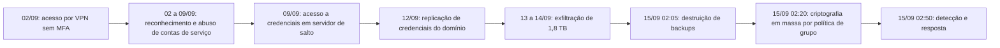

# Caso 1: Ransomware com Exfiltração em Empresa Industrial

> **Objetivo pedagógico:** estudar, de ponta a ponta, um incidente de ransomware com exfiltração de dados (dupla extorsão) em uma empresa industrial: acesso inicial por credencial sem MFA, movimentação e escalonamento de privilégios, exfiltração, destruição de backups e criptografia em massa; aplicar a preservação por ordem de volatilidade, a reconstrução da cronologia, as decisões de contenção e de recuperação, as obrigações legais e a comunicação.

> **Caso fictício, para treinamento.** Organizações, pessoas, endereços IP e domínios são inventados; os IPs pertencem a faixas reservadas para documentação.

## 1. Resumo

| Item | Descrição |
|---|---|
| Organização | Metalúrgica Aurora S.A. (fictícia): 1.800 colaboradores, 3 plantas, ERP e servidores de arquivos locais, virtualização, backups em disco e fita |
| Ameaça | Grupo de ransomware com extorsão dupla (criptografia e ameaça de divulgação) |
| Impacto | Cerca de 420 servidores e estações criptografados; 1,8 TB exfiltrados; parada parcial da produção por 6 dias |
| Detecção | Alertas de criptografia em massa do EDR, às 02:50 UTC de 15/09/2026 |
| Desfecho | Recuperação a partir de backups offline; sem pagamento; comunicações à ANPD e aos titulares; reforço de controles |
| Pastas | 03, 04, 05, 07, 09, 11, 13, 16 e 22 |
| Playbooks | PB-00, PB-01, PB-02, PB-10, PB-12, PB-15, PB-24 e PB-25 |

## 2. Contexto e ativos

| Elemento | Situação antes do incidente |
|---|---|
| Acesso remoto | VPN com perfil legado de um fornecedor de manutenção sem MFA |
| Identidade | Active Directory com contas de serviço com senhas antigas e privilégios amplos |
| Endpoints | EDR em 70% dos servidores; 100% das estações; alertas de severidade média sem triagem rápida |
| Rede | Segmentação parcial entre TI e produção; saída à internet permitida a partir de servidores de arquivos |
| Backups | Cópia em disco no domínio (alcançável pelo atacante) e fitas offline mensais |
| Registros | SIEM com logs de VPN, de firewall e de controladores de domínio; retenção de 90 dias |
| Plano de resposta | Existente, mas sem teste recente; sem contato com seguradora atualizado |

## 3. Cronologia (UTC)

| Data e hora | Evento | Fonte |
|---|---|---|
| 02/09 03:12 | Entrada na VPN com a conta `svc-manut`, a partir do IP 203.0.113.45 (hospedagem comercial) | Log da VPN |
| 02/09 a 08/09 | Reconhecimento da rede e consulta ao domínio; tráfego incomum de LDAP | Firewall e controladores de domínio |
| 08/09 22:40 | Solicitações de tíquetes de serviço com criptografia fraca para várias contas de serviço (padrão de Kerberoasting) | Eventos 4769 |
| 09/09 01:15 | Acesso à memória do processo de autenticação em um servidor de salto (alerta de severidade média do EDR, não tratado) | EDR |
| 12/09 04:30 | Replicação de credenciais do domínio por conta com privilégio (padrão de DCSync) | Eventos 4662 |
| 13/09 a 14/09 | Cópia de 1,8 TB de servidores de arquivos para um serviço de armazenamento externo, por ferramenta de sincronização | Firewall (saída), EDR |
| 15/09 02:05 | Exclusão de tarefas e de repositórios do servidor de backup | Logs do servidor de backup |
| 15/09 02:20 | Distribuição do executável de criptografia por política de grupo | Eventos de GPO e de criação de serviços (7045) |
| 15/09 02:50 | Alertas de criptografia em massa do EDR | EDR |
| 15/09 03:05 | Acionamento do plantão; abertura do caso DFL-2026-041 (gravidade crítica) | Livro de decisões |
| 15/09 03:40 | Isolamento de segmentos e desligamento de links entre plantas | Firewall |



## 4. Abertura e preservação (PB-00, PB-01 e PB-02)

| Hora (UTC) | Ação | Racional |
|---|---|---|
| 03:05 a 03:20 | Abertura do caso, canal fora de banda, comitê de crise, contato com Jurídico, DPO e seguradora | Governança e coordenação (PB-00 e PB-25) |
| 03:20 a 04:00 | Exportação dos logs de VPN, de firewall, de controladores de domínio e do EDR; hash e retenção ampliada | Fontes de retenção curta e de risco de adulteração (PB-01) |
| 03:40 a 05:00 | Isolamento de rede; **manutenção de servidores ligados** para captura de memória do servidor de salto e de dois controladores de domínio | Memória é volátil; criptografia já concluída nos alvos principais (PB-02) |
| 05:00 a 09:00 | Coleta de triagem em 30 servidores críticos; preservação do servidor de backup (imagem); amostra do executável e da nota de resgate | PB-03, PB-10, PB-12 e PB-13 |
| Dia 1 | Proteção das fitas offline e dos backups restantes | Recuperação |

| ID | Evidência | Origem | Observação |
|---|---|---|---|
| E001 | Logs de VPN (30 dias) | Appliance e SIEM | Hash e retenção ampliada |
| E010 | Memória do servidor de salto | Captura ao vivo | Hash; custódia |
| E011 | Pacote de triagem de 30 servidores | Coleta remota | Hash por host |
| E020 | Logs de segurança dos controladores de domínio | Exportação | Eventos 4624, 4662, 4769, 7045 |
| E030 | Logs de firewall de saída | SIEM | Volumes por origem e destino |
| E040 | Nota de resgate e amostras de arquivos criptografados | Servidores afetados | Sem executar |
| E041 | Executável de criptografia | Compartilhamento da GPO | Análise em laboratório (PB-21) |
| E050 | Imagem e logs do servidor de backup | Servidor de backup | Exclusões de repositórios |

## 5. Análise por fase

### 5.1 Acesso inicial

```kusto
// Entradas da conta do fornecedor na VPN, com origem e horário (tabela ilustrativa "VpnLogs")
VpnLogs
| where TimeGenerated between (datetime(2026-08-25) .. datetime(2026-09-16))
| where Usuario == "svc-manut"
| project TimeGenerated, Usuario, IpOrigem, Perfil, MfaUsado, Resultado
| order by TimeGenerated asc
```

**Achados:** o primeiro acesso a partir de IP de hospedagem comercial ocorreu em 02/09, às 03:12 UTC, fora do padrão do fornecedor (acessos diurnos, de um IP corporativo conhecido). O perfil legado não exigia MFA. A senha constava em um conjunto de credenciais vazadas publicamente (hipótese corroborada pelo fornecedor, que reutilizava a senha em outro serviço).

### 5.2 Credenciais e movimentação

```kusto
// Solicitações de tíquetes com criptografia fraca (RC4) para contas de serviço: possível Kerberoasting
SecurityEvent
| where TimeGenerated between (datetime(2026-09-08) .. datetime(2026-09-09))
| where EventID == 4769 and TicketEncryptionType == "0x17"
| summarize Tiquetes = count(), Servicos = dcount(ServiceName) by IpAddress, TargetUserName
| order by Tiquetes desc

// Replicação de credenciais do domínio por conta que não seja controlador de domínio
SecurityEvent
| where TimeGenerated between (datetime(2026-09-12) .. datetime(2026-09-13))
| where EventID == 4662
| where Properties has_any ("1131f6aa-9c07-11d1-f79f-00c04fc2dcd2", "1131f6ad-9c07-11d1-f79f-00c04fc2dcd2")
| where SubjectUserName !endswith "$"
| project TimeGenerated, Computer, SubjectUserName, SubjectLogonId
```

**Achados:** 112 tíquetes com criptografia fraca solicitados a partir do servidor de salto em 40 minutos; a memória (E010) mostrou acesso ao processo de autenticação e credenciais em memória de uma conta administrativa; a replicação de credenciais foi feita por essa conta a partir do servidor de salto.

### 5.3 Exfiltração

```kusto
// Volume de saída por origem e destino (tabela de firewall normalizada)
CommonSecurityLog
| where TimeGenerated between (datetime(2026-09-02) .. datetime(2026-09-15))
| where DeviceAction == "allow" and not(ipv4_is_private(DestinationIP))
| summarize BytesSaida = sum(SentBytes) by SourceIP, DestinationIP, bin(TimeGenerated, 1d)
| top 20 by BytesSaida desc
```

**Achados:** 1,8 TB saíram de 2 servidores de arquivos para um destino de armazenamento em nuvem em dois dias; o EDR mostrou uma ferramenta de sincronização de arquivos executada pela conta administrativa comprometida. A análise de nomes de pasta indicou dados de RH, financeiros e de clientes.

### 5.4 Destruição de backups e criptografia

**Achados:** o servidor de backup (E050) registrou exclusão de repositórios às 02:05 UTC por sessão da conta administrativa; a política de grupo distribuiu o executável (E041) a cerca de 420 máquinas às 02:20 UTC. As fitas offline de agosto não foram atingidas.

### 5.5 Linha do tempo integrada (PB-15)

A linha do tempo foi construída a partir de E001, E011, E020, E030 e E050, normalizada em UTC, com os marcos: acesso inicial, credenciais, escalonamento, exfiltração, destruição de backups e criptografia (seção 3).

## 6. Decisões críticas

| Decisão | Alternativas | Critérios | Decisão tomada |
|---|---|---|---|
| Desligar tudo ou isolar e manter ligados | Desligar para parar a criptografia; isolar e preservar memória | A criptografia já havia terminado nos alvos principais; memória tem valor probatório | Isolar segmentos e manter ligados os sistemas-chave por tempo limitado para capturar memória |
| Pagar o resgate | Pagar; não pagar | Existência de backups offline; risco legal e ético; sem garantia de exclusão dos dados exfiltrados; orientação do Jurídico e da seguradora | Não pagar; recuperar de backups offline |
| Quando comunicar às autoridades e aos titulares | Aguardar a conclusão; comunicar no prazo | Prazos legais correm a partir da ciência do incidente | Comunicar à ANPD no prazo da regulamentação (três dias úteis, conforme a Resolução CD/ANPD nº 15/2024; confirme), com informações preliminares e complementação posterior |
| Ordem de recuperação | Reconstruir pela operação ou pela identidade | Sem identidade confiável, tudo se reinfecta | Primeiro reconstrução do Active Directory e redefinição de credenciais (inclusive KRBTGT em duas etapas), depois backups, depois serviços de produção |
| Reativar a fábrica | Reativar rapidamente; reativar após validação | Risco de reinfecção; pressão do negócio | Reativação em fases, com monitoramento reforçado |

## 7. Impacto e obrigações

| Tema | Avaliação |
|---|---|
| Dados pessoais | Cerca de 11.200 titulares (colaboradores, ex-colaboradores e contatos de clientes), com dados cadastrais, financeiros e de RH |
| Dados sigilosos | Projetos de engenharia e contratos |
| Operações | Parada parcial por 6 dias; custos de recuperação e de perda de produção |
| LGPD e ANPD | Comunicação do incidente à ANPD e aos titulares (art. 48; Resolução CD/ANPD nº 15/2024) |
| Contratos | Notificação a clientes conforme cláusulas; verificação de multas |
| Seguro | Comunicação à seguradora; atenção às condições de cobertura |
| Autoridades | Boletim de ocorrência e comunicação a autoridades competentes |
| Pior caso | Divulgação dos dados exfiltrados na internet; monitoramento de sites de vazamento |

## 8. Trecho de relatório (modelo)

> **Resumo executivo.** Entre 02 e 15/09/2026, um agente não autorizado acessou a rede da Metalúrgica Aurora por uma conta de fornecedor sem MFA, obteve privilégios administrativos de domínio, copiou cerca de 1,8 TB de dados e implantou ransomware em cerca de 420 sistemas em 15/09. **Confiança alta** no acesso inicial por credencial válida (E001) e no uso de privilégios de domínio (E020, E010). **Confiança moderada** quanto à identidade do grupo, com base em indicadores da nota de resgate e na análise do executável (E040 e E041); a atribuição não é conclusiva. **Limitações:** o EDR não cobria 30% dos servidores; os logs de VPN anteriores a 30 dias estavam expirados; não foi possível confirmar o conteúdo exato dos arquivos copiados, sendo adotado o pior caso para fins de notificação.

## 9. O que funcionou e o que falhou

| Funcionou | Falhou |
|---|---|
| Preservação de logs e de memória nas primeiras horas | VPN sem MFA para perfil legado |
| Fitas offline preservadas | Alerta de severidade média não tratado em 6 dias |
| Canal fora de banda e comitê de crise | Backups no domínio, alcançáveis pelo atacante |
| Decisão fundamentada de não pagar | EDR incompleto; segmentação parcial |
| Comunicação tempestiva à ANPD | Ausência de teste recente do plano e de contato atualizado com a seguradora |

## 10. Lições aprendidas e recomendações

| Prioridade | Recomendação |
|---|---|
| Alta | MFA obrigatório e remoção de perfis legados; revisão de acessos de terceiros |
| Alta | Backups imutáveis e isolados do domínio; testes de restauração |
| Alta | Triagem de alertas médios do EDR com prazo; cobertura de 100% dos servidores |
| Alta | Rotação e redução de privilégios de contas de serviço; proteção contra Kerberoasting (senhas longas e criptografia moderna) |
| Média | Segmentação entre TI e produção; restrição de saída à internet de servidores de arquivos |
| Média | Retenção de logs de 12 meses para fontes críticas |
| Média | Exercícios semestrais de mesa e atualização de contatos |
| Média | Monitoramento de volume de saída e de ferramentas de sincronização |

## 11. Mapeamento

| Etapa do caso | Pastas e playbooks |
|---|---|
| Abertura, preservação e decisão sobre sistemas ligados | Pastas 02 a 04; PB-00, PB-01 e PB-02 |
| Memória, triagem e linha do tempo | Pastas 05, 07 e 09; PB-10, PB-12 e PB-15 |
| Logs, rede e exfiltração | Pastas 11 e 13; PB-23 e PB-24 |
| Ransomware e recuperação | Pasta 16; PB-25 |
| Relatórios e comunicação | Pasta 22 |

## 12. Perguntas para discussão

1. Que fontes de retenção curta deveriam ter sido preservadas primeiro, e em que ordem?
2. Quais evidências sustentam a hipótese de acesso inicial por credencial vazada, e que hipótese alternativa deveria ser descartada?
3. Quais são os riscos e os benefícios de manter servidores ligados após a criptografia?
4. Que informações você apresentaria ao comitê de crise na primeira hora, e quais incertezas declararia?
5. Como o resultado mudaria se os backups imutáveis existissem? E se o EDR tivesse cobertura total?
6. Como você estimaria os titulares afetados quando o conteúdo exato da exfiltração é desconhecido?

## 13. Exercícios

1. Construa a linha do tempo integrada a partir dos eventos da seção 3, em formato de planilha, com fonte e confiança.
2. Escreva as consultas de detecção que teriam alertado cedo (Kerberoasting, DCSync e volume de saída).
3. Elabore o SITREP das primeiras 4 horas (pasta 22).
4. Redija a comunicação preliminar à ANPD (conteúdo mínimo) e a mensagem aos colaboradores.
5. Prepare o plano de recuperação priorizado (identidade, backups, serviços).

## 14. Normas e frameworks relevantes

- MITRE ATT&CK: T1133, T1078, T1558.003, T1003, T1003.006, T1567.002, T1490, T1484.001, T1486
- NIST SP 800-61 Rev. 3; NIST SP 800-86; ISO/IEC 27035; ISO/IEC 27037; CIS Controls v8.1 (controles 4, 5, 6, 8, 11 e 17)
- LGPD, arts. 6º, 46 e 48; Resolução CD/ANPD nº 15/2024; CPP, arts. 158-A a 158-F

## 15. Referências

- CISA. #StopRansomware Guide.
- NIST. IR 8374: Ransomware Risk Management. 2022.
- MITRE. ATT&CK Enterprise.
- Pastas 03, 04, 05, 07, 09, 11, 13, 16, 22 e 23 deste repositório.
