# 29 Laboratório de Ferramentas Forenses

## Objetivo

Montar e operar um laboratório forense prático, seguro e reproduzível: projetar a arquitetura (níveis, redes isoladas, armazenamento e controles), instalar e inventariar ferramentas com verificação de integridade, praticar com dados sintéticos e conjuntos públicos (aquisição, recuperação e linha do tempo de disco; logs, artefatos e memória do Windows; rede, arquivos suspeitos benignos e regras YARA e Suricata; nuvem, Microsoft 365 e IA), validar ferramentas e documentar o trabalho de forma reproduzível, e consolidar o aprendizado em exercícios integrados, rotinas de operação e checklist de maturidade.

## Trilha de estudo recomendada

```mermaid
flowchart LR
    A["1. Arquitetura do laboratório"] --> B["2. Instalação e inventário"]
    B --> C["3. Prática 1: disco e linha do tempo"]
    C --> D["4. Prática 2: Windows, logs e memória"]
    D --> E["5. Prática 3: rede e arquivos"]
    E --> F["6. Prática 4: nuvem, M365 e IA"]
    F --> G["7. Validação e reprodutibilidade"]
    G --> H["8. Exercícios integrados e checklist"]
```

## Conteúdo da pasta

| Ordem | Arquivo | Objetivo |
|---|---|---|
| 1 | [arquitetura-do-laboratorio-forense-e-requisitos.md](arquitetura-do-laboratorio-forense-e-requisitos.md) | Níveis, topologia, isolamento, diretórios e requisitos legais |
| 2 | [distribuicoes-instalacao-e-inventario-de-ferramentas.md](distribuicoes-instalacao-e-inventario-de-ferramentas.md) | Distribuições, ferramentas por finalidade, instalação verificável e inventário |
| 3 | [pratica-1-aquisicao-hash-recuperacao-e-linha-do-tempo.md](pratica-1-aquisicao-hash-recuperacao-e-linha-do-tempo.md) | Disco de teste, E01, recuperação, `bulk_extractor`, `mactime` e Plaso |
| 4 | [pratica-2-windows-logs-artefatos-e-memoria.md](pratica-2-windows-logs-artefatos-e-memoria.md) | Eventos benignos, EvtxECmd, Hayabusa, Chainsaw, artefatos e Volatility 3 |
| 5 | [pratica-3-rede-arquivos-suspeitos-e-ambiente-isolado.md](pratica-3-rede-arquivos-suspeitos-e-ambiente-isolado.md) | Beaconing benigno, Zeek, Suricata, YARA, EICAR e isolamento |
| 6 | [pratica-4-nuvem-microsoft-365-e-ia.md](pratica-4-nuvem-microsoft-365-e-ia.md) | Logs de nuvem, KQL, auditoria do M365, IA local, integridade de modelos e MLflow |
| 7 | [validacao-de-ferramentas-documentacao-e-reprodutibilidade.md](validacao-de-ferramentas-documentacao-e-reprodutibilidade.md) | Plano e registro de validação, verificação cruzada e reprodutibilidade |
| 8 | [exercicios-integrados-operacao-e-checklist-do-laboratorio.md](exercicios-integrados-operacao-e-checklist-do-laboratorio.md) | Exercícios integrados, operação, sanitização, checklist e roteiro de 12 semanas |

## Princípios

- Isolar o que é perigoso: rede sem rota para a internet e para a produção, snapshots e ausência de pastas compartilhadas
- Preservar a integridade: evidências originais em somente leitura, hashes e custódia, mesmo em exercícios
- Verificar antes de confiar: hashes e assinaturas dos instaladores, versões fixadas e inventário
- Validar ferramentas e métodos com dados de referência e verificação cruzada, e declarar as limitações
- Tornar tudo reproduzível: registro de comandos, de versões e de ambiente, e scripts em Git
- Usar somente dados sintéticos, conjuntos públicos licenciados e material benigno nos exercícios
- Operar contas de nuvem e locatários apenas de laboratório, com orçamentos e limpeza ao final
- Tratar o próprio laboratório como um ambiente a proteger, com procedimentos, revisões e resposta a incidentes

## Relação com outras pastas

- 02, 03 e 04: custódia, coleta e hashes
- 05 e 10: linha do tempo e forense de disco
- 07 a 09: Windows, Linux e memória
- 11 a 15: logs, e-mail, rede, mobile e malware
- 17 a 19: nuvem, Azure e Microsoft 365
- 21: OSINT e preservação de conteúdo
- 22 e 23: relatórios e playbooks
- 24 a 27: IA, prompts, incidentes com LLM e deepfakes
- 28: estudos de caso (base para o projeto final)
- 30: lições aprendidas

## Referências

- NIST. Computer Forensics Tool Testing Program (CFTT); SP 800-86; SP 800-88; SP 800-84
- ISO/IEC 27037, 27041, 27042 e 27043; ISO 21043; ABNT NBR ISO/IEC 17025
- SWGDE. Documentos de validação de ferramentas e de qualidade de laboratório
- Carrier, B. File System Forensic Analysis (2005)
- Documentação do The Sleuth Kit, do libewf, do Plaso, do Volatility 3, do Zeek, do Suricata, do YARA, do DuckDB, do MLflow, do DVC e do Ollama
- Conjuntos de treinamento: NIST CFReDS e Digital Corpora
- EICAR. Arquivo de teste de antivírus
