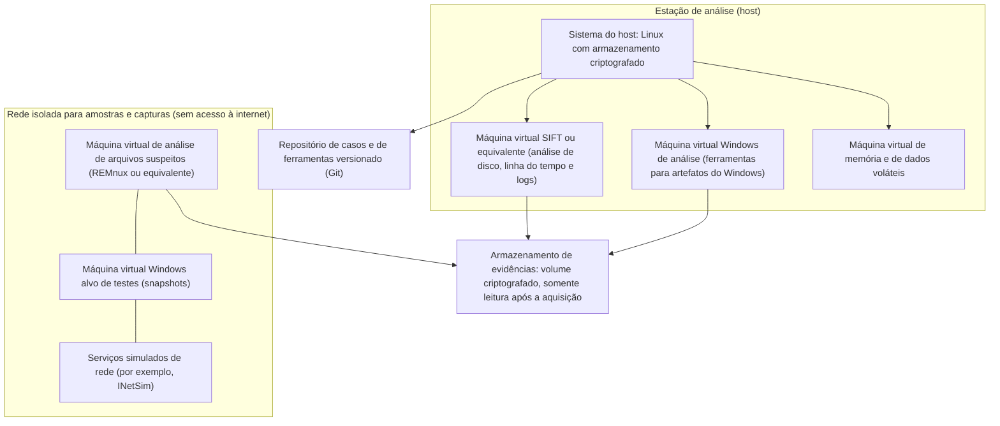

# Arquitetura do Laboratório Forense e Requisitos

> **Objetivo pedagógico:** projetar um laboratório forense de estudo e de trabalho que seja seguro, isolado, reproduzível e documentado: definir os níveis de investimento (básico, intermediário e avançado), a topologia de máquinas e de redes (estação de análise, máquinas virtuais, rede isolada para amostras e armazenamento de evidências), os controles de segurança do próprio laboratório, a organização de diretórios e a nomenclatura, e os requisitos legais e de privacidade aplicáveis a dados de laboratório.

## 1. Objetivos do laboratório

| Objetivo | Descrição |
|---|---|
| Aprender e treinar | Praticar as técnicas das pastas 01 a 28 com dados sintéticos e conjuntos públicos |
| Validar ferramentas | Testar e documentar ferramentas antes de usá-las em casos (arquivo 7) |
| Analisar com segurança | Examinar material potencialmente hostil sem risco para a rede de produção |
| Reproduzir resultados | Qualquer análise deve poder ser repetida por outro analista |
| Preservar a integridade | Manter a cadeia de custódia e a integridade das evidências, inclusive em exercícios |

## 2. Níveis do laboratório

| Nível | Perfil | Recursos mínimos sugeridos | Capacidades |
|---|---|---|---|
| Básico (estudo individual) | Aprendizado e práticas das pastas 03 a 11 | Notebook com 16 GB de RAM, SSD de 512 GB, virtualização (VirtualBox, VMware ou KVM), HD externo de 1 TB | Imagens de teste, linha do tempo, logs, rede com capturas públicas |
| Intermediário (equipe pequena) | Prática regular, memória, Windows e nuvem | Estação com 32 a 64 GB de RAM, SSD NVMe de 1 a 2 TB, armazenamento de 4 TB com redundância, bloqueador de escrita por hardware, rede isolada, contas de nuvem de laboratório | Aquisição de mídias, análise de memória, laboratórios de nuvem, de M365 e de IA local |
| Avançado (laboratório de produção) | Casos reais e perícias | Servidor ou cluster de análise, armazenamento criptografado e com redundância, sala com controle de acesso, bloqueadores de escrita, estação de aquisição móvel, cofre de evidências, UPS, rede segregada e registro de acesso físico | Processamento em escala, plataformas de linha do tempo e de caça, fluxo de custódia completo |

## 3. Topologia de referência



| Componente | Função | Observações |
|---|---|---|
| Host da estação | Hospeda as máquinas virtuais e o armazenamento | Disco criptografado (LUKS ou BitLocker); atualizações controladas |
| VM de análise (SIFT ou equivalente) | Análise de disco, linha do tempo, logs e rede | Snapshots antes de cada caso ou exercício |
| VM Windows de análise | Ferramentas que rodam apenas no Windows (por exemplo, as de Eric Zimmerman) | Sem acesso à rede de produção |
| VM de memória | Análise de imagens de memória | Muita RAM e disco; símbolos em cache |
| Rede isolada | Contém o material perigoso | Rede "somente host" ou interna, sem rota para a internet e para a rede corporativa |
| Serviços simulados | Respondem a DNS, HTTP e outros para observar o comportamento de amostras | Mantidos dentro da rede isolada |
| Armazenamento de evidências | Preserva imagens e coletas | Acesso restrito, registro e cópias de segurança |
| Repositório Git | Scripts, runbooks, consultas e documentação | Sem evidências nem dados sensíveis dentro do Git |

## 4. Requisitos de isolamento e de segurança do laboratório

| Controle | Descrição |
|---|---|
| Separação de redes | A rede isolada não tem rota para a internet nem para a rede de produção; verificar com testes de conectividade |
| Sem pastas compartilhadas e sem área de transferência entre a máquina de amostras e o host | Evita fuga de contaminação |
| Snapshots e reversão | Restaurar o estado limpo antes e depois de cada análise |
| Mídia removível | Controlada; varredura e registro; nunca conectar mídias desconhecidas a estações de produção |
| Controle de acesso | Contas nominais, privilégio mínimo, autenticação multifator e registro de acesso |
| Criptografia | Discos do host, volumes de evidências e cópias de segurança criptografados |
| Atualizações | Janela controlada; o host é atualizado, as VMs de análise ficam em versão fixa durante um caso |
| Registro das ações do analista | Histórico de comandos com horário e anotações de cada análise (arquivo 7) |
| Sincronização de tempo | Todas as VMs com relógio sincronizado e fuso registrado (UTC) |
| Antivírus e EDR | Exclusões documentadas para pastas de amostras; o host mantém proteção |
| Cópias de segurança | Cópia de evidências e de documentação em local separado, com teste de restauração |
| Descarte seguro | Sanitização de mídias antes do reuso ou do descarte (arquivo 8) |
| Controle físico (níveis intermediário e avançado) | Sala com acesso restrito, registro de entrada, cofre para evidências e etiquetas |

## 5. Organização de diretórios e nomenclatura

```
/lab
├── casos/
│   └── DFL-AAAA-NNN/
│       ├── 00-autorizacao/
│       ├── 01-evidencias-originais/      (somente leitura após a aquisição)
│       ├── 02-copias-de-trabalho/
│       ├── 03-saidas-de-analise/
│       ├── 04-relatorios/
│       └── 05-custodia-e-registros/
├── ferramentas/
│   ├── instaladores-verificados/         (com hashes e assinaturas)
│   └── versoes-e-inventario/
├── dados-de-treino/
│   ├── sinteticos/
│   └── publicos/                         (com a licença de cada conjunto)
├── scripts-e-runbooks/                   (repositório Git)
└── validacao/
    ├── imagens-de-referencia/
    └── resultados/
```

| Convenção | Regra |
|---|---|
| Identificador de caso | DFL-AAAA-NNN (exercícios: DFL-LAB-NNN) |
| Identificador de evidência | DFL-AAAA-NNN-ENNN |
| Nome de arquivo | Sem espaços; datas em UTC no formato AAAAMMDD |
| Hashes | SHA-256 em manifestos por caso |
| Permissões | Evidências originais em somente leitura (`chmod -R a-w` e montagem somente leitura) |

```bash
# Criar a estrutura de um novo caso de laboratório
CASO=DFL-LAB-001
mkdir -p /lab/casos/$CASO/{00-autorizacao,01-evidencias-originais,02-copias-de-trabalho,03-saidas-de-analise,04-relatorios,05-custodia-e-registros}
chmod 700 /lab/casos/$CASO
```

## 6. Dados do laboratório: privacidade e legalidade

| Tema | Orientação |
|---|---|
| Dados de treino | Use dados sintéticos e conjuntos públicos de treinamento; verifique licenças e termos |
| Dados pessoais reais | Não use dados pessoais reais em exercícios; se houver necessidade, aplicar base legal, minimização e controles (LGPD) |
| Evidências de casos reais | Mantenha em ambiente de produção do laboratório, e não no ambiente de estudo |
| Amostras de malware | Somente em ambiente isolado, de fontes e para fins autorizados; observe as leis aplicáveis |
| Software e licenças | Respeite as licenças (por exemplo, restrições de uso comercial de algumas ferramentas gratuitas) |
| Registro | Documente a origem e a licença de cada conjunto de dados |

## 7. Requisitos de pessoal e de processos (níveis intermediário e avançado)

| Elemento | Descrição |
|---|---|
| Papéis | Responsável técnico, analistas, custodiante de evidências e revisor |
| Procedimentos operacionais | Aquisição, custódia, análise, validação, descarte e incidentes do laboratório |
| Treinamento | Programa contínuo e registros de capacitação |
| Revisão por pares | Obrigatória em conclusões relevantes |
| Gestão da qualidade | Alinhamento com a ABNT NBR ISO/IEC 17025 quando houver pretensão de acreditação |
| Gestão de mudanças | Alterações de ferramentas e de infraestrutura registradas |

## 8. Exemplo prático: montagem do laboratório básico

| Passo | Ação |
|---|---|
| 1 | Instalar o virtualizador e criar uma VM Linux de análise (SIFT ou equivalente) com 8 GB de RAM e 100 GB de disco |
| 2 | Criar uma segunda VM Windows de análise, sem acesso à rede de produção |
| 3 | Criar uma rede "somente host" e uma VM de arquivos suspeitos conectada apenas a ela |
| 4 | Criar a estrutura de diretórios e o repositório Git de scripts |
| 5 | Registrar as versões de todas as ferramentas (arquivo 2) e tirar snapshots "limpo" de cada VM |
| 6 | Executar a prática 1 (arquivo 3) para validar o ambiente |

## 9. Casos de uso corporativos

- Montagem de um laboratório de DFIR para o SOC, com ambientes isolados e documentação.
- Programa de capacitação com laboratório padronizado para novos analistas.
- Base para a validação de ferramentas e para a preparação de acreditação.

## 10. Normas e frameworks relevantes

- ABNT NBR ISO/IEC 17025 (competência de laboratórios); ISO/IEC 27037, 27041, 27042 e 27043
- NIST SP 800-86 e NIST SP 800-88 (sanitização de mídias); NIST CFTT (Computer Forensics Tool Testing)
- ISO/IEC 27001:2022 e 27002:2022 (controle físico e de acesso); CIS Controls v8.1
- LGPD, arts. 6º, 46 e 50; CPP, arts. 158-A a 158-F

## 11. Referências

- NIST. Computer Forensics Tool Testing Program (CFTT), https://www.nist.gov/itl/ssd/software-quality-group/computer-forensics-tool-testing-program-cftt
- NIST SP 800-88: Guidelines for Media Sanitization (revisão vigente).
- SWGDE. Requirements for Digital Forensic Laboratory Quality Assurance e documentos relacionados.
- Pastas 02, 03, 04 e 15 deste repositório.
