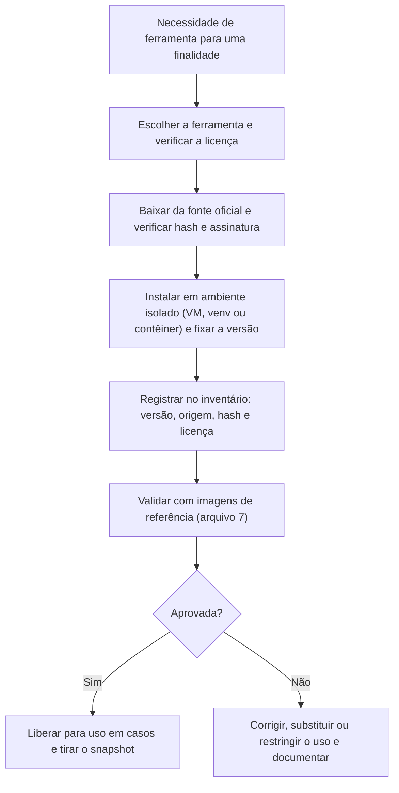

# Distribuições, Instalação e Inventário de Ferramentas

> **Objetivo pedagógico:** escolher distribuições e ferramentas por finalidade, instalá-las de forma verificável (hashes, assinaturas e versões fixadas), registrar um inventário reproduzível (versões, origem e licença), configurar ambientes isolados de Python e de contêineres, e reconhecer as limitações de licenciamento das ferramentas.

> Nomes de pacotes, versões e opções mudam. Confirme a documentação oficial de cada ferramenta e registre as versões instaladas.

## 1. Distribuições e ambientes prontos

| Ambiente | Uso | Observações |
|---|---|---|
| SIFT Workstation | Estação de análise forense (disco, memória, linha do tempo e logs), baseada em Ubuntu | Mantida pela comunidade; instalação por pacote de provisionamento ou máquina virtual pronta |
| REMnux | Análise de arquivos suspeitos e de malware (ambiente Linux dedicado) | Usar em rede isolada; consulte a documentação para instalação como máquina virtual ou contêiner |
| Tsurugi Linux | Distribuição voltada a DFIR e OSINT | Opção alternativa de estação |
| CAINE | Ambiente forense com interface gráfica | Opção alternativa |
| Windows com ferramentas de Eric Zimmerman e Autopsy | Artefatos do Windows | Muitas ferramentas são exclusivas do Windows |
| Contêineres (Docker ou Podman) | Ferramentas específicas (por exemplo, Plaso e Timesketch) | Fixar a versão por *digest* |
| Máquinas virtuais de teste (Windows e Linux) | Alvos de práticas com snapshots | Licenças e ativação conforme o fornecedor |

## 2. Ferramentas por finalidade

| Finalidade | Ferramentas | Observações |
|---|---|---|
| Aquisição e imagens | libewf (`ewfacquire`, `ewfverify`, `ewfinfo`), `dd`, `dc3dd`, FTK Imager (Windows) | Bloqueador de escrita para mídias físicas |
| Sistema de arquivos e recuperação | The Sleuth Kit (`fls`, `icat`, `istat`, `mmls`, `tsk_recover`, `mactime`), Autopsy, `bulk_extractor` | Autopsy é a interface gráfica sobre o TSK |
| Linha do tempo | Plaso (`log2timeline.py`, `psort.py`), Timesketch | Plaso em contêiner facilita a fixação de versão |
| Memória | Volatility 3, AVML, LiME, WinPmem | Símbolos: o Volatility 3 usa tabelas de símbolos (ISF) |
| Artefatos do Windows | Ferramentas de Eric Zimmerman (EvtxECmd, MFTECmd, PECmd, AmcacheParser, RECmd e outras), RegRipper, KAPE | O KAPE exige atenção ao licenciamento em uso comercial |
| Logs do Windows e Sigma | Hayabusa, Chainsaw, `sigma-cli` | Regras Sigma para detecção em logs |
| Coleta e caça em escala | Velociraptor | Servidor e agentes; usar em laboratório antes de produção |
| Rede | Wireshark e `tshark`, Zeek, Suricata, NetworkMiner, `tcpdump` | Capturas somente de redes de sua propriedade ou autorizadas |
| Arquivos suspeitos (análise estática) | `file`, `strings`, YARA, ExifTool, Detect It Easy, FLOSS, capa, Ghidra | Análise dinâmica apenas em rede isolada |
| E-mail | `munpack`, ferramentas de cabeçalho, ExifTool, scripts em Python | Pasta 12 |
| Mobile | MVT (Mobile Verification Toolkit), ALEAPP e iLEAPP, bibliotecas SQLite | Pasta 14 |
| Mídia | ExifTool, FFmpeg, MediaInfo, ImageMagick, SoX, `c2patool`, `imagehash` | Pastas 21 e 27 |
| Dados e consultas | DuckDB, `jq`, Python (pandas), `sqlite3` | Análise de logs e de exportações |
| Nuvem | AWS CLI, Azure CLI, Google Cloud CLI, PowerShell (módulos do Microsoft Graph e do Exchange Online) | Contas de laboratório |
| IA e ML | Python, MLflow, DVC, `safetensors`, Ollama (modelos locais), promptfoo e garak (testes autorizados) | Pastas 24 a 26 |
| Documentação e relatórios | Git, Pandoc, Markdown e Mermaid | Pasta 22 |

## 3. Instalação verificável

| Boa prática | Descrição |
|---|---|
| Fonte oficial | Baixe do site ou do repositório oficial do projeto, preferencialmente de versões marcadas (releases) |
| Verificar integridade | Compare o hash (SHA-256) publicado e, quando existir, verifique a assinatura (GPG ou outra) |
| Fixar versões | Registre e fixe a versão usada em cada caso; evite atualizações automáticas durante um caso |
| Ambiente isolado | Use ambientes virtuais de Python e contêineres para evitar conflitos |
| Mínimo necessário | Instale apenas o necessário a cada VM |
| Registrar a origem e a licença | Inventário (seção 6) |
| Cópia dos instaladores | Guarde instaladores verificados em `ferramentas/instaladores-verificados` |

```bash
# Verificação de um instalador baixado (exemplo genérico)
sha256sum ferramenta-1.2.3-linux-x64.tar.gz
# Compare o resultado com o hash publicado pelo projeto, em fonte independente do download, quando possível
gpg --verify ferramenta-1.2.3-linux-x64.tar.gz.asc ferramenta-1.2.3-linux-x64.tar.gz
```

## 4. Instalação básica em Ubuntu (estação de análise)

```bash
# Pacotes de sistema (nomes podem variar conforme a versão do Ubuntu)
sudo apt update
sudo apt install -y sleuthkit ewf-tools bulk-extractor yara libimage-exiftool-perl ffmpeg jq tshark sox imagemagick sqlite3 git curl unzip

# Ambiente virtual de Python para as ferramentas de análise
python3 -m venv ~/venvs/forense
source ~/venvs/forense/bin/activate
pip install --upgrade pip
pip install volatility3 yara-python duckdb pandas imagehash pillow numpy

# Verificar as instalações e registrar as versões
fls -V; ewfacquire -V; yara --version; vol --help | head -n 3; python -c "import duckdb; print(duckdb.__version__)"
```

```bash
# Plaso: opção em contêiner, com versão fixada por tag (ajuste a tag e confirme o nome da imagem na documentação oficial)
docker pull log2timeline/plaso:latest
docker image inspect --format '{{index .RepoDigests 0}}' log2timeline/plaso:latest
# Execução (monte as pastas do caso; substitua os caminhos)
docker run --rm -v /lab/casos/DFL-LAB-001:/dados log2timeline/plaso log2timeline.py --storage-file /dados/03-saidas-de-analise/lab.plaso /dados/01-evidencias-originais/evidencia.E01
```

```bash
# Ferramentas de linha de comando adicionais (confirme os comandos e as versões nas documentações oficiais)
pip install mvt              # Mobile Verification Toolkit
pip install sigma-cli        # conversão de regras Sigma
# c2patool, Hayabusa e Chainsaw: baixe os binários das páginas oficiais de releases dos projetos e verifique os hashes
```

## 5. Ferramentas do Windows (VM de análise)

| Ferramenta | Instalação e uso inicial |
|---|---|
| Ferramentas de Eric Zimmerman | Baixe o pacote oficial dos autores, verifique e descompacte em `C:\ferramentas`; requer o ambiente .NET compatível (leia a página de cada ferramenta) |
| Autopsy | Instalador oficial do projeto (requer Java embutido no instalador atual); crie casos em pastas do laboratório |
| FTK Imager | Software gratuito de aquisição, do fornecedor original; verifique a licença de uso |
| KAPE | Distribuição do autor, com registro; confirme os termos de licença para o seu uso |
| Sysinternals | Pacote oficial da Microsoft (Autoruns, Process Explorer, Sysmon e outros) |
| Velociraptor | Binário oficial; use em laboratório para treinar coletas |

Registre versões e hashes e mantenha os binários em uma pasta somente leitura.

## 6. Inventário de ferramentas (modelo)

| ID | Ferramenta | Versão | Origem (URL oficial) | Data do download | Hash do arquivo | Licença e restrições | Finalidade | VM ou estação | Validada? (arquivo 7) |
|---|---|---|---|---|---|---|---|---|---|
| T-001 | The Sleuth Kit | | | | | | Sistema de arquivos | VM de análise | |
| T-002 | libewf | | | | | | Imagens E01 | VM de análise | |
| T-003 | Plaso | | | | | | Linha do tempo | Contêiner | |
| T-004 | Volatility 3 | | | | | | Memória | VM de análise | |
| T-005 | Zeek | | | | | | Rede | VM de análise | |

```bash
# Gerar um relatório das versões instaladas (para anexar ao caso)
{
  echo "Data (UTC): $(date -u +%FT%TZ)"
  echo "Sistema: $(uname -a)"
  echo "--- Pacotes forenses (dpkg) ---"
  dpkg -l | grep -E "sleuthkit|ewf-tools|yara|tshark|bulk-extractor|ffmpeg" | awk '{print $2, $3}'
  echo "--- Python (pip) ---"
  pip freeze
} > inventario_versoes_$(date -u +%Y%m%d).txt
sha256sum inventario_versoes_*.txt
```

## 7. Licenciamento e uso responsável

| Tema | Orientação |
|---|---|
| Ferramentas gratuitas | Podem ter restrições de uso comercial, de redistribuição ou de uso em perícias; leia a licença |
| Ferramentas comerciais (por exemplo, suítes de análise de dispositivos móveis, de autenticação de imagem e de computação forense) | Exigem licença; mantenha registros e treinamento |
| Código aberto | Verifique a licença (GPL, Apache, MIT) e as obrigações |
| Amostras e conjuntos de dados | Respeite licenças e termos de uso |
| Uso autorizado | Utilize ferramentas ofensivas ou de coleta apenas em ambientes e dados sob sua autorização |
| Segurança da cadeia de suprimentos | Ferramentas baixadas de fontes não oficiais podem estar adulteradas; verifique hashes e assinaturas |

## 8. Fluxo de instalação e registro



## 9. Exemplo prático: configurar a estação básica

| Passo | Resultado |
|---|---|
| 1 | VM Ubuntu com os pacotes e o ambiente virtual da seção 4 |
| 2 | Versões registradas no inventário e arquivo `inventario_versoes_AAAAMMDD.txt` com hash |
| 3 | Snapshot "base-limpa" da VM |
| 4 | Teste rápido: `ewfacquire`, `fls` e `vol --help` executam sem erros |
| 5 | Repositório Git de scripts criado e primeiro commit |

## 10. Casos de uso corporativos

- Padronização do ambiente de análise do SOC e do DFIR, com versões e origens registradas.
- Auditoria de ferramentas e de licenças do laboratório.
- Reprodução de análises por outros analistas, a partir do inventário.

## 11. Normas e frameworks relevantes

- ISO/IEC 27041 e 27042 (adequação e análise de métodos); NIST CFTT; SWGDE (validação de ferramentas)
- NIST SP 800-161 Rev. 1 (cadeia de suprimentos); CIS Controls v8.1, controles 2 e 7
- ABNT NBR ISO/IEC 17025 (equipamentos e métodos)

## 12. Referências

- Documentação oficial do SIFT Workstation, do REMnux, do Sleuth Kit, do libewf, do Plaso, do Volatility 3, do Zeek, do Suricata, do Wireshark, do YARA, do DuckDB e do MVT.
- Páginas oficiais de Eric Zimmerman, do Autopsy, do Velociraptor, do Hayabusa, do Chainsaw e do c2patool.
- Pastas 03, 09, 11, 13, 14, 15, 21 e 24 deste repositório.
