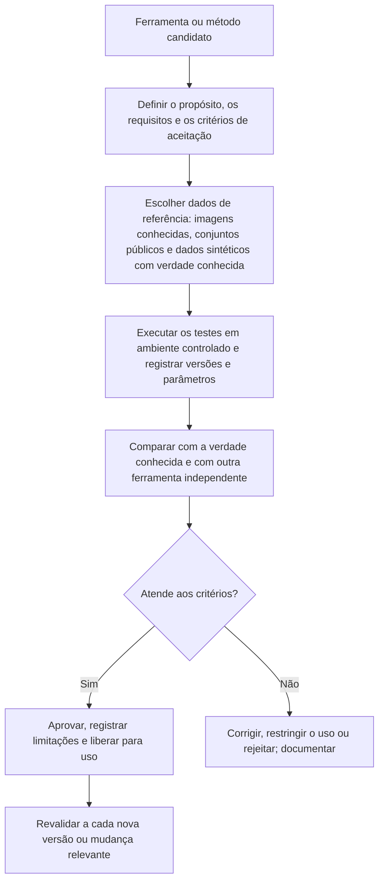

# Validação de Ferramentas, Documentação e Reprodutibilidade

> **Objetivo pedagógico:** validar ferramentas e métodos forenses antes do uso em casos (plano de validação, conjuntos de referência, critérios de aceitação e registro), documentar o trabalho de forma que outro analista possa reproduzi-lo (registro de comandos, versões, ambiente e hashes), usar a verificação cruzada entre ferramentas, gerir mudanças de versão e entender o papel das normas e dos programas de teste na defensabilidade das conclusões.

## 1. Por que validar

Ferramentas forenses interpretam estruturas complexas e **podem errar**: perder arquivos, interpretar horários de forma incorreta, falhar em novos formatos ou mudar de comportamento entre versões. Em juízo e em auditorias, é necessário demonstrar que o método é **adequado ao propósito** e que o analista conhece suas limitações.

| Risco | Exemplo |
|---|---|
| Erro de interpretação | Fuso horário aplicado de forma incorreta |
| Cobertura incompleta | Ferramenta não reconhece uma versão nova de um artefato |
| Alteração da evidência | Aquisição sem proteção contra escrita |
| Regressão em atualização | Nova versão altera o formato de saída ou o resultado |
| Dependência de uma única ferramenta | Falha não detectada |

## 2. Referenciais

| Referencial | Contribuição |
|---|---|
| NIST CFTT (Computer Forensics Tool Testing) | Metodologia, especificações e relatórios de teste de ferramentas (aquisição de disco, bloqueadores de escrita, recuperação de arquivos, ferramentas de dispositivos móveis e outras) |
| ISO/IEC 27041 | Orientações para assegurar a adequação e a adequabilidade dos métodos de investigação de incidentes |
| ISO/IEC 27042 | Análise e interpretação de evidências digitais |
| ISO/IEC 27043 | Princípios e processos de investigação |
| ABNT NBR ISO/IEC 17025 | Requisitos de competência de laboratórios, incluindo validação de métodos e rastreabilidade |
| SWGDE | Documentos sobre validação de ferramentas, controle de qualidade e boas práticas |
| ISO 21043 | Ciências forenses: interpretação e relato |

## 3. Plano de validação



| Etapa | Descrição |
|---|---|
| Propósito | O que a ferramenta deve fazer (por exemplo, listar e recuperar arquivos excluídos em FAT32 e NTFS) |
| Requisitos | Critérios mensuráveis (por exemplo, recuperar 100% dos arquivos do conjunto de referência) |
| Dados de referência | Imagens com conteúdo conhecido (criadas por você, ou conjuntos públicos como os do NIST CFReDS e do Digital Corpora) e resultados esperados |
| Casos de teste | Cenários normais, limites e falhas (arquivos corrompidos, fusos, nomes especiais) |
| Execução | Procedimento documentado, com versões e parâmetros |
| Avaliação | Comparação com a verdade conhecida; taxa de acertos e de erros |
| Verificação cruzada | Comparar os resultados com os de outra ferramenta independente |
| Decisão | Aprovar, aprovar com restrições ou reprovar |
| Revalidação | A cada atualização, mudança de configuração ou de ambiente |

## 4. Exemplo de teste: recuperação de arquivos excluídos

| Item | Descrição |
|---|---|
| Dados de referência | A imagem `disco_teste.img` da prática 1 (arquivo 3), com 4 arquivos criados e 2 excluídos, e o gabarito de nomes e conteúdos |
| Teste 1 | Listagem com `fls -d` encontra 2 entradas excluídas |
| Teste 2 | `icat` e `tsk_recover` recuperam o conteúdo com hash idêntico ao do original |
| Verificação cruzada | Repetir com o Autopsy e com o Plaso e comparar os resultados |
| Critério | 100% dos arquivos do gabarito recuperados e hashes idênticos |
| Limitações registradas | Comportamento em ext4 e em SSDs com TRIM; nomes com caracteres especiais |

```bash
# Verificação automática dos resultados contra o gabarito (hashes esperados em gabarito.sha256)
sha256sum -c gabarito.sha256 --quiet && echo "OK: todos os arquivos recuperados conferem" || echo "FALHA: divergência entre os arquivos recuperados e o gabarito"
```

## 5. Validação de bloqueadores de escrita e de aquisição

| Verificação | Descrição |
|---|---|
| Bloqueador de escrita por hardware | Testar com mídia de teste: tentar gravar e verificar que a mídia permanece inalterada (hash antes e depois); consultar relatórios do NIST CFTT sobre o modelo |
| Bloqueio por software | Verificar a configuração (por exemplo, montagem somente leitura) e testar com mídia de teste |
| Ferramenta de aquisição | Comparar o hash da imagem com o da fonte; testar com mídia que contenha setores defeituosos simulados, quando possível |
| Frequência | Antes do primeiro uso, periodicamente e após atualizações de firmware |

## 6. Registro de validação de ferramenta (modelo)

| Campo | Preenchimento |
|---|---|
| ID da validação | |
| Ferramenta, versão e origem | |
| Propósito e requisitos | |
| Ambiente de teste (sistema, VM e configuração) | |
| Dados de referência (origem, hash e gabarito) | |
| Procedimento de teste | |
| Resultados e comparação com o gabarito | |
| Verificação cruzada (ferramenta alternativa e resultados) | |
| Limitações e restrições de uso | |
| Decisão (aprovada, com restrições ou reprovada) | |
| Responsável, revisor e data (UTC) | |
| Próxima revalidação | |

## 7. Documentação e reprodutibilidade das análises

| Elemento | Prática |
|---|---|
| Registro de comandos | Gravar sessões (`script -a -t`) e salvar históricos com horário |
| Versões e ambiente | Inventário de versões (arquivo 2), imagem da VM ou *digest* do contêiner, e `pip freeze` |
| Dados de entrada | Hashes de todas as entradas |
| Parâmetros | Opções das ferramentas, filtros e consultas, versionadas em Git |
| Resultados | Arquivos de saída com hashes e metadados |
| Scripts e consultas | Em repositório Git, com mensagens de commit descritivas |
| Notas do analista | Observações, hipóteses e decisões, com data e hora (UTC) |
| Revisão por pares | Outro analista repete uma amostra da análise e compara |
| Contêineres | Para análises repetíveis, usar imagens com versão fixada |

```bash
# Registro do ambiente da análise (anexar ao caso)
CASO=DFL-LAB-001
{
  echo "Caso: $CASO"; echo "Data (UTC): $(date -u +%FT%TZ)"; echo "Analista: $(whoami)"
  echo "--- Sistema ---"; uname -a; lsb_release -a 2>/dev/null
  echo "--- Versões ---"
  fls -V 2>&1 | head -n 1; ewfacquire -V 2>&1 | head -n 1; yara --version
  echo "--- Python ---"; python3 --version; pip freeze
  echo "--- Contêineres (digests) ---"
  docker image inspect --format '{{index .RepoDigests 0}}' log2timeline/plaso 2>/dev/null
} > /lab/casos/$CASO/05-custodia-e-registros/ambiente_$(date -u +%Y%m%d).txt
sha256sum /lab/casos/$CASO/05-custodia-e-registros/ambiente_*.txt
```

```bash
# Reprodução: refazer uma etapa a partir dos registros e comparar as saídas por hash
sha256sum saidas_originais/linha_plaso.csv saidas_reproducao/linha_plaso.csv
diff <(sort saidas_originais/linha_plaso.csv) <(sort saidas_reproducao/linha_plaso.csv) | head
```

Nota: algumas ferramentas produzem saídas que variam em detalhes (por exemplo, a ordem ou os identificadores internos). Defina previamente o que significa "reproduzir": igualdade de conteúdo relevante, e não necessariamente de bytes.

## 8. Gestão de mudanças e de versões

| Prática | Descrição |
|---|---|
| Versão congelada por caso | Não atualizar ferramentas durante um caso, salvo por decisão documentada |
| Monitorar notas de versão | Alterações que afetem a interpretação dos artefatos |
| Revalidação | Após atualização relevante, repetir os testes principais |
| Controle de alterações | Registro de quem alterou o quê e por quê |
| Ambiente de testes | Atualizações testadas em uma VM antes da produção |
| Descontinuação | Ferramentas sem manutenção devem ter plano de substituição |

## 9. Limites e declaração de incerteza

| Situação | Declaração recomendada |
|---|---|
| A ferramenta não foi validada para o tipo de dado | "A ferramenta X não foi validada para Y; os resultados foram corroborados por Z" |
| Resultados divergem entre ferramentas | Registrar a divergência, investigar a causa e declarar a conclusão com a confiança correspondente |
| Versão nova de artefato desconhecida | Declarar a limitação e buscar análise manual ou outra ferramenta |
| Taxa de erro desconhecida | Declarar e, se possível, estimar com amostras de referência |

## 10. Exercícios

1. Escreva um plano de validação para a recuperação de arquivos em FAT32 e execute-o com a imagem da prática 1; preencha o registro de validação.
2. Compare a listagem de arquivos excluídos do Sleuth Kit, do Autopsy e do Plaso e documente as divergências.
3. Altere 1 byte de uma cópia da imagem e demonstre que o hash e o `ewfverify` detectam a alteração.
4. Gere o registro do ambiente de uma análise e peça a um colega para reproduzir uma etapa; compare as saídas.
5. Simule uma atualização de versão de uma ferramenta em uma VM e repita os testes principais (revalidação).

## 11. Casos de uso corporativos

- Programa de validação de ferramentas do laboratório forense e do DFIR.
- Preparação para auditorias e para acreditação (ABNT NBR ISO/IEC 17025).
- Redução do risco de contestação de laudos por falhas de método.

## 12. Normas e frameworks relevantes

- ISO/IEC 27041, 27042 e 27043; ISO 21043; ABNT NBR ISO/IEC 17025
- NIST CFTT; SWGDE (validação de ferramentas e controle de qualidade); NIST SP 800-86
- CPP, arts. 158-A a 158-F; CPC, art. 479 (valoração do laudo pericial)

## 13. Referências

- NIST. Computer Forensics Tool Testing Program: especificações e relatórios.
- SWGDE. Documentos sobre validação e controle de qualidade de ferramentas.
- ISO/IEC 27041:2015 e ISO/IEC 27042:2015.
- Pastas 02, 04, 22 e 23 deste repositório; arquivos 2, 3 e 8 desta pasta.
