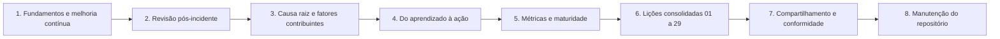

# 30 Lições Aprendidas

## Objetivo

Transformar a experiência em melhoria: conduzir revisões pós-incidente sem culpabilização, analisar causas e fatores contribuintes, converter lições em ações priorizadas e verificadas, medir o desempenho e a maturidade da capacidade forense, consolidar as lições das pastas 01 a 29, compartilhar o aprendizado de forma segura e usá-lo como evidência de conformidade, e manter o próprio repositório como um produto de conhecimento vivo, revisado e governado.

## Trilha de estudo recomendada

## Conteúdo da pasta

| Ordem | Arquivo | Objetivo |
|---|---|---|
| 1 | [fundamentos-de-licoes-aprendidas-e-melhoria-continua.md](fundamentos-de-licoes-aprendidas-e-melhoria-continua.md) | Conceitos, ciclo, cultura justa, normas e cuidados jurídicos |
| 2 | [revisao-pos-incidente-metodo-e-facilitacao.md](revisao-pos-incidente-metodo-e-facilitacao.md) | Formatos, preparação, regras, roteiro, relatório e modelos |
| 3 | [analise-de-causa-raiz-e-fatores-contribuintes.md](analise-de-causa-raiz-e-fatores-contribuintes.md) | Cinco porquês, Ishikawa, árvore de falhas, barreiras, queijo suíço e lacunas ATT&CK |
| 4 | [do-aprendizado-a-acao-plano-de-melhoria-e-verificacao.md](do-aprendizado-a-acao-plano-de-melhoria-e-verificacao.md) | Tipos de ação, priorização, SMART, verificação e integração |
| 5 | [metricas-indicadores-e-maturidade-da-capacidade-forense.md](metricas-indicadores-e-maturidade-da-capacidade-forense.md) | Indicadores, cálculo, armadilhas e modelo de maturidade |
| 6 | [licoes-consolidadas-das-pastas-01-a-29.md](licoes-consolidadas-das-pastas-01-a-29.md) | 25 princípios, lições por tema, 20 erros e mapa de consulta rápida |
| 7 | [compartilhamento-de-licoes-comunicacao-e-conformidade.md](compartilhamento-de-licoes-comunicacao-e-conformidade.md) | TLP, anonimização, comunidade, direção e conformidade |
| 8 | [manutencao-evolucao-e-governanca-do-repositorio.md](manutencao-evolucao-e-governanca-do-repositorio.md) | Calendário, vigilância, versões, qualidade, políticas e portfólio |

## Princípios

- Uma lição só existe quando vira ação verificada e institucionalizada
- Revisões justas e sem culpabilização: foco em sistemas, decisões e condições
- Julgar decisões pela informação disponível na hora, controlando os vieses retrospectivo e de resultado
- Fatores contribuintes e causas sistêmicas, em vez de uma única causa raiz
- Ações específicas, com responsável, prazo e verificação de eficácia
- Medir com poucos indicadores bem definidos, combinando velocidade e qualidade
- Compartilhar com anonimização, protocolo de sensibilidade e revisão jurídica
- Manter o conhecimento vivo: revisão periódica, controle de versões e transparência sobre limitações

## Relação com outras pastas

- 01 a 29: fonte das lições consolidadas e dos princípios
- 16 e 28: incidentes e casos que alimentam as revisões
- 20: engenharia de detecção a partir das lacunas
- 22: relatórios e comunicação
- 23: atualização de playbooks e testes
- 24 a 27: lições específicas de IA, prompts, LLM e deepfakes
- 29: laboratório para verificar as ações e reproduzir cenários

## Referências

- NIST SP 800-61 Rev. 3 (2025); NIST CSF 2.0 (ID.IM); NIST SP 800-84; NIST SP 800-55; NIST SP 800-150
- ISO/IEC 27035-1; ISO/IEC 27001:2022 (cláusulas 9 e 10); ISO/IEC 27002:2022 (5.24 a 5.28); ISO/IEC 27004
- FIRST. CSIRT Services Framework; Traffic Light Protocol 2.0
- Dekker, S. Just Culture (2012); Reason, J. Human Error (1990); Leveson, N. Engineering a Safer World (2011)
- Beyer, B. et al. Site Reliability Engineering, "Postmortem Culture" (2016)
- MITRE ATT&CK e ATLAS
- Brasil. LGPD (Lei nº 13.709/2018), arts. 6º, 46, 48 e 50
