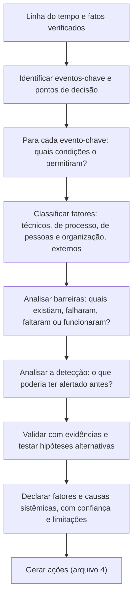
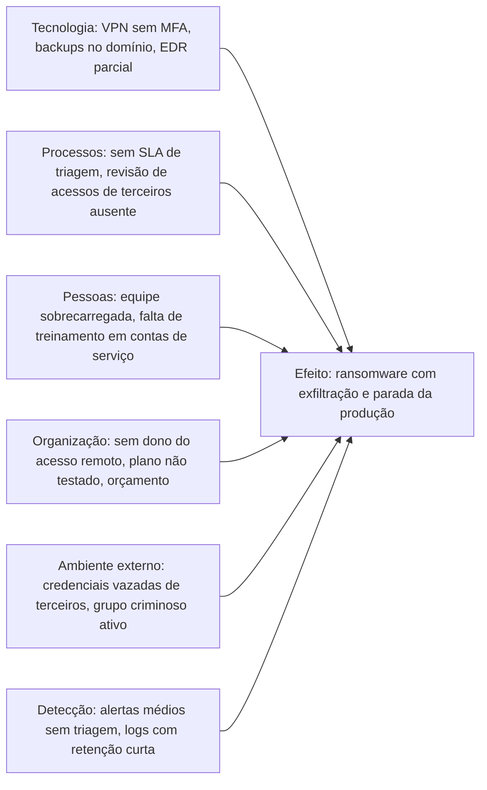

# Análise de Causa Raiz e Fatores Contribuintes

> **Objetivo pedagógico:** aplicar métodos de análise de causas e de fatores contribuintes a incidentes e investigações (os cinco porquês, o diagrama de causa e efeito, a árvore de falhas, a análise de barreiras, o modelo do queijo suíço e a análise baseada em linha do tempo), conhecer as limitações de cada método, evitar a falácia da causa única, analisar as lacunas de detecção com apoio do ATT&CK e escrever conclusões baseadas em evidências.

## 1. Causa raiz ou fatores contribuintes?

Incidentes de segurança raramente têm uma causa única. Em geral, resultam de **combinações de condições** (técnicas, de processo e organizacionais) que, juntas, permitiram o evento. Por isso, muitas organizações preferem falar em **fatores contribuintes** e em **causas sistêmicas**, em vez de uma única "causa raiz".

| Conceito | Descrição |
|---|---|
| Causa imediata | O que diretamente permitiu o evento (por exemplo, credencial sem MFA) |
| Causas subjacentes (fatores contribuintes) | Condições que tornaram a causa imediata possível ou grave (por exemplo, perfil legado ignorado nas revisões de acesso, ausência de inventário de acessos de terceiros) |
| Causa sistêmica ou organizacional | Origem em decisões, prioridades, cultura ou arquitetura (por exemplo, ausência de dono para o acesso remoto de terceiros) |
| Fator de agravamento | O que ampliou o impacto (por exemplo, backups no mesmo domínio) |
| Falha de detecção | O que impediu a identificação antes (por exemplo, alerta médio não triado) |
| Barreira que funcionou | O que limitou o dano (por exemplo, fitas offline) |

## 2. Fluxo geral

## 3. Métodos

### 3.1 Cinco porquês

| Aspecto | Descrição |
|---|---|
| Como funciona | Perguntar "por quê?" repetidamente, a partir do problema, até chegar a uma causa acionável |
| Vantagens | Simples, rápido, estimula o aprofundamento |
| Limitações | Tende a uma cadeia única e linear; depende do conhecimento de quem pergunta; pode parar em causas superficiais ou culpar pessoas |
| Boa prática | Ramificar (mais de uma resposta por "porquê"), exigir evidência em cada passo e parar em causas de sistema, e não de pessoas |

Exemplo (caso 1, ransomware): O ransomware foi implantado por GPO. **Por quê?** O atacante tinha privilégio de domínio. **Por quê?** Credenciais administrativas foram obtidas em um servidor de salto. **Por quê?** O servidor armazenava credenciais em memória e não havia proteção contra extração. **Por quê?** Contas administrativas eram usadas em servidores sem estação de acesso privilegiado nem camadas de administração. **Por quê?** O modelo de administração por camadas não estava definido nem priorizado. (Ramo paralelo: o alerta do EDR de severidade média não foi tratado porque não havia SLA de triagem.)

### 3.2 Diagrama de causa e efeito (Ishikawa)

Organiza os fatores por categorias em torno de um problema.

### 3.3 Árvore de falhas

Parte do evento indesejado e decompõe as condições necessárias, com portas "E" e "OU".

| Elemento | Exemplo (exfiltração de 1,8 TB) |
|---|---|
| Evento de topo | Exfiltração não detectada de 1,8 TB |
| Condições (E) | Acesso a servidores de arquivos **E** capacidade de saída à internet **E** ausência de alerta de volume |
| Subcondições (OU) para o acesso | Credencial administrativa comprometida **OU** conta de serviço com acesso amplo |
| Barreiras ausentes | Restrição de saída de servidores, monitoramento de volume, segmentação |

### 3.4 Análise de barreiras

| Pergunta | Registro |
|---|---|
| Que barreiras existiam (preventivas, detectivas e corretivas)? | Lista |
| Funcionaram? | Sim, parcialmente ou não |
| Por que falharam? | Configuração, cobertura, manutenção, contorno |
| Que barreiras faltavam? | Controles que teriam interrompido a cadeia de ataque |
| O que funcionou? | Fitas offline, canal fora de banda |

### 3.5 Modelo do queijo suíço (James Reason)

As defesas são camadas com "furos" (fraquezas). O incidente ocorre quando os furos de várias camadas se alinham. A análise identifica os furos de cada camada (técnica, de processo, de pessoas e de organização) e **como se alinharam**, o que leva a melhorias em várias camadas, e não apenas na última.

### 3.6 Análise baseada em linha do tempo e em decisões

| Passo | Descrição |
|---|---|
| 1 | Reconstruir a linha do tempo com fatos e fontes |
| 2 | Marcar os pontos em que o incidente poderia ter sido evitado, detectado ou contido |
| 3 | Para cada ponto, perguntar o que impediu: informação, ferramenta, autoridade, processo, capacidade ou prioridade |
| 4 | Registrar as condições de trabalho (carga, turno e pressão) |

### 3.7 Abordagens sistêmicas (visão geral)

Métodos como o STAMP e a análise CAST (Nancy Leveson) tratam a segurança como um problema de **controle de sistemas**, analisando estruturas de controle, fluxos de informação e modelos mentais dos decisores. São mais trabalhosos, mas úteis em incidentes complexos e organizacionais.

## 4. Taxonomia de fatores contribuintes

| Categoria | Exemplos |
|---|---|
| Técnicos | Configuração insegura, ausência de MFA, patches, segmentação, backups acessíveis, logs não habilitados, cobertura de EDR |
| Processo | Ausência de playbook ou de teste, revisão de acessos, gestão de terceiros, gestão de mudanças, SLA de triagem |
| Pessoas | Competências, treinamento, carga de trabalho, fadiga, turnos, rotatividade |
| Organização | Prioridades e orçamento, donos e responsabilidades, cultura de segurança, decisões de aceitação de risco |
| Informação e comunicação | Canais, contatos desatualizados, falta de visibilidade, silos |
| Terceiros e cadeia de suprimentos | Acessos de fornecedores, atualizações de software, contratos |
| Externos | Campanhas de ameaça, vazamentos de credenciais, mudanças regulatórias |
| Detecção e resposta | Alertas não triados, lacunas de telemetria, dependência de uma pessoa |

## 5. Análise das lacunas de detecção com o ATT&CK

Para cada técnica observada no incidente, avalie se havia **telemetria**, **detecção** e **resposta**:

| Técnica (ATT&CK) | Telemetria disponível? | Detecção existente? | Resposta definida? | Lacuna | Ação |
|---|---|---|---|---|---|
| T1133 Serviços remotos externos (VPN) | Sim (logs de VPN) | Não | Não | Acesso por perfil legado, fora do padrão, sem alerta | Alerta de origem e de horário; MFA obrigatório |
| T1558.003 Kerberoasting | Sim (4769) | Não | Não | Sem regra para criptografia fraca em massa | Regra de detecção e proteção de contas de serviço |
| T1003.006 DCSync | Parcial (4662 sem auditoria completa) | Não | Não | Auditoria de replicação não habilitada em todos os controladores | Habilitar auditoria e regra |
| T1567.002 Exfiltração para armazenamento em nuvem | Sim (firewall) | Não | Não | Sem alerta de volume | Alerta de volume e restrição de saída |
| T1490 Inibição da recuperação | Sim (logs do servidor de backup) | Não | Não | Sem alerta para exclusão de repositórios | Alerta e backups imutáveis |

Essa matriz converte a análise em **requisitos de detecção** específicos (pasta 20, caça a ameaças).

## 6. Erros comuns na análise de causas

| Erro | Consequência | Prevenção |
|---|---|---|
| Parar na causa imediata ou em "erro humano" | Ações superficiais; recorrência | Perguntar que condições tornaram o erro possível |
| Buscar uma única causa raiz | Ignorar fatores combinados | Usar fatores contribuintes e múltiplas camadas |
| Culpar pessoas | Cultura de medo | Linguagem de sistemas e cultura justa |
| Basear-se em suposições, e não em evidências | Conclusões frágeis | Exigir evidência e declarar a confiança |
| Ignorar o que funcionou | Perda de práticas valiosas | Registrar as barreiras eficazes |
| Não considerar hipóteses alternativas | Viés de confirmação | Matriz de hipóteses |
| Ações que tratam apenas o sintoma | Incidentes recorrentes | Ligar cada ação a um fator contribuinte |
| Esquecer as lacunas de detecção | Mesmo ataque, mesma cegueira | Matriz ATT&CK de telemetria e detecção |

## 7. Escrita das conclusões

| Elemento | Exemplo |
|---|---|
| Fato | "A conta `svc-manut` autenticou-se na VPN sem MFA, a partir de IP de hospedagem comercial, em 02/09 às 03:12 UTC (E001)." |
| Fator contribuinte | "O perfil legado não exigia MFA e não era coberto pela revisão trimestral de acessos de terceiros." |
| Causa sistêmica | "Não havia dono nomeado para o ciclo de vida de acessos de fornecedores." |
| Confiança | "Alta; corroborada por logs de VPN e pelo fornecedor." |
| Limitação | "Logs anteriores a 30 dias indisponíveis; não é possível excluir acesso anterior." |
| Ação ligada | "Ação A-03: MFA obrigatório e revisão mensal de acessos de terceiros, com dono definido." |

## 8. Exemplo prático: fatores contribuintes do caso 4 (credencial de nuvem)

| Camada | Furos identificados |
|---|---|
| Prevenção | Chave de longa duração com política de administrador; sem varredura de segredos antes do commit |
| Contenção do dano | Sem restrição de regiões e de tipos de instância; sem limites de serviço |
| Detecção | Alertas de custo com limite alto; detecção de ameaças em apenas uma das três contas |
| Registro | Eventos de dados do armazenamento desabilitados |
| Resposta | Plano existente, porém sem exercício recente de credenciais expostas |
| O que funcionou | Trilha de gerenciamento, aviso do provedor, preservação antes da contenção |

## 9. Casos de uso corporativos

- Análises de causa em revisões pós-incidente com maior profundidade e rastreabilidade.
- Matrizes de lacunas de detecção como entrada para a engenharia de detecção.
- Preparação de respostas a auditores e a reguladores sobre as causas e as medidas.

## 10. Normas e frameworks relevantes

- NIST SP 800-61 Rev. 3; ISO/IEC 27035-1 e 27035-2; ISO/IEC 27002:2022 (5.27)
- MITRE ATT&CK (mapeamento de técnicas e de lacunas); CIS Controls v8.1
- ISO 31000 e ISO/IEC 27005 (gestão de riscos, para integrar as causas ao registro de riscos)

## 11. Referências

- Reason, J. Human Error. Cambridge University Press, 1990; Managing the Risks of Organizational Accidents. Ashgate, 1997.
- Leveson, N. Engineering a Safer World: Systems Thinking Applied to Safety. MIT Press, 2011.
- Dekker, S. The Field Guide to Understanding "Human Error". CRC Press, 2014.
- MITRE. ATT&CK. https://attack.mitre.org
- Pastas 20, 22 e 28 deste repositório.
