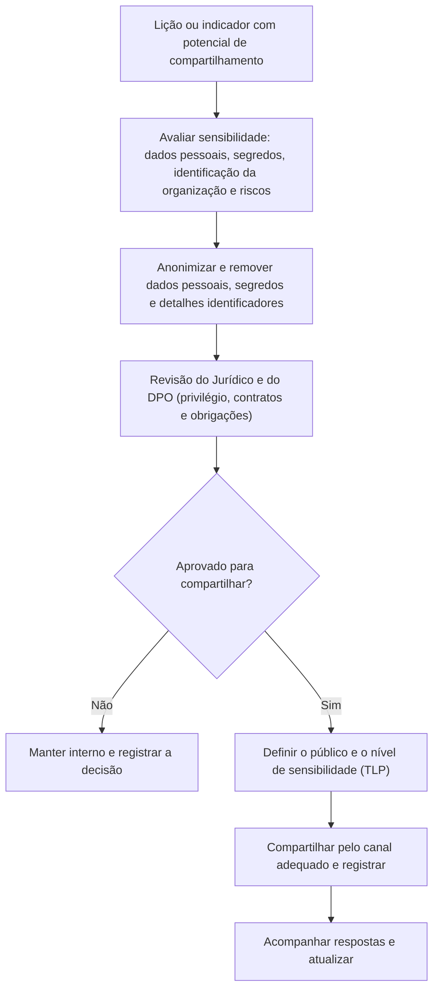

# Compartilhamento de Lições, Comunicação e Conformidade

> **Objetivo pedagógico:** compartilhar as lições aprendidas de forma útil e segura (interna e externamente), com anonimização, controle de sensibilidade (Traffic Light Protocol) e cuidado jurídico; comunicar o aprendizado à direção, ao conselho e a auditores; usar o aprendizado como evidência de conformidade (ISO/IEC 27001 e 27002, NIST e LGPD); e contribuir com a comunidade (equipes de resposta, centros de compartilhamento, bases de incidentes e regras de detecção abertas).

## 1. Por que compartilhar

| Benefício | Descrição |
|---|---|
| Multiplicar o aprendizado | Outras equipes evitam os mesmos erros |
| Fortalecer a defesa coletiva | Indicadores e técnicas compartilhados melhoram a detecção de todos |
| Reforçar a cultura | Transparência valoriza o aprendizado |
| Atender a obrigações e a expectativas | Reguladores, clientes e seguradoras esperam evidências de melhoria |
| Melhorar a reputação | Organizações que aprendem em público ganham confiança, quando bem conduzido |

## 2. Níveis de compartilhamento

| Nível | Público | Conteúdo | Cuidados |
|---|---|---|---|
| Equipe de resposta | Quem atuou | Detalhes completos | Acesso restrito |
| Segurança e TI | Equipes técnicas | Lições, indicadores e ações | Remover dados pessoais e segredos |
| Organização | Todos os colaboradores | Resumo, orientações e mudanças de processo | Sem detalhes que facilitem ataques; sem identificar pessoas |
| Direção e conselho | Liderança | Impacto, riscos, decisões e investimentos | Linguagem de negócio; incertezas claras |
| Clientes e parceiros | Externos afetados ou interessados | Fatos, medidas e contatos | Coordenação com o Jurídico e a comunicação |
| Comunidade e centros de compartilhamento | Pares, equipes de resposta e setores | Indicadores, técnicas e lições anonimizadas | Protocolos de sensibilidade; autorização do Jurídico |
| Público | Publicações, eventos e bases abertas | Estudos de caso anonimizados e regras abertas | Revisão jurídica e de segurança |

## 3. Fluxo de decisão de compartilhamento

## 4. Protocolo de sensibilidade: Traffic Light Protocol (TLP)

O TLP (versão 2.0, do FIRST) define como a informação pode ser redistribuída:

| Marca | Significado resumido |
|---|---|
| TLP:RED | Somente para os destinatários nominais, sem redistribuição |
| TLP:AMBER+STRICT | Restrito à organização do destinatário |
| TLP:AMBER | Organização do destinatário e clientes, quando necessário para a ação |
| TLP:GREEN | Comunidade, sem divulgação pública |
| TLP:CLEAR | Sem restrição de divulgação (respeitados os direitos autorais) |

Sempre confirme as regras vigentes do protocolo e do canal usado. A marca deve acompanhar o documento e a mensagem.

## 5. Anonimização e sanitização das lições

| Item | Tratamento |
|---|---|
| Nome da organização, de sistemas e de unidades | Generalizar (por exemplo, "indústria de médio porte") |
| Nomes de pessoas | Remover; usar papéis |
| Endereços IP, domínios e hostnames internos | Remover ou substituir; manter apenas os indicadores públicos de ameaça autorizados |
| Datas e horários | Usar tempos relativos (D+0, D+3) quando necessário |
| Números e valores | Arredondar ou usar faixas |
| Credenciais, chaves e segredos | Remover sempre |
| Dados pessoais | Remover totalmente |
| Detalhes de arquitetura que facilitem ataques | Generalizar ou omitir |
| Detalhes de vulnerabilidades não corrigidas | Não divulgar |
| Comunicações privilegiadas | Excluir |

## 6. Compartilhamento externo com a comunidade

| Canal | Uso | Observações |
|---|---|---|
| Equipes de resposta a incidentes nacionais e setoriais (por exemplo, o CERT.br, do NIC.br, e o CTIR Gov, no governo federal) | Comunicar incidentes, obter apoio e contribuir com indicadores | Confirme os procedimentos, os formulários e os contatos vigentes |
| Centros de compartilhamento de informações por setor (ISACs e ISAOs, quando existirem) | Troca de indicadores e de lições entre pares | Acordos de confidencialidade e TLP |
| FIRST e redes de equipes de resposta | Colaboração entre equipes | Associação e regras próprias |
| Plataformas de inteligência de ameaças (por exemplo, o MISP) | Compartilhamento estruturado de indicadores | Qualidade e contexto dos indicadores |
| Bases de incidentes de IA (por exemplo, a AI Incident Database) | Registrar incidentes de IA de forma anonimizada | Verificar o formato de submissão |
| Regras abertas de detecção (Sigma e YARA) | Contribuir com a comunidade | Remover dados identificadores; testar contra falsos positivos |
| Publicações e eventos | Estudos de caso e palestras | Revisão jurídica e de segurança; autorização da direção |
| Fornecedores afetados | Coordenar correções e comunicados | Contratos e confidencialidade |
| Autoridades (ANPD, polícia e reguladores setoriais) | Comunicações obrigatórias e voluntárias | Jurídico conduz |

## 7. Comunicação com a direção, o conselho e os auditores

| Público | O que comunicar | Formato |
|---|---|---|
| Direção e conselho | Impacto no negócio, causas sistêmicas, decisões necessárias, investimentos e riscos aceitos | Resumo de 1 a 2 páginas; indicadores; linguagem de risco e de negócio |
| Comitês de risco e de auditoria | Tendências, maturidade, ações vencidas e riscos residuais | Relatório trimestral com indicadores (arquivo 5) |
| Auditores internos e externos | Evidências de revisão, de ações e de verificação | Registros de lições, planos de ação, evidências de eficácia |
| Reguladores | Informações exigidas, com precisão e prazos | Conduzido pelo Jurídico e pelo DPO |
| Clientes e parceiros | O que ocorreu, o que foi feito e o que mudou | Comunicação factual, sem culpar terceiros |
| Colaboradores | O que mudou e o que se espera deles | Linguagem simples, sem detalhes que facilitem ataques |

### Modelo de resumo executivo de lições (1 página)

| Seção | Conteúdo |
|---|---|
| O que aconteceu | 2 a 3 frases, em linguagem de negócio |
| Impacto | Financeiro, operacional, de dados e de reputação |
| O que funcionou | 2 a 3 itens |
| Principais causas sistêmicas | 3 itens, sem atribuir culpa a pessoas |
| Decisões necessárias | O que precisa ser aprovado ou financiado |
| Plano de ação | 5 a 7 ações prioritárias, com prazos e responsáveis |
| Indicadores | Antes e meta |
| Riscos aceitos | Itens e responsável |

## 8. O aprendizado como evidência de conformidade

| Norma ou obrigação | Evidência fornecida pelo processo de lições aprendidas |
|---|---|
| ISO/IEC 27002:2022, controle 5.27 (aprendizado com incidentes) | Relatórios pós-incidente, lições e ações |
| ISO/IEC 27001:2022, cláusula 10 (melhoria) | Ações corretivas, verificação de eficácia e melhoria contínua |
| ISO/IEC 27001:2022, cláusula 9 (avaliação de desempenho) | Indicadores, auditorias internas e análises críticas pela direção |
| NIST CSF 2.0 (ID.IM, melhoria) | Melhorias derivadas de incidentes, exercícios e avaliações |
| NIST SP 800-61 Rev. 3 | Incorporação de lições ao gerenciamento de riscos e à preparação |
| LGPD, arts. 46 a 50 | Medidas de segurança, governança e boas práticas; demonstração de diligência e de melhoria |
| Exigências setoriais e contratuais | Registros de incidentes, ações e comunicações |
| Seguros cibernéticos | Evidências de controles e de melhoria para renovação e sinistros |

Mantenha os registros organizados e acessíveis: relatório pós-incidente, lista de ações com status, evidências de verificação e atas das revisões.

## 9. Aspectos jurídicos e éticos do compartilhamento

> **Aviso:** orientações gerais; consulte o Jurídico.

| Tema | Orientação |
|---|---|
| Sigilo e contratos | Verifique cláusulas de confidencialidade com clientes e fornecedores antes de compartilhar |
| Dados pessoais | Não compartilhe dados pessoais; avalie a anonimização efetiva (risco de reidentificação) |
| Privilégio | Compartilhar conteúdo privilegiado pode comprometer o sigilo |
| Responsabilidade | Evite afirmações sobre terceiros sem prova; separe fatos de opiniões |
| Divulgação de vulnerabilidades | Siga a prática de divulgação coordenada: informe o fornecedor e aguarde a correção antes de detalhar publicamente |
| Atribuição | Não atribua autoria a grupos ou a pessoas sem fundamento sólido e sem coordenação com as autoridades |
| Segurança operacional | Não publique detalhes que ajudem atacantes ou que exponham defesas em uso |
| Propriedade intelectual | Respeite licenças e direitos autorais das fontes |

## 10. Exemplo prático: compartilhamento das lições do caso 2 (BEC no Microsoft 365)

| Passo | Decisão |
|---|---|
| Interno (organização) | Boletim: "como identificar tentativas de captura de sessão e o que fazer"; revisão do processo de alteração de dados bancários; sem nomes |
| Direção | Resumo de uma página com impacto financeiro, causas sistêmicas e a decisão de investir em MFA resistente a phishing |
| Fornecedores | Comunicado orientando a verificação independente de alterações bancárias |
| Comunidade | Regras de detecção para criação de regras de caixa e de consentimentos suspeitos, testadas e anonimizadas, compartilhadas no repositório do setor com a marca TLP:CLEAR, após revisão do Jurídico |
| Indicadores de ameaça | Domínio e IP de infraestrutura do atacante enviados ao centro de compartilhamento do setor com TLP:GREEN |
| Auditoria | Relatório pós-incidente, plano de ação e evidências de verificação arquivados |

## 11. Casos de uso corporativos

- Programa de compartilhamento de lições com revisão jurídica e anonimização.
- Participação em comunidades de resposta a incidentes e em centros de compartilhamento.
- Relatórios periódicos de aprendizado para comitês de risco e de auditoria.

## 12. Normas e frameworks relevantes

- FIRST. Traffic Light Protocol (TLP) 2.0; FIRST CSIRT Services Framework
- ISO/IEC 27002:2022 (5.5, 5.6 e 5.27); ISO/IEC 27001:2022 (cláusulas 9 e 10); ISO/IEC 29147 e 30111 (divulgação e tratamento de vulnerabilidades)
- NIST SP 800-150 (compartilhamento de informações sobre ameaças); NIST CSF 2.0; STIX e TAXII (padrões de compartilhamento)
- LGPD, arts. 6º, 46, 48 e 50

## 13. Referências

- FIRST. Traffic Light Protocol, versão 2.0.
- Johnson, C. et al. NIST SP 800-150: Guide to Cyber Threat Information Sharing. 2016.
- CERT.br (NIC.br) e CTIR Gov: páginas oficiais de notificação de incidentes (confirmar os procedimentos vigentes).
- OASIS. STIX 2.1 e TAXII 2.1.
- Responsible AI Collaborative. AI Incident Database.
- Pastas 21, 22 e 28 deste repositório; arquivos 1 a 6 desta pasta.
