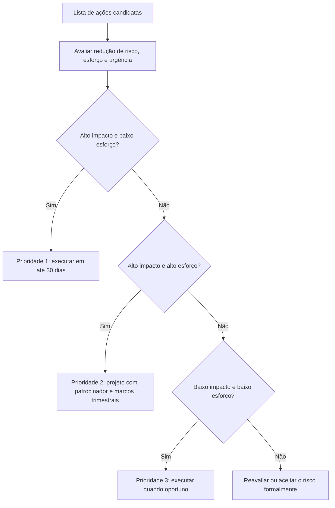

# Do Aprendizado à Ação: Plano de Melhoria e Verificação

> **Objetivo pedagógico:** converter lições aprendidas em ações priorizadas, específicas e verificáveis: classificar os tipos de ação, priorizar por risco, impacto e esforço, escrever ações no formato SMART, definir responsáveis e critérios de encerramento, verificar a eficácia com testes e exercícios, integrar as ações ao registro de riscos, à engenharia de detecção, aos playbooks e aos treinamentos, e acompanhar a execução com relatórios para a gestão.

## 1. O problema da "lista de lições sem ação"

O principal modo de falha do aprendizado é a **lista de recomendações que não vira mudança**. Causas típicas: ações vagas, sem dono ou sem prazo; excesso de ações; falta de patrocínio; ausência de verificação; e dependência de orçamentos não aprovados.

## 2. Tipos de ação

| Tipo | Objetivo | Exemplos |
|---|---|---|
| Preventiva | Impedir ou dificultar a ocorrência | MFA resistente a phishing, privilégio mínimo, backups imutáveis, varredura de segredos |
| Detectiva | Detectar mais cedo | Regras de detecção, alertas de volume de saída, cobertura de EDR, telemetria |
| Corretiva (contenção e recuperação) | Limitar o dano e acelerar a recuperação | Mecanismo de desligamento, restauração testada, reconstrução do diretório |
| De evidência e de registro | Melhorar a capacidade forense | Retenção de logs, eventos de dados, centralização, imutabilidade |
| De processo | Melhorar procedimentos | Atualizar playbooks, SLAs de triagem, revisão de acessos de terceiros |
| De pessoas | Competências e carga | Treinamento, exercícios, escala de plantão |
| De governança | Responsabilidades e decisões | Donos, critérios de risco, orçamento |
| De comunicação | Informação e contatos | Atualização de contatos, modelos de comunicação |
| De aceitação de risco | Registrar o risco aceito | Decisão formal do responsável pelo risco |

## 3. Priorização

| Critério | Pergunta |
|---|---|
| Redução de risco | Quanto a ação reduz a probabilidade ou o impacto de um incidente semelhante? |
| Cobertura de técnicas | Impede ou detecta técnicas observadas (ATT&CK)? |
| Esforço e custo | Tempo, orçamento e dependências |
| Urgência regulatória e contratual | Há prazo ou exigência? |
| Dependências | Há ações que habilitam outras? |
| Efeito colateral | Impacto sobre usuários e operação |



Limite o número de ações simultâneas por equipe; é melhor concluir poucas ações importantes do que iniciar muitas.

## 4. Escrita de ações (formato SMART)

| Critério | Pergunta | Exemplo bom |
|---|---|---|
| Específica | O que exatamente será feito? | "Habilitar eventos de dados do armazenamento nos 14 buckets classificados como sensíveis" |
| Mensurável | Como saber que foi feito? | "Eventos de dados visíveis na conta de auditoria; teste de reconstrução de acesso a objeto" |
| Atribuída | Quem é o responsável (uma pessoa, e não um grupo)? | "Responsável: líder de plataforma de nuvem" |
| Realista | Há recursos e autoridade? | "Orçamento de armazenamento de logs aprovado" |
| Temporal | Qual o prazo? | "Até 31/03" |

| Ação ruim | Ação reescrita |
|---|---|
| "Melhorar a segurança de acessos remotos" | "Exigir MFA em todos os perfis de VPN e remover perfis legados até 15/12; verificação: relatório de perfis sem MFA igual a zero" |
| "Treinar os usuários sobre phishing" | "Treinamento de 20 minutos e simulação trimestral para contas a pagar e tesouraria; meta: taxa de relato acima de 60% e cliques abaixo de 5% em dois trimestres" |
| "Revisar os logs" | "Ampliar a retenção de logs de VPN, de identidade e de controladores de domínio para 12 meses e exportar mensalmente ao SIEM; verificação: consulta de 12 meses executada com sucesso" |

## 5. Verificação da eficácia

Uma ação só está **concluída** quando sua **eficácia é verificada**.

| Método | Uso |
|---|---|
| Teste técnico | Confirmar a configuração (consulta, relatório ou varredura) |
| Teste funcional | Simular o cenário e verificar o resultado (por exemplo, tentar acessar sem MFA) |
| Exercício de mesa | Reexecutar o cenário do incidente e avaliar as novas respostas |
| Emulação de adversário controlada (purple team) | Verificar se as detecções disparam para as técnicas observadas |
| Auditoria interna | Verificar a evidência de implementação |
| Métricas | Acompanhar indicadores (tempo de detecção, cobertura e outros) |
| Revisão de acompanhamento | Aos 30, 60 e 90 dias |

| Status da ação | Critério |
|---|---|
| Proposta | Registrada, sem aprovação |
| Aprovada | Com responsável, prazo e verificação |
| Em andamento | Execução iniciada |
| Implementada | Mudança realizada |
| **Verificada** | Eficácia comprovada por evidência |
| Encerrada | Verificada e institucionalizada |
| Aceita (risco) | Decisão formal registrada |
| Cancelada | Com justificativa |

## 6. Integração com a detecção, os playbooks e o treinamento

| Destino | Como alimentar |
|---|---|
| Engenharia de detecção | Converter a matriz de lacunas ATT&CK em regras (por exemplo, consultas KQL e regras Sigma), testadas e versionadas |
| Playbooks (pasta 23) | Atualizar passos, decisões, portões legais e contatos; registrar a versão e a data |
| Treinamentos e exercícios | Transformar o caso em cenário de mesa e de laboratório (pasta 28) |
| Registro de riscos | Atualizar probabilidade e impacto; registrar riscos aceitos |
| Padrões de arquitetura | Incluir requisitos (por exemplo, retenção de logs e eventos de dados) em checklists de projeto |
| Contratos com fornecedores | Cláusulas de notificação, de registro e de cooperação |
| Inventário de ativos | Corrigir lacunas de cobertura (EDR e logs) |

```kusto
// Exemplo de transformação de lição em detecção: contas de serviço com tíquetes Kerberos de criptografia fraca em volume
SecurityEvent
| where TimeGenerated > ago(1d)
| where EventID == 4769 and TicketEncryptionType == "0x17"
| summarize Tiquetes = count(), Servicos = dcount(ServiceName) by IpAddress, bin(TimeGenerated, 1h)
| where Servicos > 10
```

Toda regra nova deve ser **testada** (com dados de exercício), documentada (objetivo, técnica, limiares e falsos positivos esperados) e atribuída a um responsável.

## 7. Acompanhamento e relatórios

| Elemento | Prática |
|---|---|
| Registro único de ações | Uma planilha ou um sistema de tíquetes, com todos os campos da seção 8 |
| Reunião de acompanhamento | Mensal para ações críticas; resumo trimestral à direção |
| Indicadores | Percentual de ações concluídas no prazo, percentual verificado, idade média das ações abertas e ações vencidas |
| Escalonamento | Ações vencidas e bloqueadas sobem ao patrocinador |
| Transparência | Relatório de situação das lições com visão por incidente e por tema |
| Auditoria | Evidências de implementação guardadas por prazo definido |

```bash
# Exemplo de consulta em DuckDB sobre um registro de ações em CSV (colunas: id, prioridade, responsavel, prazo, status, verificada)
duckdb -c "SELECT prioridade, count(*) AS total,
           count(*) FILTER (WHERE status IN ('Verificada','Encerrada')) AS concluidas,
           count(*) FILTER (WHERE CAST(prazo AS DATE) < current_date AND status NOT IN ('Verificada','Encerrada','Cancelada')) AS vencidas
           FROM read_csv_auto('acoes.csv') GROUP BY prioridade ORDER BY prioridade;"
```

## 8. Modelo: plano de ação

| ID | Lição de origem | Ação (SMART) | Tipo | Fator contribuinte tratado | Prioridade | Responsável | Prazo | Verificação de eficácia | Status | Evidência |
|---|---|---|---|---|---|---|---|---|---|---|
| A-001 | LA-2026-001 | | | | | | | | | |
| A-002 | LA-2026-002 | | | | | | | | | |

### Modelo de aceitação de risco

| Campo | Preenchimento |
|---|---|
| Risco ou lacuna | |
| Justificativa para não tratar agora | |
| Controles compensatórios | |
| Responsável pelo risco e aprovação | |
| Data e prazo de revisão | |

## 9. Plano 30, 60 e 90 dias após um incidente grave (referência)

| Prazo | Foco | Exemplos |
|---|---|---|
| 30 dias | Fechar as brechas imediatas | Revogar acessos indevidos, MFA em perfis expostos, rotação de credenciais, correção de configurações críticas, ajustes de retenção de logs |
| 60 dias | Detecção e processos | Regras de detecção para as técnicas observadas, atualização de playbooks, contatos e papéis, triagem de alertas com SLA |
| 90 dias | Estrutura e verificação | Projetos de arquitetura (segmentação e backups imutáveis), exercício de mesa do cenário, revisão de acompanhamento e relatório à direção |

## 10. Exemplo prático: do caso 1 ao plano de ação

| Lição | Ação | Tipo | Prioridade | Responsável | Prazo | Verificação |
|---|---|---|---|---|---|---|
| Perfil legado de VPN sem MFA | Exigir MFA e remover perfis legados | Preventiva | 1 | Líder de infraestrutura | 15 dias | Relatório de perfis sem MFA igual a zero; teste de acesso |
| Backups alcançáveis a partir do domínio | Backups imutáveis e isolados; teste de restauração | Corretiva | 1 | Líder de backup | 60 dias | Restauração testada em exercício |
| Alertas médios do EDR sem triagem | SLA de triagem de 24 horas com revisão semanal | Processo | 1 | Líder do SOC | 30 dias | Indicador de alertas fora do SLA |
| Sem detecção de Kerberoasting e de DCSync | Regras de detecção e proteção de contas de serviço | Detectiva | 2 | Engenharia de detecção | 45 dias | Teste de detecção em laboratório |
| Retenção de 90 dias para logs críticos | Retenção de 12 meses e exportação mensal | Evidência | 2 | Líder de SIEM | 60 dias | Consulta de 12 meses |
| Plano de crise sem teste | Exercício de mesa semestral | Processo | 2 | Gestão de crise | 90 dias | Relatório do exercício |

## 11. Casos de uso corporativos

- Programa de gestão de ações pós-incidente com relatórios para a direção e para auditorias.
- Integração das lições à engenharia de detecção e ao ciclo de vida de playbooks.
- Justificativa de orçamento de segurança com base em lições e riscos.

## 12. Normas e frameworks relevantes

- NIST SP 800-61 Rev. 3; NIST CSF 2.0 (ID.IM); NIST SP 800-84
- ISO/IEC 27001:2022 (cláusula 10); ISO/IEC 27002:2022 (5.27); ISO/IEC 27005 e ISO 31000 (riscos)
- CIS Controls v8.1; MITRE ATT&CK (cobertura de técnicas)
- LGPD, arts. 6º, 46 e 50

## 13. Referências

- Doran, G. T. There's a S.M.A.R.T. way to write management's goals and objectives. Management Review, 1981.
- NIST. Cybersecurity Framework 2.0 (2024).
- MITRE. ATT&CK; Sigma Project (regras de detecção).
- Pastas 20, 22, 23 e 28 deste repositório.
